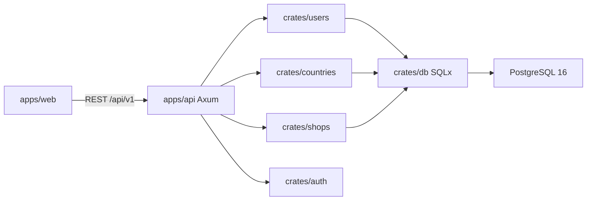

# Architecture

## Product principle

Kisaan is the **online warehouse**: one trusted platform for discovery and (later) checkout.
Each seller operates a branded **sub-shop** (`Shop` aggregate) with its own slug, catalogue,
currency, and fulfilment. Customers may buy from many shops in one basket; fulfilment splits
into per-farmer orders (Phase 3–4).

## Phase 2 shape

## Domain

- **User** — `CUSTOMER` / `FARMER` / `ADMIN` (creating a shop promotes CUSTOMER → FARMER)
- **Country / Currency** — configuration-driven markets; URL market keys (`uk`) map to ISO codes (`GB`)
- **Shop** — first-class sub-shop owned via `shop_members` (`OWNER` | `STAFF`)
  - Slug uniqueness is **country-scoped**: `UNIQUE(country_code, slug)`
  - `default_currency` must match the country’s default currency (Phase 2)
- **Product / Variant / Inventory** — catalogue priced as `amount_minor_units` + `currency`
- **Money** — never floats; optional **approximate** display conversion via `exchange_rates`

## API surface (Phase 2)

| Method | Path | Purpose |
|--------|------|---------|
| GET | `/healthz` | Liveness |
| GET | `/readyz` | Postgres readiness |
| GET | `/openapi.json` | OpenAPI stub |
| GET | `/api/v1/countries` | Active countries (+ `market` key) |
| POST | `/api/v1/auth/register` | Register |
| POST | `/api/v1/auth/login` | Login |
| POST | `/api/v1/shops` | Create sub-shop (auth) |
| GET | `/api/v1/shops/me` | List my shops (auth) |
| PATCH | `/api/v1/shops/{id}` | Update draft shop (auth) |
| POST | `/api/v1/shops/{id}/publish` | Publish shop (auth) |
| POST | `/api/v1/shops/{id}/products` | Create product (auth) |
| GET | `/api/v1/shops/{id}/products` | List my products (auth) |
| PATCH | `/api/v1/products/{id}` | Update product (auth) |
| POST | `/api/v1/products/{id}/publish` | Publish product (auth) |
| POST | `/api/v1/products/{id}/archive` | Archive product (auth) |
| GET | `/api/v1/countries/{code}/shops` | Published shops in market |
| GET | `/api/v1/shops/{country}/{slug}` | Public shop |
| GET | `/api/v1/shops/{country}/{slug}/products` | Public catalogue (`?display_currency=`) |

Handlers stay thin; logic lives in crates.

## Web markets

Country-aware routes under `apps/web/src/app/[country]/`:

- `/uk`, `/in`, `/us` — warehouse home for that market
- `/[country]/shops` — browse published sub-shops
- `/[country]/shops/[slug]` — seller storefront
- `/[country]/seller` — auth-gated create / publish flow
- `/[country]/become-a-farmer` — onboarding CTA

## Database strategy

| Concern | Store |
|---------|--------|
| Users, shops, products, orders, ledger, inventory | **PostgreSQL** |
| Semantic search, embeddings, RAG shopping | **NebulaDB** (Phase 6) |

## Legacy

`devops/helm-charts/kisaanPHPChart` and OpenResty/PHP Docker images are legacy.
New deploys target `apps/*` + Postgres.
