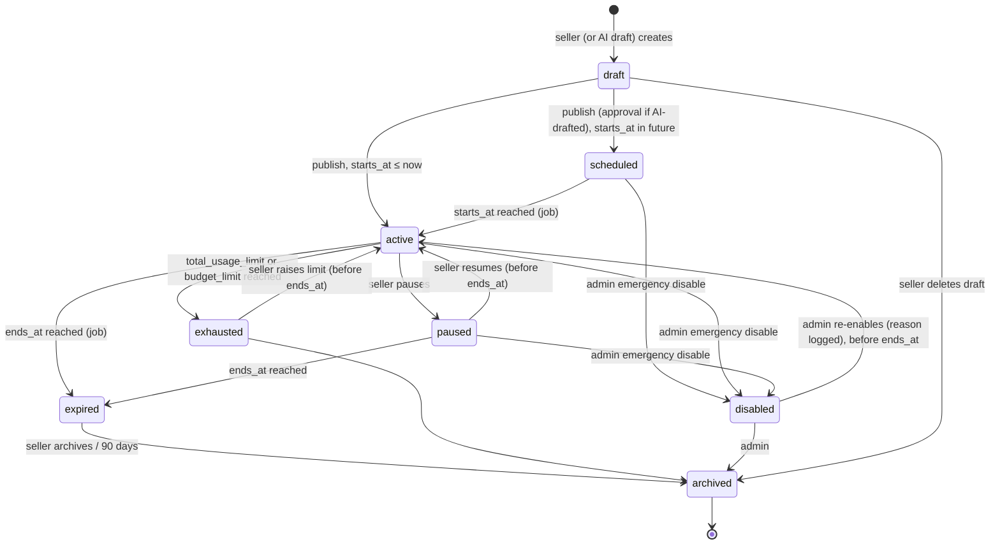

# KISAAN — Coupons and Membership (KISAAN Plus)

> Status: Draft v0.2 · Last updated: 2026-11-14 · Owner: Commerce product lead (promotions & membership) · Source of truth index: [README](README.md)

> **Owner document** for seller coupons (Master Prompt v2 §8) and the KISAAN Plus membership (§9). It covers the coupon data model, validation, stacking, limits, cancellation and fraud rules, plus the membership lifecycle, renewal, benefits engine, abuse rules and T&C versioning.
> - The **arithmetic** of how coupons and membership benefits combine with other prices is owned by [PRICING_ENGINE](PRICING_ENGINE.md) (stages 5, 6 and 8, and the stack matrix in §6).
> - The **user-facing terms** are in [MEMBERSHIP_TERMS_AND_CONDITIONS](MEMBERSHIP_TERMS_AND_CONDITIONS.md) (draft, `[LEGAL REVIEW]`).
> - Payment mechanics (e-mandates, refunds, invoices) are in [PAYMENT_AND_BUSINESS_MODEL](PAYMENT_AND_BUSINESS_MODEL.md) §10.
>
> Values marked placeholder are illustrative and not business decisions.

Related: [PRD](PRD.md) (KIS-COUPON-*, KIS-MEMBER-*) · [FUNCTIONAL_SPECIFICATION](FUNCTIONAL_SPECIFICATION.md) §26, §29 (feature summaries) · [WHOLESALE_AND_GROUP_BUYING](WHOLESALE_AND_GROUP_BUYING.md) · [SINGLE_AI_ARCHITECTURE](SINGLE_AI_ARCHITECTURE.md) · [UX_UI_SPECIFICATION](UX_UI_SPECIFICATION.md) · [DATABASE_SCHEMA](DATABASE_SCHEMA.md) · [API_SPECIFICATION](API_SPECIFICATION.md) · [SECURITY_AND_COMPLIANCE](SECURITY_AND_COMPLIANCE.md) · [TESTING_STRATEGY](TESTING_STRATEGY.md)

---

## Table of contents

**Part A — Seller coupons**
1. [Scope and principles](#1-scope-and-principles)
2. [Coupon specification](#2-coupon-specification)
3. [Coupon requirements, acceptance and tests](#3-coupon-requirements-acceptance-and-tests)

**Part B — KISAAN Plus membership**
4. [Membership specification](#4-membership-specification)
5. [Membership requirements, acceptance and tests](#5-membership-requirements-acceptance-and-tests)

**Part C**
6. [Decisions, assumptions and risks raised here](#6-decisions-assumptions-and-risks-raised-here)

---

# Part A — Seller coupons

## 1. Scope and principles

| Scope | Status |
|---|---|
| Seller-created, seller-funded coupons for the seller's own store, listings or categories | **MVP** |
| Admin moderation and emergency disable of any coupon | **MVP** |
| Coupons on group orders (leader applies one group-eligible coupon) | **MVP** |
| Platform-funded (KISAAN) coupons and campaigns | Future (KIS-COUPON-012) |
| Coupons stacked with a platform coupon | Future |
| Auto-applied "best coupon" | Not in MVP — the UI *suggests* the best public coupon; the buyer applies it |

**Principles**

1. **Sellers own their coupons; KISAAN owns the rules.** A seller can create, pause, extend and end their own coupons. A seller cannot change platform limits (maximum %, maximum active coupons, maximum duration, stacking rules, code blocklist).
2. **Server-side validation, twice.** A coupon is validated when applied and again at payment capture. The client never decides whether a coupon is valid or how much it saves.
3. **Atomic limits.** Usage and budget limits hold under concurrency. No over-redemption.
4. **Honest urgency.** Countdowns and "limited" labels reflect the real end time and the real remaining uses (dark-pattern guidelines `[LEGAL REVIEW]`).
5. **AI drafts, seller publishes.** The KISAAN AI can prepare a coupon draft from chat or voice. Publishing is a COMMIT action that needs the seller's explicit approval.

## 2. Coupon specification

### 2.1 Coupon data model (logical)

Physical schema: `kisaan_coupons`, `kisaan_coupon_products`, `kisaan_coupon_redemptions` in [DATABASE_SCHEMA](DATABASE_SCHEMA.md) §7.5. Fields marked **v0.2** are additions the schema owner must apply.

| Field | Type / values | Rule | Source |
|---|---|---|---|
| `code` | 4–20 chars `A-Z0-9`, stored upper-case | Unique per seller (case-insensitive); platform blocklist (offensive words, `KISAAN*`, `ADMIN*`, look-alikes of official terms) | §8 Coupon code |
| `title_i18n`, `description_i18n` | pa / hi / en | Shown on store and product page for public coupons | — |
| `discount_type` | `percentage` · `fixed` (₹ per order) | — | §8 Discount type |
| `discount_value` | percentage: (0, 50] (D-40 hard cap); fixed: > 0 | Any coupon's applied discount is also capped at **50 % of the goods value** it applies to (D-40, KIS-SEC-161) | §8 Percentage / Fixed |
| `max_discount_amount` | ₹ | **Required** for percentage | §8 Maximum discount |
| `min_order_value` | ₹, optional | Evaluated on goods after pricing stages 2–5, before the coupon | §8 Minimum order value |
| `min_qty_kg` | optional | — | — |
| `applies_to` | `store` · `listings` · `categories` | With `kisaan_coupon_products` rows | §8 Eligible products / categories |
| `eligible_segments` **v0.2** | set of: `ALL`, `NEW_CUSTOMER` (no completed or confirmed order with this seller), `EXISTING_CUSTOMER` (≥ 1 completed order with this seller), `BULK_BUYERS` (verified bulk-buyer profile), `GROUP_ORDERS` (leader applying to a group order), `MEMBERS` (KISAAN Plus benefit-eligible) | A buyer qualifies if they match **any** listed segment; `ALL` excludes others. (v0.1 values `FIRST_TIME_BUYER` → `NEW_CUSTOMER`, `GROUP_LEADERS` → `GROUP_ORDERS`.) Replaces v0.1 single-value `eligibility`. | §8 Eligible buyers, new / existing customer, bulk buyer, group buyer, membership users |
| `eligible_user_ids` **v0.2** | optional list (max 500) | "Eligible buyers" as specific accounts (e.g. a seller's regular customers). Private coupons only. | §8 Eligible buyers |
| `group_eligible` **v0.2** | boolean, default false | Required to use the coupon on a group order (PRICING_ENGINE §6 n5) | D-103 |
| `count_per_member` **v0.2** | boolean, default false | Group orders only. Default: a group coupon counts as **one** redemption against `total_usage_limit` and the **leader's** `per_user_limit`, and does not consume members' per-user limits. If true, every paying member's per-user limit is also consumed (a member at their limit makes the coupon inapplicable to the group at lock). | KIS-COUPON-016 |
| `allow_on_negotiated` | boolean, default false | KIS-COUPON-011 | — |
| `exclude_when_wholesale` | boolean, default false | If true, the coupon is rejected when a tier or whole-lot price applies | v0.1 |
| `total_usage_limit` | 1–100,000 | Maximum number of redemptions | §8 Usage limit |
| `per_user_limit` | 1–100, ≤ total | Keyed on the buyer identity key (verified phone + PAN/GSTIN HMAC) | §8 Per-user usage limit |
| `budget_limit` **v0.2** | ₹, optional | Maximum **total discount** given across all redemptions (the seller's promotion budget). Once reached the coupon is `exhausted`. | §8 Total redemption limit |
| `starts_at`, `ends_at` | timestamps (IST shown, UTC stored) | ends_at > starts_at, ≤ starts_at + 365 days | §8 Start / end date |
| `valid_days_of_week` **v0.2** | optional subset of Mon–Sun | — | §8 Time restrictions |
| `valid_hours` **v0.2** | optional IST window, e.g. 06:00–10:00 | Max one window per day in MVP | §8 Time restrictions |
| `visibility` | `public` · `private` | Public: shown on store/product page. Private: works by code only. | KIS-COUPON-007 |
| `status` | `draft` · `scheduled` · `active` · `paused` · `expired` · `exhausted` · `disabled` · `archived` | See §2.3 | §8 Active / inactive |
| `admin_disabled_at`, `admin_disabled_by`, `admin_disabled_reason` **v0.2** | — | Set only by admin emergency disable | §8 admin controls |
| `created_via` **v0.2** | `ui` · `ai` · `whatsapp` | AI-created drafts record the approval request id | Audit |
| `funded_by` | `seller` (MVP) · `platform` (Future) | — | — |
| `version` | integer | Optimistic locking (`If-Match`) | — |

### 2.2 Platform rules sellers cannot change

| Rule | MVP value (placeholder) | Changeable by |
|---|---|---|
| Maximum discount | 50 % of goods value for **every** coupon type: percentage value ≤ 50, and fixed coupons are capped at 50 % of the goods value at application (D-40, KIS-SEC-161) | Product owner (code/config) |
| Maximum active + scheduled coupons per seller | 20 | Admin config |
| Maximum duration | 365 days | Admin config |
| Coupons per order | 1 seller coupon (PRICING_ENGINE §6) | Code (BR-PRC-10) |
| Self-redemption | Blocked | Code |
| Coupon on delivery fee | Not allowed (coupons reduce goods only) | Code |
| Code blocklist | Platform-maintained | Admin |
| Mandatory `max_discount_amount` for percentage | Yes | Code |

### 2.3 Coupon lifecycle



Editing rules (BR-COUPON-11, retained):
- On `draft` / `scheduled`: every field is editable.
- On `active` / `paused`: the seller may extend `ends_at`, raise limits or budget, change `visibility`, add listings, and pause or resume. Once a coupon has **any** redemption, `code`, `discount_type`, `discount_value`, `max_discount_amount`, `min_order_value` and segment narrowing are **immutable** (`COUPON_IMMUTABLE_AFTER_REDEMPTION`). The seller creates a new coupon instead.
- Pausing does not affect redemption slots already reserved by checkout quotes. An admin emergency disable **does** invalidate unpaid checkout quotes (PRICING_ENGINE §13.3).

### 2.4 Validation order (deterministic)

The coupon module runs these checks in this exact order and returns the **first** failure. The order matters because users see one precise reason in their language.

| # | Check | Failure code |
|---|---|---|
| 1 | Code exists for this order's seller (case-insensitive), not archived | `COUPON_NOT_FOUND` |
| 2 | Not admin-disabled | `COUPON_NOT_ACTIVE` (`context.reason = disabled`) |
| 3 | Status active (or paused/exhausted with this quote's own existing reservation) | `COUPON_NOT_ACTIVE` |
| 4 | `starts_at ≤ as_of < ends_at` | `COUPON_NOT_STARTED` / `COUPON_EXPIRED` |
| 5 | Day-of-week and `valid_hours` window (IST) | `COUPON_OUTSIDE_HOURS` |
| 6 | Self-redemption: buyer is not the store owner and not in the same identity cluster (PAN, device or payout account) | `COUPON_NOT_ELIGIBLE` + trust flag |
| 7 | Segment eligibility (§2.1) for this buyer and order type | `COUPON_NOT_ELIGIBLE` |
| 8 | Order type: group order needs `group_eligible` and the caller must be the **leader** at lock; negotiated needs `allow_on_negotiated` | `COUPON_NOT_APPLICABLE` / `COUPON_NOT_ALLOWED_ON_NEGOTIATED` |
| 9 | Applies to this listing or category | `COUPON_NOT_APPLICABLE` |
| 10 | `exclude_when_wholesale` and a tier or whole-lot price applies | `COUPON_NOT_COMBINABLE_WITH_WHOLESALE` |
| 11 | Minimum order value and minimum quantity (pre-coupon goods) | `COUPON_MIN_NOT_MET` |
| 12 | Total usage: `used + reserved < total_usage_limit` | `COUPON_EXHAUSTED` |
| 13 | Budget: `discount_given + discount_reserved + this_discount ≤ budget_limit`. If only part of the budget is left, the discount is reduced to what remains and labelled "partly applied". | `COUPON_EXHAUSTED` (budget fully used) |
| 14 | Per-user: buyer identity key `redeemed + reserved < per_user_limit` | `COUPON_USER_LIMIT_REACHED` |
| 15 | Compute the discount (PRICING_ENGINE stage 6) and the floor check (stage 7) | — (partly applied label) |
| 16 | Checkout contexts only: reserve the slot atomically (§2.6) | `COUPON_EXHAUSTED` if lost to a race |

`POST /api/v2/kisaan/coupons/validate` (**KISAAN-specific endpoint (OpsAPI plugin)**, [API_SPECIFICATION](API_SPECIFICATION.md)) runs checks 1–15 without reserving. A checkout quote runs 1–16.

### 2.5 Discount computation

Owned by [PRICING_ENGINE](PRICING_ENGINE.md) stage 6 and BR-COUPON-02 (retained):
- `percentage`: min(base × v %, `max_discount_amount`, budget remaining), half-up to ₹0.01.
- `fixed`: min(v, base, budget remaining).
- **Platform cap (all types):** the discount never exceeds 50 % of the base (D-40, KIS-SEC-161); if capped, it is labelled "partly applied".
- Base = goods value after pricing stages 2–5 (or the negotiated value if allowed).
- Then capped by the seller floor (stage 7).
- A coupon never reduces delivery, fees or taxes directly. GST is computed on the post-coupon taxable value (PRICING_ENGINE §11).

### 2.6 Reservation, redemption and concurrency

```mermaid
sequenceDiagram
  autonumber
  participant B as Buyer
  participant Q as Checkout quote (pricing)
  participant C as Coupon module
  participant P as Payment (PA webhook)
  B->>Q: Checkout with code
  Q->>C: validate 1–15
  C->>C: BEGIN; SELECT … FOR UPDATE coupon row;<br/>check usage, budget, per-user; INSERT redemption(status=reserved, expires_at=quote.valid_until);<br/>reserved_count += 1; discount_reserved += d; COMMIT
  C-->>Q: reserved (redemption id)
  P-->>C: payment captured for order (from quote)
  C->>C: redemption → redeemed; used_count += 1; discount_given += d; reserved −= …
  Note over C: quote expired / superseded / invalidated → redemption released (reserved −= …)
```

- One coupon row lock per reservation. The lock is held only for the counter update (milliseconds). The conditional update in [DATABASE_SCHEMA](DATABASE_SCHEMA.md) §7.5 is the reference implementation.
- A sweeper job releases reservations whose `expires_at` has passed (every minute). Releasing is idempotent.
- `status` moves to `exhausted` when `used_count = total_usage_limit` or `discount_given ≥ budget_limit`. It returns to `active` if redemptions are later released or reversed and the coupon is still within its window (§2.8).

### 2.7 Stacking, priority and conflicts

| Situation | Rule |
|---|---|
| Two seller coupons on one order | Not allowed. Applying a second replaces the first after the buyer confirms. |
| Coupon + wholesale tier / whole-lot | Stacks (coupon after tier), unless `exclude_when_wholesale` |
| Coupon + group discount | Stacks only on a group order with a `group_eligible` coupon applied by the leader |
| Group coupon allocation and counting | Applied once at lock on the group goods total; allocated to members pro-rata by goods value with largest-remainder paise rounding (PRICING_ENGINE §8.2); a dropped member's share is not redistributed; re-allocated only at a re-offer re-lock; counts as one redemption (see `count_per_member`) |
| Coupon + member price | Stacks (coupon after member price) |
| Coupon + negotiated price | Only if `allow_on_negotiated` |
| Coupon + member free delivery | Independent (coupon on goods, waiver on delivery) |
| Coupon + platform coupon | Future |
| Several public coupons available | The UI shows the one giving the lowest total, as computed by the pricing engine (ties: the one ending soonest). It is never auto-applied. |
| A coupon and a seller price change in the same moment | The checkout quote's pinned listing version and coupon reservation win until the quote expires |

Full matrix: [PRICING_ENGINE](PRICING_ENGINE.md) §6.

### 2.8 Cancellation, refund and return behaviour (D-105, D-122)

| Event | Coupon effect | Usage count | Budget |
|---|---|---|---|
| Quote expires / superseded / invalidated before payment | Reservation released | Not consumed | Released |
| Payment fails | Reservation held until the quote's validity ends (retry possible), then released | Not consumed | Released |
| **Whole order cancelled before dispatch** (by buyer, seller, system, deadline) | Redemption **voided** | **Restored** | **Restored** |
| Whole order cancelled/refunded **after dispatch** (dispute outcome, rejection on delivery) | Redemption kept as `reversed-with-refund`; the buyer gets back what they paid | Not restored (admin override possible, logged) | Not restored |
| **Partial** cancellation, return or quantity/weight shortfall | Discount **pro-rated** to the remaining quantity; refund = amount paid for the removed quantity (net of its coupon share) | Not restored | Pro-rated share restored |
| Buyer-initiated partial cancellation that drops the remaining goods below the coupon's `min_order_value` / `min_qty` | Coupon recomputed on what remains. If no longer eligible, the coupon value attributable to the remaining goods is deducted from the refund ("coupon clawback"). The buyer sees the net refund **before** confirming the cancellation. `[DECISION D-122]` | Not restored | Pro-rated |
| Seller- or system-initiated partial cancellation (stock shortfall, quality rejection) | No clawback. Discount pro-rated. | Not restored | Pro-rated |
| Group order: a member leaves before lock | No effect (the coupon is applied only at lock; nobody has paid yet, D-72) | — | — |
| Group order: a member does not pay within the payment window after lock | Their coupon share is released; the coupon stays redeemed for the group if any member paid | Not restored (restored only if the whole group order is cancelled) | Unpaid share restored |
| Group order: a member's allocation cancelled after lock | Member's coupon share pro-rated out of their refund; the coupon stays redeemed for the group | Not restored | Pro-rated |
| Late payment capture after the order was cancelled (BR-PAYM-10) | Auto-refund in full; redemption voided | Restored | Restored |

All refunds go to the original payment method (BR-PAYM-05) with a credit note where an invoice exists.

### 2.9 Fraud prevention

| Threat | Control | Action |
|---|---|---|
| Self-redemption (seller buys from own store) | Identity check: user, PAN, payout account, device cluster | Block + flag |
| Multi-account farming of per-user limits | Per-user limit keyed on HMAC(verified phone + PAN/GSTIN); device fingerprint and UPI-handle clustering | Block at validation; flag cluster |
| Redemption burst (e.g. leaked private code) | Deterministic velocity rule: > 10× the 7-day baseline per hour, or > 50 % of limit in 10 minutes | Auto-pause the coupon (deterministic rule), notify the seller |
| Collusive "buy-and-cancel" to reach thresholds | §2.8 clawback; cancellation-rate monitoring per buyer | Flag; limit coupons for the buyer |
| Coupon + fake group (one person, many accounts) | Group member verification rules ([WHOLESALE_AND_GROUP_BUYING](WHOLESALE_AND_GROUP_BUYING.md)); identity clustering | Block lock; review |
| Code guessing / brute force | Rate limit `coupons/validate`: 10 per minute per user, 50 per day; generic error after limit | 429 |
| Seller mistake (e.g. 50 % with a high cap) | Liability preview before publish ("max total discount ₹1,00,000"); confirmation step; for AI drafts, readback | — |

AI and risk scores **flag** only; they never pause a coupon or penalise a user on their own. Deterministic rules and human review decide (consistent with KIS-MEMBER-011 and SECURITY_AND_COMPLIANCE).

### 2.10 Error codes

`COUPON_NOT_FOUND`, `COUPON_NOT_ACTIVE`, `COUPON_NOT_STARTED`, `COUPON_EXPIRED`, `COUPON_OUTSIDE_HOURS` (v0.2), `COUPON_EXHAUSTED`, `COUPON_USER_LIMIT_REACHED`, `COUPON_NOT_ELIGIBLE`, `COUPON_NOT_APPLICABLE`, `COUPON_NOT_ALLOWED_ON_NEGOTIATED`, `COUPON_NOT_COMBINABLE_WITH_WHOLESALE`, `COUPON_MIN_NOT_MET`, `COUPON_CODE_TAKEN`, `COUPON_CODE_BLOCKED` (v0.2), `COUPON_LIMIT_ACTIVE_REACHED`, `COUPON_IMMUTABLE_AFTER_REDEMPTION`, `COUPON_RATE_LIMITED` (v0.2). Body format per [OPSAPI_INTEGRATION](OPSAPI_INTEGRATION.md) §7.2; `context.reason` carries the detail.

### 2.11 Permissions (seller vs admin)

| Action | Seller (own store) | Buyer | Group leader | Support | Admin (promotions) | KISAAN AI |
|---|---|---|---|---|---|---|
| Create / edit draft | ✅ | — | — | — | — | DRAFT tool for the seller (`coupons.draft_coupon`; publish via `coupons.propose_create_coupon`) |
| Publish / change active coupon | ✅ (approval if AI-drafted) | — | — | — | — | Only via ApprovalRequest confirmed by the seller |
| Pause / resume | ✅ | — | — | — | ✅ | Via approval |
| View redemption report | ✅ (own, aggregated; buyer identities masked) | — | — | — | ✅ | READ for the seller |
| Apply to a direct order | — | ✅ | — | — | — | Can suggest; applying happens in the user's checkout |
| Apply to a group order | — | — | ✅ (at lock) | — | — | Can suggest to the leader |
| Emergency disable / re-enable | — | — | — | Request only | ✅ (`kisaan_coupons.manage`, reason required, audit) | — |
| Change platform rules (§2.2) | ❌ | ❌ | ❌ | ❌ | Config admin only, dual control | ❌ |

RBAC module: `kisaan_coupons` ([OPSAPI_INTEGRATION](OPSAPI_INTEGRATION.md) §7.3).

### 2.12 UX notes

- **Coupon creator** (seller): the 10-step flow in FS §29 plus segment chips, time-of-day picker and budget field. A live "maximum liability" preview: min(total uses × max discount, budget).
- **Voice**: "Kinnow te 10 percent di coupon, 20 tareekh tak, ik banda ik vaar" → draft → readback of type, value, cap, dates, limits → seller confirms.
- **Buyer**: public coupons show as chips with the real end time ("ends 20 Jan, 11:59 PM"). Errors show the precise reason in the buyer's language, and the next step where there is one ("Add ₹240 more to use this coupon").
- Screen references: [UX_UI_SPECIFICATION](UX_UI_SPECIFICATION.md) (coupon creator, checkout).

## 3. Coupon requirements, acceptance and tests

### 3.1 Requirements

Existing: KIS-COUPON-001…012 ([PRD](PRD.md)). New in v0.2:

| ID | Requirement | Scope |
|---|---|---|
| KIS-COUPON-013 | Buyer segment eligibility as a set: new customer, existing customer, bulk buyer, group order, members, specific users (§2.1) | MVP |
| KIS-COUPON-014 | Time-of-day and day-of-week restrictions (IST) | MVP |
| KIS-COUPON-015 | Discount budget limit (total ₹ across redemptions), with partial application when the remaining budget is smaller than the computed discount | MVP |
| KIS-COUPON-016 | `group_eligible` flag; group coupons applied once by the leader at lock and allocated pro-rata by goods value with largest-remainder rounding (PRICING_ENGINE §8.2); a group coupon counts as **one** redemption against the total limit and the leader's per-user limit, and not against members' per-user limits unless `count_per_member = true` | MVP |
| KIS-COUPON-017 | Admin emergency disable and re-enable with mandatory reason, audit entry, seller notification and invalidation of unpaid checkout quotes within 60 s | MVP |
| KIS-COUPON-018 | Cancellation, refund and return behaviour per §2.8 (void and restore before dispatch; pro-rate after; clawback on buyer-initiated partial cancellation) | MVP |
| KIS-COUPON-019 | Deterministic validation order and precise localised failure reasons (§2.4) | MVP |
| KIS-COUPON-020 | Platform rules (§2.2) are not seller-editable; violating configurations are rejected | MVP |
| KIS-COUPON-021 | AI coupon drafts: the KISAAN AI may create a draft; publishing requires the seller's approval with readback of type, value, cap, dates and limits | MVP |
| KIS-COUPON-022 | Coupon audit trail: every create, edit, status change and admin action is recorded with actor, channel and before/after values | MVP |

### 3.2 Acceptance criteria

1. 100 parallel checkouts on a coupon with `total_usage_limit = 10` → exactly 10 redemptions committed; none over budget.
2. A coupon with `valid_hours` 06:00–10:00 IST is rejected at 10:00:00 with `COUPON_OUTSIDE_HOURS`; a quote issued at 09:58 is honoured until its expiry.
3. A `NEW_CUSTOMER` coupon is rejected for a buyer with one completed order from that seller.
4. A member tries to apply any coupon to their group allocation → rejected; the leader applies a `group_eligible` coupon at lock → allocated with exact sums.
5. Admin disable → open unpaid checkout quotes invalidated within 60 s; captured payments unaffected; the seller sees the reason.
6. Whole-order cancellation before dispatch restores usage and budget. A partial return pro-rates the discount and shows the clawback before confirmation.
7. A self-redemption attempt is blocked and flagged.
8. Code, type and value cannot change after the first redemption.

### 3.3 Edge cases

| # | Scenario | Expected |
|---|---|---|
| CE-01 | Coupon expires between quote and capture | Honoured within the 15-minute quote validity; after that re-quote and `PRICE_CHANGED_REAPPROVE` |
| CE-02 | Budget has ₹120 left; computed discount ₹500 | Discount ₹120, "partly applied"; then `exhausted` |
| CE-03 | Seller raises the limit on an exhausted coupon | Back to `active` (if inside the window) |
| CE-04 | Seller deletes a listing that a coupon targets | Coupon continues for remaining targets; if none left, it stops applying (`COUPON_NOT_APPLICABLE`) |
| CE-05 | Two different sellers use the same code `WELCOME10` | Allowed; the order's seller decides which coupon is meant |
| CE-06 | Buyer becomes a member after the quote | Not retroactive; re-quote to get member-segment eligibility |
| CE-07 | Coupon edited (end date extended) while a quote is open | Quote unaffected |
| CE-08 | Store suspended | Coupons paused automatically; open quotes invalidated |

### 3.4 Test cases

Existing KIS-TEST-COUPON-001…018 remain owned by [TESTING_STRATEGY](TESTING_STRATEGY.md). New (numbered from 101; TESTING_STRATEGY imports them):

| ID | Scenario | Requirements |
|---|---|---|
| KIS-TEST-COUPON-101 | Segment set evaluation: each segment alone and combined | KIS-COUPON-013 |
| KIS-TEST-COUPON-102 | Time-of-day window boundaries (start inclusive, end exclusive) and day-of-week | KIS-COUPON-014 |
| KIS-TEST-COUPON-103 | Budget limit with partial application and the concurrency race on the last ₹ | KIS-COUPON-015 |
| KIS-TEST-COUPON-104 | Group coupon by leader at lock; rejected for a member; non-group-eligible coupon rejected | KIS-COUPON-016 |
| KIS-TEST-COUPON-105 | Admin emergency disable → quote invalidation within 60 s, audit, seller notification | KIS-COUPON-017 |
| KIS-TEST-COUPON-106 | §2.8 table, one test per row | KIS-COUPON-018 |
| KIS-TEST-COUPON-107 | Validation order: a coupon failing several checks returns the first one in §2.4 order | KIS-COUPON-019 |
| KIS-TEST-COUPON-108 | Seller attempts > 50 %, > 20 active, > 365 days, blocklisted code | KIS-COUPON-020 |
| KIS-TEST-COUPON-109 | AI drafts a coupon by voice (Punjabi); no publish without approval; readback matches stored values | KIS-COUPON-021 |
| KIS-TEST-COUPON-110 | Brute-force validate attempts hit the rate limit | §2.9 |

---

# Part B — KISAAN Plus membership

## 4. Membership specification

### 4.1 Product, name and principles

- **Name:** **KISAAN Plus** (D-105; brand confirmation remains `[DECISION D-41]`). KISAAN does not use "Prime" or any other marketplace's branding, terminology or design.
- **Who:** buyers, including bulk buyers, group leaders and group members. Seller-side membership is Future (KIS-MEMBER-003).
- **Principles:**
  1. **Promise only what we can deliver.** Every benefit has a written limit and an availability state (Launch / Later). A benefit that depends on logistics coverage says so.
  2. **No subscription traps.** The trial needs no payment details; auto-renew is opt-in and never pre-selected; cancellation takes ≤ 2 taps or one voice command plus confirmation.
  3. **Informed acceptance.** Terms are versioned and actively accepted before any membership starts.
  4. **Benefits are deterministic.** A benefits engine decides eligibility from the membership snapshot. The AI explains benefits; it never grants them.

### 4.2 Plans (placeholders `[DECISION D-11]`)

| Plan | Price (incl. GST, placeholder) | Billing | Trial |
|---|---|---|---|
| **Free** (no membership) | ₹0 | — | — |
| **KISAAN Plus Monthly** | ₹199 / month | Monthly, optional auto-renew | 30 days, once per user and per PAN/GSTIN |
| **KISAAN Plus Annual** | ₹1,999 / year | Yearly, optional auto-renew | Same trial, if unused |

Plan prices stay ≤ ₹15,000 per debit so renewals fit the RBI no-AFA recurring limit (BR-PAYM-08). Plans are admin-managed, effective-dated and versioned; a price change for existing members needs 30 days' notice and, for auto-renew members, consent per T&C §7.

### 4.3 Benefits catalogue

| Code | Benefit | Rule (placeholders) | Funding | Availability | Guarantee level |
|---|---|---|---|---|---|
| B1 | **Free delivery** | Waiver of the delivery fee up to ₹500 per order and ₹2,000 per calendar month (IST). MVP: applies to the seller's delivery fee (`SELLER_DELIVERS_FEE`); the platform funds the waived amount and the seller still receives the full fee (D-106). From roadmap Phase 9 it also applies to `PLATFORM_LOGISTICS` delivery and booking fees inside service areas. Not for buyer pickup or `SELLER_DELIVERS` (fee ₹0). | Platform | Launch | Capped waiver, guaranteed when eligible |
| B2 | **Member-only deals** | Seller-set member price per listing (opt-in) | Seller | Launch | Not guaranteed: depends on sellers |
| B3 | **Early access** | New listings ≥ 100 qtl and new buying groups visible to members 2 h before the public | — | Launch | Guaranteed visibility window, not stock |
| B4 | **Priority support** | Member tickets one priority level higher; target first response 2 business hours | Platform | Launch | Target, not a guarantee |
| B5 | **Priority delivery** | Member shipments offered to transporters first | Platform | Later — with the transporter marketplace (D-96, roadmap Phase 9) | Target, not a guarantee |
| B6 | **Better bulk pricing** | Delivered through B2 (seller member prices) on bulk listings; KISAAN does not fund goods discounts | Seller | Launch (via B2) | Not guaranteed |
| B7 | **Member AI features** | e.g. saved procurement plans, price alerts on more commodities (limits higher than free users) | Platform | Later | Feature limits, `[DECISION D-125]` |
| B8 | Quality-inspection credits; extended acceptance window | — | Platform | Later (P2) | — |

Benefits must never be described as "fastest delivery", "lowest price guaranteed" or similar unless a measured, enforceable guarantee exists.

### 4.4 Lifecycle state machine

```mermaid
stateDiagram-v2
  [*] --> Free
  Free --> TermsPending: selects a plan or trial
  TermsPending --> Free: abandons
  TermsPending --> Trial: accepts T&C; trial-eligible (no payment details, no mandate)
  TermsPending --> PaymentPending: accepts T&C; paid plan
  PaymentPending --> Active: first payment captured (mandate set up if auto-renew ON)
  PaymentPending --> Free: payment failed / abandoned (30 min)
  Trial --> PaymentPending: buys a plan during or after trial
  Trial --> Expired: trial ends (no automatic charge)
  Trial --> CancelledPendingEnd: cancels trial
  Active --> Active: renewal captured
  Active --> Grace: renewal debit failed
  Grace --> Active: retry or manual payment captured
  Grace --> Expired: grace ends unpaid (3 days)
  Active --> CancelledPendingEnd: cancels (auto-renew off, mandate revoked)
  Grace --> Expired: cancels during grace
  CancelledPendingEnd --> Active: resumes before period end
  CancelledPendingEnd --> Expired: period end
  Active --> Refunded: cancels within 7 days, no benefit used
  Active --> Suspended: confirmed-review misuse hold (admin, reason)
  Grace --> Suspended
  Suspended --> Active: appeal upheld (period extended by suspension time)
  Suspended --> Terminated: misuse confirmed (refund per T&C §12)
  Expired --> Free
  Refunded --> Free
  Terminated --> Free: after ban period, if any
```

| State | Benefits eligible? | Auto-renew | Notes |
|---|---|---|---|
| Free | No | — | Default |
| TermsPending / PaymentPending | No | — | Transient |
| Trial | Yes | Not possible (no mandate) | Reminder 3 days before end |
| Active | Yes | As chosen | — |
| Grace | Yes (3 days) | Retry per §4.5 | Banner and notifications |
| CancelledPendingEnd | Yes until period end | Off | Can resume |
| Suspended | **No** | Paused | Open quotes invalidated (PRICING_ENGINE §13.3) |
| Expired / Refunded / Terminated | No | Off | — |

### 4.5 Renewal and payment failure

| Step | Timing | Detail |
|---|---|---|
| KISAAN renewal reminder | 7 days before | Price, date, how to cancel (KIS-MEMBER-007) |
| Bank pre-debit notification | ≥ 24 h before each debit | Sent by the issuer under the e-mandate framework; the member can skip a debit or cancel the mandate |
| Material T&C change not re-accepted | At renewal | Renewal is **not charged**; membership moves to Expired at period end; reminders 30, 7 and 1 days before (BR-MEMBER-03) |
| Debit attempt | Renewal date | Success → new period; failure → **Grace** |
| Grace | 3 days | Benefits continue. One automatic retry on day 2 **only if** a fresh pre-debit notification can be issued in time `[LEGAL REVIEW]`. The member can pay manually at any time through a payment link. |
| End of grace unpaid | Day 3 end (IST) | Expired; mandate kept or revoked per the member's choice; no penalty fee |
| Card / UPI mandate revoked by the member at the bank | Webhook | Auto-renew turned off; membership continues to period end |

Payment details: [PAYMENT_AND_BUSINESS_MODEL](PAYMENT_AND_BUSINESS_MODEL.md) §10 (KIS-PAY-010, KIS-PAY-025).

### 4.6 Benefits and eligibility engine

The engine is a deterministic module in the KISAAN plugin (`kisaan_membership`). It answers one question for the pricing engine and other modules: *what is this user entitled to, right now, in this context?*

```mermaid
flowchart LR
  P[Pricing engine<br/>stage 5 and 8] -->|evaluate(user, context, as_of)| E[Benefits engine]
  E --> S[(Membership snapshot<br/>state, plan, period)]
  E --> U[(Benefit usage ledger<br/>per member, per month)]
  E --> C[(Benefit catalogue<br/>versioned caps)]
  E -->|entitlements + remaining caps + benefit version| P
  O[Order / payment events] -->|reserve, consume, release, restore| U
```

**Rules**

- **BR-MEMBER-07 (retained, snapshot):** benefits apply only if the state is Trial, Active, Grace or CancelledPendingEnd **at quote time**, and the snapshot is pinned in the quote for its validity (EC-06).
- **BR-MEMBER-12 (v0.2, reserve–consume):** waiver usage is *reserved* with a checkout quote, *consumed* on payment capture, *released* on quote expiry/invalidation, and *restored* if the order is cancelled before dispatch. After dispatch it is not restored.
- **BR-MEMBER-13 (v0.2, group orders):** each member's waiver applies to their own pro-rata delivery share within their own caps (PRICING_ENGINE §8.2). A member's benefits never transfer to other group members or to the leader.
- **BR-MEMBER-14 (v0.2, catalogue versions):** each benefit has a version with caps and effective dates. Reductions are effective only after 30 days' notice (BR-MEMBER-10); improvements may apply immediately. The quote records the benefit version.
- **BR-MEMBER-15 (v0.2, early access):** visibility rules for B3 are enforced in search and group discovery queries server-side, not by hiding UI elements.
- **BR-MEMBER-16 (v0.2, explanation):** the engine returns a reason code for each benefit not applied (`NOT_MEMBER`, `CAP_REACHED_MONTH`, `CAP_REACHED_ORDER`, `MODE_NOT_ELIGIBLE`, `AREA_NOT_SERVED`, `SUSPENDED`), which the UI and the AI show in the user's language.

**Benefit usage ledger** (logical; physical `kisaan_membership_benefit_usage`): `membership_id, benefit_code, benefit_version, month (IST), order_id/quote_id, amount, status (reserved | consumed | released | restored), created_at`. Remaining cap = cap − Σ(reserved + consumed).

### 4.7 Cancellation and refunds (BR-MEMBER-05, BR-MEMBER-06 retained)

| Case | Outcome `[DECISION D-12]` `[LEGAL REVIEW]` |
|---|---|
| Cancel within 7 days of first paid activation, **no benefit used** | Full refund; state Refunded |
| Monthly plan, otherwise | No refund; benefits until period end |
| Annual plan after 7 days | Pro-rata refund of unused full months minus the value of benefits used (waived delivery amounts), floor ₹0 |
| Platform terminates without misuse (e.g. programme closed) | Pro-rata refund |
| Terminated for confirmed misuse | Per T&C §12 |
| Trial cancelled | Nothing to refund; benefits end at trial end or immediately if the user chooses |

Cancellation is reachable in ≤ 2 taps from the membership page, or one voice command plus confirmation. No retention maze. The KISAAN AI may *prepare* a cancellation; the member confirms in their own client (COMMIT).

### 4.8 T&C acceptance and versioning

| Rule | Detail |
|---|---|
| Mandatory acceptance (BR-MEMBER-02) | No activation (trial or paid) without a `terms_acceptance` row: user, terms version, accepted_at (UTC), language shown, channel, IP, device id, hash of the rendered text |
| Presentation | Key-terms summary (price, renewal, cancellation, refund, benefit limits) above an **unticked** checkbox, with audio playback; full text one tap away in pa/hi/en |
| Voice | The AI reads the key-terms summary, the user says an explicit acceptance phrase, then confirms with OTP |
| Versions | `YYYY.MM.n`; publication needs dual control; each version marked `material` or not |
| Material change | Re-acceptance required before the next renewal; without it the renewal is not charged (§4.5) |
| Non-material change | Notified; re-acceptance not required |
| Evidence retention | Acceptance records kept for the membership period + limitation period `[LEGAL REVIEW]` (see SECURITY_AND_COMPLIANCE retention table) |

Terms text: [MEMBERSHIP_TERMS_AND_CONDITIONS](MEMBERSHIP_TERMS_AND_CONDITIONS.md).

### 4.9 Abuse prevention and suspension (BR-MEMBER-09 retained)

| Pattern | Detection (deterministic rules) | Action |
|---|---|---|
| Account sharing | Logins from > 3 devices in different districts within 24 h | Warning → review |
| Ordering for non-members as a business pattern | Many distinct delivery addresses/recipients per month above threshold | Review |
| Free-delivery abuse | Many tiny orders that only exist to use waivers (e.g. > 10 orders/month under ₹200 goods each) | Review; possible per-order minimum for the waiver |
| Repeated trials | Same PAN/GSTIN, phone or device cluster | Trial refused (`TRIAL_NOT_ELIGIBLE`) |
| Chargeback after benefits used | Payment dispute on membership fee | Suspend benefits pending outcome |

- Suspension needs a **human review** with a recorded reason. AI or risk scores are signals, never proof.
- The member is told the reason (in their language) and how to appeal. Appeals are decided within 7 days (placeholder).
- While suspended, benefits stop and open quotes are re-priced.

### 4.10 Interactions with pricing, coupons and groups

| Interaction | Rule | Owner |
|---|---|---|
| Member price vs wholesale tier | min of the two, no compounding | PRICING_ENGINE §5 stage 5 |
| Member price on a negotiated order | Not applied | PRICING_ENGINE §6 |
| Member price in a group | Per member line | PRICING_ENGINE §8.2 |
| Members-segment coupons | Eligible while benefit-eligible | §2.1 |
| Free delivery | Delivery waiver, platform-funded, caps per member | PRICING_ENGINE §10 |
| Coupon and free delivery | Independent | PRICING_ENGINE §6 |

### 4.11 Admin controls

| Control | Permission | Notes |
|---|---|---|
| Create/edit plans, prices | `kisaan_membership.manage` + dual control for price changes | Effective-dated; 30-day notice to existing members |
| Benefit catalogue and caps | `kisaan_membership.manage` | Versioned (BR-MEMBER-14) |
| Publish T&C version | `kisaan_legal.manage` + dual control | Material flag required |
| Suspend / reinstate member | `kisaan_membership.manage` (support lead) | Reason, audit, notification |
| Manual refund | Finance maker-checker above ₹50,000 (BR-PAYM-06); membership refunds are always below this but still need a reason code | — |
| Reports | Conversion, churn, benefit cost (KIS-MEMBER-014), trial-to-paid | — |

### 4.12 KISAAN AI and membership

| AI action | Tool class | Notes |
|---|---|---|
| Explain plans, benefits, remaining caps, renewal date | READ (`membership.get_my_membership`, `membership.get_plans`, `membership.get_terms`) | From the benefits engine only |
| "Am I getting free delivery on this order?" | READ (`pricing.get_quote`) | Reads the waiver line and reason code |
| Prepare a membership purchase | COMMIT (`membership.propose_purchase`, then `payments.propose_pay`) | T&C summary readback + explicit acceptance + OTP; payment completed in the payment provider's page |
| Prepare cancellation / toggle auto-renew | DRAFT → COMMIT | Member confirms in own client |
| Grant, extend or refund a membership | **Not allowed** | Admin/finance only |

Tool names are proposals; the canonical catalogue is in [SINGLE_AI_ARCHITECTURE](SINGLE_AI_ARCHITECTURE.md).

## 5. Membership requirements, acceptance and tests

### 5.1 Requirements

Existing: KIS-MEMBER-001…014 ([PRD](PRD.md)). New in v0.2:

| ID | Requirement | Scope |
|---|---|---|
| KIS-MEMBER-015 | Benefits and eligibility engine returning entitlements, remaining caps, benefit version and not-applied reason codes (§4.6) | MVP |
| KIS-MEMBER-016 | Benefit usage ledger with reserve / consume / release / restore semantics (BR-MEMBER-12) | MVP |
| KIS-MEMBER-017 | Group orders: per-member waiver on the member's delivery share within the member's caps (BR-MEMBER-13) | MVP |
| KIS-MEMBER-018 | Benefit catalogue versioning with effective dates and 30-day notice for reductions (BR-MEMBER-14) | MVP |
| KIS-MEMBER-019 | Grace handling: benefits continue 3 days; at most one automatic retry with a fresh pre-debit notice; manual pay link | MVP `[LEGAL REVIEW]` |
| KIS-MEMBER-020 | Every benefit is published with its limit and availability state; no unbacked guarantees (§4.3) | MVP |
| KIS-MEMBER-021 | Suspension needs human review, reason, notification and appeal; suspension invalidates open quotes | MVP |
| KIS-MEMBER-022 | KISAAN AI may explain and prepare membership actions but never grant, extend or refund (§4.12) | MVP |
| KIS-MEMBER-023 | The membership is named **"KISAAN Plus"** in every surface (UI, T&C, invoices, AI replies, notifications); no Amazon (or other third-party) branding, terminology or design is used | MVP |

### 5.2 Acceptance criteria

1. No activation without a T&C acceptance record (`TERMS_NOT_ACCEPTED`).
2. Trial start needs no payment details; trial end never charges.
3. Cancel reachable in ≤ 2 taps; benefits continue to period end; mandate revoked.
4. A material T&C change not re-accepted → renewal not charged.
5. Free-delivery caps enforced at ₹500/order and ₹2,000/month (placeholders), including across group orders.
6. A cancelled-before-dispatch order restores waiver usage; after dispatch it does not.
7. A suspended member's open checkout quote is invalidated and re-priced without member benefits.
8. The benefits shown in the UI and by the AI match the benefits engine output for the same user and time.

### 5.3 Edge cases

| # | Scenario | Expected |
|---|---|---|
| ME-01 | Membership expires between quote and payment | Waiver honoured within quote validity (EC-06) |
| ME-02 | Renewal fails while a group the member joined is locking | The waiver is evaluated at lock (when the member's payment quote is created). In Grace → applies; after grace ends → no waiver |
| ME-03 | Member upgrades monthly → annual mid-period | New annual period starts immediately; unused monthly days credited pro-rata against the annual price `[DECISION D-126]` |
| ME-04 | Member changes phone number | Membership follows the account (OTP re-verification); trial eligibility still keyed on PAN/GSTIN |
| ME-05 | Benefit cap reduction announced while members have time left on annual plans | Reduction applies after 30 days' notice; members may cancel with pro-rata refund per T&C §10 |
| ME-06 | Two orders paid at the same moment both claim the last ₹300 of the monthly cap | Ledger reservation is atomic; one gets ₹300, the other ₹0 with `CAP_REACHED_MONTH` |
| ME-07 | Bank pre-debit notice not delivered (bank-side) | Debit outcome handled normally; KISAAN reminder was still sent 7 days before |

### 5.4 Test cases

Existing KIS-TEST-MEMBER-001…016 remain owned by [TESTING_STRATEGY](TESTING_STRATEGY.md). New (numbered from 101; TESTING_STRATEGY imports them):

| ID | Scenario | Requirements |
|---|---|---|
| KIS-TEST-MEMBER-101 | Benefits engine: each state × each benefit → entitled / reason code | KIS-MEMBER-015 |
| KIS-TEST-MEMBER-102 | Ledger reserve/consume/release/restore across quote expiry, capture, pre- and post-dispatch cancellation | KIS-MEMBER-016 |
| KIS-TEST-MEMBER-103 | Group order with 2 members and 1 non-member (PRICING_ENGINE Example 7 variant) | KIS-MEMBER-017 |
| KIS-TEST-MEMBER-104 | Benefit cap reduction effective only after 30 days; quote pins the benefit version | KIS-MEMBER-018 |
| KIS-TEST-MEMBER-105 | Grace: retry only with a fresh pre-debit notice; manual pay link; expiry at day 3 end IST | KIS-MEMBER-019 |
| KIS-TEST-MEMBER-106 | Suspension → open quotes invalidated; appeal upheld extends the period | KIS-MEMBER-021 |
| KIS-TEST-MEMBER-107 | AI asked "mera membership 1 mahina vadha do" → refuses to grant; offers purchase flow | KIS-MEMBER-022 |
| KIS-TEST-MEMBER-108 | Concurrency on the last part of the monthly cap (ME-06) | KIS-MEMBER-016 |
| KIS-TEST-MEMBER-109 | Voice T&C acceptance in Punjabi with OTP; acceptance record fields complete | KIS-MEMBER-005 |

---

# Part C

## 6. Decisions, assumptions and risks raised here

Register entries for [RISKS_AND_ASSUMPTIONS](RISKS_AND_ASSUMPTIONS.md):

| ID | Type | Item | Proposed |
|---|---|---|---|
| D-105 | Decision | KISAAN Plus naming; coupon fields; coupon cancellation/refund behaviour (canonical brief) | This document |
| D-122 | Decision | Coupon clawback on buyer-initiated partial cancellation that breaks the coupon minimum | Proposed |
| D-125 | Decision | Whether any AI features are member-only (B7), and their limits | Open; default: none at launch |
| D-126 | Decision | Monthly → annual upgrade credit | Pro-rata credit of unused monthly days |
| D-127 | Decision | Coupon segment model replaces v0.1 single `eligibility` value with a segment set plus optional user list | Proposed (schema change) |
| D-128 | Decision | Coupon discount budget (`budget_limit`) as the meaning of "total redemption limit" in Master Prompt §8, separate from the usage-count limit | Proposed |
| A-122 | Assumption | The chosen payment provider can issue a retry debit within the 3-day grace with a compliant pre-debit notice `[UNVERIFIED]` | — |
| R-122 | Risk | Free delivery (B1) depends on sellers offering `SELLER_DELIVERS_FEE` in MVP; members in districts with few delivering sellers see little value, and platform-funded waivers on seller fees invite fee inflation | Mitigation: show which sellers deliver; cap waiver; monitor seller delivery-fee changes after members order (abuse flag) |
| R-123 | Risk | Seller coupon misconfiguration causes large unintended discounts | Mitigation: liability preview, budget limit, confirmation readback, admin emergency disable |
