# KISAAN — Database Schema

> Status: Draft v0.2 · Last updated: 2026-11-14 · Owner: KISAAN data architecture (backend lead) · Source of truth index: [README](README.md)

> **v0.2 changes:** single KISAAN AI tables (D-101: `kisaan_ai_tool_executions`, `kisaan_ai_tool_catalogue`, `kisaan_ai_prompt_versions`, `kisaan_ai_usage_daily`; `kisaan_ai_agent_executions` and `kisaan_ai_tool_calls` retired); bulk-buyer profile (D-104, `kisaan_bulk_buyer_profiles`); group-discount fields (D-103) on listings, tiers, negotiations/offers, group orders and allocations; coupon fields per D-105 (`valid_hours`, `eligible_segments`, `group_eligible`, `admin_disabled*`); inventory `damaged_kg` / `unavailable_kg` buckets; §2A maps every Master Prompt v2 §25 entity to a physical table and owner. **Reconciliation pass (2026-11-14):** canonical group/member states (forming → locked → repricing → confirmed → fulfilling → completed; member committed → payment_due → paid / released); `kisaan_wholesale_tier_sets`, `kisaan_buyer_preferred_sellers`, `kisaan_group_announcements`, `kisaan_member_reliability`; quote contexts `preview/checkout/offer_accept/group_join/group_lock` + status + rule versions; coupon segments `ALL/NEW_CUSTOMER/EXISTING_CUSTOMER/BULK_BUYERS/GROUP_ORDERS/MEMBERS`, `eligible_user_ids`, `budget_limit`, `valid_days_of_week`, `created_via`, statuses scheduled/disabled/archived; listing `max_order_qty_kg`, MRP, `seller_delivery_fee`; store MOV and vacation mode; inventory `returned_kg`; offer `offer_kind` and group min/max quantities; approval `tool_name`, `active_role`, `origin`, `prompt_version_id`.

Related: [OPSAPI_INTEGRATION](OPSAPI_INTEGRATION.md) (reuse map, migrations pipeline) · [PRICING_ENGINE](PRICING_ENGINE.md) · [SELLER_STORE_AND_INVENTORY](SELLER_STORE_AND_INVENTORY.md) · [WHOLESALE_AND_GROUP_BUYING](WHOLESALE_AND_GROUP_BUYING.md) · [COUPON_AND_MEMBERSHIP](COUPON_AND_MEMBERSHIP.md) · [SINGLE_AI_ARCHITECTURE](SINGLE_AI_ARCHITECTURE.md) · [API_SPECIFICATION](API_SPECIFICATION.md) · [FUNCTIONAL_SPECIFICATION](FUNCTIONAL_SPECIFICATION.md) · [PRD](PRD.md) · [REQUIREMENTS_TRACEABILITY](REQUIREMENTS_TRACEABILITY.md)

---

## 1. Principles

| # | Principle | Detail |
|---|---|---|
| DB-P1 | **opsapi tables are never altered** | Kisaan never runs `ALTER TABLE` on opsapi tables. Extra fields go into a `kisaan_*` **side table** with a 1:1 or 1:N foreign key (tag **EXTENDED**). This follows the opsapi plugin rule "Don't alter OpsAPI tables" (`PLUGINS.md:630-632`). |
| DB-P2 | **All Kisaan tables live in Kisaan migrations** | They live in `backend/plugins/kisaan/migrations/*.lua` in the Kisaan repo (deployed to `/app/projects/kisaan/migrations/` in the image) and are tracked in opsapi's `project_migrations` table under `project_code = 'kisaan'`. See §11 for the order. |
| DB-P3 | **Namespace column everywhere** | Every `kisaan_*` table has `namespace_id INTEGER NOT NULL REFERENCES namespaces(id) ON DELETE CASCADE`, and every composite index starts with `namespace_id` (opsapi plugin convention). Production runs a single marketplace namespace `kisaan`; the column keeps the door open for white-label or state-level tenants (Future). |
| DB-P4 | **Identifiers** | Internal PK is `id BIGSERIAL`. The external identifier is `uuid UUID NOT NULL DEFAULT gen_random_uuid() UNIQUE`. APIs expose only `uuid`. opsapi tables use `id SERIAL` + `uuid VARCHAR`, so Kisaan FKs to opsapi tables are `INTEGER`. |
| DB-P5 | **Money** | INR as `NUMERIC(14,2)`. The currency column is `CHAR(3) DEFAULT 'INR'` with `CHECK (currency = 'INR')` in MVP. |
| DB-P6 | **Quantity** | Canonical **kilograms** as `NUMERIC(14,3)`. Display unit (`kg`, `qtl`, `tonne`) is stored alongside for UX only (1 qtl = 100 kg, 1 tonne = 1,000 kg). Prices are stored **per kg** and also as the seller's entered `price_per_display_unit` for exact display. |
| DB-P7 | **Time** | `TIMESTAMPTZ` everywhere, stored in UTC and displayed in IST. Every table has `created_at` and `updated_at` (trigger-maintained). |
| DB-P8 | **Soft delete** | User-facing business records (listings, stores, coupons, groups, addresses) carry `deleted_at TIMESTAMPTZ NULL`, and partial indexes use `WHERE deleted_at IS NULL`. Financial, ledger, approval, consent and audit tables are **append-only**: no soft or hard delete, enforced by a trigger that raises on `UPDATE`/`DELETE` where noted. |
| DB-P9 | **PII** | Columns marked 🔒 hold personal data under DPDP (see [SECURITY_AND_COMPLIANCE](SECURITY_AND_COMPLIANCE.md)). Columns marked 🔐 are **application-level encrypted** (AES-256-GCM envelope encryption, key in Vault/KMS, ciphertext stored as `BYTEA`) and have a separate `*_hash` (HMAC-SHA256 with a pepper) for equality lookup. KYC documents are **never** stored in the DB, only object-storage keys in a separate encrypted bucket. Raw Aadhaar numbers are never stored (KIS-ONB-003). |
| DB-P10 | **Status columns** | `TEXT` with `CHECK (status IN (...))`, not Postgres enums, so migrations can add states without enum alteration locks. |
| DB-P11 | **Optimistic concurrency** | Mutable aggregates (listings, inventory, offers, groups, memberships) carry `version INTEGER NOT NULL DEFAULT 0`, incremented on each update. APIs accept `If-Match` / `version` to prevent lost updates. |
| DB-P12 | **Inventory consistency** | Stock changes **only** through the inventory service functions in §5.4. They use atomic conditional updates plus row locks, and every change writes a movement ledger row in the same transaction. |

### 1.1 Legend

| Tag | Meaning |
|---|---|
| **REUSED** | An existing opsapi table, used as-is through opsapi APIs or read by Kisaan code. Table name is given. |
| **EXTENDED** | An opsapi table is reused, and Kisaan adds a `kisaan_*` side table keyed to it. |
| **NEW** | A new `kisaan_*` table created by a Kisaan migration. |
| `[UNVERIFIED]` | Exact opsapi column details not yet confirmed against `origin/main`. Confirm during Phase 1 with `\d <table>` on the pinned image. |

opsapi baseline: `origin/main` @ `0544d487` (release tag `1.0.339`). Table names were confirmed from `lapis/ecommerce-migrations.lua`, `lapis/migrations.lua` and the files cited in [OPSAPI_INTEGRATION](OPSAPI_INTEGRATION.md).

---

## 2. Entity catalogue (master prompt §10)

| # | Entity (master prompt) | Physical table(s) | Tag | Domain § |
|---|---|---|---|---|
| 1 | Users | `users` (opsapi) + `kisaan_user_identities` | EXTENDED | 4.1 |
| 2 | UserRoles | `roles`, `user__roles`, `namespace_roles`, `namespace_user_roles` (opsapi) + `kisaan_user_roles` | EXTENDED | 4.1 |
| 3 | FarmerProfiles | `kisaan_seller_profiles` | NEW | 4.2 |
| 4 | BuyerProfiles | `kisaan_buyer_profiles` | NEW | 4.2 |
| 4a | BulkBuyerProfiles | `kisaan_bulk_buyer_profiles` (1:1 with `kisaan_buyer_profiles` where `buyer_kind = 'bulk'`) | NEW (v0.2) | 4.2 |
| 5 | TransporterProfiles | `delivery_partners` (opsapi) + `kisaan_transporter_profiles` | EXTENDED | 4.2 |
| 6 | (Group leader profile) | `kisaan_group_leader_profiles` | NEW | 4.2 |
| 7 | Addresses | `kisaan_addresses` | NEW | 4.2 |
| 8 | VerificationRecords | `kisaan_verification_records`, `kisaan_kyc_documents`, `kisaan_payout_accounts` | NEW | 4.3 |
| 9a | (Category × state rules, APMC gating) | `kisaan_category_state_rules` | NEW | 5.1 |
| 9 | Categories | `kisaan_categories` (global taxonomy); opsapi `categories` is store-scoped and not used for marketplace taxonomy | NEW | 5.1 |
| 10 | ProductAttributes | `kisaan_category_attributes` (schema) + `kisaan_listings.attributes` JSONB (values) | NEW | 5.1 |
| 11 | Products | `kisaan_commodities`, `kisaan_varieties` (master data) | NEW | 5.1 |
| 12 | ProductListings | `storeproducts` (opsapi) + `kisaan_listings` | EXTENDED | 5.2 |
| 13 | ProductImages | `documents` (opsapi, MinIO) + `kisaan_listing_media` | EXTENDED | 5.2 |
| 14 | SellerStores | `stores` (opsapi) + `kisaan_store_profiles`, `kisaan_store_slug_history` | EXTENDED | 5.3 |
| 15 | Inventory | `kisaan_inventory` | NEW | 5.4 |
| 16 | InventoryReservations / InventoryMovements | `kisaan_inventory_reservations`, `kisaan_inventory_movements` | NEW | 5.4 |
| 17 | WholesalePriceTiers | `kisaan_wholesale_tiers` (+ whole-lot columns on `kisaan_listings`) | NEW | 5.5 |
| 18 | BuyerRequirements | `kisaan_buyer_requirements` | NEW | 6.1 |
| 19 | Negotiations | `kisaan_negotiations` | NEW | 6.2 |
| 20 | Offers | `kisaan_offers` | NEW | 6.2 |
| 21 | CounterOffers | `kisaan_offers` rows with `kind = 'counter'` and `parent_offer_id` | NEW | 6.2 |
| 22 | (Enquiries) | `enquiries` (opsapi, core) + `kisaan_enquiry_threads` | EXTENDED | 6.1 |
| 23 | Orders | `orders` (opsapi) + `kisaan_order_details`, `kisaan_order_levies` | EXTENDED | 7.1 |
| 24 | OrderItems | `orderitems` (opsapi) + `kisaan_order_item_pricing` | EXTENDED | 7.1 |
| 25 | (Price quotes) | `kisaan_price_quotes` | NEW | 7.2 |
| 26 | Payments | `kisaan_payments`, `kisaan_payment_events`, `kisaan_refunds`, `kisaan_settlements`, `kisaan_ledger_entries`, `kisaan_payment_mandates` | NEW | 7.3 |
| 27 | Invoices | `kisaan_invoices`, `kisaan_invoice_lines`, `kisaan_invoice_sequences` | NEW | 7.4 |
| 28 | Coupons / CouponRedemptions | `kisaan_coupons`, `kisaan_coupon_products`, `kisaan_coupon_redemptions` | NEW | 7.5 |
| 29 | (Commission) | `kisaan_commission_rules` | NEW | 7.6 |
| 30 | Transporters | `delivery_partners` (opsapi) + `kisaan_vehicles` | EXTENDED | 8 |
| 31 | Shipments | `order_delivery_assignments` (opsapi) + `kisaan_transport_requests`, `kisaan_transport_quotes`, `kisaan_shipments`, `kisaan_shipment_events` | EXTENDED | 8 |
| 32 | BuyingGroups / BuyingGroupMembers | `kisaan_buying_groups`, `kisaan_buying_group_members` | NEW | 9 |
| 33 | GroupOrders / GroupOrderAllocations | `kisaan_group_orders`, `kisaan_group_order_allocations` | NEW | 9 |
| 34 | MembershipPlans / Memberships | `kisaan_membership_plans`, `kisaan_memberships`, `kisaan_membership_benefit_usage` | NEW | 10 |
| 35 | MembershipTermsVersions / TermsAcceptances | `kisaan_legal_documents`, `kisaan_legal_acceptances` | NEW | 10 |
| 36 | Reviews | `store_reviews`, `product_reviews` (opsapi) + `kisaan_reviews` | EXTENDED | 11.1 |
| 37 | Notifications | `notifications`, `notification_preferences`, `device_tokens` (opsapi) + `kisaan_notification_log`, `kisaan_channel_optins` | EXTENDED | 11.2 |
| 38 | SupportTickets | `kisaan_support_tickets`, `kisaan_support_messages` | NEW | 11.3 |
| 39 | Disputes | `kisaan_disputes`, `kisaan_dispute_evidence` | NEW | 11.3 |
| 40 | AIConversations / AIMessageHistory | `kisaan_ai_conversations`, `kisaan_ai_messages` | NEW | 12 |
| 41 | AIToolExecutions (v0.1 *AIAgentExecutions* retired) | `kisaan_ai_tool_executions` (+ opsapi `ai_usage` REUSED for token metering `[UNVERIFIED]`) | NEW | 12 |
| 42 | ApprovalRequests (AIApprovals) | `kisaan_approval_requests` | NEW | 12 |
| 42a | (AI tool catalogue config, prompt versions, cost rollup) | `kisaan_ai_tool_catalogue`, `kisaan_ai_prompt_versions`, `kisaan_ai_usage_daily` | NEW (v0.2) | 12 |
| 43 | AuditLogs | `namespace_audit_logs`, `audit_events` (opsapi) + `kisaan_audit_log` | EXTENDED | 13 |
| 44 | (Mandi prices) | `kisaan_mandi_markets`, `kisaan_mandi_prices`, `kisaan_msp_rates`, `kisaan_price_alerts` | NEW | 14 |
| 45 | (Consent / privacy) | `kisaan_consents`, `kisaan_data_requests` | NEW | 13 |
| 46 | (Saved searches) | `kisaan_saved_searches` | NEW | 6.1 |
| 47 | (Platform config) | `kisaan_settings` (effective-dated config: TTLs, thresholds) | NEW | 13 |
| 48 | (Search read model) | `kisaan_search_documents` | NEW | 5.2 |
| 49 | (HSN master) | `kisaan_hsn_codes` | NEW | 7.4 |
| 50 | (Analytics events) | `kisaan_analytics_events` | NEW | 13 |

**Deliberately not reused**:

| opsapi table | Why not |
|---|---|
| `categories` | Store-scoped (`store_id`, unique per store). KISAAN needs one marketplace taxonomy with attribute schemas. |
| `payments`, `refunds`, `stripe_webhook_events` | Stripe-specific. KISAAN needs Indian PA (Razorpay/Cashfree) split settlements and a ledger. |
| `invoices*` | Requires the `invoicing` feature (not in the chosen `PROJECT_CODE`), and has no GST/GSTIN/HSN/bill-of-supply support. |
| `inventory_transactions`, `storeproducts.inventory_quantity` | Integer quantities, no reservations, no API. |
| `billing_coupons` | Platform-billing coupons, not seller coupons. |
| `billing_plans`, `billing_subscriptions` | Stripe/GBP-centric. See `[DECISION D-24]` in §10. |
| `shop_*` | The single-merchant `shop` module is not enabled by `ecommerce_chat` and is GBP/VAT-specific. |
| `groups`, `user__groups` | User/SCIM groups, not buying groups. |

---

## 2A. Master Prompt v2 §25 entity map (owner: OpsAPI vs KISAAN)

Every logical entity named in Master Prompt v2 §25 maps to physical tables below. **Owner** = which migration set creates and evolves the table: *OpsAPI* (created by the pinned OpsAPI image's own migrations — KISAAN never alters it, DB-P1) or *KISAAN* (created by `backend/plugins/kisaan/migrations`, tracked in `project_migrations` with `project_code = 'kisaan'`). EXTENDED rows have both: the OpsAPI base table plus a KISAAN side table.

| Prompt §25 entity | Physical table(s) | Owner | § |
|---|---|---|---|
| Users | `users` + `kisaan_user_identities`, `kisaan_sessions`, `kisaan_otp_challenges` | OpsAPI + KISAAN | 4.1 |
| Roles | `roles`, `user__roles`, `namespace_roles`, `namespace_user_roles` + `kisaan_user_roles` | OpsAPI + KISAAN | 4.1 |
| FarmerProfiles | `kisaan_seller_profiles` | KISAAN | 4.2 |
| BuyerProfiles | `kisaan_buyer_profiles` | KISAAN | 4.2 |
| BulkBuyerProfiles | `kisaan_bulk_buyer_profiles` (+ `kisaan_buyer_preferred_sellers`) | KISAAN | 4.2, 6.1 |
| TransporterProfiles | `delivery_partners` + `kisaan_transporter_profiles`, `kisaan_vehicles` | OpsAPI + KISAAN | 4.2, 8 |
| BuyerGroups | `kisaan_buying_groups` (+ leader: `kisaan_group_leader_profiles`) | KISAAN | 9 |
| BuyerGroupMembers | `kisaan_buying_group_members` (+ `kisaan_member_reliability`) | KISAAN | 9 |
| BuyerGroupRequirements | Requirement columns on `kisaan_buying_groups` (commodity, target/min/committed qty, deadline) + `kisaan_buyer_requirements` rows with `owner_type = 'group'` and `buying_group_id` for requirement-bound groups (MVP, D-133); leader announcements in `kisaan_group_announcements` | KISAAN | 9, 6.1 |
| SellerStores | `stores` + `kisaan_store_profiles`, `kisaan_store_slug_history` | OpsAPI + KISAAN | 5.3 |
| StoreProducts | `storeproducts` (OpsAPI base row of every listing) | OpsAPI | 5.2 |
| Products | `kisaan_commodities`, `kisaan_varieties` (marketplace master data) | KISAAN | 5.1 |
| Categories | `kisaan_categories` (+ `kisaan_category_state_rules`) | KISAAN | 5.1 |
| ProductAttributes | `kisaan_category_attributes` (schema) + `kisaan_listings.attributes` (values) | KISAAN | 5.1 |
| ProductListings | `storeproducts` + `kisaan_listings` | OpsAPI + KISAAN | 5.2 |
| ProductImages | `documents` + `kisaan_listing_media` | OpsAPI + KISAAN | 5.2 |
| Inventory | `kisaan_inventory`, `kisaan_inventory_reservations` | KISAAN | 5.4 |
| InventoryTransactions | `kisaan_inventory_movements` (append-only ledger; OpsAPI `inventory_transactions` deliberately not used) | KISAAN | 5.4 |
| WholesalePricingTiers | `kisaan_wholesale_tier_sets` (versioned, time-boxed) + `kisaan_wholesale_tiers` (+ whole-lot and default group-discount columns on `kisaan_listings`) | KISAAN | 5.5 |
| Offers | `kisaan_offers` (`kind IN ('offer','quotation')`) | KISAAN | 6.2 |
| CounterOffers | `kisaan_offers` (`kind = 'counter'`, `parent_offer_id`) | KISAAN | 6.2 |
| Negotiations | `kisaan_negotiations` | KISAAN | 6.2 |
| Orders | `orders` + `kisaan_order_details`, `kisaan_order_status_events`, `kisaan_order_levies`; group: `kisaan_group_orders` | OpsAPI + KISAAN | 7.1, 9 |
| OrderItems | `orderitems` + `kisaan_order_item_pricing`; group: `kisaan_group_order_allocations` | OpsAPI + KISAAN | 7.1, 9 |
| Payments | `kisaan_payments`, `kisaan_payment_events`, `kisaan_refunds`, `kisaan_settlements`, `kisaan_ledger_entries`, `kisaan_reconciliation_*`, `kisaan_payment_mandates` | KISAAN | 7.3 |
| Invoices | `kisaan_invoices`, `kisaan_invoice_lines`, `kisaan_invoice_sequences`, `kisaan_hsn_codes` | KISAAN | 7.4 |
| Shipments | `order_delivery_assignments` + `kisaan_transport_requests`, `kisaan_transport_quotes`, `kisaan_shipments`, `kisaan_shipment_events` | OpsAPI + KISAAN | 8 |
| Coupons | `kisaan_coupons` | KISAAN | 7.5 |
| CouponRules | Rule columns on `kisaan_coupons` (discount, caps, dates, `valid_days_of_week`, `valid_hours`, `eligible_segments`, `eligible_user_ids`, usage and `budget_limit` limits, `group_eligible`, `allow_on_negotiated`) + `kisaan_coupon_products` (product/category scope) | KISAAN | 7.5 |
| CouponRedemptions | `kisaan_coupon_redemptions` | KISAAN | 7.5 |
| MembershipPlans | `kisaan_membership_plans` | KISAAN | 10 |
| MembershipSubscriptions | `kisaan_memberships` (+ `kisaan_payment_mandates` for auto-renew) | KISAAN | 10 |
| MembershipBenefits | `kisaan_membership_plans.benefits` (definition, versioned by plan row) + `kisaan_membership_benefit_usage` (consumption) | KISAAN | 10 |
| MembershipTerms | `kisaan_legal_documents` (`doc_code = 'membership_tc'`, versioned) + `kisaan_legal_acceptances` | KISAAN | 10 |
| Reviews | `store_reviews`, `product_reviews` + `kisaan_reviews` | OpsAPI + KISAAN | 11.1 |
| Notifications | `notifications`, `notification_preferences`, `device_tokens` + `kisaan_notification_log`, `kisaan_channel_optins` | OpsAPI + KISAAN | 11.2 |
| SupportTickets | `kisaan_support_tickets`, `kisaan_support_messages` | KISAAN | 11.3 |
| Disputes | `kisaan_disputes`, `kisaan_dispute_evidence` | KISAAN | 11.3 |
| VerificationRecords | `kisaan_verification_records`, `kisaan_kyc_documents` | KISAAN | 4.3 |
| AIConversations | `kisaan_ai_conversations` | KISAAN | 12 |
| AIMessageHistory | `kisaan_ai_messages` | KISAAN | 12 |
| AIToolExecutions | `kisaan_ai_tool_executions` (+ `kisaan_ai_tool_catalogue`, `kisaan_ai_prompt_versions`, `kisaan_ai_usage_daily`) | KISAAN | 12 |
| AIApprovals | `kisaan_approval_requests` | KISAAN | 12 |
| AuditLogs | `namespace_audit_logs`, `audit_events` + `kisaan_audit_log` | OpsAPI + KISAAN | 13 |

No §25 entity is left unmapped. ER coverage: §3 (domain overview), §4–§13 (per-domain ER diagrams), §2B (v0.2 commercial-rules ER).

## 2B. Commercial rules ER (v0.2 — wholesale, group discount, coupons, membership)

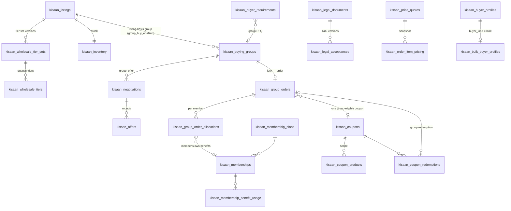

---

## 3. Domain overview ER (high level)

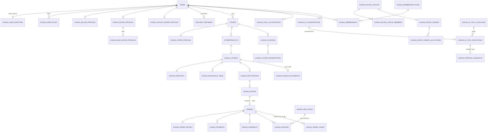

Detailed per-domain ER diagrams follow in each section.

---

## 4. Identity, roles, profiles, verification

### 4.1 Users & roles

#### `users` — REUSED (opsapi core)
Columns used: `id SERIAL`, `uuid VARCHAR UNIQUE`, `first_name`, `last_name`, `email VARCHAR UNIQUE`, `username VARCHAR UNIQUE`, `password TEXT`, `phone_no TEXT NULL` 🔒, `active BOOLEAN`, timestamps (`lapis/migrations.lua:571`).

- **Phone-first users:** opsapi `users.email` is unique and core login is email-based. KISAAN users sign up with a phone number. Kisaan creates the `users` row via the opsapi user API/SDK with a **non-routable placeholder email** `u<uuid>@phone.kisaan.invalid` and a random unusable password. The real phone lives in `kisaan_user_identities`. `[UNVERIFIED]` Confirm in Phase 1 whether `email` is NOT NULL and how the opsapi JWT helper can be called from a plugin to issue a session (see [OPSAPI_INTEGRATION](OPSAPI_INTEGRATION.md) §Auth gap).
- `users.phone_no` is also populated (E.164) for opsapi features that read it. The authoritative value is `kisaan_user_identities.phone_e164`.

#### `kisaan_user_identities` — EXTENDED (`users`)
Phone identity and login security (KIS-AUTH-001…003, KIS-AUTH-008).

| Field | Type | Null | Default | Notes |
|---|---|---|---|---|
| id | BIGSERIAL | N | | PK |
| uuid | UUID | N | gen_random_uuid() | UNIQUE |
| namespace_id | INTEGER | N | | FK namespaces(id) |
| user_id | INTEGER | N | | FK users(id) ON DELETE CASCADE, UNIQUE |
| phone_e164 | BYTEA 🔐 | N | | Encrypted, e.g. +9198xxxxxxxx |
| phone_hash | CHAR(64) | N | | HMAC for lookup; UNIQUE (namespace_id, phone_hash) |
| phone_last4 | CHAR(4) | N | | For masked display |
| phone_verified_at | TIMESTAMPTZ | Y | | |
| preferred_language | TEXT | N | 'pa' | CHECK IN ('pa','hi','en') |
| preferred_script | TEXT | N | 'native' | CHECK IN ('native','latin') |
| whatsapp_same_as_phone | BOOLEAN | N | true | |
| status | TEXT | N | 'active' | CHECK IN ('active','suspended','deletion_pending','deleted') |
| suspended_reason | TEXT | Y | | |
| last_login_at | TIMESTAMPTZ | Y | | |
| created_at / updated_at | TIMESTAMPTZ | N | now() | |

Indexes: `UNIQUE(namespace_id, phone_hash)`, `(namespace_id, status)`.

#### `kisaan_otp_challenges` — NEW
| Field | Type | Null | Notes |
|---|---|---|---|
| id | BIGSERIAL | N | PK |
| namespace_id | INTEGER | N | FK |
| phone_hash | CHAR(64) | N | |
| purpose | TEXT | N | CHECK IN ('login','register','change_phone','consent_delegate','approve_payment') |
| channel | TEXT | N | CHECK IN ('sms','whatsapp') |
| code_hash | CHAR(64) | N | HMAC of the OTP. The OTP itself is never stored. |
| attempts | SMALLINT | N | DEFAULT 0, CHECK (attempts <= 5) |
| expires_at | TIMESTAMPTZ | N | now() + 5 min |
| consumed_at | TIMESTAMPTZ | Y | |
| request_ip | INET 🔒 | Y | |
| device_id_hash | CHAR(64) | Y | |
| provider_message_id | TEXT | Y | SMS/WA provider reference |
| created_at | TIMESTAMPTZ | N | |

Indexes: `(namespace_id, phone_hash, created_at DESC)` for the KIS-AUTH-002 rate limit. A purge job deletes rows older than 30 days.

#### `kisaan_sessions` — NEW
Refresh-token families for phone-OTP sessions, used if opsapi `refresh_tokens` cannot be reused from a plugin `[UNVERIFIED]`.

| Field | Type | Notes |
|---|---|---|
| id BIGSERIAL PK, uuid, namespace_id, user_id FK users | | |
| refresh_token_hash | CHAR(64) | UNIQUE |
| family_id | UUID | Rotation family; reuse of a rotated token revokes the family |
| device_label, device_id_hash, user_agent | TEXT | |
| ip_first, ip_last | INET 🔒 | |
| expires_at, revoked_at, revoked_reason | TIMESTAMPTZ/TEXT | KIS-AUTH-003 |
| created_at, last_used_at | TIMESTAMPTZ | |

#### Roles — REUSED (`roles`, `user__roles`, `namespace_roles`, `namespace_user_roles`)
KISAAN RBAC roles are seeded as **namespace roles** in the `kisaan` namespace: `seller`, `buyer`, `group_leader`, `transporter`, `support_agent`, `verifier`, `finance`, `inspector` (P2), `admin`. Each gets `module.action` permissions on the plugin's RBAC modules declared in `project.lua` (`kisaan_listings`, `kisaan_offers`, …). See [OPSAPI_INTEGRATION](OPSAPI_INTEGRATION.md) §RBAC.

#### `kisaan_user_roles` — EXTENDED (`namespace_user_roles`)
Business state of each marketplace role a user holds (multi-role; KIS-AUTH-005, KIS-ONB-002, KIS-ONB-011).

| Field | Type | Null | Default | Notes |
|---|---|---|---|---|
| id | BIGSERIAL | N | | PK |
| uuid | UUID | N | | |
| namespace_id | INTEGER | N | | FK |
| user_id | INTEGER | N | | FK users(id) |
| role | TEXT | N | | CHECK IN ('seller','buyer','group_leader','transporter','support_agent','verifier','finance','inspector','admin') |
| status | TEXT | N | 'pending' | CHECK IN ('pending','active','suspended','revoked') |
| kyc_tier | TEXT | N | 'T0' | CHECK IN ('T0','T1','T2','T3'), defined in PRD KIS-ONB-002 |
| is_primary | BOOLEAN | N | false | Partial UNIQUE (user_id) WHERE is_primary |
| activated_at, suspended_at | TIMESTAMPTZ | Y | | |
| suspension_reason | TEXT | Y | | |
| created_at/updated_at | | | | |

Constraints: `UNIQUE(namespace_id, user_id, role)`. The application keeps `namespace_user_roles` in sync (role granted ⇔ status='active').

### 4.2 Profiles & addresses

#### `kisaan_seller_profiles` — NEW (FarmerProfiles, KIS-PROF-002)
| Field | Type | Null | Default | Notes |
|---|---|---|---|---|
| id, uuid, namespace_id | | | | |
| user_id | INTEGER | N | | FK users, UNIQUE |
| seller_type | TEXT | N | 'farmer' | CHECK IN ('farmer','fpo','aggregator','agri_input_dealer') (agri_input_dealer is Future) |
| display_name | TEXT 🔒 | N | | |
| village | TEXT | Y | | |
| tehsil | TEXT | Y | | |
| district_code | TEXT | N | | LGD district code `[ASSUMPTION A-12: LGD codes used as geo master]` |
| state_code | TEXT | N | 'PB' | |
| land_acres | NUMERIC(8,2) | Y | | Optional, never mandatory |
| crops | TEXT[] | Y | | Commodity codes grown |
| fpo_registration_no | TEXT | Y | | For seller_type = fpo |
| gstin | TEXT 🔒 | Y | | Format CHECK `^[0-9]{2}[A-Z0-9]{10}[0-9A-Z]{3}$` |
| gstin_verified_at | TIMESTAMPTZ | Y | | |
| pan_last4 | CHAR(4) | Y | | Full PAN in verification records only |
| show_phone | BOOLEAN | N | false | KIS-PROF-004 |
| response_time_p50_minutes | INTEGER | Y | | Derived (KIS-PROF-007) |
| rating_avg | NUMERIC(3,2) | Y | | Denormalised |
| rating_count | INTEGER | N | 0 | |
| completed_orders | INTEGER | N | 0 | |
| reliability_score | NUMERIC(5,2) | Y | | Internal |
| version | INTEGER | N | 0 | |
| created_at/updated_at/deleted_at | | | | |

#### `kisaan_buyer_profiles` — NEW (BuyerProfiles, KIS-ONB-010)
| Field | Type | Null | Notes |
|---|---|---|---|
| id, uuid, namespace_id, user_id (UNIQUE FK users) | | | |
| buyer_kind | TEXT | N | DEFAULT 'normal', CHECK IN ('normal','bulk') — D-104. `bulk` only via the bulk-buyer onboarding path; requires a `kisaan_bulk_buyer_profiles` row (deferred trigger) |
| buyer_type | TEXT | N | CHECK IN ('individual','retailer','wholesaler','distributor','processor','restaurant','exporter','agri_business') |
| business_name | TEXT | Y | Required if buyer_type <> 'individual' (CHECK) |
| gstin | TEXT 🔒 | Y | |
| gstin_verified_at | TIMESTAMPTZ | Y | |
| fssai_license_no | TEXT | Y | Optional; FSSAI applicability per [SECURITY_AND_COMPLIANCE](SECURITY_AND_COMPLIANCE.md) |
| apmc_licence_no | TEXT | Y | APMC trader/commission-agent licence number, required where `kisaan_category_state_rules.requires_buyer_apmc_licence` (KIS-CMP-046, `[DECISION D-80: APMC gating]`) |
| apmc_licence_state | TEXT | Y | State code that issued the licence, e.g. 'PB' |
| apmc_licence_verified_at | TIMESTAMPTZ | Y | Set by a verifier (verification record `check_type = 'apmc_licence'`) |
| iec_code | TEXT | Y | Exporters (optional) |
| default_delivery_address_id | BIGINT | Y | FK kisaan_addresses |
| typical_monthly_volume_kg | NUMERIC(14,3) | Y | Used by the deterministic matching service (`matching.find_matches`) |
| interested_commodities | TEXT[] | Y | |
| interested_districts | TEXT[] | Y | |
| rating_avg, rating_count, completed_orders | | | Denormalised |
| contact_preference | TEXT | N | DEFAULT 'in_app', CHECK IN ('in_app','phone','whatsapp') |
| version, timestamps, deleted_at | | | |

#### `kisaan_bulk_buyer_profiles` — NEW (v0.2; BulkBuyerProfiles, KIS-BULK-001…008, D-104)
1:1 extension of `kisaan_buyer_profiles` for buyers who signed up via `/signup/bulk-buyer`. Normal buyers have no row here. Group leader/member status is **per group** (`kisaan_buying_groups`, `kisaan_buying_group_members`), not a buyer kind.

| Field | Type | Null | Notes |
|---|---|---|---|
| id, uuid, namespace_id | | | |
| buyer_profile_id | BIGINT | N | FK kisaan_buyer_profiles UNIQUE |
| business_type | TEXT | N | CHECK IN ('retailer','wholesaler','distributor','processor','restaurant','exporter','institution','fpo','agri_business','other') |
| required_commodity_ids | BIGINT[] | N | FK-validated by trigger against `kisaan_commodities` |
| typical_order_qty_kg | NUMERIC(14,3) | N | CHECK (> 0) |
| purchase_frequency | TEXT | N | CHECK IN ('one_time','weekly','fortnightly','monthly','seasonal') |
| delivery_district_codes | TEXT[] | N | LGD codes (A-12) |
| budget_min_inr, budget_max_inr | NUMERIC(14,2) | Y | CHECK (budget_min_inr <= budget_max_inr); private — never shown to sellers |
| quality_requirements | JSONB | Y | Attribute constraints per commodity, same shape as `kisaan_buyer_requirements.quality_specs` |
| preferred_store_ids | INTEGER[] | Y | FK-validated against `stores` |
| business_verification_status | TEXT | N | DEFAULT 'unverified', CHECK IN ('unverified','pending','verified','rejected') — via `kisaan_verification_records` (`check_type IN ('gstin','business_docs')`) |
| recurring_procurement_enabled | BOOLEAN | N | DEFAULT false (P2 recurring RFQs) |
| version, timestamps, deleted_at | | | |

Index: GIN(`required_commodity_ids`), GIN(`delivery_district_codes`) — used by matching and seller "bulk demand" views (aggregates only; individual bulk buyers are not exposed until they send an RFQ or offer).

#### `kisaan_group_leader_profiles` — NEW (KIS-GROUP-001, KIS-GROUP-002)
| Field | Type | Null | Notes |
|---|---|---|---|
| id, uuid, namespace_id, user_id UNIQUE FK users | | | Requires an active `buyer` role |
| leader_type | TEXT | N | CHECK IN ('individual','cooperative','fpo','rwa','shopkeeper','other') |
| organisation_name | TEXT | Y | |
| area_name | TEXT | N | e.g. "Dugri Phase 2, Ludhiana" |
| area_district_code | TEXT | N | |
| area_centroid | GEOGRAPHY(Point,4326) | Y | PostGIS (opsapi enables PostGIS; `[UNVERIFIED]` extension present in pinned image) |
| area_radius_km | NUMERIC(6,2) | N | DEFAULT 5, CHECK (> 0 AND <= 50) |
| proof_of_association_doc_id | BIGINT | Y | FK kisaan_kyc_documents |
| verification_status | TEXT | N | CHECK IN ('pending','verified','rejected','suspended') |
| verified_at, verified_by | TIMESTAMPTZ / INTEGER | Y | FK users |
| groups_completed | INTEGER | N | DEFAULT 0 |
| groups_cancelled | INTEGER | N | DEFAULT 0 |
| completion_rate | NUMERIC(5,2) | Y | |
| rating_avg, rating_count | | | Member ratings (KIS-REV-005) |
| max_open_groups | SMALLINT | N | DEFAULT 2 (new leader: 2 open groups, max group value ₹2,00,000); raised automatically to 10 groups / ₹20,00,000 after 3 completed groups (KIS-GROUP-012, D-71) |
| max_group_value_inr | NUMERIC(14,2) | N | DEFAULT 200000.00 `[DECISION D-71: group-leader limits]` |
| agreement_acceptance_id | BIGINT | Y | FK kisaan_legal_acceptances (group-leader agreement) |
| timestamps, deleted_at | | | |

#### `delivery_partners` — REUSED (opsapi delivery)
Columns used: vehicle_types, service_radius_km, pricing_model, base/per-km charges, rating, `bank_ifsc_code`, verification_documents, geo columns (`migrations/geolocation-delivery-system.lua`). opsapi partner dashboards, earnings and assignment flows are reused.

#### `kisaan_transporter_profiles` — EXTENDED (`delivery_partners`) (KIS-ONB-014)
| Field | Type | Null | Notes |
|---|---|---|---|
| id, uuid, namespace_id | | | |
| delivery_partner_id | INTEGER | N | FK delivery_partners(id), UNIQUE |
| user_id | INTEGER | N | FK users |
| operator_type | TEXT | N | CHECK IN ('owner_driver','fleet_operator') |
| service_district_codes | TEXT[] | N | |
| driving_licence_last4 | CHAR(4) | Y | Full document in KYC store |
| dl_verified_at | TIMESTAMPTZ | Y | |
| on_time_rate | NUMERIC(5,2) | Y | |
| completed_shipments | INTEGER | N | DEFAULT 0 |
| accepts_whatsapp_updates | BOOLEAN | N | DEFAULT true |
| timestamps, deleted_at | | | |

#### `kisaan_addresses` — NEW (KIS-PROF-003)
| Field | Type | Null | Notes |
|---|---|---|---|
| id, uuid, namespace_id | | | |
| user_id | INTEGER | N | FK users |
| purpose | TEXT | N | CHECK IN ('farm','pickup','delivery','billing','business','group_drop_point') |
| label | TEXT | Y | "Khet", "Godown" |
| line1 🔒, line2 🔒, landmark 🔒 | TEXT | Y | |
| village, tehsil | TEXT | Y | |
| district_code | TEXT | N | |
| state_code | TEXT | N | |
| pincode | CHAR(6) | Y | CHECK `^[1-9][0-9]{5}$` |
| location | GEOGRAPHY(Point,4326) 🔒 | Y | Precise pin; public views use district/rounded coordinates only |
| location_public | GEOGRAPHY(Point,4326) | Y | Rounded to about 1 km (≈0.01°) for distance search without exposing the farm |
| contact_name 🔒, contact_phone_enc 🔐 | TEXT/BYTEA | Y | |
| is_default | BOOLEAN | N | DEFAULT false |
| timestamps, deleted_at | | | |

Indexes: `(namespace_id, user_id) WHERE deleted_at IS NULL`, GIST(`location_public`).

### 4.3 Verification, KYC & payouts

#### `kisaan_verification_records` — NEW (KIS-ONB-002…005, KIS-ONB-012, KIS-ONB-014, KIS-GROUP-001)
| Field | Type | Null | Notes |
|---|---|---|---|
| id, uuid, namespace_id | | | |
| user_id | INTEGER | N | FK users |
| subject_role | TEXT | N | seller / buyer / group_leader / transporter |
| check_type | TEXT | N | CHECK IN ('phone','identity_digilocker','identity_offline_aadhaar','pan','gstin','bank_penny_drop','driving_licence','vehicle_rc','fssai','organic_certificate','leader_area_proof','business_registration','apmc_licence') |
| method | TEXT | N | e.g. 'digilocker', 'manual_review', 'provider_api' |
| provider | TEXT | Y | Verification vendor `[UNVERIFIED vendor]` |
| provider_reference | TEXT | Y | |
| status | TEXT | N | CHECK IN ('pending','in_review','verified','rejected','expired') |
| result_summary | JSONB | Y | Minimal: name match score, masked identifiers. **No raw Aadhaar.** |
| name_match_score | NUMERIC(5,2) | Y | |
| ai_risk_score | NUMERIC(5,2) | Y | Computed by the deterministic verification risk-rules job (not an AI agent). Advisory only, never a decision. |
| ai_risk_reasons | JSONB | Y | |
| reviewed_by | INTEGER | Y | FK users (verifier) |
| reviewed_at | TIMESTAMPTZ | Y | |
| rejection_reason | TEXT | Y | |
| valid_until | TIMESTAMPTZ | Y | e.g. DL expiry |
| created_at/updated_at | | | |

Indexes: `(namespace_id, status, check_type)` for the verifier queue (KIS-ADM-002), `(namespace_id, user_id)`.

#### `kisaan_kyc_documents` — NEW
| Field | Type | Null | Notes |
|---|---|---|---|
| id, uuid, namespace_id, user_id | | | |
| verification_record_id | BIGINT | Y | FK |
| doc_type | TEXT | N | Same domain as check_type plus 'vehicle_photo', 'shop_photo' |
| object_bucket | TEXT | N | Dedicated **private, SSE-encrypted** bucket `kisaan-kyc` (never public, no CDN) |
| object_key | TEXT | N | Random key, no PII in path |
| sha256 | CHAR(64) | N | Duplicate-document detection (verification job) |
| mime_type | TEXT | N | CHECK IN ('image/jpeg','image/png','application/pdf') |
| size_bytes | INTEGER | N | CHECK (<= 10485760) |
| masked_number | TEXT | Y | e.g. "XXXX-XXXX-1234" |
| retention_until | DATE | N | Per retention policy |
| purged_at | TIMESTAMPTZ | Y | |
| created_at | TIMESTAMPTZ | N | |

Every access is audit-logged (`kisaan_audit_log` action `kyc.document.view`).

#### `kisaan_payout_accounts` — NEW (KIS-PROF-005)
| Field | Type | Null | Notes |
|---|---|---|---|
| id, uuid, namespace_id, user_id | | | |
| account_type | TEXT | N | CHECK IN ('bank','upi') |
| account_holder_name 🔒 | TEXT | N | |
| bank_account_enc 🔐 | BYTEA | Y | |
| bank_account_last4 | CHAR(4) | Y | |
| ifsc | CHAR(11) | Y | CHECK `^[A-Z]{4}0[A-Z0-9]{6}$` |
| upi_vpa_enc 🔐 | BYTEA | Y | |
| penny_drop_status | TEXT | N | CHECK IN ('pending','verified','failed') |
| penny_drop_name_match | NUMERIC(5,2) | Y | |
| pa_linked_account_id | TEXT | Y | PA sub-merchant / linked account id (e.g. Razorpay Route account) |
| pa_linked_account_status | TEXT | Y | |
| is_default | BOOLEAN | N | false |
| timestamps, deleted_at | | | |

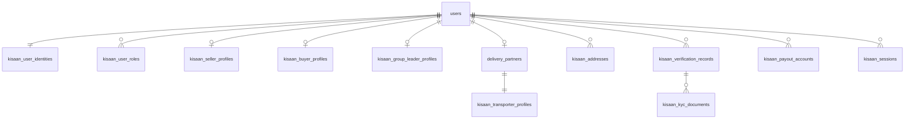

---

## 5. Catalogue, listings, stores, inventory, wholesale

### 5.1 Taxonomy & attribute schema

#### `kisaan_categories` — NEW (CAT, KIS-ADM-007)
| Field | Type | Null | Notes |
|---|---|---|---|
| id, uuid, namespace_id | | | |
| parent_id | BIGINT | Y | FK self |
| code | TEXT | N | e.g. 'cereals', 'cereals.wheat'. UNIQUE(namespace_id, code) |
| name_i18n | JSONB | N | `{"en":"Wheat","hi":"गेहूं","pa":"ਕਣਕ"}`. CHECK has keys en, hi, pa |
| synonyms | TEXT[] | N | DEFAULT '{}'. Romanised/local names: "kanak", "gehun" (KIS-SRCH-005) |
| hsn_code | TEXT | Y | For GST invoicing `[TAX REVIEW]` |
| scope | TEXT | N | CHECK IN ('mvp','p2','future') |
| is_active | BOOLEAN | N | DEFAULT false (only MVP categories active at launch, D-01) |
| requires_licence | TEXT | Y | e.g. 'insecticide_licence' for Future agri-inputs |
| perishability | TEXT | N | CHECK IN ('non_perishable','semi_perishable','perishable'). Drives TTLs (KIS-ORD-004/006) |
| default_display_unit | TEXT | N | CHECK IN ('kg','qtl','tonne') |
| sort_order | INTEGER | N | DEFAULT 0 |
| timestamps | | | |

#### `kisaan_category_attributes` — NEW (ProductAttributes schema; KIS-SRCH-012)
| Field | Type | Null | Notes |
|---|---|---|---|
| id, uuid, namespace_id | | | |
| category_id | BIGINT | N | FK kisaan_categories |
| key | TEXT | N | e.g. 'moisture_pct', 'grade', 'variety', 'harvest_date'. UNIQUE(category_id, key) |
| label_i18n | JSONB | N | |
| data_type | TEXT | N | CHECK IN ('text','number','integer','date','enum','multi_enum','boolean') |
| unit | TEXT | Y | '%', 'mm', 'kg/bag' |
| enum_values | JSONB | Y | `[{"value":"FAQ","label_i18n":{...}}]` |
| min_value / max_value | NUMERIC | Y | e.g. moisture 0–25 |
| required | BOOLEAN | N | DEFAULT false |
| filterable | BOOLEAN | N | DEFAULT false |
| ai_extractable | BOOLEAN | N | DEFAULT true. KISAAN AI (`catalogue.create_listing_draft`) may propose a value for user confirmation. |
| inherited | BOOLEAN | N | DEFAULT true. Applies to child categories. |
| sort_order | INTEGER | N | |

#### `kisaan_commodities`, `kisaan_varieties` — NEW (master data for "Products")
- `kisaan_commodities(id, uuid, namespace_id, category_id FK, code UNIQUE, name_i18n JSONB, synonyms TEXT[], agmarknet_commodity_name TEXT, msp_applicable BOOLEAN)`
- `kisaan_varieties(id, uuid, namespace_id, commodity_id FK, code, name_i18n, synonyms TEXT[], UNIQUE(commodity_id, code))` e.g. wheat → HD-3086, PBW-343 (romanised names; agronomic variety list curated by admin).

#### `kisaan_category_state_rules` — NEW (APMC gating feature flag; KIS-CMP-046, `[DECISION D-80]`)
Controls whether marketplace **checkout is enabled per category per state**, plus state-specific obligations. Example: wheat/paddy in Punjab may stay "discovery + enquiry only" until legal sign-off.

| Field | Type | Null | Notes |
|---|---|---|---|
| id, uuid, namespace_id | | | |
| category_id | BIGINT | N | FK kisaan_categories (applies to children unless overridden) |
| state_code | TEXT | N | 'PB', 'HR', … |
| checkout_enabled | BOOLEAN | N | DEFAULT false. false → listings are discoverable and enquiries/offers allowed per `offers_enabled`, but `checkout/orders`, offer acceptance and group lock return `403 CHECKOUT_DISABLED_FOR_STATE` |
| offers_enabled | BOOLEAN | N | DEFAULT true |
| requires_buyer_apmc_licence | BOOLEAN | N | DEFAULT false |
| levies | JSONB | N | '[]'. Levy templates, e.g. `[{"levy_type":"market_fee","rate_pct":"2.000","payer":"buyer"},{"levy_type":"rural_dev_fee","rate_pct":"2.000","payer":"buyer"}]` `[LEGAL REVIEW]` rates |
| legal_basis_note | TEXT | Y | Reference to legal opinion |
| effective_from | TIMESTAMPTZ | N | |
| effective_to | TIMESTAMPTZ | Y | |
| approved_by | INTEGER | N | FK users (admin). Change audit-logged. |
| created_at | TIMESTAMPTZ | N | |

Constraint: EXCLUDE (btree_gist) overlapping effective ranges per (namespace_id, category_id, state_code). Resolution uses the most specific category, then the effective date. **Default when no rule exists: checkout disabled** (fail-closed).

### 5.2 Listings

A **listing** is a seller's lot for sale. Each listing is backed by one opsapi `storeproducts` row so that opsapi public-store pages, product reads, media and reviews continue to work. Kisaan-specific data lives in `kisaan_listings`.

#### `storeproducts` — REUSED (opsapi ecommerce)
Kisaan writes: `store_id`, `name` (localised title in the seller's language), `description`, `price` (effective **per display unit** list price, informational for opsapi pages), `images` (JSON array of public media URLs), `is_active`/`status`, **`track_inventory = true`** (so opsapi's own stock checks stay consistent with Kisaan), `inventory_quantity`. **Kisaan inventory is authoritative**: `inventory_quantity` is mirrored as `floor(available_kg / display_unit_kg)` in the same transaction as each inventory movement. These are sanctioned core writes W-1 ([OPSAPI_INTEGRATION](OPSAPI_INTEGRATION.md) §6.4, D-28), done only through `kisaan.core_adapter`. Clients never call opsapi `/checkout` or `checkout-enhanced` (blocked at the edge; see [API_SPECIFICATION](API_SPECIFICATION.md) §3.15). The adapter's order creation (W-3) must not double-decrement opsapi stock; confirm in spike S-02 `[UNVERIFIED]`. `[UNVERIFIED]` exact `storeproducts` status column semantics.

#### `kisaan_listings` — EXTENDED (`storeproducts`) (KIS-PRD-001…009, KIS-PRD-020…023)
| Field | Type | Null | Default | Notes |
|---|---|---|---|---|
| id | BIGSERIAL | N | | PK |
| uuid | UUID | N | | UNIQUE |
| namespace_id | INTEGER | N | | |
| storeproduct_id | INTEGER | N | | FK storeproducts(id) ON DELETE RESTRICT, UNIQUE |
| store_id | INTEGER | N | | FK stores(id). Denormalised. |
| seller_user_id | INTEGER | N | | FK users |
| category_id | BIGINT | N | | FK kisaan_categories |
| commodity_id | BIGINT | N | | FK kisaan_commodities |
| variety_id | BIGINT | Y | | FK kisaan_varieties |
| title_i18n | JSONB | N | | Auto-translated (KIS-PRD-004), `{"pa":..,"hi":..,"en":..,"source":"pa"}` |
| description_i18n | JSONB | Y | | |
| attributes | JSONB | N | '{}' | Validated against category schema (app + trigger function `kisaan_validate_attributes`) |
| seller_declared_grade | TEXT | Y | | KIS-PRD-006 |
| ai_observation | JSONB | Y | | `{"summary":..,"confidence":..,"model":..,"disclaimer_shown":true}`. **Never a quality certification.** |
| display_unit | TEXT | N | 'qtl' | CHECK IN ('kg','qtl','tonne') |
| initial_qty_kg | NUMERIC(14,3) | N | | CHECK (> 0) |
| moq_kg | NUMERIC(14,3) | N | 100.000 | CHECK (moq_kg > 0 AND moq_kg <= initial_qty_kg) |
| qty_step_kg | NUMERIC(14,3) | N | 1.000 | Order increment |
| max_order_qty_kg | NUMERIC(14,3) | Y | | v0.2 (KIS-PRC-012): maximum quantity per order; CHECK (max_order_qty_kg IS NULL OR max_order_qty_kg >= moq_kg). Above it → `QTY_ABOVE_MAX` |
| list_price_per_kg | NUMERIC(14,4) | N | | CHECK (> 0). 4 dp because ₹2,450/qtl = ₹24.5000/kg. |
| list_price_per_display_unit | NUMERIC(14,2) | N | | As entered |
| price_floor_per_kg | NUMERIC(14,4) | Y | | KIS-PRC-003 seller floor |
| price_negotiable | BOOLEAN | N | true | |
| wholesale_enabled | BOOLEAN | N | false | KIS-WHL-001 |
| whole_lot_enabled | BOOLEAN | N | false | KIS-WHL-004 |
| whole_lot_price_per_kg | NUMERIC(14,4) | Y | | CHECK (whole_lot_enabled = false OR whole_lot_price_per_kg IS NOT NULL) |
| auto_reject_below_per_kg | NUMERIC(14,4) | Y | | KIS-OFR-015 — **P2, not enabled in MVP** (D-06); column created now, must stay NULL in MVP |
| harvest_date | DATE | Y | | |
| available_from | DATE | N | CURRENT_DATE | |
| expires_at | TIMESTAMPTZ | N | | KIS-PRD-021 |
| pickup_address_id | BIGINT | N | | FK kisaan_addresses |
| district_code | TEXT | N | | Denormalised for search |
| location_public | GEOGRAPHY(Point,4326) | N | | Rounded (from address) |
| delivery_options | TEXT[] | N | '{buyer_pickup}' | ⊆ {buyer_pickup, seller_delivery, seller_delivery_fee, platform_logistics}. Tokens map to FUNCTIONAL_SPECIFICATION delivery terms `BUYER_PICKUP`, `SELLER_DELIVERS`, `SELLER_DELIVERS_FEE`, `PLATFORM_LOGISTICS`. `platform_logistics` is P2 (D-106); a CHECK via feature flag rejects it in MVP |
| seller_delivery_fee_inr | NUMERIC(14,2) | Y | | v0.2: seller-set delivery fee for `seller_delivery_fee` (flat per order, or per drop point for groups). Charged through KISAAN; the KISAAN Plus free-delivery waiver applies to it in MVP (D-106) |
| mrp_per_unit_inr | NUMERIC(14,2) | Y | | v0.2: MRP incl. taxes for packaged goods only (PRICING_ENGINE §11, Legal Metrology `[LEGAL REVIEW]`); price incl. GST must not exceed it (`PRICE_ABOVE_MRP`) |
| mrp_unit | TEXT | Y | | e.g. 'bag_50kg'; required when `mrp_per_unit_inr` set |
| member_price_per_kg | NUMERIC(14,4) | Y | | Seller opt-in member-only price (PRICING_ENGINE stage 5) |
| group_buy_enabled | BOOLEAN | N | false | v0.2 `group_eligible` (D-103): listing may be the basis of a buying group and receive the group discount |
| group_discount_type | TEXT | Y | | CHECK IN ('percentage','fixed_per_unit'); required when `group_discount_value` set |
| group_discount_value | NUMERIC(14,4) | Y | | percentage: CHECK (> 0 AND <= 50); fixed: ₹ per kg. Applied after the wholesale stage (PRICING_ENGINE stage 3) |
| group_min_qty_kg | NUMERIC(14,3) | Y | | Minimum **total group** quantity for the group discount; CHECK (>= moq_kg). Also the seller minimum used for the `repricing` check after the payment window (R5) unless a tier set or accepted group offer overrides it |
| organic_certified | BOOLEAN | N | false | Requires verified certificate (KIS-PRD-009) |
| status | TEXT | N | 'draft' | CHECK IN ('draft','pending_review','active','paused','out_of_stock','closed','expired','rejected','removed') |
| moderation_flags | JSONB | N | '[]' | Duplicate, price-outlier, prohibited (KIS-PRD-022) |
| created_via | TEXT | N | 'form' | CHECK IN ('form','chat','voice','photo','whatsapp','csv','assisted') |
| ai_conversation_id | BIGINT | Y | | FK kisaan_ai_conversations |
| published_at | TIMESTAMPTZ | Y | | |
| published_approval_id | BIGINT | Y | | FK kisaan_approval_requests (KIS-APR-001: publish is commit-class) |
| search_vector | TSVECTOR | Y | | Generated from title_i18n, synonyms, variety (trigger) |
| search_text_latin | TEXT | Y | | Transliterated text for trigram search |
| view_count | INTEGER | N | 0 | |
| version | INTEGER | N | 0 | |
| created_at/updated_at/deleted_at | TIMESTAMPTZ | | | |

Indexes:
- `(namespace_id, status, category_id) WHERE deleted_at IS NULL`
- `(namespace_id, seller_user_id, status)`
- GIN(`search_vector`); GIN(`search_text_latin gin_trgm_ops`) (`pg_trgm`)
- GIST(`location_public`)
- `(namespace_id, commodity_id, list_price_per_kg)` for price sort
- GIN(`attributes jsonb_path_ops`)
- `(expires_at) WHERE status = 'active'` for the expiry job

Constraints: `CHECK (price_floor_per_kg IS NULL OR price_floor_per_kg <= list_price_per_kg)`; `CHECK (group_discount_value IS NULL OR (group_buy_enabled AND group_discount_type IS NOT NULL AND group_min_qty_kg IS NOT NULL))`.

#### `kisaan_listing_media` — EXTENDED (`documents` / MinIO) (KIS-PRD-003)
| Field | Type | Null | Notes |
|---|---|---|---|
| id, uuid, namespace_id | | | |
| listing_id | BIGINT | N | FK kisaan_listings ON DELETE CASCADE |
| document_id | INTEGER | Y | FK opsapi `documents(id)` when uploaded via opsapi documents API `[UNVERIFIED]` column type |
| object_key_original | TEXT | N | Private bucket |
| object_key_web | TEXT | N | Compressed WebP (≤ 150 KB) for low bandwidth |
| object_key_thumb | TEXT | N | ≤ 20 KB |
| media_type | TEXT | N | CHECK IN ('image','video') (video P2) |
| sort_order | SMALLINT | N | 0 = cover |
| exif_stripped | BOOLEAN | N | CHECK (exif_stripped = true) |
| malware_scan_status | TEXT | N | CHECK IN ('pending','clean','infected') |
| moderation_status | TEXT | N | CHECK IN ('pending','approved','rejected') |
| perceptual_hash | TEXT | Y | Duplicate-listing detection (moderation job) |
| ai_labels | JSONB | Y | KISAAN AI photo attribute extraction (draft only; user confirms) |
| width, height | INTEGER | Y | |
| created_at, deleted_at | | | |

Constraint: max 10 active media per listing (app-enforced plus a trigger).

#### `kisaan_search_documents` — NEW (denormalised search read model, KIS-SRCH-001…023)
One row per active listing (and per public store / buying group in P2), rebuilt by triggers/event listeners on `kisaan.listing.*`, inventory and store changes. Keeps search queries off the transactional tables.

| Field | Type | Null | Default | Notes |
|---|---|---|---|---|
| id | BIGSERIAL | N | | PK |
| namespace_id | INTEGER | N | | |
| doc_type | TEXT | N | 'listing' | CHECK IN ('listing','store','group') (store/group P2) |
| listing_id | BIGINT | Y | | FK kisaan_listings ON DELETE CASCADE; UNIQUE when doc_type='listing' |
| store_id | INTEGER | Y | | opsapi `stores.id` |
| category_id, commodity_id, variety_id | BIGINT | Y | | |
| title_i18n | JSONB | N | '{}' | pa/hi/en titles |
| search_text | TEXT | N | | Concatenated native-script + transliterated (romanised) text and synonyms |
| search_vector | TSVECTOR | N | | Generated from `search_text` ('simple' config, script-agnostic) |
| available_kg | NUMERIC(14,3) | N | | From `kisaan_inventory.available` |
| list_price_per_kg | NUMERIC(14,4) | N | | |
| has_wholesale | BOOLEAN | N | false | |
| best_tier_price_per_kg | NUMERIC(14,4) | Y | | For "price at your quantity" sort |
| member_price_available | BOOLEAN | N | false | |
| grade | TEXT | Y | | |
| location_public | GEOGRAPHY(Point,4326) | Y | | Rounded public location (PostGIS `[UNVERIFIED]`, fallback lat/lng + bounding box) |
| district_code | TEXT | Y | | LGD (A-12) |
| seller_verification_tier | TEXT | Y | | badge filter |
| seller_rating | NUMERIC(3,2) | Y | | |
| is_early_access_until | TIMESTAMPTZ | Y | | Members-only visibility window (2 h, MEM benefit) |
| visible | BOOLEAN | N | true | false when stock = 0, expired, hidden or moderated |
| updated_at | TIMESTAMPTZ | N | now() | |

Indexes: GIN(search_vector); GIN(search_text gin_trgm_ops); GIST(location_public); (namespace_id, visible, category_id, list_price_per_kg); (district_code) WHERE visible.

#### `kisaan_saved_searches` — NEW (KIS-SRCH-006)
`id, uuid, namespace_id, user_id, query_text, filters JSONB, alert_enabled BOOLEAN, alert_channel TEXT, last_alerted_at, created_at, deleted_at`.

### 5.3 Seller stores (STR)

#### `stores` — REUSED (opsapi ecommerce)
One store per seller. Kisaan uses `user_id` (owner), `name`, `slug`, `logo`/`banner`, `description`, `status`, `is_verified`, `currency = 'INR'`, `namespace_id`. Public pages are served via opsapi `GET /api/v2/public/stores/:slug` **and** the Kisaan public store API, which adds tiers, groups and coupons (see API spec).

#### `kisaan_store_profiles` — EXTENDED (`stores`) (KIS-STORE-001…008)
| Field | Type | Null | Notes |
|---|---|---|---|
| id, uuid, namespace_id | | | |
| store_id | INTEGER | N | FK stores(id), UNIQUE |
| seller_user_id | INTEGER | N | FK users |
| tagline_i18n | JSONB | Y | |
| description_i18n | JSONB | Y | |
| policies | JSONB | N | `{"returns":..,"delivery":..,"payment":..}` per language |
| service_district_codes | TEXT[] | N | |
| public_contact_mode | TEXT | N | CHECK IN ('in_app_only','show_phone','whatsapp_link'), DEFAULT 'in_app_only' (KIS-PROF-004) |
| qr_object_key | TEXT | Y | KIS-STORE-005 |
| slug_changed_at | TIMESTAMPTZ | Y | Change allowed once per 30 days (KIS-STORE-004) |
| visibility | TEXT | N | CHECK IN ('public','hidden','suspended') |
| hidden_until | TIMESTAMPTZ | Y | v0.2 vacation mode (KIS-STORE-012): store hidden from search; reopens automatically |
| vacation_reopen_on | DATE | Y | v0.2: shown on the store page while hidden |
| min_order_value_inr | NUMERIC(14,2) | Y | v0.2 store MOV (KIS-PRC-012, D-123): goods after pricing stages 2–5, before coupon; non-negotiated path only. Below it → `MIN_ORDER_VALUE_NOT_MET` |
| policies_version | INTEGER | N | v0.2, DEFAULT 1; bumped on each policy change and snapshotted into `kisaan_order_details.store_policy_version` |
| location_precision | TEXT | N | v0.2, DEFAULT 'district', CHECK IN ('district','village') — public location level |
| store_views | BIGINT | N | DEFAULT 0 |
| share_count | BIGINT | N | DEFAULT 0 |
| timestamps | | | |

#### `kisaan_store_slug_history` — NEW
`id, namespace_id, store_id FK, old_slug TEXT, changed_at, UNIQUE(namespace_id, old_slug)`. Old slugs 301-redirect.

### 5.4 Inventory (2A.5 — KIS-INV-001…010)

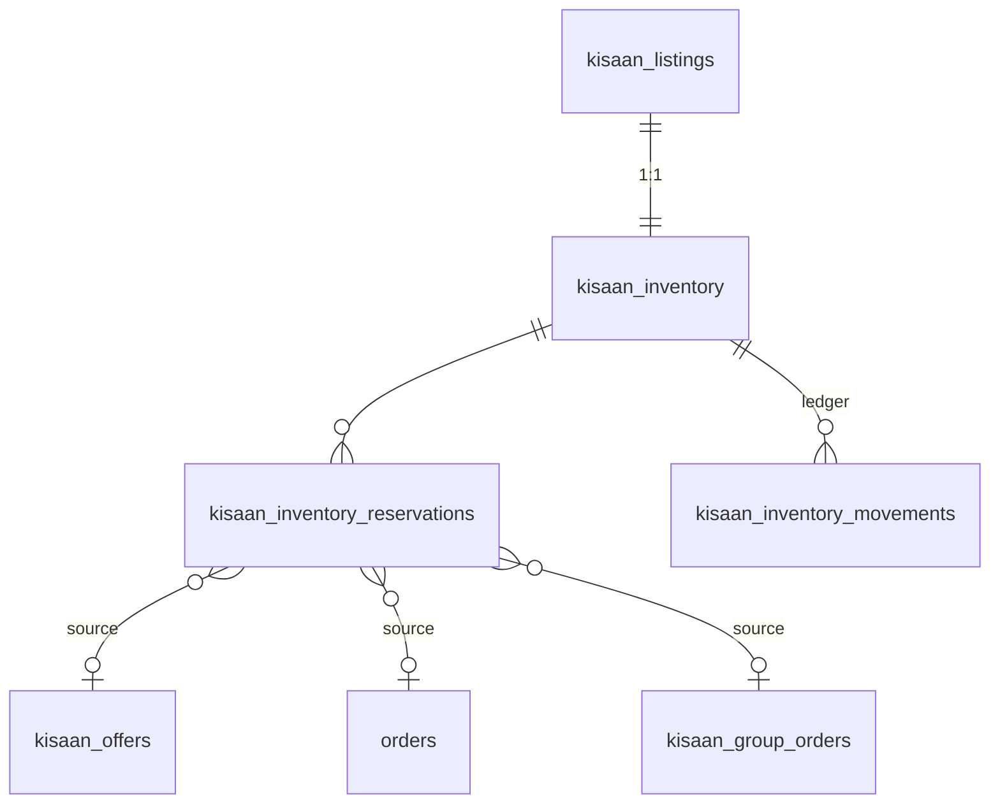

#### `kisaan_inventory` — NEW
| Field | Type | Null | Default | Notes |
|---|---|---|---|---|
| id | BIGSERIAL | N | | PK |
| namespace_id | INTEGER | N | | |
| listing_id | BIGINT | N | | FK kisaan_listings, UNIQUE |
| on_hand_kg | NUMERIC(14,3) | N | | CHECK (on_hand_kg >= 0) |
| reserved_kg | NUMERIC(14,3) | N | 0 | CHECK (reserved_kg >= 0) |
| available_kg | NUMERIC(14,3) | — | GENERATED ALWAYS AS (on_hand_kg - reserved_kg) STORED | |
| sold_kg | NUMERIC(14,3) | N | 0 | Cumulative deducted |
| damaged_kg | NUMERIC(14,3) | N | 0 | v0.2. Stock moved out of `on_hand_kg` as damaged/spoiled (movement `mark_damaged`); not sellable |
| unavailable_kg | NUMERIC(14,3) | N | 0 | v0.2. Expired / withheld / quality-hold stock moved out of `on_hand_kg` (movement `mark_unavailable` / `quarantine`); may return via `restore_unavailable` / `unquarantine` |
| returned_kg | NUMERIC(14,3) | N | 0 | v0.2 (P2 returns flow; column created now). Returned goods awaiting inspection; `return_restock` moves them to `on_hand_kg`, `write_off` to `damaged_kg` |
| low_stock_threshold_kg | NUMERIC(14,3) | N | | KIS-INV-007 default max(10% initial, MOQ) |
| low_stock_alerted_at | TIMESTAMPTZ | Y | | Reset when restocked above threshold |
| version | INTEGER | N | 0 | |
| updated_at | TIMESTAMPTZ | N | | |

**Hard invariant:** `CHECK (reserved_kg <= on_hand_kg)`, so `available_kg >= 0` always (KIS-INV-001, KIS-INV-005). Bucket semantics (owner doc [SELLER_STORE_AND_INVENTORY](SELLER_STORE_AND_INVENTORY.md)): *available* = `on_hand − reserved`; *reserved/pending* = live holds for checkout, accepted offers and group orders; *sold* = cumulative deducted; *damaged* and *unavailable* sit outside `on_hand`. Moving stock into damaged/unavailable only takes from `available_kg` (never from reserved).

#### `kisaan_inventory_reservations` — NEW
| Field | Type | Null | Notes |
|---|---|---|---|
| id, uuid, namespace_id | | | |
| inventory_id | BIGINT | N | FK kisaan_inventory |
| listing_id | BIGINT | N | Denormalised |
| qty_kg | NUMERIC(14,3) | N | CHECK (> 0) |
| source_type | TEXT | N | CHECK IN ('offer','checkout','group_order') |
| source_id | BIGINT | N | offer id / price-quote id / group order id |
| order_id | INTEGER | Y | FK orders(id), set when the order is created |
| buyer_user_id | INTEGER | N | FK users |
| status | TEXT | N | CHECK IN ('held','committed','released','expired') |
| expires_at | TIMESTAMPTZ | N | TTL: checkout 15 min; accepted offer = payment deadline (KIS-ORD-004: 24 h / 4 h perishable); group = group payment window |
| released_reason | TEXT | Y | 'cancelled','payment_failed','expired','superseded','admin' |
| created_at, committed_at, released_at | TIMESTAMPTZ | | |

Indexes: `(status, expires_at) WHERE status = 'held'` for the expiry sweeper; `(namespace_id, listing_id, status)`; UNIQUE `(source_type, source_id) WHERE status = 'held'` (idempotency: one live hold per source).

#### `kisaan_inventory_movements` — NEW (append-only ledger, KIS-INV-009)
| Field | Type | Null | Notes |
|---|---|---|---|
| id | BIGSERIAL | N | PK |
| namespace_id | INTEGER | N | |
| inventory_id | BIGINT | N | FK |
| listing_id | BIGINT | N | |
| movement_type | TEXT | N | CHECK IN ('initial','reserve','release','expire','deduct','adjust_add','adjust_remove','return','correction','mark_damaged','mark_unavailable','restore_unavailable','quarantine','unquarantine','write_off','return_restock') |
| qty_kg | NUMERIC(14,3) | N | Signed effect on the bucket described |
| on_hand_after_kg | NUMERIC(14,3) | N | Snapshot |
| reserved_after_kg | NUMERIC(14,3) | N | Snapshot |
| reason_code | TEXT | Y | KIS-INV-006: 'harvest_added','spoilage','sold_offline','correction','order_cancelled_restock','quality_downgrade','other' (required for adjust_*) |
| channel | TEXT | Y | v0.2: CHECK IN ('ui','ai','whatsapp','system','admin') |
| reason_text | TEXT | Y | Required when reason_code = 'other' |
| reservation_id | BIGINT | Y | FK |
| order_id | INTEGER | Y | FK orders |
| actor_type | TEXT | N | CHECK IN ('user','system','ai_on_behalf','admin') |
| actor_user_id | INTEGER | Y | |
| approval_request_id | BIGINT | Y | For AI-drafted adjustments (KIS-INV-010) |
| created_at | TIMESTAMPTZ | N | |

Trigger forbids UPDATE/DELETE. **Reconciliation invariant:** `on_hand_kg = Σ(initial, adjust_add, return) − Σ(adjust_remove, deduct)` and `reserved_kg = Σ(reserve) − Σ(release, expire, deduct)`. A nightly job verifies it (alert on mismatch).

#### Inventory operations (DB-level contract; implemented as SQL inside Kisaan Lua service functions, single transaction)

**Reserve (KIS-INV-002, KIS-INV-005)**, atomic and free of overselling:
```sql
UPDATE kisaan_inventory
   SET reserved_kg = reserved_kg + :qty, version = version + 1, updated_at = now()
 WHERE listing_id = :listing_id
   AND on_hand_kg - reserved_kg >= :qty          -- conditional update = no oversell
RETURNING id, on_hand_kg, reserved_kg;
-- 0 rows → 409 INSUFFICIENT_STOCK. Else INSERT reservation (status held) + movement 'reserve'.
```
The single conditional `UPDATE` takes a row lock, so concurrent reservations serialise on the inventory row and the second fails cleanly when stock is short. No `SELECT … FOR UPDATE` then `UPDATE` race.

**Deduct (KIS-INV-003)** on payment confirmation: `SELECT … FROM kisaan_inventory_reservations WHERE id = :rid AND status = 'held' FOR UPDATE`, then `UPDATE kisaan_inventory SET on_hand_kg = on_hand_kg - :qty, reserved_kg = reserved_kg - :qty, sold_kg = sold_kg + :qty`, then reservation → `committed`, then movement `deduct`. If the reservation already **expired** but payment arrived (race), the service tries a fresh reserve+deduct. On failure the order goes to `payment_received_stock_unavailable` and auto-refunds (see FUNCTIONAL_SPECIFICATION payment edge cases).

**Release / expire (KIS-INV-004):** the reservation row is locked, status `held` → `released|expired`, `reserved_kg -= qty`, movement written. The sweeper job (opsapi plugin job, `FOR UPDATE SKIP LOCKED`, every 1 min) expires overdue holds.

**Post-change hooks (same transaction):** if `available_kg < moq_kg` → listing `status = 'out_of_stock'` (KIS-INV-008); if `available_kg >= moq_kg` and status = 'out_of_stock' → `active`. Low-stock alert event emitted via the outbox (`kisaan.inventory.low_stock`).

### 5.5 Wholesale tiers (2A.1 — KIS-WHL-001…012)

#### `kisaan_wholesale_tier_sets` — NEW (v0.2; owner doc [WHOLESALE_AND_GROUP_BUYING](WHOLESALE_AND_GROUP_BUYING.md) §13.2)
A versioned, time-boxed bundle of tiers for one listing. Publishing a set is a COMMIT action (approval `wholesale.publish`); scheduled sets activate automatically.

| Field | Type | Null | Notes |
|---|---|---|---|
| id, uuid, namespace_id | | | |
| listing_id | BIGINT | N | FK kisaan_listings ON DELETE CASCADE |
| version | INTEGER | N | UNIQUE(listing_id, version) |
| status | TEXT | N | CHECK IN ('draft','scheduled','active','expired','disabled','superseded') |
| starts_at, ends_at | TIMESTAMPTZ | Y | Validity window (prompt §5 start/end date). NULL `starts_at` = on publish; NULL `ends_at` = open-ended |
| eligible_buyer_types | TEXT[] | N | DEFAULT '{normal,bulk}'; ⊆ {normal, bulk} (prompt §5 applicable buyer types; group eligibility is the flag below) |
| max_order_qty_kg | NUMERIC(14,3) | Y | Overrides `kisaan_listings.max_order_qty_kg` while active |
| group_eligible | BOOLEAN | N | DEFAULT false. Tiers usable by group orders (evaluated on group total when `applies_to_group_total`) |
| group_min_qty_kg | NUMERIC(14,3) | Y | Seller minimum group total for the group discount; required if `group_discount_value` set |
| group_discount_type | TEXT | Y | CHECK IN ('percentage','fixed_per_unit') |
| group_discount_value | NUMERIC(14,4) | Y | percentage CHECK (> 0 AND <= 50); fixed ₹/kg > 0 |
| group_min_paid_qty_kg | NUMERIC(14,3) | Y | Paid-quantity floor checked after the member payment window; below it the group enters `repricing` (R5, D-132) |
| publish_approval_id | BIGINT | Y | FK kisaan_approval_requests |
| created_via | TEXT | N | DEFAULT 'ui', CHECK IN ('ui','ai','whatsapp') |
| timestamps | | | |

Constraint: exclusion constraint (`btree_gist`) — no two sets with status IN ('scheduled','active') overlap in `tstzrange(starts_at, ends_at)` for the same listing. The listing-level group fields (`group_buy_enabled`, `group_discount_*`, `group_min_qty_kg`) are the defaults used when no active set overrides them.

#### `kisaan_wholesale_tiers` — NEW
| Field | Type | Null | Notes |
|---|---|---|---|
| id, uuid, namespace_id | | | |
| listing_id | BIGINT | N | FK kisaan_listings ON DELETE CASCADE |
| tier_set_id | BIGINT | Y | v0.2 FK kisaan_wholesale_tier_sets ON DELETE CASCADE (NULL only for migrated v0.1 rows) |
| tier_no | SMALLINT | N | 1..5, UNIQUE(tier_set_id, tier_no) |
| min_qty_kg | NUMERIC(14,3) | N | CHECK (> 0) |
| discount_type | TEXT | N | CHECK IN ('percentage','fixed_per_unit','unit_price') — v0.2 `unit_price` = seller sets the tier's price per kg directly (prompt §5 "10 kg → ₹48/kg") |
| discount_value | NUMERIC(14,4) | N | percentage: CHECK (> 0 AND <= 50) `[DECISION D-60: max tier % cap]`; fixed: ₹ per kg off; unit_price: ₹ per kg (< list price) |
| effective_price_per_kg | NUMERIC(14,4) | N | Computed and stored for search/sort, CHECK (> 0) |
| applies_to_group_total | BOOLEAN | N | DEFAULT true. v0.2 (D-103): for group orders the tier is evaluated on the total group quantity; seller may restrict a tier to individual orders by setting false |
| eligible_buyer_kinds | TEXT[] | N | DEFAULT '{normal,bulk}'. Prompt §5 "applicable buyer types" (copied from the tier set) |
| group_eligible | BOOLEAN | N | DEFAULT true. v0.2: false = tier never applies to a group order |
| starts_at, ends_at | TIMESTAMPTZ | Y | Inherited from the tier set (kept for v0.1-migrated rows); NULL = always |
| is_active | BOOLEAN | N | DEFAULT true |
| created_at/updated_at | | | |

App and deferred-trigger rules (KIS-WHL-003): `min_qty_kg` strictly increasing with `tier_no`; effective discount non-decreasing; `min_qty_kg >= listing.moq_kg`; `effective_price_per_kg >= listing.price_floor_per_kg` if set. Whole-lot price lives on `kisaan_listings` (`whole_lot_enabled`, `whole_lot_price_per_kg`). Tier edits never touch existing reservations or orders (KIS-WHL-010), because price snapshots are kept in `kisaan_price_quotes` / `kisaan_order_item_pricing`.

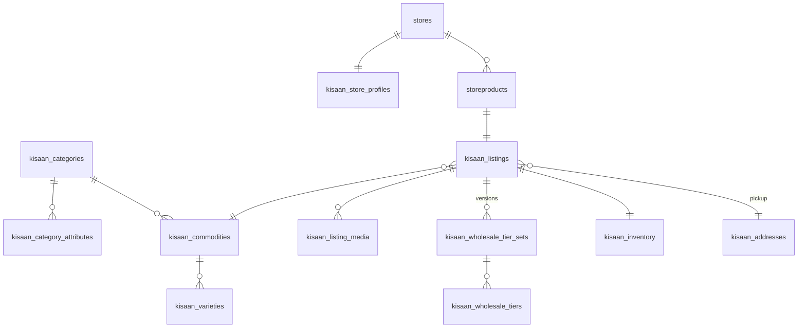

---

## 6. Enquiries, requirements, offers & negotiation

### 6.1 Enquiries & buyer requirements

#### `enquiries` — REUSED (opsapi core) + `kisaan_enquiry_threads` — EXTENDED (KIS-ENQ-001, KIS-ENQ-004)
opsapi `enquiries` is used for the generic contact form. Listing conversations need two-party threads, so they use **opsapi chat** (`chat_channels` of type direct/business; REUSED, `ecommerce_chat` preset) with a Kisaan mapping row:

`kisaan_enquiry_threads(id, uuid, namespace_id, listing_id FK, buyer_user_id, seller_user_id, chat_channel_uuid TEXT /* opsapi chat_channels.uuid */, status CHECK IN ('open','closed','blocked'), last_message_at, created_at, UNIQUE(listing_id, buyer_user_id))`.

Phone numbers are never exchanged in-thread by default (KIS-PROF-004). Messages are scanned for phone/UPI patterns, which are masked and flagged (anti-disintermediation and fraud).

#### `kisaan_buyer_requirements` — NEW (KIS-ENQ-002, KIS-ENQ-006, RFQ / "Smart Bulk Purchase Request")
| Field | Type | Null | Notes |
|---|---|---|---|
| id, uuid, namespace_id | | | |
| buyer_user_id | INTEGER | N | FK users (the leader when `owner_type = 'group'`) |
| owner_type | TEXT | N | v0.2, DEFAULT 'buyer', CHECK IN ('buyer','group'). `group` = requirement-bound buying group (MVP, D-133) |
| buying_group_id | BIGINT | Y | FK; required when `owner_type = 'group'` (KIS-GROUP-003) |
| category_id, commodity_id, variety_id | BIGINT | N/N/Y | |
| qty_kg | NUMERIC(14,3) | N | CHECK (> 0) |
| qty_tolerance_pct | NUMERIC(5,2) | N | DEFAULT 0 |
| quality_specs | JSONB | N | Attribute constraints, e.g. `{"moisture_pct":{"max":12}}` |
| delivery_address_id | BIGINT | Y | FK kisaan_addresses |
| delivery_district_code | TEXT | N | |
| needed_by | DATE | N | |
| target_price_per_kg | NUMERIC(14,4) | Y | Optional, hidden from sellers if `show_target_price = false` |
| show_target_price | BOOLEAN | N | DEFAULT false |
| visibility | TEXT | N | CHECK IN ('public_districts','invited_only'). Buyer identity hidden until a quotation is accepted (KIS-ENQ-006) |
| target_district_codes | TEXT[] | N | |
| status | TEXT | N | CHECK IN ('draft','open','partially_fulfilled','fulfilled','closed','expired','cancelled') — `partially_fulfilled` v0.2 |
| expires_at | TIMESTAMPTZ | N | |
| created_via | TEXT | N | form/chat/voice/whatsapp |
| quotations_count | INTEGER | N | DEFAULT 0 |
| timestamps, deleted_at | | | |

Indexes: `(namespace_id, status, commodity_id)`, GIN(`target_district_codes`).
Open-RFQ limits (D-135): 3 open for a normal buyer, 20 for a verified bulk buyer (app check).

#### `kisaan_buyer_preferred_sellers` — NEW (v0.2; KIS-BULK, prompt §3.3 "preferred sellers")
`id, uuid, namespace_id, buyer_user_id FK users, store_id FK stores, commodity_id BIGINT NULL, note TEXT NULL /* private to buyer */, created_at, UNIQUE(namespace_id, buyer_user_id, store_id, commodity_id)`. Private to the buyer; sellers never see who prefers them (only aggregate counts in analytics). Used by `matching.find_matches` as a ranking boost. Replaces `kisaan_bulk_buyer_profiles.preferred_store_ids` (kept as a read-only mirror for v0.1 compatibility).

### 6.2 Negotiations & offers (KIS-OFR-001…015)

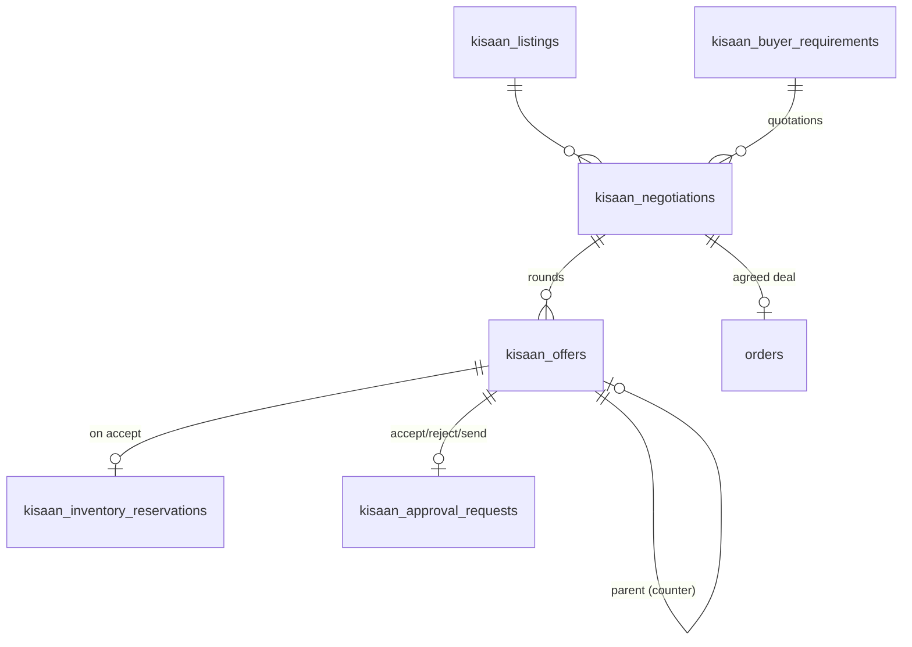

#### `kisaan_negotiations` — NEW (Negotiations)
One thread per (listing, buyer) or (requirement, seller).

| Field | Type | Null | Notes |
|---|---|---|---|
| id, uuid, namespace_id | | | |
| context_type | TEXT | N | CHECK IN ('listing_offer','rfq_quotation','group_offer') — `group_offer` (v0.2): seller ↔ group leader thread for a buying group |
| buying_group_id | BIGINT | Y | FK kisaan_buying_groups; required when `context_type = 'group_offer'` |
| listing_id | BIGINT | Y | FK |
| requirement_id | BIGINT | Y | FK kisaan_buyer_requirements |
| buyer_user_id | INTEGER | N | |
| seller_user_id | INTEGER | N | |
| store_id | INTEGER | N | FK stores |
| status | TEXT | N | CHECK IN ('open','agreed','rejected','withdrawn','expired','superseded') |
| rounds | SMALLINT | N | DEFAULT 0, CHECK (rounds <= 10) (KIS-OFR-011) |
| current_offer_id | BIGINT | Y | FK kisaan_offers (DEFERRABLE) |
| agreed_offer_id | BIGINT | Y | FK |
| order_id | INTEGER | Y | FK orders(id) |
| expires_at | TIMESTAMPTZ | N | |
| version | INTEGER | N | 0 |
| timestamps | | | |

Constraints: `CHECK ((context_type='listing_offer' AND listing_id IS NOT NULL) OR (context_type='rfq_quotation' AND requirement_id IS NOT NULL) OR (context_type='group_offer' AND buying_group_id IS NOT NULL))`; for `group_offer`, `buyer_user_id` = the group leader (who may negotiate but cannot commit members); partial UNIQUE `(listing_id, buyer_user_id) WHERE status = 'open'` (KIS-OFR-006: one open offer per buyer per listing).

#### `kisaan_offers` — NEW (Offers + CounterOffers)
| Field | Type | Null | Notes |
|---|---|---|---|
| id, uuid, namespace_id | | | |
| negotiation_id | BIGINT | N | FK |
| round_no | SMALLINT | N | 1..10, UNIQUE(negotiation_id, round_no) |
| kind | TEXT | N | CHECK IN ('offer','quotation','counter') |
| offer_kind | TEXT | N | v0.2, DEFAULT 'custom_price', CHECK IN ('listing_terms','custom_price'): `listing_terms` = seller offers its published tiers/group discount unchanged (engine prices it); `custom_price` = negotiated price replacing stages 1–3 and 5 (D-103) |
| parent_offer_id | BIGINT | Y | FK self (counter → previous) |
| from_party | TEXT | N | CHECK IN ('buyer','seller') |
| from_user_id | INTEGER | N | |
| qty_kg | NUMERIC(14,3) | N | CHECK (> 0) |
| price_per_kg | NUMERIC(14,4) | N | CHECK (> 0) |
| price_per_display_unit | NUMERIC(14,2) | N | |
| display_unit | TEXT | N | |
| delivery_terms | TEXT | N | CHECK IN ('buyer_pickup','seller_delivery','seller_delivery_fee','platform_logistics') — `platform_logistics` P2 (D-106) |
| delivery_fee_inr | NUMERIC(14,2) | Y | v0.2: required when `delivery_terms = 'seller_delivery_fee'` |
| delivery_address_id | BIGINT | Y | |
| delivery_by | DATE | Y | |
| payment_terms | TEXT | N | DEFAULT 'prepaid_escrow_pa'. MVP only PA prepaid (KIS-PAY-001); 'credit' Future |
| quality_terms | JSONB | Y | |
| message | TEXT | Y | |
| valid_until | TIMESTAMPTZ | N | |
| status | TEXT | N | CHECK IN ('pending','countered','accepted','rejected','withdrawn','expired','superseded','auto_rejected') — `auto_rejected` is used only from P2 (D-06) |
| drafted_by_ai | BOOLEAN | N | DEFAULT false (KIS-OFR-014) |
| send_approval_id | BIGINT | Y | FK kisaan_approval_requests: an AI-drafted offer/counter is sent only after approval |
| decision_approval_id | BIGINT | Y | FK kisaan_approval_requests: accept/reject (KIS-OFR-012) |
| decided_at | TIMESTAMPTZ | Y | |
| reject_reason | TEXT | Y | |
| net_realisation_estimate | NUMERIC(14,2) | Y | Seller net after commission & logistics (KIS-OFR-003) |
| group_min_total_qty_kg | NUMERIC(14,3) | Y | v0.2, `group_offer` only: offer valid only if the group's committed total reaches this at lock. Alias in WHOLESALE_AND_GROUP_BUYING: `min_total_qty_kg` |
| max_total_qty_kg | NUMERIC(14,3) | Y | v0.2, `group_offer`: seller's cap on the group total (stock reserved at lock ≤ this) |
| group_min_paid_qty_kg | NUMERIC(14,3) | Y | v0.2, `group_offer`: paid-quantity floor after the payment window; below it the group enters `repricing` (R5). Defaults to `group_min_total_qty_kg` |
| includes_group_discount | BOOLEAN | N | DEFAULT false. Informational: `price_per_kg` already contains the seller's group discount. A negotiated price **replaces** stages 1–3 and 5 (D-103) |
| coupon_allowed | BOOLEAN | N | DEFAULT false. Mirrors coupon `allow_on_negotiated`; if false, no coupon on the resulting order |
| created_at/updated_at | | | |

Indexes: `(namespace_id, negotiation_id, round_no)`, `(status, valid_until) WHERE status = 'pending'` (expiry job).
Trigger: once status ∈ (accepted, rejected, withdrawn, expired), the row is immutable.

---

## 7. Orders, pricing, payments, invoices, coupons, commission

### 7.1 Orders

#### `orders` / `orderitems` / `order_status_history` — REUSED (opsapi ecommerce)
Kisaan creates orders through its own checkout service (it does not call opsapi `/checkout`). It writes opsapi `orders` (order_number, `store_id`, status, financial_status, fulfillment_status, subtotal, tax, shipping, `discount_amount`, total, `currency='INR'`, addresses) and `orderitems` (`product_id` → storeproducts, qty, price). That way opsapi seller/buyer order lists, status history and `order.*` plugin events keep working.

- **Quantity mapping:** `orderitems.quantity` is an integer in opsapi `[UNVERIFIED type]`. Kisaan writes the quantity in **display units rounded** for opsapi display only. The authoritative kg quantity is in `kisaan_order_item_pricing.qty_kg`.
- **Status mapping:** opsapi `orders.status` gets a mapped coarse status. The fine-grained KISAAN state is `kisaan_order_details.kisaan_status`.

| kisaan_status | opsapi `orders.status` / `financial_status` / `fulfillment_status` `[UNVERIFIED value sets]` |
|---|---|
| pending_payment | pending / pending / unfulfilled |
| confirmed | confirmed / paid / unfulfilled |
| ready_for_pickup | processing / paid / unfulfilled |
| in_transit | shipped / paid / partial |
| delivered | delivered / paid / fulfilled |
| completed | completed / paid / fulfilled |
| cancelled | cancelled / (refunded / voided) / unfulfilled |
| disputed | on_hold / paid / fulfilled |
| payment_received_stock_unavailable | cancelled / refunded |

Risk: writing core tables from a plugin is outside the SDK compatibility contract. Mitigation: all writes go through one adapter module (`projects/kisaan/lib/opsapi_orders.lua`) with contract tests run against each candidate opsapi tag ([OPSAPI_INTEGRATION](OPSAPI_INTEGRATION.md) §Upgrade).

#### `kisaan_order_details` — EXTENDED (`orders`) (KIS-ORD-001…008)
| Field | Type | Null | Notes |
|---|---|---|---|
| id, uuid, namespace_id | | | |
| order_id | INTEGER | N | FK orders(id), UNIQUE |
| order_number | TEXT | N | Mirrors opsapi, e.g. KSN-2026-000123 |
| source_type | TEXT | N | CHECK IN ('buy_now','offer','rfq_quotation','group_allocation') (KIS-ORD-001) |
| negotiation_id | BIGINT | Y | FK |
| group_order_id | BIGINT | Y | FK |
| group_allocation_id | BIGINT | Y | FK |
| parent_group_order_id | BIGINT | Y | v0.2: FK kisaan_group_orders for child orders created per paid allocation (D-137: created directly in `confirmed`) |
| buyer_user_id | INTEGER | N | |
| seller_user_id | INTEGER | N | |
| store_id | INTEGER | N | |
| kisaan_status | TEXT | N | CHECK IN ('pending_payment','confirmed','ready_for_pickup','in_transit','delivered','completed','cancelled','disputed','payment_received_stock_unavailable') |
| delivery_mode | TEXT | N | CHECK IN ('buyer_pickup','seller_delivery','seller_delivery_fee','platform_logistics') — `platform_logistics` P2 (D-106) |
| store_policy_version | INTEGER | N | v0.2 snapshot of `kisaan_store_profiles.policies_version` at order time |
| pickup_address | BIGINT | N | |
| delivery_address_id | BIGINT | Y | |
| price_quote_id | BIGINT | N | FK kisaan_price_quotes (immutable snapshot, KIS-ORD-003) |
| goods_total | NUMERIC(14,2) | N | After discounts |
| delivery_fee | NUMERIC(14,2) | N | DEFAULT 0 |
| delivery_fee_waived | NUMERIC(14,2) | N | DEFAULT 0 (membership, platform-funded) |
| platform_fee_buyer | NUMERIC(14,2) | N | DEFAULT 0 |
| commission_seller | NUMERIC(14,2) | N | |
| tax_total | NUMERIC(14,2) | N | DEFAULT 0 `[TAX REVIEW]` |
| tcs_amount | NUMERIC(14,2) | N | DEFAULT 0 (KIS-INVC-006) |
| levies_buyer | NUMERIC(14,2) | N | DEFAULT 0. Σ kisaan_order_levies.amount WHERE payer = 'buyer' |
| grand_total | NUMERIC(14,2) | N | CHECK (grand_total >= 0) |
| payment_due_at | TIMESTAMPTZ | Y | KIS-ORD-004 |
| acceptance_window_ends_at | TIMESTAMPTZ | Y | KIS-ORD-006 |
| delivered_qty_kg | NUMERIC(14,3) | Y | KIS-ORD-007 weighbridge reconciliation |
| weight_variance_pct | NUMERIC(6,3) | Y | |
| cancelled_by | TEXT | Y | buyer/seller/system/admin |
| cancel_reason | TEXT | Y | |
| confirm_approval_id | BIGINT | Y | APR for order confirm/cancel |
| membership_id | BIGINT | Y | Benefit applied |
| coupon_redemption_id | BIGINT | Y | |
| timestamps | | | |

Constraint: `CHECK (grand_total = goods_total + delivery_fee - delivery_fee_waived + platform_fee_buyer + tax_total + levies_buyer)`. Commission is seller-side and not in the buyer total.
Indexes: `(namespace_id, buyer_user_id, kisaan_status)`, `(namespace_id, seller_user_id, kisaan_status)`, `(kisaan_status, payment_due_at)`, `(kisaan_status, acceptance_window_ends_at)`.

#### `kisaan_order_status_events` — NEW (fine-grained timeline; mirrored to opsapi `order_status_history`)
`id, namespace_id, order_id, from_status, to_status, actor_type, actor_user_id, approval_request_id, note, created_at`. Append-only.

#### `kisaan_order_item_pricing` — EXTENDED (`orderitems`)
| Field | Type | Notes |
|---|---|---|
| id, namespace_id, orderitem_id FK orderitems(id) UNIQUE, listing_id | | |
| qty_kg | NUMERIC(14,3) | Authoritative |
| list_price_per_kg | NUMERIC(14,4) | Snapshot |
| wholesale_rule | JSONB | `{"type":"tier","tier_no":2,"discount_type":"percentage","value":5}` or whole-lot |
| negotiated_price_per_kg | NUMERIC(14,4) NULL | |
| unit_price_before_coupon_per_kg | NUMERIC(14,4) | |
| coupon_discount | NUMERIC(14,2) | |
| member_discount | NUMERIC(14,2) | |
| line_total | NUMERIC(14,2) | |
| hsn_code | TEXT | |
| gst_rate_pct | NUMERIC(5,2) | `[TAX REVIEW]` |
| inventory_reservation_id | BIGINT | FK |

#### `kisaan_order_levies` — NEW (mandi/market fee & other statutory levies; KIS-CMP-046, `[DECISION D-80]`)
| Field | Type | Null | Notes |
|---|---|---|---|
| id | BIGSERIAL | N | PK |
| uuid | UUID | N | |
| namespace_id | INTEGER | N | |
| order_id | INTEGER | N | FK orders(id) |
| levy_type | TEXT | N | CHECK IN ('market_fee','rural_dev_fee','other') |
| levy_label | TEXT | Y | Required when levy_type = 'other' |
| rate_pct | NUMERIC(6,3) | N | CHECK (rate_pct >= 0) |
| base_amount | NUMERIC(14,2) | N | Usually goods_total |
| amount | NUMERIC(14,2) | N | CHECK (amount >= 0); = round(base_amount × rate_pct / 100, 2) |
| payer | TEXT | N | CHECK IN ('buyer','seller','platform') |
| jurisdiction | TEXT | N | State code, e.g. 'PB' |
| rule_id | BIGINT | Y | FK kisaan_category_state_rules (source template) |
| collected_by | TEXT | N | e.g. 'platform_on_behalf', 'licensed_buyer_direct', 'not_collected' `[LEGAL REVIEW]` |
| remittance_ref | TEXT | Y | Challan / receipt reference once remitted to the market committee |
| remitted_at | TIMESTAMPTZ | Y | |
| created_at | TIMESTAMPTZ | N | |

Append-only after order confirmation (corrections via a new row with negative amount). Buyer-payable levies are included in `kisaan_order_details.grand_total` through a `levies_buyer` amount (below) and in the price-quote breakdown.

### 7.2 Price quotes (KIS-PRC-001…007)

#### `kisaan_price_quotes` — NEW
The output of the pricing engine, stored so checkout, payment re-validation and order snapshots use identical numbers.

| Field | Type | Null | Notes |
|---|---|---|---|
| id, uuid, namespace_id | | | |
| buyer_user_id | INTEGER | N | |
| context | TEXT | N | CHECK IN ('preview','checkout','offer_accept','group_join','group_lock') — v0.2 contexts per [PRICING_ENGINE](PRICING_ENGINE.md) §13.1 (v0.1 `product_page`/`cart` → `preview`; `group_close` → `group_lock`) |
| status | TEXT | N | v0.2, DEFAULT 'issued', CHECK IN ('issued','consumed','expired','superseded','invalidated') (PRICING_ENGINE §13.2). Coupon-slot and waiver reservations are released in the same transaction on expired/superseded/invalidated |
| listing_id | BIGINT | N | |
| qty_kg | NUMERIC(14,3) | N | |
| negotiation_id | BIGINT | Y | |
| coupon_code | TEXT | Y | |
| membership_id | BIGINT | Y | |
| breakdown | JSONB | N | Full PRC breakdown (see API example §3.15) incl. funding attribution (KIS-PRC-005) |
| goods_total | NUMERIC(14,2) | N | |
| delivery_fee | NUMERIC(14,2) | N | |
| grand_total | NUMERIC(14,2) | N | |
| buying_group_id | BIGINT | Y | v0.2: for `group_join` / `group_lock` |
| group_quote_id | BIGINT | Y | v0.2: member-line quotes point to the group-level `group_lock` quote |
| inputs | JSONB | N | v0.2: full normalised engine inputs (listing version, tier set id, membership snapshot, coupon, delivery) for replay (KIS-PRC-019) |
| rule_versions | JSONB | N | v0.2: `{engine, tax_table, benefits, commission_rule, tier_set}` |
| breakdown_hash | CHAR(64) | N | Bound into payment and approval (KIS-APR-004); a replay must reproduce it |
| valid_until | TIMESTAMPTZ | N | Per context: preview/checkout 15 min (KIS-PRC-006); offer_accept = offer payment deadline; group_join = until lock; group_lock = member payment window |
| consumed_by_order_id | INTEGER | Y | |
| created_at | TIMESTAMPTZ | N | |

### 7.3 Payments, refunds, settlements, ledger (KIS-PAY-001…010)

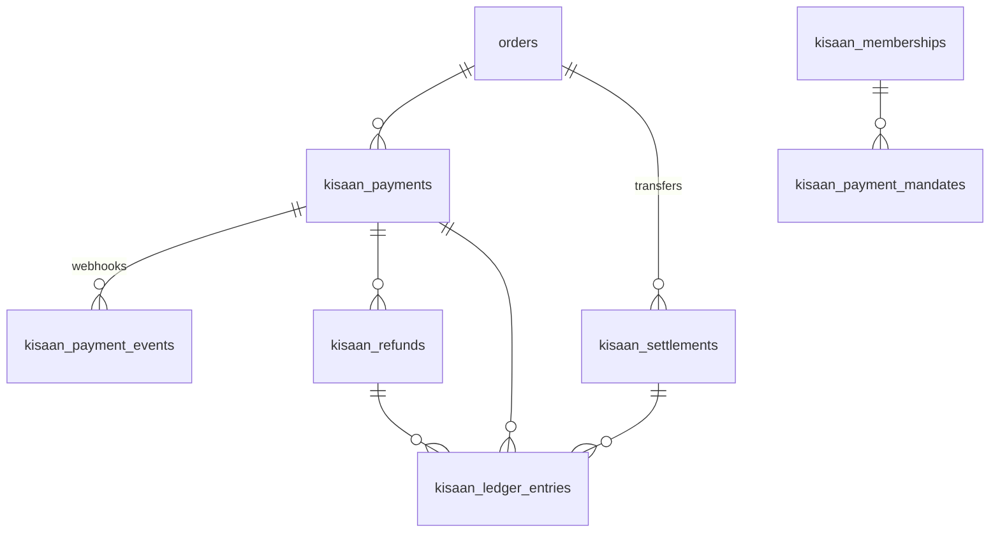

#### `kisaan_payments` — NEW
| Field | Type | Null | Notes |
|---|---|---|---|
| id, uuid, namespace_id | | | |
| purpose | TEXT | N | CHECK IN ('order','group_allocation','membership','membership_renewal','transport') |
| order_id | INTEGER | Y | FK orders |
| group_allocation_id | BIGINT | Y | |
| membership_id | BIGINT | Y | |
| payer_user_id | INTEGER | N | |
| amount | NUMERIC(14,2) | N | CHECK (> 0) |
| currency | CHAR(3) | N | 'INR' |
| provider | TEXT | N | CHECK IN ('razorpay','cashfree') `[DECISION D-09]` |
| provider_order_id | TEXT | N | UNIQUE(provider, provider_order_id) |
| provider_payment_id | TEXT | Y | UNIQUE(provider, provider_payment_id) |
| method | TEXT | Y | upi / card / netbanking / upi_autopay / emandate / bank_transfer |
| status | TEXT | N | CHECK IN ('created','authorized','captured','failed','refunded','partially_refunded','cancelled') |
| failure_code, failure_reason | TEXT | Y | |
| idempotency_key | TEXT | N | UNIQUE(namespace_id, idempotency_key) (KIS-PAY-005) |
| price_quote_hash | CHAR(64) | Y | Must equal the order's quote hash |
| captured_at | TIMESTAMPTZ | Y | |
| verified_via | TEXT | Y | 'webhook_signature' + 'server_fetch' (KIS-PAY-004) |
| timestamps | | | |

#### `kisaan_payment_events` — NEW (append-only webhook inbox)
`id, namespace_id, provider, event_id TEXT, event_type TEXT, payload JSONB (PII-minimised), signature_valid BOOLEAN, received_at, processed_at, processing_error TEXT, payment_id FK NULL, UNIQUE(provider, event_id)`. The UNIQUE constraint gives webhook de-duplication (KIS-PAY-005).

#### `kisaan_refunds` — NEW (KIS-PAY-007)
`id, uuid, namespace_id, payment_id FK, order_id, amount NUMERIC(14,2) CHECK (>0), reason CHECK IN ('order_cancelled','dispute','weight_reconciliation','stock_unavailable','membership_cancellation','group_not_formed','admin'), dispute_id FK NULL, provider_refund_id UNIQUE NULL, status CHECK IN ('requested','processing','processed','failed'), requested_by, approval_request_id NULL, finance_approved_by NULL, timestamps`. Constraint (app plus a trigger): Σ refunds ≤ captured amount.

#### `kisaan_settlements` — NEW (KIS-PAY-002, KIS-PAY-003, KIS-LOG-008)
Transfers from the PA to linked accounts (seller, transporter), held until release.

| Field | Type | Notes |
|---|---|---|
| id, uuid, namespace_id | | |
| order_id | INTEGER | |
| shipment_id | BIGINT NULL | Transporter transfers |
| beneficiary_type | TEXT | CHECK IN ('seller','transporter') |
| beneficiary_user_id | INTEGER | |
| payout_account_id | BIGINT | FK kisaan_payout_accounts |
| gross_amount | NUMERIC(14,2) | |
| commission_amount | NUMERIC(14,2) | |
| tcs_withheld | NUMERIC(14,2) | `[TAX REVIEW]` |
| tds_withheld | NUMERIC(14,2) | `[TAX REVIEW]` (s.194-O applicability) |
| net_amount | NUMERIC(14,2) | CHECK (net_amount = gross_amount - commission_amount - tcs_withheld - tds_withheld) |
| provider_transfer_id | TEXT UNIQUE NULL | |
| status | TEXT | CHECK IN ('pending_hold','on_hold','released','settled','reversed','frozen_dispute') (KIS-DSP-003) |
| hold_until | TIMESTAMPTZ | Acceptance window end |
| released_at, settled_at | TIMESTAMPTZ | |
| release_approval_by | INTEGER NULL | Manual release needs dual approval (KIS-ADM-004) |

#### `kisaan_ledger_entries` — NEW (append-only, double-entry, KIS-PAY-008 reconciliation)
| Field | Type | Notes |
|---|---|---|
| id BIGSERIAL, namespace_id | | |
| journal_id | UUID | Groups the balanced entries of one business event |
| account | TEXT | e.g. 'buyer_payments_pa', 'seller_payable', 'transporter_payable', 'platform_commission_revenue', 'membership_revenue', 'delivery_subsidy_expense', 'refunds', 'tcs_payable', 'pa_fees_expense' |
| direction | CHAR(1) | CHECK IN ('D','C') |
| amount | NUMERIC(14,2) | CHECK (> 0) |
| order_id, payment_id, refund_id, settlement_id, membership_id | NULL FKs | |
| event | TEXT | 'payment_captured','commission_accrued','settlement_released','refund_processed','membership_fee','delivery_waiver' |
| created_at | TIMESTAMPTZ | |

Deferred constraint trigger: Σ D = Σ C per `journal_id`. The platform never holds funds: these are **book entries mirroring PA movements**, not a wallet ([PAYMENT_AND_BUSINESS_MODEL](PAYMENT_AND_BUSINESS_MODEL.md)).

#### `kisaan_reconciliation_runs` / `kisaan_reconciliation_items` — NEW
`runs(id, namespace_id, provider, report_date DATE, status, totals JSONB, started_at, finished_at)`; `items(id, run_id, provider_ref, kisaan_ref, mismatch_type CHECK IN ('missing_internal','missing_provider','amount_mismatch','status_mismatch'), amount_provider, amount_internal, resolved_by, resolved_at, note)`.

#### `kisaan_payment_mandates` — NEW (KIS-PAY-010, KIS-MEMBER-007 recurring)
`id, uuid, namespace_id, user_id, membership_id, provider, provider_mandate_id UNIQUE, method CHECK IN ('upi_autopay','card_emandate','nach'), max_amount NUMERIC(14,2), frequency CHECK IN ('monthly','yearly'), status CHECK IN ('pending','active','paused','revoked','expired','failed'), next_debit_at, last_pre_debit_notice_at /* RBI pre-debit notification */, timestamps`.

### 7.4 Invoices (KIS-INVC-001…006)

#### `kisaan_invoices` — NEW
| Field | Type | Notes |
|---|---|---|
| id, uuid, namespace_id | | |
| invoice_type | TEXT | CHECK IN ('tax_invoice','bill_of_supply','commission_invoice','membership_invoice','delivery_invoice','receipt','credit_note') `[TAX REVIEW]` |
| issuer_type | TEXT | CHECK IN ('seller','platform','transporter') |
| issuer_user_id | INTEGER NULL | Seller/transporter issuer; NULL = platform |
| issuer_gstin | TEXT NULL | |
| recipient_user_id | INTEGER | |
| recipient_gstin | TEXT NULL | |
| order_id / membership_id / payment_id | NULL FKs | |
| sequence_id | BIGINT | FK kisaan_invoice_sequences |
| invoice_number | TEXT | UNIQUE(namespace_id, issuer_type, issuer_user_id, invoice_number) |
| financial_year | TEXT | '2026-27' |
| issue_date | DATE | |
| place_of_supply_state | TEXT | |
| taxable_value, cgst, sgst, igst, cess, tcs, total | NUMERIC(14,2) | |
| irn | TEXT NULL | e-invoice (P2, KIS-INVC-005) |
| eway_bill_no | TEXT NULL | P2 |
| pdf_object_key | TEXT | Private bucket, signed URL access |
| status | TEXT | CHECK IN ('issued','cancelled') |
| original_invoice_id | BIGINT NULL | For credit notes |
| created_at | | Append-only after issue (cancellation via credit note) |

#### `kisaan_invoice_lines` — NEW
`id, invoice_id FK, line_no, description, hsn_sac, qty, unit, rate, taxable_value, gst_rate_pct, cgst, sgst, igst, total`.

#### `kisaan_hsn_codes` — NEW (HSN/SAC master for GST invoices, KIS-INVC-001)
| Field | Type | Null | Default | Notes |
|---|---|---|---|---|
| id | BIGSERIAL | N | | PK |
| code | TEXT | N | | HSN (goods) or SAC (services); UNIQUE(code, effective_from) |
| code_type | TEXT | N | | CHECK IN ('hsn','sac') |
| description_i18n | JSONB | N | '{}' | pa/hi/en |
| gst_rate_pct | NUMERIC(5,2) | N | | e.g. 0.00 for loose unbranded cereals, 5.00 pre-packaged & labelled, 18.00 commission services `[TAX REVIEW]` |
| condition_note | TEXT | Y | | e.g. "pre-packaged and labelled" |
| effective_from | DATE | N | | |
| effective_to | DATE | Y | | NULL = current |
| created_at | TIMESTAMPTZ | N | now() | |

Indexes: UNIQUE(code, effective_from); btree(code) WHERE effective_to IS NULL. Referenced by `kisaan_categories.hsn_code`, `kisaan_invoice_lines.hsn_sac` (app-validated against the code valid on the invoice date). Seeded from the CA-approved rate list; changes are new rows, never updates.

#### `kisaan_invoice_sequences` — NEW (KIS-INVC-004: gap-free)
`id, namespace_id, issuer_type, issuer_user_id NULL, financial_year, prefix, next_number BIGINT, UNIQUE(namespace_id, issuer_type, issuer_user_id, financial_year)`. Allocation: `UPDATE … SET next_number = next_number + 1 … RETURNING next_number - 1` inside the invoice transaction (row lock ⇒ gap-free).

### 7.5 Seller coupons (2A.6 — KIS-COUPON-001…012)

#### `kisaan_coupons` — NEW
| Field | Type | Null | Notes |
|---|---|---|---|
| id, uuid, namespace_id | | | |
| store_id | INTEGER | N | FK stores. Owner = seller (KIS-COUPON-001) |
| created_by_user_id | INTEGER | N | |
| funded_by | TEXT | N | CHECK IN ('seller','platform'). 'platform' only for Future admin coupons (KIS-COUPON-012) |
| code | TEXT | N | CHECK `^[A-Z0-9]{4,20}$` (stored upper-case); UNIQUE(namespace_id, store_id, code) WHERE deleted_at IS NULL |
| title_i18n | JSONB | Y | |
| discount_type | TEXT | N | CHECK IN ('percentage','fixed') |
| discount_value | NUMERIC(14,2) | N | CHECK (> 0); percentage CHECK (<= 50) — hard cap, no admin override in MVP (D-40) |
| max_discount_amount | NUMERIC(14,2) | Y | Required when percentage (CHECK) |
| min_order_value | NUMERIC(14,2) | Y | |
| min_qty_kg | NUMERIC(14,3) | Y | |
| applies_to | TEXT | N | CHECK IN ('store','listings','categories') |
| starts_at | TIMESTAMPTZ | N | |
| ends_at | TIMESTAMPTZ | N | CHECK (ends_at > starts_at) |
| total_usage_limit | INTEGER | Y | CHECK (BETWEEN 1 AND 100000) |
| per_user_limit | INTEGER | N | DEFAULT 1, CHECK (BETWEEN 1 AND 100) |
| budget_limit | NUMERIC(14,2) | Y | v0.2: maximum **total discount** across all redemptions (seller promotion budget). Reached → status `exhausted` |
| discount_given_total | NUMERIC(14,2) | N | v0.2, DEFAULT 0: Σ redeemed discount − reversed; checked against `budget_limit` atomically with the counters |
| used_count | INTEGER | N | DEFAULT 0, CHECK (total_usage_limit IS NULL OR used_count <= total_usage_limit) |
| reserved_count | INTEGER | N | DEFAULT 0 (held at checkout, KIS-COUPON-005) |
| eligibility | TEXT | N | **Deprecated v0.2** (kept for migration only) — superseded by `eligible_segments` |
| eligible_segments | TEXT[] | N | DEFAULT '{ALL}'. v0.2 (D-105) CHECK subset of ('ALL','NEW_CUSTOMER','EXISTING_CUSTOMER','BULK_BUYERS','GROUP_ORDERS','MEMBERS'); `ALL` cannot be combined with others. Multiple values = buyer must match **any**. v0.1 values migrate: `FIRST_TIME_BUYER`/`new_customer`→`NEW_CUSTOMER`, `GROUP_LEADERS`/`group_buyer`→`GROUP_ORDERS`, `bulk_buyer`→`BULK_BUYERS`, `member`→`MEMBERS` |
| eligible_user_ids | INTEGER[] | Y | v0.2: specific eligible buyers (max 500, CHECK `cardinality <= 500`); only when `visibility = 'private'` |
| eligible_buyer_types | TEXT[] | Y | Optional further filter on `kisaan_buyer_profiles.buyer_type` |
| group_eligible | BOOLEAN | N | DEFAULT false. Only these coupons may be applied to a group order, once, by the leader at group lock (D-103) |
| count_per_member | BOOLEAN | N | DEFAULT false. v0.2 (D-105, COUPON_AND_MEMBERSHIP): false = a group coupon counts as **one** redemption against `total_usage_limit` and the leader's `per_user_limit`; true = it also consumes each paying member's `per_user_limit` (enforced at confirm-and-pay) |
| valid_days_of_week | SMALLINT[] | Y | v0.2: ISO days 1–7 (Mon=1); NULL = every day |
| valid_hours | JSONB | Y | Optional single IST window per day (MVP), e.g. `{"from":"06:00","to":"11:00"}`; evaluated at quote time. Outside it → `422 COUPON_NOT_APPLICABLE` with code `COUPON_OUTSIDE_HOURS` |
| admin_disabled | BOOLEAN | N | DEFAULT false. Platform emergency kill (KIS-COUPON-010); seller cannot clear it. Generated-equivalent: `admin_disabled_at IS NOT NULL` |
| admin_disabled_reason, admin_disabled_by, admin_disabled_at | TEXT, INTEGER, TIMESTAMPTZ | Y | Audit of the admin action |
| created_via | TEXT | N | v0.2, DEFAULT 'ui', CHECK IN ('ui','ai','whatsapp'); AI drafts also set `publish_approval_id` |
| allow_on_negotiated | BOOLEAN | N | DEFAULT false (KIS-COUPON-011, KIS-PRC-004) |
| visibility | TEXT | N | CHECK IN ('public','private') (KIS-COUPON-007) |
| status | TEXT | N | CHECK IN ('draft','scheduled','active','paused','expired','exhausted','disabled','archived') — `draft` = AI- or UI-prepared, not yet confirmed by the seller; `scheduled` = confirmed, `starts_at` in the future; `disabled` = admin emergency disable (mirrors `admin_disabled`); `archived` = seller-hidden, history kept (COUPON_AND_MEMBERSHIP §2.3) |
| publish_approval_id | BIGINT | Y | FK kisaan_approval_requests when published via KISAAN AI |
| version | INTEGER | N | 0 |
| timestamps, deleted_at | | | |

A coupon is redeemable only if `status = 'active' AND NOT admin_disabled AND now() BETWEEN starts_at AND ends_at`, `valid_days_of_week`/`valid_hours` (if any) match, and `budget_limit` is not reached. Platform caps: ≤ 20 active+scheduled coupons per store; `ends_at ≤ starts_at + 365 days`.

Indexes: `(namespace_id, store_id, status)`, `(namespace_id, upper(code))`.

#### `kisaan_coupon_products` — NEW
`coupon_id FK, listing_id NULL FK, category_id NULL FK, CHECK (num_nonnulls(listing_id, category_id) = 1)`.

#### `kisaan_coupon_redemptions` — NEW
| Field | Type | Notes |
|---|---|---|
| id, uuid, namespace_id, coupon_id FK | | |
| buyer_user_id | INTEGER | |
| buyer_identity_key | CHAR(64) | HMAC(verified phone + PAN/GSTIN) for per-user limits across accounts (KIS-COUPON-008) |
| price_quote_id | BIGINT | |
| order_id | INTEGER NULL | |
| group_order_id | BIGINT NULL | v0.2: set for a group redemption (one per group order; `buyer_user_id` = leader). Counts as **one** redemption against the coupon's total limit and the leader's per-user limit, not against each member's per-user limit (unless the coupon says otherwise). Allocated pro-rata by member goods value with paise rounding by largest remainder into `kisaan_group_order_allocations.coupon_discount_share`. A fixed-amount group coupon is **not** redistributed when a member lapses; it is re-allocated only at a re-offer re-lock (R5) |
| eligible_goods_value | NUMERIC(14,2) | Goods value the coupon applied to (after stages 2–5) |
| discount_amount | NUMERIC(14,2) | CHECK (discount_amount > 0 AND discount_amount <= 0.5 * eligible_goods_value): seller coupon discount capped at 50% of goods value (D-40), whatever the coupon type |
| reversed_amount | NUMERIC(14,2) | DEFAULT 0. Pro-rated on partial refund (D-105) |
| status | TEXT | CHECK IN ('reserved','redeemed','released','reversed','partially_reversed'). Full cancel before dispatch → `released` and usage restored; partial refund → `partially_reversed`, usage **not** restored (D-105) |
| expires_at | TIMESTAMPTZ | Reservation TTL = quote validity |
| created_at, redeemed_at | | |

Atomic limit enforcement (KIS-COUPON-005):
```sql
UPDATE kisaan_coupons SET reserved_count = reserved_count + 1
 WHERE id = :id AND status = 'active' AND now() BETWEEN starts_at AND ends_at
   AND (total_usage_limit IS NULL OR used_count + reserved_count < total_usage_limit)
RETURNING id;
-- plus: SELECT count(*) FROM kisaan_coupon_redemptions WHERE coupon_id=:id AND buyer_identity_key=:k AND status IN ('reserved','redeemed') < per_user_limit (same txn, after locking the coupon row)
```
Self-redemption block: `buyer_user_id <> store owner` (KIS-COUPON-008). Partial UNIQUE `(coupon_id, group_order_id) WHERE group_order_id IS NOT NULL AND status IN ('reserved','redeemed')`.

### 7.6 Commission & fees (KIS-ADM-006)

#### `kisaan_commission_rules` — NEW
`id, uuid, namespace_id, category_id NULL (NULL = default), payer CHECK IN ('seller','buyer'), rate_pct NUMERIC(5,2), min_amount NUMERIC(14,2), max_amount NUMERIC(14,2) NULL, applies_to CHECK IN ('order','transport','group_order'), effective_from TIMESTAMPTZ, effective_to NULL, created_by, created_at`. EXCLUDE constraint (btree_gist) prevents overlapping effective ranges per (category_id, payer, applies_to). Rates and payer are `[DECISION D-19]`; MVP default row: `payer = 'seller'`, `rate_pct = 1.50` (placeholder), deducted from the seller payout.

---

## 8. Logistics (KIS-LOG-001…009)

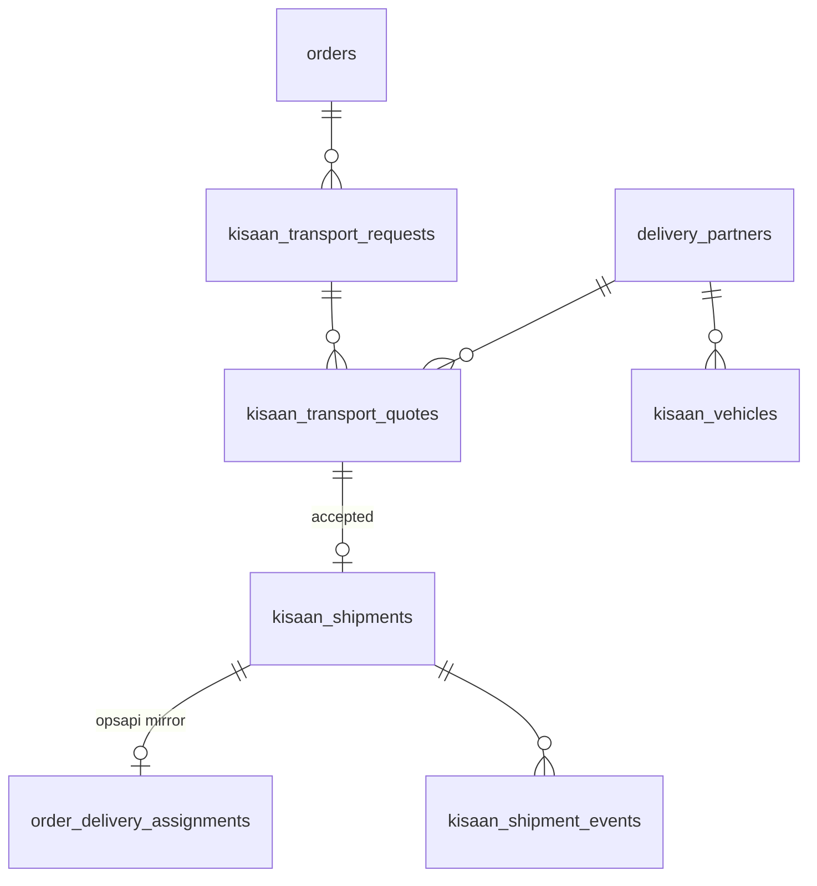

#### `delivery_requests`, `order_delivery_assignments` — REUSED (opsapi delivery)
On quote acceptance, Kisaan creates an opsapi `order_delivery_assignments` row (fees, pickup/delivery times, distance_km, tracking_number, proof_of_delivery) so the opsapi delivery-partner dashboard, earnings and history work for transporters. opsapi `delivery_requests` (single proposed fee per partner) is **not** used for competitive quoting; Kisaan quotes are richer (vehicle, ETA, validity).

#### `kisaan_vehicles` — NEW (KIS-LOG-007)
`id, uuid, namespace_id, delivery_partner_id FK delivery_partners, vehicle_type CHECK IN ('tempo','pickup','mini_truck','truck_10t','truck_16t','tractor_trolley','reefer'), capacity_kg NUMERIC(14,3), registration_no_enc 🔐, registration_last4, rc_verified_at, insurance_valid_until DATE, permit_valid_until DATE, is_active, timestamps, deleted_at`. Job: insurance expiry alerts at 30/7 days.

#### `kisaan_transport_requests` — NEW (KIS-LOG-002)
| Field | Type | Notes |
|---|---|---|
| id, uuid, namespace_id | | |
| order_id | INTEGER NULL | NULL allowed for group order (one request) |
| group_order_id | BIGINT NULL | |
| requested_by_user_id | INTEGER | Seller or buyer |
| pickup_address_id, drop_address_id | BIGINT | |
| pickup_district_code, drop_district_code | TEXT | |
| distance_km_est | NUMERIC(8,2) | Maps provider `[UNVERIFIED provider]` |
| weight_kg | NUMERIC(14,3) | |
| commodity_id | BIGINT | |
| vehicle_type_pref | TEXT NULL | |
| pickup_window_start, pickup_window_end | TIMESTAMPTZ | |
| priority | TEXT | CHECK IN ('standard','member_priority') (KIS-MEMBER-002) |
| status | TEXT | CHECK IN ('open','quoted','assigned','cancelled','expired') |
| quotes_deadline | TIMESTAMPTZ | |
| accepted_quote_id | BIGINT NULL | |
| timestamps | | |

#### `kisaan_transport_quotes` — NEW (KIS-LOG-003)
`id, uuid, namespace_id, transport_request_id FK, delivery_partner_id FK, vehicle_id FK, price NUMERIC(14,2) CHECK (>0), eta_pickup TIMESTAMPTZ, eta_delivery TIMESTAMPTZ, valid_until, notes, status CHECK IN ('submitted','withdrawn','accepted','rejected','expired'), accept_approval_id NULL, created_at, UNIQUE(transport_request_id, delivery_partner_id) WHERE status='submitted'`.

#### `kisaan_shipments` — EXTENDED (`order_delivery_assignments`) (KIS-LOG-004, KIS-LOG-005, KIS-ORD-007)
| Field | Type | Notes |
|---|---|---|
| id, uuid, namespace_id | | |
| delivery_assignment_id | INTEGER NULL | FK opsapi `order_delivery_assignments(id)` |
| order_id / group_order_id | NULL FKs | |
| transport_quote_id | BIGINT NULL | NULL for buyer pickup / seller delivery |
| mode | TEXT | CHECK IN ('buyer_pickup','seller_delivery','seller_delivery_fee','platform_logistics') — `platform_logistics` P2 (D-106) |
| delivery_partner_id, vehicle_id | NULL FKs | |
| status | TEXT | CHECK IN ('assigned','en_route_pickup','picked_up','in_transit','delivered','closed','failed','cancelled') |
| pickup_weight_kg | NUMERIC(14,3) NULL | Weighbridge |
| pickup_weighbridge_doc_id | BIGINT NULL | |
| pickup_photo_keys | TEXT[] | |
| delivered_weight_kg | NUMERIC(14,3) NULL | |
| delivery_photo_keys | TEXT[] | |
| delivery_otp_hash | CHAR(64) NULL | Buyer OTP for POD |
| delivered_at, closed_at | TIMESTAMPTZ | |
| freight_amount | NUMERIC(14,2) | |
| freight_waived_by_membership | NUMERIC(14,2) DEFAULT 0 | |
| live_location_consent | BOOLEAN DEFAULT false | P2 |
| timestamps | | |

#### `kisaan_shipment_events` — NEW (append-only)
`id, namespace_id, shipment_id, status, location GEOGRAPHY NULL 🔒, note, source CHECK IN ('app','voice','whatsapp','system','admin'), actor_user_id, created_at`.

---

## 9. Group buying (2A.2 — KIS-GROUP-001…026; owner doc [WHOLESALE_AND_GROUP_BUYING](WHOLESALE_AND_GROUP_BUYING.md))

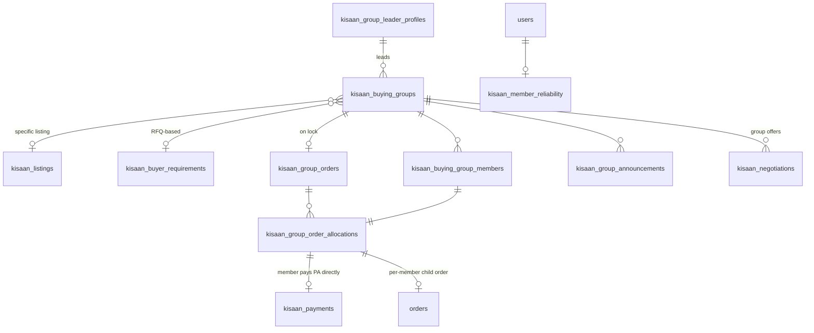

**MVP money model (decision 6):** each member pays the platform's PA **directly** for their own allocation. The leader **never** collects money. The leader-collects mode (KIS-GROUP-013) is Future, blocked on `[LEGAL REVIEW]`; the schema reserves `money_model` for it but the CHECK allows only `'member_direct'` in MVP.

#### `kisaan_buying_groups` — NEW
| Field | Type | Null | Notes |
|---|---|---|---|
| id, uuid, namespace_id | | | |
| leader_user_id | INTEGER | N | FK users; must have an active group_leader role (trigger) |
| title_i18n | JSONB | N | |
| slug | TEXT | N | Public URL (KIS-GROUP-004), UNIQUE(namespace_id, slug) |
| basis | TEXT | N | CHECK IN ('listing','rfq'). `rfq` = requirement-bound group (MVP, D-133) |
| listing_id | BIGINT | Y | |
| requirement_id | BIGINT | Y | |
| commodity_id | BIGINT | N | |
| area_name | TEXT | N | |
| area_district_code | TEXT | N | |
| area_centroid | GEOGRAPHY(Point,4326) | Y | |
| drop_point_address_id | BIGINT | N | Common delivery point (KIS-GROUP-010) |
| target_qty_kg | NUMERIC(14,3) | N | CHECK (> 0) |
| min_close_qty_kg | NUMERIC(14,3) | N | CHECK (<= target_qty_kg). Leader's minimum to lock (v0.1 `min_qty_to_proceed_kg`, renamed v0.2) |
| member_min_qty_kg | NUMERIC(14,3) | N | |
| member_max_qty_kg | NUMERIC(14,3) | Y | |
| committed_qty_kg | NUMERIC(14,3) | N | DEFAULT 0, CHECK (committed_qty_kg <= target_qty_kg * 1.2) `[DECISION D-61: overfill tolerance]` |
| member_count | INTEGER | N | DEFAULT 0 |
| projected_price_per_kg | NUMERIC(14,4) | Y | From PRC at target qty (KIS-WHL-008) |
| join_deadline | TIMESTAMPTZ | N | |
| locked_at | TIMESTAMPTZ | Y | v0.2 |
| payment_window_hours | SMALLINT | N | v0.2, DEFAULT 24, CHECK (BETWEEN 4 AND 48) (D-124; perishables 4) |
| payment_window_ends_at | TIMESTAMPTZ | Y | v0.2: `locked_at + payment_window_hours`. Replaces v0.1 `payment_deadline` (members no longer pay at join, D-72) |
| locked_quote_id | BIGINT | Y | v0.2: FK kisaan_price_quotes (context `group_lock`, group-level) |
| selected_offer_id | BIGINT | Y | v0.2: FK kisaan_offers — accepted group offer (`group_offer` negotiation), if the price basis is an offer |
| group_min_qty_kg | NUMERIC(14,3) | Y | v0.2: seller minimum (paid quantity) copied at lock from the tier set / listing / accepted offer (`group_min_paid_qty_kg`); paid total below it → `repricing` |
| honour_locked_price | BOOLEAN | Y | v0.2: seller's repricing decision `honour` sets true (locked price kept for the paid quantity) |
| repricing_decision | TEXT | Y | v0.2: CHECK IN ('honour','re_offer','decline'); NULL until decided. No decision within 6 h = `decline` (D-132) |
| repricing_deadline | TIMESTAMPTZ | Y | v0.2 |
| delivery_strategy | TEXT | N | v0.2, DEFAULT 'single_drop', CHECK IN ('single_drop','member_pickup_at_drop','door_delivery') — door delivery P2 |
| co_leader_user_id | INTEGER | Y | v0.2: optional co-leader (handover support); same privacy limits as the leader |
| coupon_id | BIGINT | Y | v0.2: the one group-eligible coupon chosen by the leader before lock (BR-GROUP-12) |
| verified_members_only | BOOLEAN | N | v0.2, DEFAULT false |
| suspended_at, suspended_reason | TIMESTAMPTZ, TEXT | Y | v0.2: admin suspension (overlay on any state; blocks joins, lock and payments) |
| money_model | TEXT | N | DEFAULT 'member_direct', CHECK IN ('member_direct') (MVP) |
| visibility | TEXT | N | CHECK IN ('public','unlisted') DEFAULT 'public' |
| status | TEXT | N | CHECK IN ('draft','forming','locked','repricing','confirmed','fulfilling','completed','cancelled','expired'). Canonical v0.2 flow (reconciliation R5): `forming` (published, accepting commitments; no payment) → `locked` (leader's ✋ lock; final price; member payment window open) → optional `repricing` (paid qty < `group_min_qty_kg`; seller decides honour / re-offer / decline) → `confirmed` (paid allocations become child orders) → `fulfilling` → `completed`. `cancelled` = leader/seller decline/admin; `expired` = join deadline passed without lock. `draft` = not yet published (not public). v0.1 `open`/`threshold_met` → `forming` ("target reached" is a derived flag); `ordered` → `confirmed`; `delivered` → `fulfilling`; `failed` → `cancelled` |
| target_reached | BOOLEAN | — | GENERATED (committed_qty_kg >= target_qty_kg) |
| close_outcome | TEXT | Y | 'proceed_full','proceed_paid_only','re_offered','cancelled_refund' (KIS-GROUP-008) |
| create_approval_id, lock_approval_id | BIGINT | Y | APR (`group.create`, `group.lock`) |
| version | INTEGER | N | 0 |
| timestamps, deleted_at | | | |

Constraints: `CHECK ((basis='listing' AND listing_id IS NOT NULL) OR (basis='rfq' AND requirement_id IS NOT NULL))`; `CHECK (status <> 'locked' OR payment_window_ends_at IS NOT NULL)`.
Indexes: `(namespace_id, status, commodity_id)`, GIST(`area_centroid`), `(join_deadline) WHERE status = 'forming'`, `(payment_window_ends_at) WHERE status = 'locked'`, `(repricing_deadline) WHERE status = 'repricing'`.

#### `kisaan_buying_group_members` — NEW
| Field | Type | Notes |
|---|---|---|
| id, uuid, namespace_id, group_id FK | | |
| member_user_id | INTEGER | UNIQUE(group_id, member_user_id) WHERE status <> 'released' |
| committed_qty_kg | NUMERIC(14,3) | CHECK (> 0) |
| status | TEXT | CHECK IN ('committed','payment_due','paid','released'). Canonical v0.2 (R5): `committed` at join (no payment, D-72) → `payment_due` at lock → `paid`; or `released` (lapsed at window end, withdrew before lock, or removed by the leader — see `release_reason`). Fulfilment, receipt, dispute and refund are tracked on `kisaan_group_order_allocations.status` |
| release_reason | TEXT | NULL; CHECK IN ('lapsed_unpaid','withdrew','removed_by_leader','group_cancelled','declined_reoffer') |
| removal_reason | TEXT | NULL; required when `release_reason = 'removed_by_leader'` (shown to the member, audit-logged) |
| confirmed_at | TIMESTAMPTZ | v0.2: member confirmed own line after lock (confirm-and-pay) |
| name_visible_to_leader | BOOLEAN | v0.2, DEFAULT true; false shows "Member 7" to the leader |
| commit_approval_id | BIGINT | APR (committing a quantity that leads to payment is commit-class) |
| payment_id | BIGINT NULL | FK kisaan_payments (paid directly to the PA after lock, KIS-GROUP-006) |
| display_name_public | TEXT | Masked, e.g. "Harpreet K." (privacy) |
| joined_at, left_at | TIMESTAMPTZ | |

Group totals are updated atomically: `UPDATE kisaan_buying_groups SET committed_qty_kg = committed_qty_kg + :q, member_count = member_count + 1 WHERE id = :g AND status = 'forming' AND suspended_at IS NULL AND now() < join_deadline AND committed_qty_kg + :q <= target_qty_kg * 1.2 RETURNING …`.

#### `kisaan_group_orders` — NEW
`id, uuid, namespace_id, group_id FK UNIQUE, seller_user_id, store_id, listing_id, negotiation_id NULL /* group_offer */, total_qty_kg, price_per_kg (snapshot, after stages 2–4), wholesale_tier_id NULL, group_discount_per_kg NUMERIC(14,4) DEFAULT 0 /* stage 3 snapshot, v0.2 */, coupon_id NULL FK kisaan_coupons /* group_eligible only */, coupon_discount_amount NUMERIC(14,2) DEFAULT 0, delivery_fee_total NUMERIC(14,2), price_quote_id, price_locked_at TIMESTAMPTZ, price_lock_expires_at TIMESTAMPTZ /* member payment window, default 24 h (D-103) */, lock_approval_id BIGINT /* leader's lock approval */, inventory_reservation_id, status CHECK IN ('pending_member_payments','repricing','confirmed','in_transit','delivered_to_drop_point','completed','cancelled'), transport_request_id NULL, leader_receipt_confirmed_at, timestamps`.

#### `kisaan_group_order_allocations` — NEW
`id, uuid, namespace_id, group_order_id FK, member_id FK kisaan_buying_group_members UNIQUE, qty_kg, goods_amount NUMERIC(14,2), member_price_applied BOOLEAN DEFAULT false /* stage 5, per member */, allocation_code TEXT /* v0.2: short code + OTP for member collection at the drop point */, coupon_discount_share NUMERIC(14,2) DEFAULT 0 /* v0.2: pro-rata by member goods value, largest-remainder paise rounding (R5) */, delivery_share NUMERIC(14,2), delivery_buffer NUMERIC(14,2) DEFAULT 0 /* v0.2: +10 % buffer on platform-logistics estimate, unused part refunded (D-134, PENDING OWNER SIGN-OFF) */, member_delivery_waiver NUMERIC(14,2) DEFAULT 0 /* member's own KISAAN Plus waiver */, tax_amount NUMERIC(14,2) DEFAULT 0, payable_amount NUMERIC(14,2), price_quote_id BIGINT /* per-member quote, same lock */, payment_id FK NULL, order_id INTEGER NULL /* child opsapi order per member for invoices */, status CHECK IN ('awaiting_payment','paid','released','collected','received','disputed','refunded'), received_confirmed_at, timestamps`. Constraint: Σ allocations.qty_kg (status ≠ released) = group_order.total_qty_kg and Σ coupon_discount_share = group_order.coupon_discount_amount (deferred trigger; paise remainders distributed by largest remainder, R5).

#### `kisaan_group_announcements` — NEW (v0.2; KIS-GROUP-015)
`id, uuid, namespace_id, group_id FK, author_user_id /* leader or co-leader */, body_i18n JSONB, kind CHECK IN ('info','offer_shared','deadline','delivery','cancellation'), shared_offer_id BIGINT NULL FK kisaan_offers, created_at, deleted_at`. Members read; only the leader/co-leader write. Bodies are scanned for phone/UPI patterns (masked) like enquiry messages. Members never see each other's contact data.

#### `kisaan_member_reliability` — NEW (v0.2; R-130 mitigation)
`user_id INTEGER PK FK users, namespace_id, no_pay_strikes SMALLINT DEFAULT 0, last_strike_at TIMESTAMPTZ, capture_at_commit_until TIMESTAMPTZ NULL /* repeat offenders must pay at commit until this time */, updated_at`. Private to the user and platform; never shown to leaders or sellers. A strike is added when a `payment_due` member is released as `lapsed_unpaid`.

**Privacy (D-104):** the leader's API projection of allocations returns only `display_name_public`, `qty_kg` and a paid/pending flag; `payment_id`, payment method, address and phone are never exposed to the leader or other members (row-level filter in the `kisaan_groups` service, not just the UI).

---

## 10. Membership & legal documents (2A.3 — KIS-MEMBER-001…014)

`[DECISION D-24]` **Membership uses Kisaan tables, not opsapi `billing_*`.** Reason: opsapi billing is Stripe/GBP-centric (`docs/BILLING_ENTITLEMENTS.md`), while KISAAN needs INR recurring via UPI AutoPay / e-mandate through the Indian PA, plus marketplace-specific benefit accounting. Alternative: mirror plans into `billing_plans` for the opsapi dashboard (read-only). Owner to confirm.

#### `kisaan_membership_plans` — NEW
`id, uuid, namespace_id, code UNIQUE ('plus_monthly','plus_yearly'), name_i18n, billing_period CHECK IN ('monthly','yearly'), price NUMERIC(14,2) /* placeholders ₹199 / ₹1,999 – D-11 */, trial_days SMALLINT DEFAULT 30, benefits JSONB /* e.g. {"free_delivery":{"per_order_cap":500,"monthly_cap":2000},"priority_delivery":true,"member_prices":true,"early_access_hours":24,"priority_support":true} */, terms_document_code TEXT DEFAULT 'membership_tc', is_active, effective_from, effective_to NULL, timestamps`.

#### `kisaan_memberships` — NEW
| Field | Type | Null | Notes |
|---|---|---|---|
| id, uuid, namespace_id | | | |
| user_id | INTEGER | N | FK users |
| plan_id | BIGINT | N | FK |
| status | TEXT | N | CHECK IN ('pending_payment','trial','active','grace','cancelled','expired','suspended') (KIS-MEMBER-010) |
| trial_identity_key | CHAR(64) | Y | HMAC(phone/PAN) to stop repeat trials (KIS-MEMBER-004) |
| current_period_start, current_period_end | TIMESTAMPTZ | N | |
| auto_renew | BOOLEAN | N | DEFAULT false. Explicit opt-in, never pre-ticked (KIS-MEMBER-007) |
| mandate_id | BIGINT | Y | FK kisaan_payment_mandates. **Must be NULL while `status = 'trial'`** (CHECK: no autopay tied to a trial, D-11); set only when the user buys a plan with auto-renew |
| terms_acceptance_id | BIGINT | N | FK kisaan_legal_acceptances. **NOT NULL: no activation without T&C (KIS-MEMBER-005)** |
| cancelled_at, cancel_reason | | Y | |
| grace_until | TIMESTAMPTZ | Y | 3 days |
| suspended_reason | TEXT | Y | KIS-MEMBER-011 |
| version | INTEGER | N | 0 |
| timestamps | | | |

Partial UNIQUE `(namespace_id, user_id) WHERE status IN ('pending_payment','trial','active','grace','cancelled')` (one live membership; `cancelled` stays live until period end).

#### `kisaan_membership_benefit_usage` — NEW (KIS-MEMBER-006, KIS-MEMBER-014)
`id, namespace_id, membership_id FK, benefit CHECK IN ('free_delivery','priority_delivery' /* P2, D-96 */,'member_price','priority_support','early_access'), order_id NULL, shipment_id NULL, amount NUMERIC(14,2) /* platform-funded value */, period_month DATE, created_at`. Monthly cap check: `SUM(amount) WHERE period_month = date_trunc('month', now())` under a lock on the membership row.

#### `kisaan_legal_documents` — NEW (MembershipTermsVersions + other legal docs)
| Field | Type | Notes |
|---|---|---|
| id, uuid, namespace_id | | |
| doc_code | TEXT | CHECK IN ('platform_terms','privacy_notice','membership_tc','seller_agreement','group_leader_agreement','transporter_agreement','cookie_policy') |
| version | TEXT | Semver-ish '1.0.0'; UNIQUE(namespace_id, doc_code, version) |
| language | TEXT | 'en','hi','pa'. One row per language per version (UNIQUE adds language) |
| title | TEXT | |
| body_markdown | TEXT | |
| body_sha256 | CHAR(64) | Proves the exact text accepted |
| effective_from | TIMESTAMPTZ | |
| material_change | BOOLEAN | Requires re-acceptance |
| legal_reviewed_by / legal_reviewed_at | TEXT/TIMESTAMPTZ | `[LEGAL REVIEW]` gate. Cannot set is_current without it (CHECK) |
| is_current | BOOLEAN | Partial UNIQUE(doc_code, language) WHERE is_current |
| created_at | | Immutable after publish |

#### `kisaan_legal_acceptances` — NEW (TermsAcceptances; append-only)
| Field | Type | Notes |
|---|---|---|
| id BIGSERIAL, uuid, namespace_id | | |
| user_id | INTEGER | |
| document_id | BIGINT | FK kisaan_legal_documents (exact version + language) |
| doc_code, version | TEXT | Denormalised |
| body_sha256 | CHAR(64) | Copy at acceptance |
| context | TEXT | 'membership_signup','registration','group_leader_signup','seller_onboarding' |
| channel | TEXT | CHECK IN ('web','pwa','whatsapp','voice_assisted','assisted_agent') |
| statement_shown | TEXT | The exact checkbox/voice statement |
| accepted_at | TIMESTAMPTZ | |
| ip 🔒 | INET | |
| user_agent / device_id_hash | TEXT | |
| approval_request_id | BIGINT NULL | When accepted via AI/voice, the explicit approval |
| assisted_by_user_id | INTEGER NULL | KIS-APR-007 |

No UPDATE/DELETE (trigger). On DPDP erasure the row is retained under the legal-claims exemption with PII columns nulled `[LEGAL REVIEW]`.

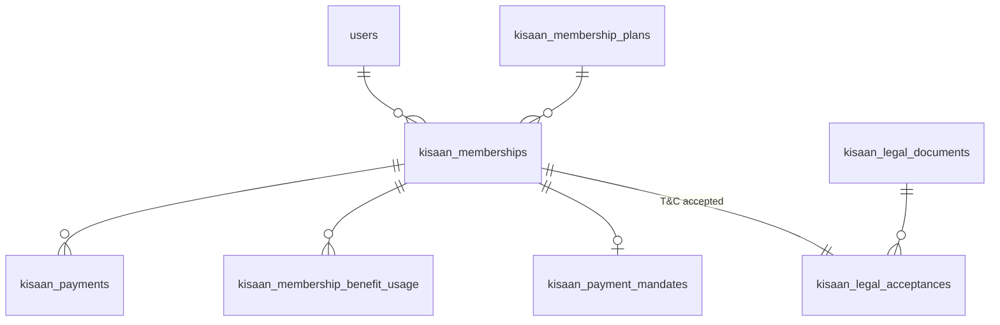

---

## 11. Reviews, notifications, support, disputes

### 11.1 Reviews (KIS-REV-001…005)

#### `store_reviews`, `product_reviews` — REUSED (opsapi `migrations/reviews.lua`)
Buyer → seller ratings are **mirrored** into `store_reviews` (and, per listing, into `product_reviews` with `is_verified_purchase = true`, `order_id`) so opsapi `GET /api/v2/public/stores/:slug/reviews` shows them. opsapi has no create/moderate API, so Kisaan writes these rows in its review service (a core-table write, behind the adapter, contract-tested).

#### `kisaan_reviews` — EXTENDED (authoritative two-way reviews)
| Field | Type | Notes |
|---|---|---|
| id, uuid, namespace_id | | |
| order_id | INTEGER NULL | |
| group_id | BIGINT NULL | Leader ratings (KIS-REV-005) |
| shipment_id | BIGINT NULL | |
| reviewer_user_id | INTEGER | |
| reviewer_role | TEXT | buyer/seller/member |
| subject_type | TEXT | CHECK IN ('seller','buyer','transporter','group_leader') |
| subject_user_id | INTEGER | |
| rating | SMALLINT | CHECK BETWEEN 1 AND 5 |
| tags | TEXT[] | 'on_time','quality_as_described','good_communication' |
| comment | TEXT NULL | |
| voice_note_key | TEXT NULL | P2 |
| seller_reply | TEXT NULL | One reply (KIS-REV-004) |
| moderation_status | TEXT | CHECK IN ('published','pending','hidden','removed') |
| opsapi_store_review_id | INTEGER NULL | Mirror pointer |
| created_at | | UNIQUE(order_id, reviewer_user_id, subject_type) |

Constraint: created only within 14 days of order completion (KIS-REV-002, app-enforced).

### 11.2 Notifications (KIS-NOTF-001…005, KIS-WA-002)

#### `notifications`, `notification_preferences`, `device_tokens` — REUSED (opsapi core/notifications)
In-app inbox and FCM push. ⚠ Risk: the `ecommerce` legacy `notifications` table can clash with core (`project-config.lua:212-217`). Kisaan uses only the core notifications API and validates the combination in Phase 1 ([OPSAPI_INTEGRATION](OPSAPI_INTEGRATION.md)).

#### `kisaan_notification_log` — NEW (dedupe, SMS/WhatsApp, which opsapi lacks)
`id, namespace_id, user_id, event_type TEXT, dedupe_key TEXT /* e.g. offer.received:<offer_uuid> */, channel CHECK IN ('in_app','push','sms','whatsapp','email','voice_call'), template_code TEXT, language TEXT, provider TEXT, provider_message_id TEXT, status CHECK IN ('queued','sent','delivered','read','failed','suppressed_quiet_hours','suppressed_dedupe','suppressed_optout'), cost_inr NUMERIC(10,4) NULL, created_at, sent_at`. UNIQUE(namespace_id, user_id, channel, dedupe_key) (KIS-NOTF-004).

#### `kisaan_channel_optins` — NEW (KIS-WA-002, KIS-NOTF-002)
`id, namespace_id, user_id, channel CHECK IN ('whatsapp','sms_promotional','email_marketing','push'), status CHECK IN ('opted_in','opted_out'), source TEXT /* where opt-in was captured, business name shown */, consent_text TEXT, changed_at, quiet_hours_start TIME DEFAULT '21:00', quiet_hours_end TIME DEFAULT '07:00'`. History is kept via `kisaan_consents`.

### 11.3 Support & disputes (KIS-SUP-001…005, KIS-DSP-001…007)

#### `kisaan_support_tickets` — NEW
`id, uuid, namespace_id, ticket_no UNIQUE, user_id, role, category CHECK IN ('order','payment','delivery','account','listing','kyc','membership','group','technical','grievance','other'), order_id NULL, subject, status CHECK IN ('open','pending_user','pending_internal','escalated','resolved','closed'), priority CHECK IN ('low','normal','high','urgent'), channel CHECK IN ('app','ai','whatsapp','phone_callback'), created_by_ai BOOLEAN, ai_conversation_id NULL, assigned_to NULL, first_response_due_at, first_responded_at, resolved_at, is_grievance BOOLEAN DEFAULT false /* e-commerce rules grievance timelines */, timestamps`.

#### `kisaan_support_messages` — NEW
`id, ticket_id FK, author_type CHECK IN ('user','agent','ai','system'), author_user_id NULL, body, attachment_keys TEXT[], internal BOOLEAN DEFAULT false, created_at`.

#### `kisaan_disputes` — NEW
| Field | Type | Notes |
|---|---|---|
| id, uuid, namespace_id | | |
| dispute_no | TEXT UNIQUE | |
| order_id | INTEGER | |
| group_allocation_id | BIGINT NULL | KIS-GROUP-011 |
| raised_by_user_id, raised_by_role | | |
| against_user_id | INTEGER | |
| reason | TEXT | CHECK IN ('quality_mismatch','weight_shortfall','non_delivery','damaged','wrong_item','non_payment','buyer_rejection','buyer_no_show','other') |
| claimed_amount | NUMERIC(14,2) NULL | |
| status | TEXT | CHECK IN ('open','awaiting_response','under_review','inspection_requested','resolved','closed','escalated_legal') |
| resolution | TEXT NULL | CHECK IN ('full_refund','partial_refund','price_adjustment','no_refund','redelivery') |
| resolution_amount | NUMERIC(14,2) NULL | |
| resolved_by | INTEGER NULL | A human, never the AI (KIS-DSP-006) |
| ai_summary | JSONB NULL | Evidence summary for the resolver |
| settlement_frozen | BOOLEAN DEFAULT true | KIS-DSP-003 |
| sla_first_response_at, sla_resolution_due_at | TIMESTAMPTZ | KIS-DSP-005 |
| timestamps | | |

#### `kisaan_dispute_evidence` — NEW
`id, dispute_id FK, submitted_by, evidence_type CHECK IN ('photo','video','weighbridge_slip','document','statement','inspection_report'), object_key, note, created_at`.

---

## 12. KISAAN AI — conversations, tool executions, catalogue, approvals (D-101, single AI)

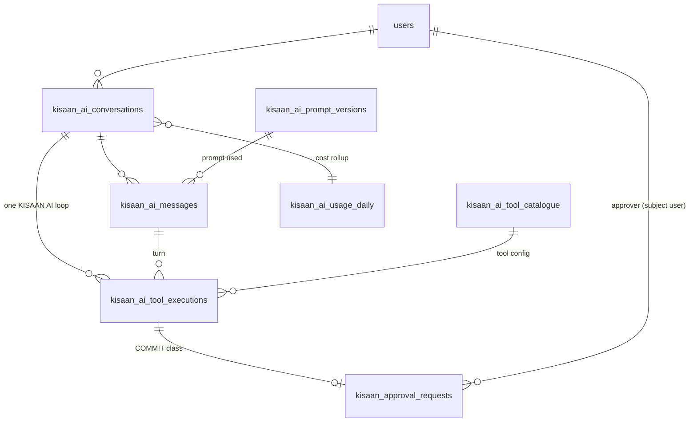

There is exactly **one** KISAAN AI. It has one runtime and one reasoning loop per conversation turn, and no sub-agents (D-101). The runtime is a module inside the KISAAN Next.js application (D-102). It writes these tables **only through KISAAN plugin APIs** (`/api/v2/kisaan/ai/...`) using its service identity, which is limited to AI telemetry writes and ApprovalRequest creation. Business tools run with the end user's delegated token. The runtime has no direct DB access, so there is one audit path.

#### `kisaan_ai_conversations` — NEW (AIConversations)
`id, uuid, namespace_id, user_id, active_role TEXT /* resolved server-side from namespace_user_roles at turn start — never from chat text */, channel CHECK IN ('web','pwa','whatsapp','voice'), language TEXT, title TEXT, status CHECK IN ('active','archived','deleted_by_user'), task_state JSONB /* multi-step workflow progress KIS-AI-005, e.g. {"workflow":"listing_create","step":"confirm_price","draft_uuid":"…"} */, summary TEXT /* rolling memory */, prompt_version_id BIGINT NULL FK kisaan_ai_prompt_versions, started_at, last_message_at, deleted_at`.

#### `kisaan_ai_messages` — NEW (AIMessageHistory)
| Field | Type | Notes |
|---|---|---|
| id BIGSERIAL, uuid, namespace_id, conversation_id FK | | |
| role | TEXT | CHECK IN ('user','assistant','tool','system_note') |
| content_text 🔒 | TEXT | Redacted for phone/UPI/account numbers before storage |
| content_lang | TEXT | |
| input_mode | TEXT | CHECK IN ('text','voice','image','button') |
| audio_object_key | TEXT NULL | Voice deleted after transcription unless the user consented to quality review (then kept max 30 days) `[DECISION D-54: voice retention]` |
| stt_transcript_confidence | NUMERIC(4,3) NULL | |
| attachments | JSONB | |
| citations | JSONB | Source + timestamp for facts (KIS-AI-006) |
| ui_cards | JSONB | Approval cards, listing previews |
| model_provider, model_name | TEXT NULL | Assistant turns only |
| prompt_version_id | BIGINT NULL | FK kisaan_ai_prompt_versions |
| input_tokens, output_tokens | INTEGER NULL | Assistant turns only |
| cost_inr | NUMERIC(10,4) NULL | |
| latency_ms | INTEGER NULL | |
| guardrail_events | JSONB NULL | e.g. injection detected in tool output, PII redaction |
| trace_id | TEXT NULL | OpenTelemetry trace |
| created_at | | |

Partitioned by month (`created_at`) for retention and performance.

#### `kisaan_ai_tool_executions` — NEW (AIToolExecutions; replaces v0.1 `kisaan_ai_agent_executions` + `kisaan_ai_tool_calls`)
| Field | Type | Null | Notes |
|---|---|---|---|
| id | BIGSERIAL | N | PK |
| uuid, namespace_id | | N | |
| conversation_id | BIGINT | N | FK |
| message_id | BIGINT | N | FK kisaan_ai_messages (the assistant turn that called the tool) |
| sequence_no | SMALLINT | N | Order within the turn (controlled multi-tool sequence); CHECK (<= 8) — per-turn tool budget `[DECISION D-101]` |
| tool_name | TEXT | N | `<category>.<verb_noun>`, e.g. `catalogue.create_listing_draft`, `pricing.get_quote`, `groups.get_my_commitment` — FK-like to `kisaan_ai_tool_catalogue.tool_name` |
| tool_version | TEXT | N | Schema version of the tool contract |
| tool_category | TEXT | N | CHECK IN ('seller','catalogue','inventory','pricing','discovery','market','matching','groups','offers','orders','payments','logistics','membership','coupons','support','account') |
| action_class | TEXT | N | CHECK IN ('READ','DRAFT','COMMIT') |
| acting_user_id | INTEGER | N | The end user whose delegated token was used |
| acting_role | TEXT | N | Role resolved server-side |
| arguments_redacted | JSONB | N | PII-redacted arguments |
| arguments_hash | CHAR(64) | N | SHA-256 of canonical arguments |
| result_status | TEXT | N | CHECK IN ('ok','denied','validation_error','error','timeout','approval_required','rate_limited','disabled') |
| http_status | SMALLINT | Y | Backend response |
| error_code | TEXT | Y | Backend error code (e.g. `INSUFFICIENT_STOCK`) |
| result_summary | JSONB | Y | Small, redacted result digest (never full payloads with PII) |
| approval_request_id | BIGINT | Y | FK kisaan_approval_requests (COMMIT class) |
| idempotency_key | TEXT | Y | Sent to the backend; required for DRAFT/COMMIT |
| attempt_no | SMALLINT | N | DEFAULT 1. Retries only for READ and idempotent calls |
| latency_ms | INTEGER | Y | |
| created_at | TIMESTAMPTZ | N | |

Indexes: `(namespace_id, conversation_id, message_id, sequence_no)`, `(namespace_id, tool_name, created_at)`, `(result_status, created_at) WHERE result_status IN ('denied','error','timeout')`. Append-only (trigger). Retention follows `kisaan_ai_messages`.

#### `kisaan_ai_tool_catalogue` — NEW (v0.2; admin-configurable tool registry, KIS-AI-0xx / KIS-ADM-0xx)
The **code** defines each tool (schema, permission, action class). This table holds the **runtime configuration** that admins can change. Overrides can only *narrow* what code allows; they can never widen it.

| Field | Type | Null | Notes |
|---|---|---|---|
| id, uuid, namespace_id | | | |
| tool_name | TEXT | N | UNIQUE(namespace_id, tool_name) |
| tool_category | TEXT | N | As above |
| action_class | TEXT | N | Mirrors code; CHECK IN ('READ','DRAFT','COMMIT'); a mismatch with code blocks startup |
| code_allowed_roles | TEXT[] | N | Synced from code at deploy (read-only) |
| enabled | BOOLEAN | N | DEFAULT true. Per-tool kill switch |
| role_allow_override | TEXT[] | Y | Must be a subset of `code_allowed_roles` (CHECK via trigger) |
| rate_limit_per_user_per_min | INTEGER | Y | NULL = code default |
| timeout_ms | INTEGER | N | DEFAULT from code; CHECK (BETWEEN 500 AND 30000) |
| requires_approval | BOOLEAN | N | true for COMMIT; may be set true for DRAFT (stricter), never false for COMMIT (CHECK) |
| description_i18n | JSONB | Y | Admin-facing description |
| updated_by_user_id | INTEGER | Y | |
| version | INTEGER | N | 0 |
| timestamps | | | |

The global kill switch is `kisaan_settings.key = 'ai.enabled'`. Each change is written to `kisaan_audit_log`.

#### `kisaan_ai_prompt_versions` — NEW (v0.2)
`id, uuid, namespace_id, version_label TEXT UNIQUE(namespace_id, version_label), system_prompt_object_key TEXT /* prompt text in object storage, hash below */, content_sha256 CHAR(64), model_provider TEXT, model_name TEXT, params JSONB /* temperature, max_tokens */, status CHECK IN ('draft','evaluating','active','retired'), eval_report_key TEXT NULL /* offline eval gate result */, activated_by_user_id, activated_at, created_at`. At most one `active` row per namespace (partial UNIQUE). Activation requires a passed evaluation (see TESTING_STRATEGY).

#### `kisaan_ai_usage_daily` — NEW (v0.2; cost rollup for the admin AI cost dashboard)
`namespace_id, usage_date DATE, model_provider TEXT, model_name TEXT, channel TEXT, role TEXT, conversations INTEGER, assistant_turns INTEGER, tool_executions INTEGER, tool_errors INTEGER, approvals_requested INTEGER, approvals_executed INTEGER, input_tokens BIGINT, output_tokens BIGINT, stt_seconds INTEGER, tts_characters INTEGER, cost_inr NUMERIC(14,4), PRIMARY KEY (namespace_id, usage_date, model_provider, model_name, channel, role)`. Built nightly (and incrementally every 15 min) from `kisaan_ai_messages` / `kisaan_ai_tool_executions`. Contains no PII.

#### `kisaan_approval_requests` — NEW (ApprovalRequests; KIS-APR-001…007)
| Field | Type | Null | Notes |
|---|---|---|---|
| id, uuid, namespace_id | | | |
| user_id | INTEGER | N | Who must approve (the principal) |
| requested_by | TEXT | N | CHECK IN ('ai','user_ui','support_agent','field_agent','system') — `ai` = the single KISAAN AI; `support_agent`/`field_agent` are **human** staff roles |
| requested_by_user_id | INTEGER | Y | Human support/field staff user, if any |
| conversation_id | BIGINT | Y | |
| tool_execution_id | BIGINT | Y | FK kisaan_ai_tool_executions (v0.2; was `tool_call_id`) |
| tool_name | TEXT | Y | v0.2: the COMMIT tool that proposed it, exactly as in the SINGLE_AI_ARCHITECTURE catalogue (e.g. `groups.propose_lock_group_order`); NULL for UI-created approvals |
| active_role | TEXT | N | v0.2: the principal's active role resolved server-side at proposal time; re-checked at execution |
| origin | TEXT | N | v0.2: CHECK IN ('ai_chat','ai_voice','ai_whatsapp','ui','support_assisted','field_assisted','system') |
| prompt_version_id | BIGINT | Y | v0.2: FK kisaan_ai_prompt_versions for AI-proposed approvals (eval/forensics) |
| action_type | TEXT | N | CHECK IN ('listing.publish','listing.update_price','listing.change','store.publish','inventory.adjust','wholesale.publish','offer.send','offer.counter','offer.accept','offer.reject','offer.withdraw','quotation.send','requirement.publish','enquiry.send','order.confirm','order.cancel','order.mark_ready','order.confirm_receipt','payment.initiate','transport.publish_request','transport.accept_quote','transport.submit_quote','shipment.event','group.create','group.update','group.commit','group.change_commitment','group.leave','group.accept_offer','group.lock','group.confirm_receipt','group.apply_coupon','membership.subscribe','membership.cancel','membership.autorenew','terms.accept','coupon.publish','coupon.update','coupon.pause_resume','refund.request','dispute.raise'). v0.2: one action type per SINGLE_AI COMMIT tool (§10.2 approval matrix); `group.close` retired (replaced by `group.lock` + repricing decision) |
| target_type / target_uuid | TEXT / UUID | N/Y | |
| params | JSONB | N | Exact parameters |
| params_hash | CHAR(64) | N | SHA-256 of canonical params (KIS-APR-004). Execution verifies it. |
| summary_i18n | JSONB | N | Plain-language summary in the user's language (KIS-APR-002) |
| amount_inr | NUMERIC(14,2) | Y | Shown prominently |
| qty_kg | NUMERIC(14,3) | Y | |
| status | TEXT | N | CHECK IN ('pending','approved','rejected','expired','executed','failed','superseded') |
| channel_approved | TEXT | Y | CHECK IN ('app_tap','voice_readback','whatsapp_button','otp') |
| readback_transcript | TEXT | Y | For voice approvals |
| requires_otp | BOOLEAN | N | DEFAULT false. True for assisted actions (KIS-APR-007) and high-value thresholds |
| expires_at | TIMESTAMPTZ | N | now()+15 min (KIS-APR-004) |
| decided_at, executed_at | TIMESTAMPTZ | Y | |
| execution_result | JSONB | Y | |
| created_at | TIMESTAMPTZ | N | |

Indexes: `(namespace_id, user_id, status)`, `(status, expires_at) WHERE status = 'pending'`.
Rule (enforced in every commit-class API): the request must carry `approval_request_id` with status `approved`, `user_id = caller`, a matching `params_hash`, and must not be expired or already executed. The API then sets `executed` in the same transaction as the business change (single use).

---

## 13. Audit, consent, privacy, configuration

#### `namespace_audit_logs`, `audit_events`, `user_activity`, `auth_events` — REUSED (opsapi)
Admin and namespace-level activity, login events.

#### `kisaan_audit_log` — EXTENDED (business-critical audit, KIS-ADM-012, KIS-APR-006)
| Field | Type | Notes |
|---|---|---|
| id BIGSERIAL, namespace_id | | |
| occurred_at | TIMESTAMPTZ | |
| actor_type | TEXT | user / admin / system / ai_on_behalf / support_agent |
| actor_user_id | INTEGER NULL | |
| on_behalf_of_user_id | INTEGER NULL | |
| action | TEXT | e.g. 'listing.publish', 'kyc.document.view', 'settlement.release', 'price.override', 'role.grant' |
| entity_type, entity_uuid | TEXT, UUID | |
| before, after | JSONB | Redacted |
| approval_request_id | BIGINT NULL | |
| ip 🔒, user_agent | | |
| request_id / trace_id | TEXT | |
| prev_hash, row_hash | CHAR(64) | **Hash chain** for tamper evidence |

Append-only (trigger). Monthly partitions. Retention 8 years for financial actions `[LEGAL REVIEW]`.

#### `kisaan_consents` — NEW (DPDP, PRIV; KIS-AUTH-007)
`id, uuid, namespace_id, user_id, purpose CHECK IN ('account_service','marketing','whatsapp_messages','analytics','location_sharing','voice_storage','ai_training_improvement','third_party_verification'), status CHECK IN ('granted','withdrawn'), notice_document_id FK kisaan_legal_documents, notice_language, channel, captured_at, withdrawn_at, consent_manager_ref TEXT NULL`. Append-only history (a new row per change).

#### `kisaan_data_requests` — NEW (KIS-AUTH-009, DPDP rights)
`id, uuid, namespace_id, user_id, request_type CHECK IN ('access','correction','erasure','grievance','nominate'), status CHECK IN ('received','verifying','in_progress','completed','rejected_with_reason'), due_at, completed_at, notes, handled_by`.

#### `kisaan_analytics_events` — NEW (KIS-ANL-001…005)
| Field | Type | Null | Default | Notes |
|---|---|---|---|---|
| id | BIGSERIAL | N | | PK (partitioned by month on `occurred_at`) |
| event_name | TEXT | N | | e.g. `listing_created`, `offer_accepted`, `voice_listing_completed`, `checkout_started` (catalogue in PRD ANL) |
| occurred_at | TIMESTAMPTZ | N | now() | |
| user_pseudo_id | CHAR(64) | Y | | HMAC of user_id (no raw PII) |
| role | TEXT | Y | | active role |
| channel | TEXT | Y | | CHECK IN ('web','pwa','whatsapp','ai','admin') |
| language | TEXT | Y | | pa/hi/en |
| district_code | TEXT | Y | | LGD (A-12) |
| entity_type, entity_uuid | TEXT, UUID | Y | | e.g. listing / order |
| properties | JSONB | N | '{}' | no PII; schema per event_name |
| ai_tool_execution_id | BIGINT | Y | | FK kisaan_ai_tool_executions (for AI funnel metrics; v0.2 rename of `ai_execution_id`) |

Indexes: btree(event_name, occurred_at); BRIN(occurred_at). Retention 2 years then aggregated. P2: export to a warehouse; KPI materialised views refresh from this table.

#### `kisaan_settings` — NEW (KIS-ADM-013)
`id, namespace_id, key TEXT, value JSONB, effective_from TIMESTAMPTZ, updated_by, created_at, UNIQUE(namespace_id, key, effective_from)`. Holds reservation TTLs, acceptance windows, quiet hours, risk thresholds and similar. Plugin `settings` in `project.lua` holds deploy-level defaults; this table holds runtime overrides with history.

---

## 14. Mandi price intelligence (KIS-MKT-001…007)

#### `kisaan_mandi_markets` — NEW
`id, namespace_id, source CHECK IN ('agmarknet_datagov','enam','manual_admin'), source_market_code TEXT, market_name, district_name, district_code NULL, state_name, location GEOGRAPHY NULL, is_active, UNIQUE(source, source_market_code)`. Duplicate market IDs in the source are mapped to one canonical row via `canonical_market_id` (known Agmarknet data-quality issue; see [COMPETITOR_ANALYSIS](COMPETITOR_ANALYSIS.md) §data sources).

#### `kisaan_mandi_prices` — NEW (append-only; KIS-MKT-002)
| Field | Type | Notes |
|---|---|---|
| id BIGSERIAL, namespace_id | | |
| market_id | BIGINT | FK |
| commodity_id | BIGINT NULL | Mapped Kisaan commodity |
| source_commodity, source_variety, source_grade | TEXT | As published |
| arrival_date | DATE | |
| min_price_per_qtl, max_price_per_qtl, modal_price_per_qtl | NUMERIC(12,2) | ₹/quintal as published |
| arrivals_tonnes | NUMERIC(14,3) NULL | |
| source | TEXT | 'data.gov.in resource 9ef84268-d588-465a-a308-a864a43d0070' `[UNVERIFIED live API]` |
| source_record_hash | CHAR(64) | UNIQUE (dedupe) |
| fetched_at | TIMESTAMPTZ | |
| quality_flags | TEXT[] | 'modal_outside_range','modal_is_avg','late_upload','outlier' |

Indexes: `(commodity_id, arrival_date DESC)`, `(market_id, commodity_id, arrival_date DESC)`. Partitioned by year. **Never updated in place**: corrections arrive as new rows, and the latest `fetched_at` wins in the view `kisaan_mandi_prices_latest`.

#### `kisaan_msp_rates` — NEW (KIS-MKT-007)
`id, namespace_id, commodity_id, marketing_season TEXT ('RMS 2026-27'), msp_per_qtl NUMERIC(12,2), source_url TEXT, notified_on DATE, UNIQUE(commodity_id, marketing_season)`.

#### `kisaan_price_alerts` — NEW (KIS-MKT-004)
`id, uuid, namespace_id, user_id, commodity_id, market_id NULL, district_code NULL, direction CHECK IN ('above','below'), threshold_per_qtl NUMERIC(12,2), channel, is_active, last_triggered_at, created_at`.

---

## 15. Cross-cutting constraints & consistency rules

| Rule | Mechanism |
|---|---|
| APMC gating fail-closed | No `kisaan_category_state_rules` row with `checkout_enabled = true` → commit endpoints refuse |
| No overselling (KIS-INV-005) | Conditional `UPDATE … WHERE on_hand_kg - reserved_kg >= qty` + `CHECK (reserved_kg <= on_hand_kg)` |
| One live hold per source | Partial UNIQUE on reservations |
| Coupon over-redemption (KIS-COUPON-005) | Conditional update on `kisaan_coupons` + per-identity count under row lock |
| Group overfill | Conditional update on `kisaan_buying_groups.committed_qty_kg` |
| Group leader privacy (`GROUP_FORBIDDEN_FIELD`) | Leader/co-leader projections are built server-side from an allow-list (display name or "Member N", committed qty, payment status); any request for another member's phone, address, payment instrument or amounts other than qty × unit price → `403 GROUP_FORBIDDEN_FIELD` |
| Group coupon allocation | Pro-rata by goods value, largest-remainder paise rounding, deferred-trigger sum check (R5) |
| Tier-set overlap | Exclusion constraint on `kisaan_wholesale_tier_sets` |
| Payment idempotency (KIS-PAY-005) | UNIQUE `(provider, event_id)`, UNIQUE `idempotency_key`, UNIQUE `provider_payment_id` |
| Approval single-use (KIS-APR-004) | `UPDATE kisaan_approval_requests SET status='executed' WHERE id=:id AND status='approved' AND params_hash=:h AND expires_at > now()`; 0 rows → 409 |
| Gap-free invoices (KIS-INVC-004) | Row-locked sequence allocation in the invoice transaction |
| Price snapshot immutability (KIS-ORD-003, KIS-WHL-010) | `kisaan_price_quotes` immutable; order references quote; trigger blocks updates |
| Double-entry balance | Deferred constraint trigger per journal |
| Lost update protection | `version` column + `If-Match` |
| Long transactions | None hold locks across external calls. PA calls happen **outside** DB transactions using the outbox + idempotency keys. |
| Event publishing | opsapi plugin outbox (`sdk.emit`, at-least-once). Consumers must be idempotent. |

### 15.1 Transactions and isolation

- Default `READ COMMITTED`. Correctness relies on conditional updates and row locks, not `SERIALIZABLE`.
- Lock ordering to avoid deadlocks: `kisaan_inventory` → `kisaan_inventory_reservations` → `kisaan_coupons` → `kisaan_memberships` → `orders`.

---

## 16. Privacy & retention summary

| Data | Classification | Protection | Retention (proposed `[LEGAL REVIEW]`) |
|---|---|---|---|
| Phone, bank account, UPI VPA, vehicle reg. no. | Personal / financial | 🔐 app-level encryption + HMAC lookup | Life of account + 8 years for financial records |
| KYC documents | Sensitive identity | Private encrypted bucket, signed URLs ≤ 5 min, access audit | Until verification + legally required period, then purge job |
| Precise farm location | Personal | Stored separately; public views use rounded `location_public` | Life of account |
| AI messages / voice | Personal | Redaction before storage; voice deleted after transcription; max 30 days only with consent (D-54) | Transcripts 1 year (D-53, aligned with DPDP Rule 8(3) log minimum), then anonymised |
| User-to-user chat (opsapi chat) | Personal | Access limited to channel members, support with reason code | 2 years (D-87) |
| Payments, invoices, ledger, legal acceptances, audit | Financial / legal records | Append-only | 8 years (Companies Act / GST record rules `[TAX REVIEW]`) |
| OTP challenges | Security | Code hashed | 30 days |

Erasure (DPDP): user PII columns are nulled or pseudonymised (`display_name → "Deleted user"`); financial and legal records are retained with minimal identifiers under legal exemptions `[LEGAL REVIEW]`.

---

## 17. Migration ordering (Kisaan repo `backend/plugins/kisaan/migrations/`)

Naming: `YYYYMMDDHHMMSS_NNN_<description>.lua` (timestamped, as in opsapi plugin examples). Each runs in one transaction except `CREATE INDEX CONCURRENTLY` files (`{ transaction = false, up = fn }`). Runs **after** opsapi core migrations (Helm pre-upgrade Job weight +5 vs core −5).

| # | Migration | Contents | Depends on (opsapi) |
|---|---|---|---|
| 001 | `extensions` | `CREATE EXTENSION IF NOT EXISTS pgcrypto, pg_trgm, btree_gist` (+ verify `postgis`) `[UNVERIFIED privileges in managed PG]` | — |
| 002 | `common_functions` | `kisaan_set_updated_at()`, `kisaan_forbid_mutation()`, audit hash-chain function, attribute validation function | — |
| 003 | `settings_legal_consent` | kisaan_settings, kisaan_legal_documents, kisaan_legal_acceptances, kisaan_consents, kisaan_data_requests | namespaces, users |
| 004 | `identity` | kisaan_user_identities, kisaan_otp_challenges, kisaan_sessions, kisaan_user_roles | users, namespace_user_roles |
| 005 | `geo_addresses` | kisaan_addresses | users |
| 006 | `profiles` | seller, buyer (incl. `buyer_kind`), bulk buyer, group leader, transporter profiles | delivery_partners |
| 007 | `verification` | kisaan_verification_records, kisaan_kyc_documents, kisaan_payout_accounts | |
| 008 | `taxonomy` | kisaan_categories, kisaan_category_attributes, kisaan_commodities, kisaan_varieties, kisaan_category_state_rules | |
| 009 | `seed_taxonomy_mvp` | MVP categories, attributes, synonyms (pa/hi/en) | |
| 010 | `stores` | kisaan_store_profiles, kisaan_store_slug_history | stores |
| 011 | `listings` | kisaan_listings, kisaan_listing_media, kisaan_saved_searches | storeproducts, documents |
| 012 | `inventory` | kisaan_inventory, kisaan_inventory_reservations, kisaan_inventory_movements + triggers | |
| 013 | `wholesale` | kisaan_wholesale_tier_sets (+ exclusion constraint), kisaan_wholesale_tiers + validation trigger | |
| 014 | `ai_core` | kisaan_ai_prompt_versions, kisaan_ai_conversations, kisaan_ai_messages (partitioned), kisaan_ai_tool_catalogue, kisaan_ai_tool_executions, kisaan_approval_requests, kisaan_ai_usage_daily | |
| 015 | `enquiries_rfq` | kisaan_enquiry_threads, kisaan_buyer_requirements, kisaan_buyer_preferred_sellers | chat_channels |
| 016 | `negotiation` | kisaan_negotiations, kisaan_offers | |
| 017 | `commission_pricing` | kisaan_commission_rules, kisaan_price_quotes | |
| 018 | `coupons` | kisaan_coupons, kisaan_coupon_products, kisaan_coupon_redemptions | |
| 019 | `orders_ext` | kisaan_order_details, kisaan_order_item_pricing, kisaan_order_status_events, kisaan_order_levies | orders, orderitems |
| 020 | `payments` | kisaan_payments, kisaan_payment_events, kisaan_refunds, kisaan_settlements, kisaan_ledger_entries, kisaan_reconciliation_*, kisaan_payment_mandates | |
| 021 | `invoices` | kisaan_invoices, kisaan_invoice_lines, kisaan_invoice_sequences | |
| 022 | `memberships` | kisaan_membership_plans, kisaan_memberships, kisaan_membership_benefit_usage + plan seeds | |
| 023 | `groups` | kisaan_buying_groups, members, group orders, allocations, kisaan_group_announcements, kisaan_member_reliability | |
| 024 | `logistics` | kisaan_vehicles, kisaan_transport_requests, kisaan_transport_quotes, kisaan_shipments, kisaan_shipment_events | order_delivery_assignments |
| 025 | `reviews` | kisaan_reviews | store_reviews, product_reviews |
| 026 | `notifications` | kisaan_notification_log, kisaan_channel_optins | notifications, device_tokens |
| 027 | `support_disputes` | kisaan_support_tickets, kisaan_support_messages, kisaan_disputes, kisaan_dispute_evidence | |
| 028 | `audit` | kisaan_audit_log (partitioned) + hash-chain trigger | |
| 029 | `mandi` | kisaan_mandi_markets, kisaan_mandi_prices (partitioned), kisaan_msp_rates, kisaan_price_alerts, view | |
| 030 | `indexes_concurrent` | Large GIN/GIST/trigram indexes (`transaction = false`) | |
| 031 | `rbac_seed` | Namespace roles (seller, buyer, …) and permission grants for plugin modules (if not covered by manifest upsert) | roles, namespace_roles |
| 032 | `search_hsn_analytics` | kisaan_search_documents (+ triggers from listings), kisaan_hsn_codes (+ CA-approved seed), kisaan_analytics_events (partitioned) | — |

v0.2 note: no KISAAN migration has been applied to any environment yet, so the v0.2 changes (single-AI tables, bulk-buyer profile, group-discount and coupon fields, inventory buckets) are folded into the planned files above instead of being added as `ALTER` migrations. After the first deployment, rule 1 applies.

**Migration rules:**
1. Never edit an applied migration. The checksum drift check fails the deploy, so add a new one.
2. Expand → migrate → contract for breaking changes (add nullable column/new table, backfill via job, switch code, then drop in a later release).
3. Every migration is tested in CI both on an empty DB and on a snapshot at the previous release, against the **pinned** opsapi image.
4. Seed data migrations are idempotent (`INSERT … ON CONFLICT DO NOTHING`).

---

## 18. Open items

| ID | Item |
|---|---|
| `[DECISION D-24]` | Membership on Kisaan tables vs mirroring into opsapi `billing_*` |
| `[DECISION D-60]` | Max wholesale tier discount cap (proposed 50%) |
| `[DECISION D-61]` | Group overfill tolerance (proposed 120% of target) |
| `[DECISION D-54]` | Voice audio retention period (proposed 30 days) |
| `[ASSUMPTION A-12]` | LGD (Local Government Directory) codes used as district master |
| `[DECISION D-80]` | APMC gating: which category × state combinations allow checkout, licence requirement and levy rates (see [SECURITY_AND_COMPLIANCE](SECURITY_AND_COMPLIANCE.md) KIS-CMP-046) |
| `[DECISION D-71]` | Group-leader limits (max open groups, max group value) |
| `[DECISION D-101]` | Single KISAAN AI. Per-turn tool budget proposed at 8 tool executions |
| `[DECISION D-103]` | Group discount stage and group coupon at lock. Group price-lock window proposed at 24 h |
| `[DECISION D-104]` | Bulk-buyer profile as a separate 1:1 table |
| `[DECISION D-106]` | Transporter marketplace (`platform_logistics`) is P2; MVP delivery = `buyer_pickup`, `seller_delivery`, `seller_delivery_fee`. Logistics tables are created in MVP but the mode is feature-flagged off |
| `[DECISION D-124]` / D-72 | Member payment window after lock: 24 h default (4–48 h) |
| `[DECISION D-132]` | Repricing: seller honour / re-offer / decline within 6 h; no response = decline |
| `[DECISION D-133]` | Requirement-bound groups (`basis = 'rfq'`, `owner_type = 'group'`) are MVP |
| `[DECISION D-134]` | Group platform-logistics delivery buffer +10 % — **PENDING OWNER SIGN-OFF** (applies only once `platform_logistics` is enabled, P2) |
| `[UNVERIFIED]` | opsapi `users.email` nullability; plugin ability to mint opsapi JWTs; `orderitems.quantity` type; `orders.status` value set; PostGIS presence and extension privileges in the target Postgres; `documents.id` type |
