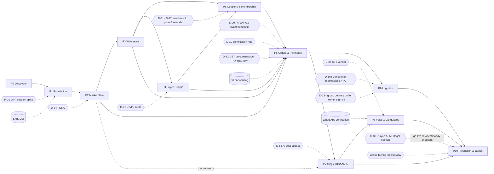

# KISAAN — Development Roadmap

> Status: Draft v0.2 · Last updated: 2026-11-14 · Owner: KISAAN product & engineering lead · Source of truth index: [README](README.md)

Related: [PRD](PRD.md) · [SYSTEM_ARCHITECTURE](SYSTEM_ARCHITECTURE.md) · [OPSAPI_INTEGRATION](OPSAPI_INTEGRATION.md) · [SINGLE_AI_ARCHITECTURE](SINGLE_AI_ARCHITECTURE.md) · [PRICING_ENGINE](PRICING_ENGINE.md) · [WHOLESALE_AND_GROUP_BUYING](WHOLESALE_AND_GROUP_BUYING.md) · [SELLER_STORE_AND_INVENTORY](SELLER_STORE_AND_INVENTORY.md) · [COUPON_AND_MEMBERSHIP](COUPON_AND_MEMBERSHIP.md) · [TESTING_STRATEGY](TESTING_STRATEGY.md) (phase entry/exit §20, release gates §22) · [RISKS_AND_ASSUMPTIONS](RISKS_AND_ASSUMPTIONS.md)

---

## 0. Planning basis

- **Structure.** Phases 0–10 exactly as in Master Prompt v2 §35 (decision **D-106**). Every phase lists deliverables, dependencies, development tasks, testing, acceptance criteria and risks.
- **Team assumption** `[ASSUMPTION A-10]`: a core team of about 6–8 engineers (2 backend Lua/OpsAPI plugin, 2 frontend Next.js, 1–2 AI/TypeScript, 1 QA, 1 DevOps shared) plus product/design. Durations are **indicative** and phases overlap where dependencies allow.
- **Architecture baseline.** OpsAPI is consumed as a pinned Docker image, never modified. KISAAN business logic, the pricing engine, inventory and the authoritative APIs live in the KISAAN OpsAPI **project plugin** (`projects/kisaan`, routes `/api/v2/kisaan/...`, migrations tracked in `project_migrations`). This is KISAAN's supported dynamic-API mechanism. The UI, BFF and **the one KISAAN AI runtime** live in a single TypeScript app `kisaan-app` (D-101, D-102).
- **AI is built per domain, assembled in Phase 7.** There is exactly one KISAAN AI. Each domain phase (2–6, 9) delivers the **tool contracts** for its own endpoints: thin, typed, permission-tagged wrappers (READ / DRAFT / COMMIT) with contract tests. Phase 7 delivers the runtime, approvals UX, evaluation and safety, and wires the catalogue together. No phase creates separate AI agents or AI services.
- **Legal gating.** Some features can be built and tested but cannot go live until a legal or tax decision lands (§5). Building ahead is allowed; enabling in production is not.

## 1. Timeline overview

```mermaid
gantt
    title KISAAN indicative roadmap (weeks from kickoff)
    dateFormat  X
    axisFormat  W%s
    section Discovery & foundation
    P0 Discovery                          :p0, 0, 3
    P1 Foundation (OpsAPI image, auth, CI):p1, 3, 5
    section Marketplace core
    P2 Marketplace (stores, listings, inventory, search) :p2, 8, 7
    P3 Wholesale (tiers, bulk buyers, offers)            :p3, 13, 4
    P4 Buyer Groups                        :p4, 16, 4
    P5 Coupons & Membership                :p5, 17, 4
    P6 Orders & Payments                   :p6, 14, 8
    section AI, voice, logistics
    P7 Single KISAAN AI                    :p7, 14, 12
    P8 Voice & Regional Languages          :p8, 20, 7
    P9 Logistics                           :p9, 19, 6
    section Launch
    P10 Production & pilot launch          :p10, 26, 5
```

Indicative pilot launch: **week ~31**. This is about four weeks later than v0.1. The extra time pays for dedicated wholesale, buyer-group and coupon/membership phases, and for the single-AI rework.

**Overlaps.**

- P6 starts with payment-provider adapter work at week 14, before P3–P5 finish, because PA onboarding has a long lead time.
- P7 starts with the runtime skeleton and approval framework at week 14 and integrates domain tools as each domain stabilises.

## 2. MVP boundary

**MVP = Phases 0–7 in full, plus the MVP slices of Phase 8 and Phase 9, plus Phase 10 hardening** (D-106). Everything else is post-MVP.

| Phase | In MVP | Post-MVP (P2 / Future) |
|---|---|---|
| P0–P7 | Everything listed in each phase | Only items explicitly marked *Post-MVP* inside a phase |
| P8 Voice & languages | Punjabi + Hindi + English UI; voice (STT/TTS) for listing, search, offers, order status, group join, membership cancel; read-back confirmation; **WhatsApp core** (opt-in, templates, conversational listing, offer approval buttons, order status) | More Indian languages; full WhatsApp flows (negotiation, group buying, membership, WhatsApp Flows); dialect-tuned models |
| P9 Logistics | Seller-delivered (delivery term `SELLER_DELIVERS_FEE`), buyer pickup, and **partner-arranged delivery** through a platform logistics partner where available (fee estimate; for groups, estimate + 10% buffer per D-134). Shipment states, delivery OTP / POD, weight tolerance, group common-delivery-point handover. The KISAAN Plus free-delivery waiver applies to `SELLER_DELIVERS_FEE` and partner fees | **Open transporter marketplace (P2, D-106)**: transporter onboarding as a marketplace role, transport requests → competing quotes → accept 🔒 → transporter payouts. Also multi-quote optimisation, cost-estimation v2, backup-transporter automation, live GPS tracking, KISAAN Plus priority delivery (D-96) |

> **Decision (v0.2, reconciled).** The open transporter marketplace is **P2, not MVP** (D-106, pending product-owner sign-off). The earlier roadmap proposal D-106a (keep it in MVP) is **withdrawn**. Membership free delivery still has something to waive at launch: the seller's delivery fee (`SELLER_DELIVERS_FEE`) and partner-arranged delivery fees. **D-134** (group partner/platform delivery charged as estimate + 10% buffer, with the platform absorbing any residual shortfall) is **PENDING OWNER SIGN-OFF**.

## 3. Placement of confirmed features

| Confirmed feature | Phases | Notes |
|---|---|---|
| Public seller stores (`KIS-STORE`) | **P2** | Built on OpsAPI stores where verified ([OPSAPI_INTEGRATION](OPSAPI_INTEGRATION.md)); public URL `/store/<slug>` |
| Automated inventory (`KIS-INV`) | **P2** (stock, buckets, history, reservations, concurrency) → **P6** (deduct on payment, release on failure/cancel, partial fulfilment) | Concurrency suite KIS-TEST-CONC-* is a P2 and P6 exit criterion |
| Wholesale / quantity pricing (`KIS-WHL`, `KIS-PRC`) | **P3** (tiers, whole-lot, pricing engine stages 1–4 and 7) → **P4** (group discount stage) → **P5** (member price and coupon stages) → **P6** (delivery and taxes, price lock at checkout) | One authoritative engine in the plugin (D-103) |
| Bulk buyers (`KIS-BULK`) | **P1** (separate signup path) → **P3** (profile-driven RFQ, matching, recurring procurement drafts) | |
| Buyer groups and leaders (`KIS-GROUP`) | **P1** (leader verification) → **P4** (listing-bound **and requirement-bound** groups — both MVP, D-133; commitments, seller offers, lock, repricing, privacy) → **P6** (per-member payment after lock, consolidated order) | Leader never collects money in MVP; leader-collects mode is **Future, pending legal review** (flagged, not dropped) |
| Seller coupons (`KIS-COUPON`) | **P5** (definition, eligibility, group coupons) → **P6** (redemption at capture, cancellation and refund behaviour) | |
| KISAAN Plus membership + T&C (`KIS-MEMBER`) | **P5** (plans, benefit engine, versioned T&C) → **P6** (recurring payments, grace, refunds; free-delivery waiver on `SELLER_DELIVERS_FEE`) → **P9** (waiver on partner-arranged delivery fees) | T&C legal sign-off is a P10 gate |
| One KISAAN AI (`KIS-AI`, `KIS-APR`) | Tool contracts in **P2–P6, P9**; runtime, approvals UX and evaluation in **P7**; voice in **P8** | D-101 / D-102 |

## 4. Phases

### Phase 0 — Discovery (≈3 weeks) · MVP

| Item | Detail |
|---|---|
| Deliverables | v0.2 documentation set signed off. Answers (or explicit deferrals) for every `D-*` in [RISKS_AND_ASSUMPTIONS](RISKS_AND_ASSUMPTIONS.md), including D-101…D-106. Legal and tax opinions commissioned (APMC D-80, PA/settlement-hold D-09/A-90, group buying, DPDP timing, FSSAI D-84, GST on commission D-82). Clickable prototypes: farmer voice listing, wholesale-tier editor, group dashboard, checkout breakdown, AI approval card. Pilot district list. OpsAPI image tag chosen and pinned. |
| Dependencies | Access to the OpsAPI repo (read-only) and Docker Hub images. Legal counsel and a CA engaged. |
| Development tasks | **Spike 1:** run `bwalia/opsapi:<tag>` with a hello-world `projects/kisaan` plugin, one migration and one `sdk.handler` route. **Spike 2 (R-31):** issue OpsAPI-compatible sessions to phone-OTP users. **Spike 3 (D-34):** STT bake-off for Punjabi/Hindi on ≥ 500 field utterances. **Spike 4:** mandi dataset ingestion (data.gov.in/Agmarknet; API key to be verified). **Spike 5:** single-AI runtime prototype in the `kisaan-app` Next.js app (no separate AI gateway): one model, 5 READ tools, 1 DRAFT tool, 1 COMMIT tool behind an approval card, SSE streaming. |
| Testing | Prototype usability with ≥ 10 Punjab farmers and ≥ 5 buyers (incl. 1 group leader). STT benchmark (KIS-TEST-VOX-001 pilot set). KIS-TEST-OPS-014. |
| Acceptance criteria | Spikes 1–2 succeed, or a documented fallback is agreed. STT vendor short-list with measured WER. Decisions answered or deferred with an owner and a date. Backlog for P1–P3 groomed with requirement IDs. Long-lead external onboarding started (PA, SMS DLT, WhatsApp). |
| Risks | Legal uncertainty on trading outside APMC in Punjab (R-13). Punjabi STT accuracy (R-10). The phone-OTP session mechanism relies on an OpsAPI helper outside the plugin SDK (R-31). |

### Phase 1 — Foundation (≈5 weeks) · MVP

| Item | Detail |
|---|---|
| Deliverables | KISAAN repo scaffold: plugin image `FROM bwalia/opsapi:<pinned 1.0.N>`, `projects/kisaan/project.lua`, `migrations/`, `api/`, and the `kisaan-app` Next.js PWA shell (pa/hi/en i18n, design tokens, offline shell). Migration pipeline as a pre-upgrade job (KISAAN-owned schema only; never OpsAPI tables). CI/CD: build, tests, image and secret scan, deploy to dev and staging. Observability baseline (traces, logs with PII redaction, metrics). |
| Features | `KIS-AUTH` phone-OTP login. `KIS-PROF` multi-role profiles (one number = one account). `KIS-ONB` seller, individual buyer, **bulk buyer (`/signup/bulk-buyer`)**, group-leader verification. (Transporter onboarding is Post-MVP with the transporter marketplace, D-106.) Consent and notice versioning (`KIS-PRIV`). RBAC modules `kisaan_*`. Admin user management with granular admin permissions. Audit log. `KIS-OPSAPI` integration requirements. |
| Dependencies | P0 spikes 1–2. OpsAPI auth, users and roles modules. SMS provider with DLT templates. Domain/TLS/Cloudflare. |
| Development tasks | Profile and role migrations. Bulk-buyer profile fields (business type, products, typical qty, frequency, delivery areas, budget range, quality, preferred sellers). Consent tables. Audit-log wiring. Namespace `kisaan` setup. Secrets management. Environment separation. **AI groundwork:** a tool-contract template and generator (schema + class + role allow-list + timeout + error codes + audit event). It is used from P2 on. |
| Testing | KIS-TEST-AUTH-*, PROF-*, ONB-*, BULK-001/002, OPS-001..014, RBAC-001 generator, RBAC-008. Migrations tested up on an empty DB and on the previous-release DB. Accessibility smoke. |
| Acceptance criteria | A user signs up by OTP in pa/hi/en, picks roles and completes a profile. The bulk-buyer path is distinct and captures all required fields. Group-leader verification works. The image builds reproducibly. Migrations are tracked in `project_migrations` with drift detection. No OpsAPI source change. |
| Risks | OpsAPI has no phone/SMS OTP login, so KISAAN builds it in the plugin (R-31). DLT template approval delays. DPDP consent UX complexity. |

### Phase 2 — Marketplace (≈7 weeks) · MVP

| Item | Detail |
|---|---|
| Deliverables | MVP categories with category-specific attributes. Listings with photos. Listing lifecycle. **Public seller stores** (`/store/<slug>`, SEO, privacy-safe location, policies, ratings display). **Inventory module**: available / reserved / sold / damaged / expired buckets, append-only movement history, manual adjustments with reasons, low-stock alerts, auto-hide, **transaction-safe reservations** (row lock / conditional update). Search and filters (product, seller, store, location radius, price, qty, MOQ, quality, availability, wholesale availability, delivery, ratings). Product details. Reviews (read). Admin moderation and verification queues. |
| Features | `KIS-CAT`, `KIS-PRD`, `KIS-SRCH`, `KIS-STORE`, `KIS-INV`, `KIS-REV` (read), `KIS-ADM` (moderation) |
| Dependencies | P1. S3-compatible storage, image processing/CDN. FSSAI capture rules for food categories (D-84). |
| Development tasks | Attribute schema per category. Search indexing (Postgres FTS + trigram + PostGIS first; a dedicated engine only if needed). Upload security (type sniffing, EXIF strip, malware scan). Store slug history and redirects. Reservation service with TTL jobs, written against the concurrency design in [SELLER_STORE_AND_INVENTORY](SELLER_STORE_AND_INVENTORY.md). **Tool contracts:** `seller.get_my_store`, `seller.draft_store_update`, `seller.propose_store_update` (COMMIT), `catalogue.list_categories`, `catalogue.get_attribute_schema`, `catalogue.upload_listing_image`, `catalogue.extract_image_hints`, `catalogue.create_listing_draft`, `catalogue.propose_publish_listing` (COMMIT), `inventory.get_listing_inventory`, `inventory.get_summary`, `inventory.propose_adjustment` (COMMIT), `discovery.search_listings`, `discovery.get_listing`, `discovery.get_store`. Names are exact SINGLE_AI_ARCHITECTURE §8 catalogue names. |
| Testing | KIS-TEST-PRD-*, CAT-*, SRCH-*, STORE-001..009 and 101..106, INV-001..013 and 101..110, SRCH-101..103, CAT-101, PRD-101, REV-101, CONC-001/004/006/007/009, upload security, tool contract tests for this phase's tools. |
| Acceptance criteria | A seller publishes a store and a listing (with approval). A logged-out visitor browses the store with no private data exposed. Search works across Gurmukhi, Devanagari and romanised input. **Prompt §17 race (1,000 kg; 700 + 500 concurrently) never confirms more than 1,000 kg.** All inventory changes are in history with their actor. |
| Risks | Cross-script search quality. Cold-start catalogue. Reservation design errors (mitigated by property and concurrency tests). |

### Phase 3 — Wholesale (≈4 weeks) · MVP

| Item | Detail |
|---|---|
| Deliverables | **Quantity tiers and whole-lot pricing** with all rule fields (min bulk qty, MOQ/max, dates, applicable products and buyer types, group eligibility). Seller wholesale-tier editor with live preview. **Pricing engine v1** in the plugin (stages: base, wholesale, negotiated, floor, taxes placeholder; D-103). `quote_id` with 15-minute validity. **Bulk-buyer features**: requirements/RFQ, profile-driven matching, recurring procurement drafts. **Offers, counteroffers and negotiations** with history and expiry. Deterministic **matching service**. |
| Features | `KIS-WHL`, `KIS-PRC` (v1), `KIS-BULK`, `KIS-ENQ`, `KIS-OFR` |
| Dependencies | P2 listings and inventory. Notifications. |
| Development tasks | Tier validation (strictly increasing min qty, max 5 tiers). Best-single-benefit selection. Offer state machine. Reservation on offer acceptance. Anti-spam limits. `@kisaan/pricing` TS preview package that must match the Lua engine. **Tool contracts:** `pricing.get_quote`, `pricing.get_wholesale_tiers`, `pricing.draft_wholesale_tiers`, `pricing.propose_wholesale_tiers` (COMMIT), `matching.find_matches`, `matching.propose_send_enquiry` (COMMIT), `discovery.create_requirement_draft`, `discovery.propose_publish_requirement` (COMMIT), `account.get_bulk_buyer_profile`, `offers.compare_offers`, `offers.draft_offer`, `offers.draft_counter`, `offers.propose_send_offer` / `propose_counter` / `propose_accept` / `propose_reject` (COMMIT). |
| Testing | KIS-TEST-WHL-001..009 and 101..105, BULK-001..006 and 101..105, ENQ-* (incl. 101), OFR-* (incl. 101..103), PRC-001..004, 017, 021; dual-engine golden tests. |
| Acceptance criteria | The prompt §5 tier table prices every boundary correctly (KIS-TEST-WHL-008). The seller bulk-offer workflow publishes only after approval. A farmer receives ≥ 2 offers, counters and accepts one with approval, and stock is reserved. A bulk buyer's requirement reaches matching sellers only. |
| Risks | Negotiation abuse and bait offers. Tier misconfiguration by sellers (mitigated by preview and AI explanation). |

### Phase 4 — Buyer Groups (≈4 weeks) · MVP

| Item | Detail |
|---|---|
| Deliverables | Group creation (name, description, area, product, target qty, deadline). **Listing-bound and requirement-bound groups (both MVP, D-133).** Public group pages with the leader badge and **independence disclaimer**. Join, leave and member commitments (no payment at commit). Live committed/remaining counters. Group requirements to sellers. Seller offers to groups. Leader offer review and sharing. **Group state machine** `forming → locked → (repricing) → confirmed → fulfilling → completed` (+ `cancelled`, `expired`); member states `committed → payment_due → paid` / `released`. **Group lock** (leader, approval) with the final group price held for the payment window (default 24 h) and reservation of the group quantity. **Repricing** when paid qty < `group_min_qty`: seller honours (`honour_locked_price`), re-offers (members re-confirm) or declines (full refunds). **Pricing engine stage 3 (group discount)**, group-coupon allocation (pro-rata by goods value, largest-remainder paise rounding; fixed coupons not redistributed on lapse) and delivery allocation. **Field-level privacy**: the leader sees only display name, qty and paid/pending. Leader limits (D-71) and fraud signals (backend trust rules). |
| Features | `KIS-GROUP`, `KIS-PRC` (group stage), `KIS-WHL` (group tiers on total qty) |
| Dependencies | P3 (pricing engine, offers, matching). Leader verification from P1. Legal position on group buying (members pay the platform directly) confirmed by P10. |
| Development tasks | Group state machine. Concurrency-safe joins. Response-schema allow-lists for leader endpoints. Group announcements (no direct member contact data). **Tool contracts:** `groups.search_groups`, `groups.get_group`, `groups.get_leader_summary` (leader, redacted), `groups.get_my_commitment`, `groups.draft_group`, `groups.propose_create_group` (COMMIT), `groups.propose_join_and_commit` (COMMIT), `groups.propose_change_commitment` / `propose_leave_group` (COMMIT), `groups.list_group_offers`, `groups.propose_accept_group_offer` (COMMIT, leader), `groups.propose_lock_group_order` (COMMIT, leader). |
| Testing | KIS-TEST-GROUP-001..003, 005, 009..019, 021 and 101..114; PRC-005, 012, 015, 016 and 102..106 at quote level; CONC-008; privacy suite at 100% (incl. `GROUP_FORBIDDEN_FIELD`). |
| Acceptance criteria | A 500 kg group forms from 4 members, including from a published group requirement that receives ≥ 1 seller offer. Repricing outcomes (honour / re-offer / decline) each work end to end with stubbed payment. The leader cannot see any member's phone, address, payment method or amounts (API and UI). A member sees only their own commitment. Lock reserves stock or fails cleanly. **Group payment is not live until P6** (formation, commitments and offers are testable end to end with stubbed payment). |
| Risks | Group-buying legal characterisation (leader as agent?). Leader fraud and circular trades. Members dropping out after lock (handled by the payment-window and repricing rules). D-134 delivery-buffer economics pending owner sign-off. |

### Phase 5 — Coupons & Membership (≈4 weeks) · MVP

| Item | Detail |
|---|---|
| Deliverables | **Seller coupons**: all fields from prompt §8 incl. segments, per-user/total limits, `valid_hours`, eligible products/categories, group-eligible flag. Pricing stage 6 with the never-stack rules. Group coupon applied once at lock by the leader and allocated pro-rata by member goods value (largest-remainder rounding); it counts as one redemption against the group, not each member's per-user limit. Admin emergency disable. Abuse controls. **KISAAN Plus**: monthly/annual plans, trial without autopay, benefit engine (free-delivery waiver with caps, member prices stage 5, member-only coupons), **versioned T&C acceptance** in pa/hi/en, lifecycle states (Trial, Active, Grace, Cancelled, Expired, Suspended). Platform coupons are **Post-MVP**. |
| Features | `KIS-COUPON`, `KIS-MEMBER`, `KIS-PRC` (stages 5–6, 8 waiver), versioned legal documents (`kisaan_legal` module, KIS-CMP) |
| Dependencies | P3 pricing engine. P4 for group coupons. Membership pricing and refund policy (D-11/D-12). Draft T&C ([MEMBERSHIP_TERMS_AND_CONDITIONS](MEMBERSHIP_TERMS_AND_CONDITIONS.md)) under legal review. |
| Development tasks | Coupon validation service with redemption counters (concurrency-safe). Membership entitlement checks in the pricing engine. T&C versioning and acceptance records. "Prime" string ban in CI. **Tool contracts:** `coupons.list_my_coupons`, `coupons.get_coupon_report`, `coupons.get_store_coupons`, `coupons.validate_coupon`, `coupons.draft_coupon`, `coupons.propose_create_coupon` (COMMIT), `coupons.propose_pause_or_resume` (COMMIT), `membership.get_plans`, `membership.get_my_membership`, `membership.get_terms`, `membership.propose_purchase` (COMMIT), `membership.propose_cancel_or_autorenew` (COMMIT). |
| Testing | KIS-TEST-COUPON-001..018 and 101..110 (redemption at capture completed in P6), MEMBER-001..003, 007, 009..011, 014..016 and 101..109, PRC-011, 013, 014, 018 and 101..123 (PRICING_ENGINE examples). |
| Acceptance criteria | The **§27 worked example prices to exactly ₹7,650.00** (KIS-TEST-PRC-011). Coupon stacking conflicts are rejected with clear reasons. Membership cannot activate without accepting the current T&C. Cancellation takes ≤ 2 taps or one voice command with confirmation. |
| Risks | Coupon abuse (multi-account). Membership benefit cost overrun (caps, monitoring). Dark-pattern compliance (KIS-TEST-CMP-014/015). |

### Phase 6 — Orders & Payments (≈8 weeks, starts during P3) · MVP

| Item | Detail |
|---|---|
| Deliverables | Cart and checkout (normal, wholesale and negotiated). Price lock and re-quote rules. **Order state machines** incl. partial fulfilment and partial cancellation. **Indian payment-provider adapter** (UPI, cards, net banking; split/route settlement with holds; provider TBD, D-09). Idempotent verified webhooks. Refunds (full/partial). Daily reconciliation. Double-entry ledger. Commission (seller-side, D-19). GST-compliant invoices, bills of supply and credit/debit notes `[TAX REVIEW]`. TCS/TDS handling. **Group order per-member payments after lock** (payment window; unpaid members released; repricing) and consolidated order. **Membership recurring payments** (e-mandate, pre-debit notice, grace). Coupon redemption commit and void rules. Inventory deduct and release. Disputes (basic). |
| Features | `KIS-ORD`, `KIS-PAY`, `KIS-INVC`, `KIS-DSP`, `KIS-PRC` (complete), `KIS-GROUP` (payments), `KIS-MEMBER` (billing), `KIS-COUPON` (redemption), `KIS-INV` (deduct/release) |
| Dependencies | P2–P5. PA marketplace onboarding complete (long lead; started in P0). CA opinion on GST/TCS/TDS (D-82). **APMC decision D-80:** wheat/paddy checkout in Punjab stays **disabled (enquire-only)** in production until a written legal opinion is received; it is fail-closed via `category_state_rules`. |
| Development tasks | Payment intents bound to server quotes. Webhook signature verification with status re-fetch. Settlement holds and release on completion. Reconciliation jobs. Invoice numbering sequences. Refund and coupon-void logic. Payment-window expiry for groups. **Tool contracts:** `pricing.get_quote` (checkout quote), `orders.propose_place_order` (COMMIT), `orders.list_my_orders`, `orders.get_order`, `orders.get_documents`, `orders.propose_cancel_order` / `propose_mark_ready` / `propose_confirm_receipt` (COMMIT), `orders.propose_raise_dispute` (COMMIT), `payments.list_pending`, `payments.propose_pay` (COMMIT), `payments.get_status`, `payments.get_invoice`, `groups.propose_confirm_receipt` (COMMIT), `support.create_ticket`, `support.request_human`. |
| Testing | KIS-TEST-ORD-* (incl. 101..105), PAY-*, INVC-*, MEMBER-004..006, 008, 012, 013, GROUP-004, 006..008, 020, PRC-006..010, 019, 020, COUPON-002/004/015, all CONC-*, ledger invariant PAY-014. E2E-03, 04, 05, 06, 10, 12, 13. |
| Acceptance criteria | An end-to-end paid order has the correct split, invoice and ledger. A group order collects four member payments and confirms. Zero overselling under load. No order is marked Paid from a client redirect. Coupon usage is restored or not restored exactly per D-105. |
| Risks | PA onboarding delay and settlement-hold feasibility (A-90, D-09). The OpsAPI payment module is Stripe-only, so the Indian adapter is new KISAAN plugin work. Tax treatment changes. |

### Phase 7 — Single KISAAN AI (≈12 weeks, runtime work starts during P6) · MVP

| Item | Detail |
|---|---|
| Deliverables | **One KISAAN AI runtime** as the `ai/` module of `kisaan-app` (D-101, D-102): intent and planning in one reasoning loop, role- and permission-aware context built from the verified token, workflow state for multi-step tasks, tool selection and execution over the **full tool catalogue** delivered in P2–P6, structured I/O, bounded context and retention controls, and safe retries with idempotency. **Approval system**: ApprovalRequests bound to user, action, parameter hash, resource version and expiry; approval cards in the web app (and WhatsApp in P8); backend re-validation at execution. Response guard against unbacked completion claims. RAG over help and policy content. **Admin**: AI configuration, tool catalogue enable/disable, limits and narrowing overrides, kill switches, tool-execution log, approvals log, cost dashboard, prompt/model version management. Model/provider abstraction with fallback. Cost budgets (D-56). |
| Features | `KIS-AI`, `KIS-APR`, `KIS-MKT` (mandi prices via `market.get_mandi_prices`), `KIS-ADM` (AI admin) |
| Dependencies | Stable P2–P6 APIs (the AI can only do what the APIs allow). LLM provider(s) chosen by the selection criteria in SINGLE_AI_ARCHITECTURE. Mandi data source. **Explicitly not:** separate agent services, sub-agents or a separate AI gateway. |
| Development tasks | Runtime loop and tool router. Per-role tool exposure. Delegated-token propagation. Approval-card UX (summary of action, amount, quantity, recipient, terms). Telemetry to `kisaan_ai_tool_executions` and `kisaan_ai_usage_daily`. AI conversation API at `/api/ai/v1/*` in `kisaan-app` (provenance `KISAAN-APP`). COMMIT (`propose_*`) tools only create ApprovalRequests; the user's own client executes with `approval_request_id`. Eval harness (golden conversations per role × workflow, red-team corpus). Prompt-injection defences (untrusted-content delimiting, tool-output sanitising, error-code mapping). SSE streaming. Graceful fallback to conventional UI. |
| Testing | KIS-TEST-AI-017..033 and the deterministic suites in AI-101..160 (SINGLE_AI_ARCHITECTURE §22) at 100%. AI-001..016, 034..036 and statistical AI-1xx suites at thresholds. PI-001..018 all pass. **AI-005 = 100%.** E2E-01 (text), 08, 14. |
| Acceptance criteria | In text chat (pa/hi/en), every role completes its golden workflows: the seller's §2 wheat example yields a tier **draft** and nothing is published without approval; the buyer's 500 kg rice request yields compared options from tool results only; a group member gets only their own commitment. **Zero COMMITs without approval** across all eval and red-team traces. **Zero ungrounded prices.** Disabling a tool in admin removes it within 60 s. |
| Risks | Hallucination (R-11), latency, cost overrun, prompt injection via user content, over-reliance on the AI (mitigated: every workflow has a conventional UI). |

### Phase 8 — Voice & Regional Languages (≈7 weeks) · MVP slice + Post-MVP

| Item | Detail |
|---|---|
| Deliverables | **MVP:** speech-to-text and text-to-speech for pa/hi/en and code-mixed input. Language detection and language lock. Domain vocabulary (crops, varieties, mandis, units, Indian number words). Numeral normalisation. **Read-back confirmation of critical details** (product, grade, qty, unit, location, price, delivery terms) before any approval card. Low-bandwidth audio (Opus, push-to-talk). Full UI localisation review. **WhatsApp core**: opt-in, template notifications, conversational listing, offer approval buttons and order status. **Post-MVP:** more Indian languages, full WhatsApp flows, dialect-tuned models. |
| Features | `KIS-VOX`, `KIS-WA` (core), `KIS-NOTF` |
| Dependencies | P7 runtime. STT/TTS vendor (D-34, from the P0 spike). Consented voice corpus. WhatsApp Business verification (started in P0). |
| Development tasks | Audio pipeline (worker role of `kisaan-app`). Vocabulary biasing. Read-back templates per language. WhatsApp webhook in `kisaan-app` with interactive buttons bound to approval IDs. |
| Testing | KIS-TEST-VOX-001..014, LANG-*, PI-008 (voice), E2E-01 (voice), E2E-02, E2E-09; field test with ≥ 20 farmers. |
| Acceptance criteria | ≥ 85% task success on voice listing with read-back in the field test `[ASSUMPTION A-11]`. Slot-word error ≤ 8%. Background "haan" never approves anything. |
| Risks | Dialect accuracy, noisy audio and low-end Android performance (R-10). Vendor data residency (KIS-NFR-110). |

### Phase 9 — Logistics (≈6 weeks) · MVP slice + Post-MVP

| Item | Detail |
|---|---|
| Deliverables | **MVP:** delivery modes: seller-delivered (`SELLER_DELIVERS_FEE`), buyer pickup, and partner-arranged delivery through a platform logistics partner where available (fee estimate via `logistics.get_fee_estimate`; group orders charged estimate + 10% buffer, residual absorbed by the platform — D-134, **pending owner sign-off**). Shipment states. Pickup weighbridge slip. Delivery OTP and POD. Weight-tolerance adjustments. Group common-delivery-point delivery with per-member collection OTP. KISAAN Plus free-delivery waiver applied to `SELLER_DELIVERS_FEE` and partner fees. **Post-MVP (P2, D-106):** open transporter marketplace (transporter profiles and vehicles as a marketplace role, transport requests → competing quotes → accept 🔒, transporter payouts), multi-quote optimisation, cost-estimation v2, backup-transporter automation, live GPS tracking, priority delivery for members (D-96). |
| Features | `KIS-LOG`, `KIS-MEMBER` (free delivery live) |
| Dependencies | P6 settlement. OpsAPI delivery modules (verify reuse in OPSAPI_INTEGRATION). Geocoding provider. Logistics partner agreement for pilot districts. |
| Development tasks | Shipment state machine. Transporter visibility limited to the assigned shipment. **Tool contracts (MVP):** `logistics.get_fee_estimate`, `logistics.get_shipment`, `logistics.propose_shipment_event` (COMMIT; seller/partner). **Post-MVP (transporter marketplace):** `logistics.draft_transport_request`, `logistics.propose_publish_transport_request`, `logistics.get_transport_request`, `logistics.compare_quotes`, `logistics.propose_accept_quote`, `logistics.get_transport_feed`, `logistics.propose_submit_quote` — catalogued now, enabled by admin flag when P2 ships. |
| Testing | KIS-TEST-LOG-* (MVP delivery modes), PAY-026, GROUP-114; E2E-15 logistics steps. E2E-11 (transporter lifecycle) and transporter RBAC tests move to the P2 transporter-marketplace release. |
| Acceptance criteria | Order → seller-delivered or partner-arranged shipment → pickup → POD → settlement release works for direct and group orders. The member waiver is funded per PAYMENT_AND_BUSINESS_MODEL in the ledger. Group delivery buffer refunds are exact (KIS-TEST-GROUP-114). |
| Risks | Logistics-partner coverage in pilot districts. No-shows. Weight disputes. Delivery-cost overrun on group orders (D-134, R-131). |

### Phase 10 — Production (≈5 weeks) · MVP launch

| Item | Detail |
|---|---|
| Deliverables | Security audit and external pen-test (incl. AI scope). Load and soak tests at 5× pilot peak. DR drill (RPO ≤ 15 min, RTO ≤ 4 h). Runbooks and on-call. Monitoring and SLO dashboards (incl. AI cost and approval metrics). Compliance pack: privacy notice, platform T&C, seller agreement, **KISAAN Plus T&C**, grievance officer published, dark-pattern self-declaration, DLT and WhatsApp compliance. Support training. **Pilot launch** in selected Punjab districts with category/state gating. |
| Dependencies | All prior phases. Legal sign-offs (see §5). Pen-test vendor. |
| Development tasks | Hardening, performance fixes, feature-flag configuration for gated categories, launch checklist, rollback rehearsal. |
| Testing | Full regression. **E2E-15 (Master Prompt v2 §32 lifecycle) and variants 15a–15e green on two consecutive release candidates.** UAT with pilot users. All release gates in TESTING_STRATEGY §22. |
| Acceptance criteria | All MVP requirements traced to passing tests ([REQUIREMENTS_TRACEABILITY](REQUIREMENTS_TRACEABILITY.md)). No open critical/high security findings. NFR targets met. Legal sign-offs recorded. APMC-gated categories remain enquire-only unless D-80 is resolved in writing. |
| Risks | Marketplace liquidity at launch (R-17). Farmer trust and onboarding (R-01/R-02). Last-minute legal findings. |

## 5. Critical path and decision dependencies

**Critical path:** P0 → P1 → P2 → P3 → P4/P5 → P6 → P7 → P8 → P10. PA onboarding and the APMC opinion are the largest external schedule risks.

| Decision / dependency | Blocks | Needed by | If late |
|---|---|---|---|
| R-31 phone-OTP session mechanism | P1 auth | End of P0 | Fallback: KISAAN-issued sessions validated by the plugin (design in OPSAPI_INTEGRATION) |
| D-09 / A-90 payment provider and settlement holds | P6 payments, settlement | Week 12 | Payments built against an adapter interface with the sandbox of the leading candidate; holds via delayed transfer if not natively supported `[LEGAL REVIEW]` |
| D-19 commission rate, D-82 GST on commission | P6 invoicing and statements | Week 18 | Config placeholder (1.5%, 18%) behind admin config; launch blocked only on the CA opinion |
| **D-80 Punjab APMC** | Production checkout for wheat/paddy in Punjab | Before P10 go-live | Launch with those categories **enquire-only** (fail-closed rule); other MVP categories go live |
| Group-buying legal review | Production group payments | Before P10 go-live | Group formation stays live; group payments disabled by flag |
| D-11 / D-12 membership price and refund policy | P5 plans, P6 billing | Week 17 | Placeholder plans in staging; launch membership only after a decision |
| D-34 STT vendor | P8 | End of P0 (spike) | Text-first launch with voice beta (the MVP voice slice is at risk; flag to product) |
| D-56 AI cost budget | P7 limits | Week 14 | Conservative default caps |
| D-71 leader limits | P4 | Week 16 | v0.1 defaults (2 groups / ₹2 lakh for new leaders) |
| D-84 FSSAI | Food-category listings | P2 | Capture the FSSAI number; platform licence displayed once obtained |
| D-101…D-106 (v0.2 architecture/pricing/scope) | All phases | End of P0 | v0.2 documents proceed on the proposed decisions |
| D-106 transporter marketplace = P2 (§2; D-106a withdrawn) | P9 scope | End of P0 | MVP ships seller-delivered, pickup and partner-arranged delivery only |
| D-134 group delivery estimate + 10% buffer, platform absorbs residual | P4/P9 group delivery charging | Week 16 | **Pending owner sign-off**; alternative is post-delivery top-up charges to members |
| D-133 requirement-bound groups in MVP | P4 scope | Week 16 | Proceed as MVP (needed for prompt §4 seller offers on group requirements) |

Long-lead items to start in Phase 0: PA marketplace onboarding, SMS DLT registration, WhatsApp Business verification, legal opinions (APMC, PA/escrow, group buying, DPDP, FSSAI), CA opinion (GST/TCS/TDS) and voice-corpus recording consent programme.

## 6. MVP prioritisation rules

1. **If the schedule slips, cut in this order.** WhatsApp beyond core → seller analytics depth → offer-comparison polish → photo-to-listing (keep text/voice listing) → Post-MVP logistics items → additional AI convenience workflows. Every workflow keeps its conventional UI, and the AI is never the only path.
2. **Never cut.** Approvals and backend re-validation; inventory transaction safety; the deterministic pricing engine; payment verification and reconciliation; group-member privacy; consent and privacy; audit logs. Never cut any confirmed feature (wholesale, bulk buyers, buyer groups and leaders, stores, inventory, coupons, KISAAN Plus with T&C, the one KISAAN AI, voice in pa/hi/en). If one is at risk, **flag it to the product owner** instead of dropping it silently.
3. **Never introduce** separate AI agents or microservices to recover schedule (D-101/D-102).

## 7. Changes from v0.1

| v0.1 | v0.2 |
|---|---|
| Phases 0–8 (P3 Offers, P4 Orders & payments incl. coupons/membership, P5 "AI assistant & core agents", P6 Voice, P7 Logistics & intelligence, P8 Launch) | Phases **0–10** per Master Prompt v2 (D-106), with dedicated Wholesale, Buyer Groups, and Coupons & Membership phases |
| AI Gateway service with an orchestrator and specialist agents | **One KISAAN AI** runtime module inside `kisaan-app`; capabilities are tools delivered per domain phase (D-101, D-102) |
| Group members paid at join; differences refunded at close | Commitments are free. Leader lock → price lock → members pay within the 24 h window; unpaid members released; repricing (honour / re-offer / decline) (D-72) |
| Pricing stages without a group discount | Group-discount stage and group-coupon allocation (D-103) |
| Core transporter marketplace in Phase 4 (MVP) | Open transporter marketplace moved to **P2** (D-106; D-106a withdrawn). MVP delivery = seller-delivered, pickup, partner-arranged |
| Requirement-bound groups P2 | Requirement-bound groups **MVP** (D-133) |
| Pilot launch ≈ week 27 | ≈ week 31 (indicative) |
