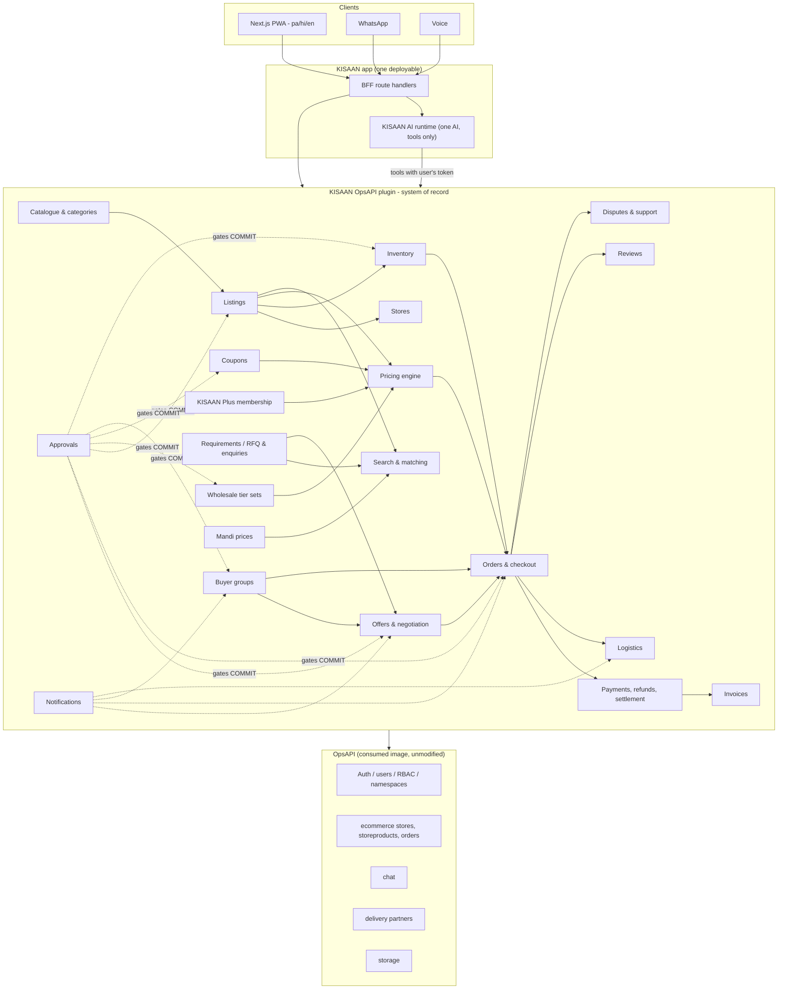
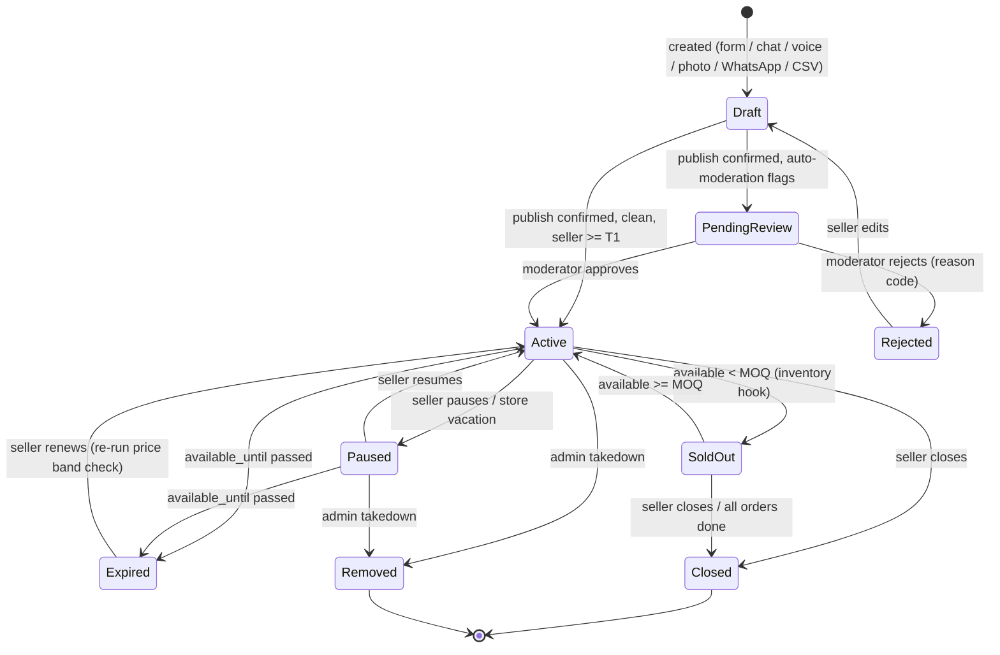
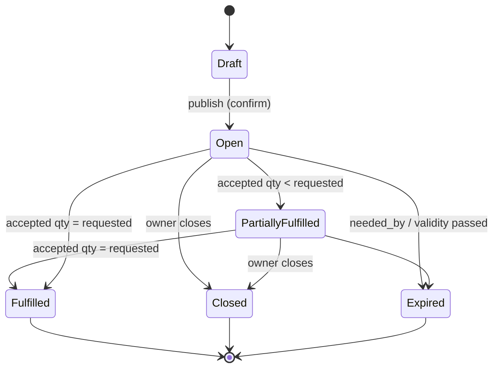
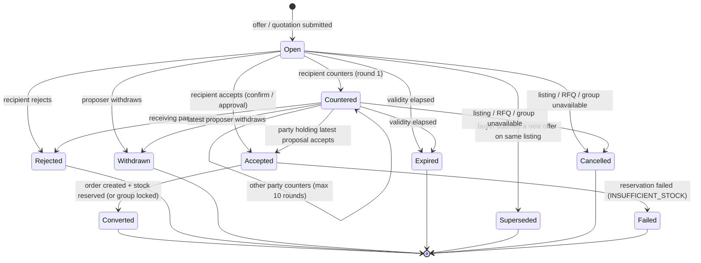
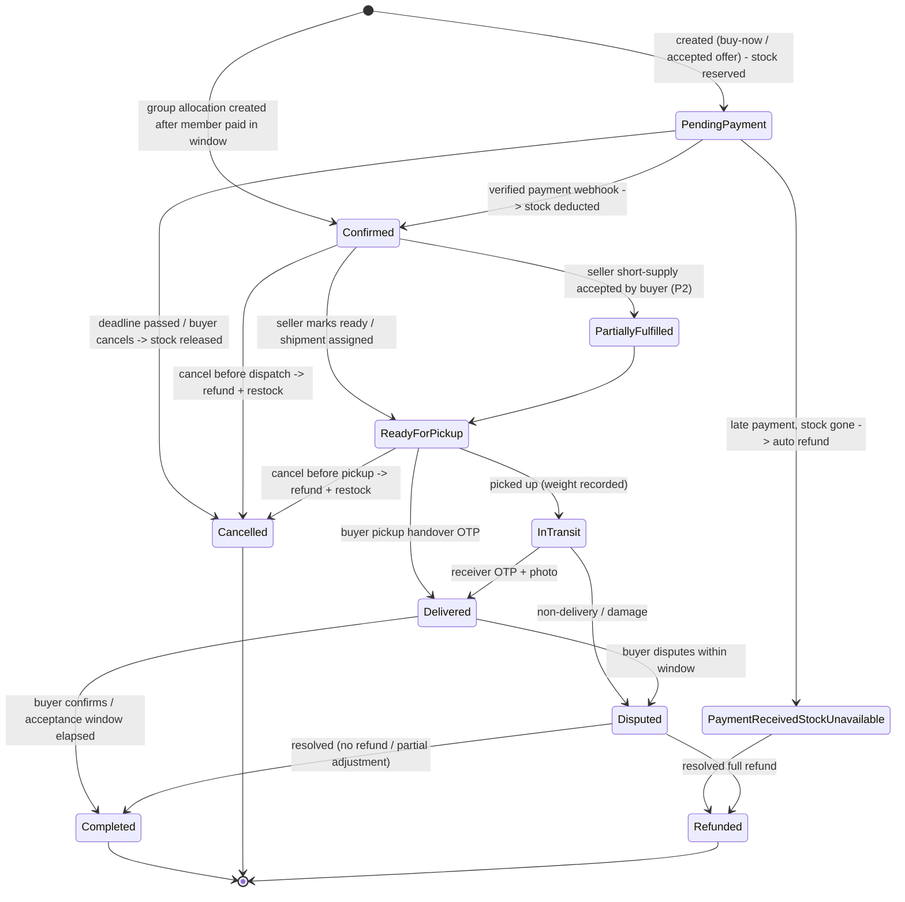
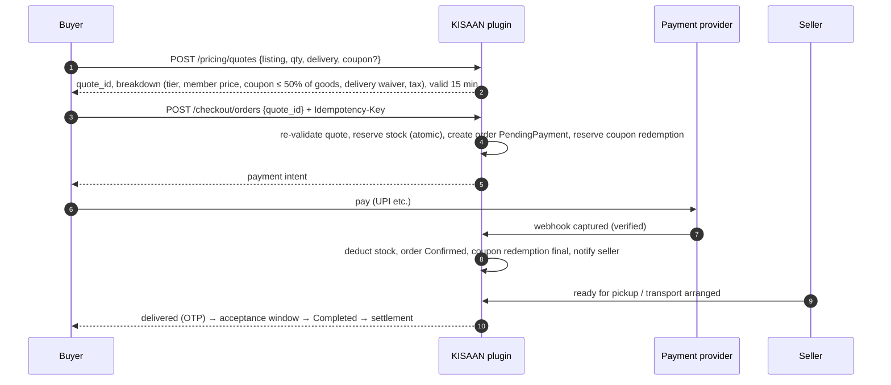
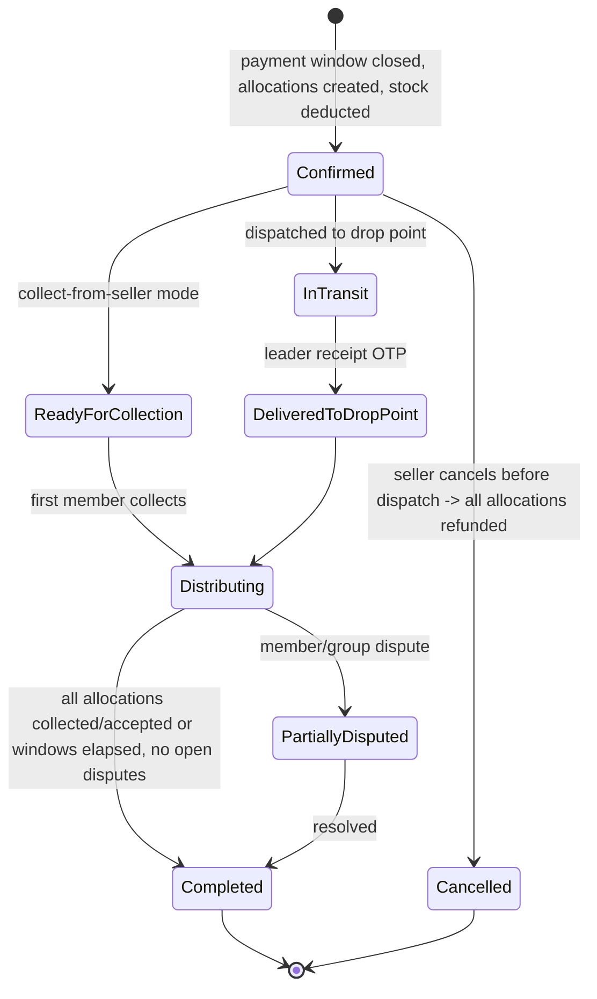

# KISAAN — Marketplace Architecture

> Status: Draft v0.2 · Last updated: 2026-11-14 · Owner: Marketplace architect · Source of truth index: [README](README.md)

This is the **owner document** for the marketplace domain model: catalogue and categories, the listing lifecycle, search and filters, buyer requirements (RFQs), offers and negotiation, and the order state machines for the four commercial flows of Master Prompt v2 §15. It also covers how reviews, disputes and logistics attach to orders. [FUNCTIONAL_SPECIFICATION](FUNCTIONAL_SPECIFICATION.md) §5–§9 and §11–§21 keep the feature-level behaviour and link here for state machines. Where they differ, this document wins.

Related owner documents:

| Topic | Owner |
|---|---|
| Price calculation, stacking, rounding, locking | [PRICING_ENGINE](PRICING_ENGINE.md) |
| Wholesale configuration, bulk buyers, groups | [WHOLESALE_AND_GROUP_BUYING](WHOLESALE_AND_GROUP_BUYING.md) |
| Stores, inventory, reservations, concurrency | [SELLER_STORE_AND_INVENTORY](SELLER_STORE_AND_INVENTORY.md) |
| Coupons, KISAAN Plus | [COUPON_AND_MEMBERSHIP](COUPON_AND_MEMBERSHIP.md) |
| The single KISAAN AI and its tools | [SINGLE_AI_ARCHITECTURE](SINGLE_AI_ARCHITECTURE.md) |
| Runtime, deployment, OpsAPI boundary | [SYSTEM_ARCHITECTURE](SYSTEM_ARCHITECTURE.md), [OPSAPI_INTEGRATION](OPSAPI_INTEGRATION.md) |

## Table of contents

1. [Domain and module map](#1-domain-and-module-map)
2. [Categories and attributes](#2-categories-and-attributes)
3. [Listing lifecycle](#3-listing-lifecycle)
4. [Search and discovery](#4-search-and-discovery)
5. [Buyer requirements (RFQ) and matching](#5-buyer-requirements-rfq-and-matching)
6. [Offers, counteroffers and negotiation](#6-offers-counteroffers-and-negotiation)
7. [Orders — common model](#7-orders--common-model)
8. [Commercial flows](#8-commercial-flows)
9. [Logistics touchpoints](#9-logistics-touchpoints)
10. [Reviews](#10-reviews)
11. [Disputes](#11-disputes)
12. [Cross-flow edge cases](#12-cross-flow-edge-cases)
13. [Requirements, APIs and tests](#13-requirements-apis-and-tests)
14. [Decisions and changes requested elsewhere](#14-decisions-and-changes-requested-elsewhere)

---

## 1. Domain and module map

The marketplace is one modular backend: the **KISAAN OpsAPI plugin** (Lua/Lapis modules under `projects/kisaan`, routes `/api/v2/kisaan/...`, migrations in the KISAAN repo). It runs on the pinned OpsAPI image and is the system of record. The **KISAAN app** (Next.js UI + BFF + the single KISAAN AI runtime module, D-102) calls it with the end user's own token. None of these modules is a microservice of its own (D-102, Master Prompt §24).

**Module rules.**
1. Each module owns its tables. Other modules read them only through module service functions (in-process Lua calls), never with ad-hoc SQL across domains. Exception: the read-only search index builder.
2. Only `kisaan.core_adapter` writes OpsAPI-owned tables (`stores`, `storeproducts`, `orders`, …) ([OPSAPI_INTEGRATION](OPSAPI_INTEGRATION.md) §6.4).
3. Cross-module side effects (search reindex, notifications, analytics, AI context refresh) go through a transactional outbox.
4. All prices shown anywhere come from PRC quotes. All stock shown comes from INV.

---

## 2. Categories and attributes

### 2.1 Category scope (Master Prompt §14)

| Category | Examples | Scope | Reason / gate |
|---|---|---|---|
| Wheat | PBW-826, PBW-725, HD-3086, DBW-187 | **MVP** | Punjab core crop; APMC gating applies (D-80) |
| Rice / Paddy | PR-126, Basmati 1121/1509/1718, milled rice | **MVP** | Variety restrictions vary by state/season `[UNVERIFIED]` |
| Maize | Spring/kharif maize | **MVP** | |
| Pulses | Moong, masoor, chana, arhar | **MVP** | |
| Vegetables | Potato, onion, peas | **MVP**; tomato, cauliflower etc. P2 | Perishable rules |
| Fruits | Kinnow | **MVP**; guava, mango, litchi P2 | Perishable rules |
| Oilseeds | Mustard, sunflower, groundnut, soybean | Phase 2 | |
| Cotton | Kapas | Phase 2 | |
| Animal feed | Fodder, straw/bhusa, cattle feed | Phase 2 (fodder/straw); compound feed Future | |
| Spices | Turmeric, chilli, coriander | Future | |
| Sugarcane | Cane | Future | Mostly mill contracts |
| Seeds | Certified seed | Future | Seeds Act / licence `[LEGAL REVIEW]` |
| Fertilisers | Urea, DAP, NPK | Future | Fertiliser Control Order `[LEGAL REVIEW]` |
| Pesticides | Insecticides, herbicides | Future | Insecticides Act `[LEGAL REVIEW]` |
| Agricultural machinery | Tractors, implements (sale/rent) | Future | Different transaction model (rental) |
| Farming equipment | Sprayers, pumps, tools | Future | Non-produce returns/warranty |
| Other agricultural products | Gur/jaggery, honey, dairy | Future | FSSAI `[LEGAL REVIEW]` |

The MVP list is `[DECISION D-01]` (business-owner confirmation pending). Licence-gated categories can only be enabled when seller licence capture and verification exist (KIS-CAT-008).

### 2.2 Category-specific attributes

Attributes are configuration, not code. Each category has a versioned **attribute schema** (KIS-CAT-003/004): key, pa/hi/en labels, type, unit, required, range or allowed values, `searchable`, `filterable`, `ai_extractable`. The same schema drives:

- the seller form,
- validation (`kisaan_validate_attributes`),
- search facets,
- the slots KISAAN AI fills by asking questions, so it asks only for missing required fields.

| Category | Required (★) and optional attributes |
|---|---|
| Common (all produce) | ★commodity, ★variety, ★quantity, ★display_unit, grade (seller-declared), ★harvest_date (perishables), packaging, storage, ★expected_price, ★MOQ, ★pickup_location, available_from/until, ★photos (1–10), organic_claim |
| Wheat | ★moisture_pct (0–25), foreign_matter_pct, damaged_grain_pct, lustre_loss, hectolitre_weight, protein_pct |
| Paddy / Rice | ★moisture_pct, ★type (paddy/milled), grain_length_mm, broken_pct, aroma (basmati), chalky_pct |
| Maize | ★moisture_pct, aflatoxin_tested (+cert), colour |
| Pulses | ★moisture_pct, ★whole_or_split, foreign_matter_pct, weevilled_pct |
| Vegetables | ★size_grade, ★harvest_date, shelf_life_days, cold_storage, defect_pct |
| Fruits | ★size_count, ★harvest_date, ★packaging (crate/box kg), brix, wax_coated |
| Oilseeds (P2) | ★moisture_pct, ★oil_content_pct (declared), foreign_matter_pct, damaged_pct |
| Cotton (P2) | ★moisture_pct, staple_length_mm, trash_pct, micronaire |
| Fodder / straw (P2) | ★type (green fodder, dry straw/bhusa), ★bale_or_loose, moisture_pct, chop_length |
| Agri-inputs (Future) | ★brand, ★licence_no, ★batch_no, ★mfg_date, ★expiry_date, technical_name, pack_size |

**Units.** 1 qtl = 100 kg; 1 tonne = 1,000 kg. Stored canonically in kg (`NUMERIC(14,3)`). Category display units (e.g. kinnow box with declared kg) convert through the category rule (KIS-CAT-005).

**Category rules** (KIS-CAT-006): the perishability flag drives offer validity (D-05), payment deadline (D-07), acceptance window (D-08) and listing expiry (D-03). State rules (`kisaan_category_state_rules`) gate direct purchase where APMC licensing applies (D-80).

---

## 3. Listing lifecycle

A **listing** is a seller's lot. It is backed by one OpsAPI `storeproducts` row and one KISAAN `kisaan_listings` row, has a 1:1 inventory record, and has at most one active wholesale tier set.

| Rule | Detail |
|---|---|
| Publish is COMMIT | Seller confirmation in UI. Via KISAAN AI, an ApprovalRequest the seller confirms (KIS-APR-001) |
| Visibility | Only Active listings with `available ≥ MOQ` appear in search, matching, store Active section and AI discovery (BR-LST-01) |
| Effects of leaving Active | Existing reservations and orders continue. Open offers are auto-rejected with `LISTING_UNAVAILABLE`. Open listing-bound groups are notified; groups not yet locked cancel if the listing is Closed or Removed |
| Edits | Price/qty/tier edits apply to new quotes only (snapshots protect existing quotes, offers, locked groups, orders). Buyers with open offers are notified (BR-LST-05) |
| Expiry | 30 days non-perishable, 7 days perishable (D-03); reminder 48 h before |
| Moderation | Versioned auto-rules: price outside mandi band, duplicate photo/text, burst listing, prohibited terms, new seller listing > 1,000 qtl (BR-LST-04). A human decides; rejection needs a reason code shown in the seller's language |
| Drafts from AI | AI-generated title/description/attributes are drafts until the seller confirms. An AI photo observation is stored separately and is never a quality certification (KIS-PRD-006) |

---

## 4. Search and discovery

### 4.1 Search types (Master Prompt §13)

| Search | Endpoint (KISAAN-specific) | Notes |
|---|---|---|
| Product (keyword, pa/hi/en/romanised) | `GET /api/v2/kisaan/public/search/listings?q=` | Synonyms: kanak/gehun/ਕਣਕ/गेहूं → wheat |
| Category | `…/search/listings?category=` | Facets from the attribute schema |
| Seller / store | `GET /api/v2/kisaan/public/search/sellers` | By commodity, district, badges |
| Location (radius / district) | `…?lat=&lng=&radius_km=` or `district=` | Default 100 km, auto-expand with disclosure |
| Quantity-based | `…?qty=&unit=` | Ranks and prices by the **effective price at that quantity** (PRC stage 2) and excludes listings whose available < qty unless `allow_partial=true` |
| Wholesale | `…?wholesale=true` | Listings with an active tier set (optionally `tier_reachable_at_qty=true`) |
| Group-buy | `GET /api/v2/kisaan/public/search/groups` and `…/listings?group_eligible=true` | Open groups near the buyer; listings that accept groups |
| Natural language / voice | via KISAAN AI `discovery.search_listings` (READ) | The AI converts the request to the same structured query; results come from the same endpoint |

### 4.2 Filters (Master Prompt §13)

| Filter | Parameter | Source |
|---|---|---|
| Product (commodity / variety) | `commodity`, `variety` | Catalogue |
| Seller | `seller`, `store` | Stores |
| Location | `district`, `lat/lng/radius_km` | Listing public location (rounded) |
| Price | `price_min`, `price_max` (₹ per display unit, effective at `qty`) | PRC stage 2 |
| Quantity available | `qty_min` | Inventory available_kg |
| Minimum order quantity | `moq_max` ("MOQ at most X") | Listing |
| Quality | category facets (`moisture_max`, `grade`, `broken_max`, …) | Attribute schema `filterable` |
| Availability | `available_from_before`, `in_stock=true` | Listing + inventory |
| Wholesale availability | `wholesale=true` | Tier sets |
| Membership benefits | `plus_price=true`, `plus_free_delivery=true` | Listing member price; delivery-waiver eligibility |
| Delivery | `delivery=BUYER_PICKUP|SELLER_DELIVERS|SELLER_DELIVERS_FEE` (`PLATFORM_LOGISTICS` from Phase 9) | Listing `delivery_options` |
| Ratings | `rating_min` | Seller aggregate |
| Verification | `verified=true` (T1+), `business_verified=true` (T3) | KYC tier |
| Group buying | `group_eligible=true`, `has_open_group=true` | Tier set + groups |
| Organic | `organic=certified|self_declared` | Listing |

**Ranking (MVP):** text match + verification boost + rating + freshness + distance. Ranking factors are disclosed on a help page `[LEGAL REVIEW]`. There is no paid boosting in MVP. Featured listings/stores are Future and labelled "Sponsored". Membership and coupons are **not** used in ranking (BR-SRCH-11).

**Index.** Postgres full-text search + `pg_trgm` + PostGIS in MVP; reindex ≤ 60 s after any listing/inventory/tier change. A stale hit is re-checked live before display. A dedicated search engine is considered only at P2 scale.

### 4.3 Requirements (search)

KIS-SRCH-001…023 (v0.1), plus:

| ID | Requirement | Scope |
|---|---|---|
| **KIS-SRCH-024** (new) | Quantity-aware search: ranking, price filter and availability use the requested quantity | MVP |
| **KIS-SRCH-025** (new) | Filters for MOQ, wholesale availability, KISAAN Plus benefits, delivery mode, group eligibility, open groups | MVP |
| **KIS-SRCH-026** (new) | Seller/store search by commodity, district and badges | MVP |
| **KIS-SRCH-027** (new) | Natural-language/voice search via KISAAN AI maps to the same structured query and endpoint; the AI may not show results not returned by the endpoint | MVP |

**Acceptance.** "500 kg rice Moga mein, 500 se zyada pe discount" via the AI produces a structured query `commodity=rice, qty=500 kg, district=Moga (radius 100 km), wholesale=true`. The results equal a UI search with the same filters. Each card shows the server-quoted effective price at 500 kg, with the tier saving and the next-tier nudge.

---

## 5. Buyer requirements (RFQ) and matching

| Element | Rule |
|---|---|
| Owners | Individual buyer (≤ 3 open), bulk buyer (≤ 20 open, D-135), group (group requirement, via the leader) |
| Fields | Commodity, variety, quality spec (attribute ranges), quantity, delivery location, needed-by, target price (optional, private by default), delivery preference, payment terms (MVP prepaid via platform) |
| Publish | COMMIT (owner confirmation) |
| Visibility | Sellers in matching districts see the RFQ with the buyer shown as type + district + badges. Identity is revealed on acceptance (D-04) |
| Matching | A **deterministic matching service** scores Active listings and sellers (commodity/variety match, quality fit, available ≥ requested or splittable, distance, verification, rating, response history). It notifies the top 20, and the next 20 after 24 h if fewer than 3 quotations arrive. Max 5 RFQ alerts per seller per day (BR-ENQ-03). KISAAN AI can call `matching.find_matches` (READ) and explain results; it does not create matches itself |
| Responses | Seller quotations (offers with `context_type = rfq_quotation`), or `group_offer` for group requirements (`listing_terms` or `custom_price`, see WHOLESALE_AND_GROUP_BUYING §7.4) |
| Comparison | Buyer sees landed price per unit at their quantity, seller badges/rating, distance, delivery date and validity (KIS-OFR-004) |
| Split | A buyer may accept several quotations whose total ≤ RFQ quantity (BR-ENQ-05) |
| Lifecycle | Draft → Open → (PartiallyFulfilled) → Fulfilled / Closed / Expired (1–30 days, default 7) |

---

## 6. Offers, counteroffers and negotiation

### 6.1 Contexts

| `context_type` | Proposer → recipient | Accept creates |
|---|---|---|
| `listing_offer` | Buyer → seller (offer on a listing) | Order (PendingPayment) + reservation |
| `rfq_quotation` | Seller → buyer (quotation on an RFQ) | Order (PendingPayment) + reservation |
| `group_offer` (new, D-133) | Seller → group leader | Group lock (WHOLESALE_AND_GROUP_BUYING §7) — not an order directly |

Offer content: quantity (or min/max total for group offers), unit price per display unit (`custom_price`) or a listing reference (`listing_terms`), delivery terms, pickup/delivery window, payment terms (MVP: prepaid via platform), validity, message.

### 6.2 Negotiation state machine

### 6.3 Rules

| Rule | Detail |
|---|---|
| Binding acceptance | Accept, reject, counter and withdraw are COMMIT actions. Acceptance is **atomic**: lock negotiation → re-validate listing Active and qty ≤ available → reserve (conditional update) → create order with the negotiated price snapshot (PRICING_ENGINE: negotiated price replaces stages 1–3 and 5) → set payment deadline. If the reserve fails → Failed + `INSUFFICIENT_STOCK` |
| Turn-taking | Only the party who received the latest proposal can accept/reject (`NOT_YOUR_TURN`) |
| Rounds | Max 10. Each counter resets validity to its own validity, capped at 72 h from the original offer |
| Stock | Offers do not reserve stock (KIS-OFR-005). The offer quantity must be ≥ MOQ and ≤ available at submission |
| Immutability | Each round is an immutable event (proposer, price, qty, terms, validity, channel, `ai_drafted`) |
| AI | KISAAN AI drafts counters and explains comparisons (net realisation for sellers; landed price vs the buyer's current tier price). It never sends, accepts or rejects without an ApprovalRequest bound to the exact parameters. AI-drafted proposals are labelled as such to the counterparty (BR-OFR-14) |
| Auto-rules (P2) | Seller auto-reject below a floor, or reply-with-floor. Never auto-accept (D-06) |
| Contact masking | Phone numbers/UPI IDs in messages are masked (BR-ENQ-06) |

---

## 7. Orders — common model

### 7.1 Sources

| Source | Created by | Price basis |
|---|---|---|
| `buy_now` | Checkout from a quote | PRC quote (list → tier → member price → coupon → delivery → tax) |
| `accepted_offer` | Negotiation acceptance | Negotiated price (+ delivery, tax; coupon only if `allow_on_negotiated`) |
| `group_allocation` | Group payment window close | Locked group quote; one child order per allocation under one group order |

MVP orders are **single-seller, single-listing** (BR-ORD-01). Multi-seller carts are Future. The "cart" in MVP is a per-listing checkout sheet.

### 7.2 Order state machine (all sources)

### 7.3 Common rules

| Rule | Detail |
|---|---|
| Price snapshot | Immutable from Confirmed: list, tier/whole-lot, group discount, negotiated price, member price, coupon (code, amount, funded by), delivery fee, KISAAN Plus waiver, commission (seller-side), taxes/TCS, payable, quote id, store policy version |
| Payment deadlines | Buy-now 15 min; accepted offer 24 h (perishable 4 h, D-07); group allocation = group payment window |
| Cancellation | BR-ORD-04 table: free in PendingPayment; full refund if cancelled before dispatch; after pickup, dispute only. Seller cancellations count against reliability |
| Dispatch SLA | 48 h (perishables 12 h) after Confirmed, else escalation and free buyer cancel (BR-ORD-08) |
| Acceptance window | 48 h after Delivered (perishables 12 h, D-08); auto-complete after |
| Weight reconciliation | ±2 % pro-rata adjustment; more than 2 % short → dispute unless the buyer accepts |
| Backend authority | Order totals come only from PRC. The client never submits amounts; it submits `quote_id` |
| Idempotency | `Idempotency-Key` required on checkout, accept, cancel, confirm-receipt |

---

## 8. Commercial flows

### 8.1 Normal purchase (Master Prompt §15)

Buyer → cart (quantity, delivery mode) → pricing → coupon → membership → checkout → payment → order → inventory reservation → delivery → completion.

| Step | Failure / edge case | Handling |
|---|---|---|
| Quote | Quote expired at checkout | `QUOTE_EXPIRED` → re-quote; if the price changed, `PRICE_CHANGED_REAPPROVE` |
| Coupon | Invalid / expired / exhausted / ineligible / above the 50 % goods-value cap | Specific error; checkout continues without the coupon only after buyer confirmation (COUPON_AND_MEMBERSHIP) |
| Membership | Expires between quote and payment | Waiver honoured for quote validity (EC-06) |
| Reserve | Insufficient stock | `INSUFFICIENT_STOCK` with available qty; AI suggests alternatives |
| Payment | Failed / abandoned | Retry within deadline; then Cancelled + release |
| Payment | Captured after cancellation | Auto-refund (EC-05) |
| Delivery | Seller misses dispatch SLA | Escalation; free cancel |
| Completion | Weight short > 2 % | Dispute |

### 8.2 Wholesale purchase

Buyer → quantity selection → tier pricing → coupon → membership → checkout → payment → inventory → delivery.

Same pipeline as §8.1, with these differences:

| Aspect | Wholesale specifics |
|---|---|
| Quantity selection | Tier table with current tier highlighted; next-tier nudge; whole-lot one-tap if enabled |
| Tier eligibility | Evaluated at quote time and **re-evaluated at reservation** (whole-lot: available may have changed → `PRICE_CHANGED_REAPPROVE`) |
| Buyer type restrictions | Bulk-only tier sets need a bulk-buyer profile (KIS-BULK-011) |
| Verification | Orders above ₹2,00,000 need T3 (`BUYER_TIER_LIMIT_EXCEEDED`) |
| Max order qty | `QTY_ABOVE_MAX` if the tier set caps it |
| APMC gating | Wheat/paddy direct checkout off until the legal opinion (D-80); buyer licence where state rules require it |
| Delivery | Large lots usually use platform logistics or buyer pickup (truck); weighbridge slip required at pickup |
| Alternative | Negotiation path (§6) when the buyer wants a price below the tier price; the AI warns if the offer is above the current tier price (BR-OFR-05) |

### 8.3 Group purchase

Group creation → member commitments → group requirement → seller offers → group pricing → member confirmation → payment → consolidated order → delivery. Fully specified in [WHOLESALE_AND_GROUP_BUYING](WHOLESALE_AND_GROUP_BUYING.md) §7 (state machine, payment window, shortfall rule, allocations, delivery strategies). The order model here applies **per allocation** (child orders start at Confirmed because payment precedes creation), plus a parent group order:

### 8.4 Seller bulk offer

Seller → product → quantity tiers → discount → start/end date → approval → publish. This is the **wholesale tier set lifecycle** (WHOLESALE_AND_GROUP_BUYING §4.4: Draft → Scheduled/Active → Expired/Disabled/Superseded).

| Edge case | Handling |
|---|---|
| Overlapping windows | `TIER_SET_OVERLAP` |
| Tier below floor / non-monotonic | Rejected with field errors |
| Published by AI without confirmation | Impossible: `pricing.propose_wholesale_tiers` is COMMIT and requires an approved ApprovalRequest |
| Edited during open quotes/groups | New quotes only; open groups notified; no worsening within 24 h of a group deadline (D-136) |
| Admin emergency disable | Tier set Disabled; seller notified; quotes in validity honoured |

---

## 9. Logistics touchpoints

| Order event | Logistics action | Owner |
|---|---|---|
| Confirmed + `PLATFORM_LOGISTICS` (Phase 9 / P2, D-106) | Transport request drafted (AI tool `logistics.draft_transport_request`, DRAFT) → requester confirms → broadcast to eligible transporters | LOG |
| Quotes received | Comparison (price, ETA, rating, vehicle) → accept (COMMIT) → shipment Assigned (OpsAPI delivery assignment via core adapter) | LOG |
| Pickup | Weighbridge weight + photo + seller OTP → order InTransit | LOG/ORD |
| Delivery | Receiver OTP + photo → order Delivered | LOG/ORD |
| Exception | Shipment Exception → reassignment proposal → requester approves | LOG |
| Group order | One shipment to the drop point; delivery share allocated pro-rata (PRICING_ENGINE) | LOG/GRP |
| KISAAN Plus priority (Phase 9 / P2) | Member orders broadcast to transporters 30 min earlier (BR-LOG-06) — no delivery-time guarantee | LOG |
| Seller delivers (`SELLER_DELIVERS` / `SELLER_DELIVERS_FEE`) / buyer pickup — **MVP** | No transporter; OTP handover | ORD |

The shipment state machine is in FUNCTIONAL_SPECIFICATION §17. Transport estimates are shown only when based on live quotes or ≥ 3 comparable historical shipments (BR-LOG-04). KISAAN AI never invents a freight rate.

---

## 10. Reviews

| Rule | Detail |
|---|---|
| Eligibility | Completed (or dispute-Refunded) orders/allocations only; once per reviewer per counterparty per order; within 14 days |
| Directions | Buyer → seller; seller → buyer; both → transporter; group member → leader |
| Dimensions | Seller: overall, quality as described, communication, timeliness. Buyer: payment/pickup reliability. Transporter: punctuality, care. Leader: coordination |
| Display | Mean to 1 dp + count; "New" below 3 ratings; store page and listing card |
| Moderation | Automatic abuse/PII screening; flagged reviews held; seller may reply once; edits locked after 48 h; admin removal only for policy violation (audited) |
| Integrity | No incentivised reviews; self-dealing orders are excluded from aggregates; reviews from orders later found fraudulent are removed |
| Storage | KISAAN create/moderate APIs; mirrored to OpsAPI `store_reviews`/`product_reviews` for public reads |

---

## 11. Disputes

The dispute state machine and rules are in FUNCTIONAL_SPECIFICATION §21 (KIS-DSP-001…007). Marketplace-level rules:

| Rule | Detail |
|---|---|
| Who | Buyer (quality, quantity short, not delivered, damaged, wrong variety), seller (buyer rejected without cause, no-show), transporter (payment issue, loading delay), group member (own allocation), leader (group-level, with member consent) |
| Effect | Freezes the related settlement (only the disputed allocation's share in group orders); blocks auto-completion |
| Evidence | ≥ 2 photos for quality/damage; weighbridge slip or weighing photo for quantity |
| Decision | Always a human resolver with a written reason. KISAAN AI only produces a neutral evidence summary and timeline (using READ tools such as `orders.get_order` and `offers.get_negotiation`; no dedicated dispute-summary tool in the MVP catalogue). It never recommends a winner (BR-DSP-05) |
| Outcomes | Full refund (+ return logistics by the party at fault), partial refund/price adjustment, re-delivery, no refund. Money moves only through PAY, idempotently. Inventory effect per SELLER_STORE_AND_INVENTORY §6.5 |
| SLA | Response 24 h, resolution target 7 days, escalation 14 days |

---

## 12. Cross-flow edge cases

| # | Scenario | Handling |
|---|---|---|
| MK-01 | Two buyers check out the last lot simultaneously | One reservation wins (SELLER_STORE_AND_INVENTORY §7.2); loser gets `INSUFFICIENT_STOCK` + alternatives |
| MK-02 | Buyer has an open offer and then buys now | Allowed; the open offer is auto-cancelled if quantity becomes unavailable |
| MK-03 | Seller accepts two offers totalling more than available | Second acceptance fails atomically (Failed, `INSUFFICIENT_STOCK`) |
| MK-04 | Listing price edited while a group is Open | Indicative price updates; locked groups unaffected |
| MK-05 | Group lock and a buy-now compete for stock | First-come at the inventory row; group may enter reduced-quantity decision |
| MK-06 | RFQ quotation accepted while the seller's listing is Paused | Quotations reference stock: Paused listing → acceptance fails `LISTING_UNAVAILABLE` |
| MK-07 | Seller suspended mid-flow | New offers/checkouts blocked; open orders complete under admin watch; groups not yet locked cancelled |
| MK-08 | Buyer suspended with an unpaid order | Order cancelled at deadline; stock released |
| MK-09 | AI states a price that differs from the server quote | Must not happen: the AI may only quote tool results. Guardrail test (KIS-TEST-AI) |
| MK-10 | Category deactivated by admin | Listings hidden from search; existing orders continue; drafts blocked from publish |
| MK-11 | APMC gate active for wheat in Punjab | Buy-now/offer acceptance blocked with `CATEGORY_TRADE_RESTRICTED` and an explanation; enquiries allowed (D-80) |

---

## 13. Requirements, APIs and tests

### 13.1 Requirements owned or referenced here

| Domain | IDs | New in v0.2 |
|---|---|---|
| Catalogue | KIS-CAT-001…009 | **KIS-CAT-010**: Phase-2 attribute schemas (oilseeds, cotton, fodder) defined before category activation (P2) |
| Listings | KIS-PRD-001…024 | — |
| Search | KIS-SRCH-001…023 | KIS-SRCH-024…027 (§4.3) |
| Requirements | KIS-ENQ-001…006 | **KIS-ENQ-007**: RFQ lifecycle incl. PartiallyFulfilled and group-owned requirements (MVP) |
| Offers | KIS-OFR-001…015 | **KIS-OFR-016**: `group_offer` context with `listing_terms` / `custom_price` kinds, seller ↔ leader negotiation (MVP) |
| Orders | KIS-ORD-001…009 | **KIS-ORD-010**: three order sources incl. group allocation child orders under a parent group order (MVP). **KIS-ORD-011**: `PaymentReceivedStockUnavailable` state with auto-refund (MVP) |
| Reviews | KIS-REV-001…005 | — |
| Disputes | KIS-DSP-001…007 | — |
| Logistics | KIS-LOG-001…009 | — |

### 13.2 APIs

All are **KISAAN-specific endpoints (OpsAPI plugin)** already listed in [API_SPECIFICATION](API_SPECIFICATION.md), except:
- `GET /api/v2/kisaan/public/search/listings` gains the §4.2 parameters (`qty`, `moq_max`, `wholesale`, `group_eligible`, `has_open_group`, `plus_price`, `plus_free_delivery`, `delivery`, `rating_min`, `organic`).
- Group-offer endpoints are listed in WHOLESALE_AND_GROUP_BUYING §13.1.

Existing OpsAPI endpoints used indirectly: `GET /api/v2/public/stores/:slug` (store fallback/reviews), `GET /api/v2/orders/:id/status-history` (admin), OpsAPI delivery-partner endpoints (transporters). All are as verified in v0.1 [OPSAPI_INTEGRATION](OPSAPI_INTEGRATION.md). No other OpsAPI endpoint is assumed.

### 13.3 Tests

| ID | Covers |
|---|---|
| KIS-TEST-SRCH-101 | Quantity-aware ranking and price filter (FS §8 acceptance example) |
| KIS-TEST-SRCH-102 | Every §4.2 filter, logged out and logged in; no Paused/SoldOut results (property test) |
| KIS-TEST-SRCH-103 | AI NL query ↔ UI query result equality |
| KIS-TEST-CAT-101 | Attribute schema drives form, validation, facets and AI slot list consistently |
| KIS-TEST-PRD-101 | Every listing transition; invalid transitions → `INVALID_STATE_TRANSITION` |
| KIS-TEST-ENQ-101 | RFQ lifecycle incl. partial fulfilment via split acceptance |
| KIS-TEST-OFR-101 | Negotiation state machine incl. turn-taking, round 11 rejection, expiry, supersede |
| KIS-TEST-OFR-102 | Atomic acceptance under concurrent acceptances (MK-03) |
| KIS-TEST-OFR-103 | Group offer `listing_terms` vs `custom_price` pricing paths |
| KIS-TEST-ORD-101 | Normal purchase happy path + every §8.1 failure row |
| KIS-TEST-ORD-102 | Wholesale purchase: tier at quote, whole-lot re-evaluation at reservation, T3 gate, max qty |
| KIS-TEST-ORD-103 | Group allocation orders: parent/child consistency, per-allocation dispute freeze |
| KIS-TEST-ORD-104 | Late payment → PaymentReceivedStockUnavailable → refund |
| KIS-TEST-ORD-105 | Order totals never accept client-supplied amounts (API fuzz) |
| KIS-TEST-REV-101 | Review eligibility, window, self-dealing exclusion |

The full Master Prompt §32 end-to-end scenario is walked step by step in WHOLESALE_AND_GROUP_BUYING §11.2. It is to be automated as an E2E test in [TESTING_STRATEGY](TESTING_STRATEGY.md).

---

## 14. Decisions and changes requested elsewhere

| ID | Item | Status |
|---|---|---|
| D-137 | Group allocation child orders are created directly in Confirmed (payment precedes order creation) | Proposed — v0.2 |
| D-138 | Search ranking ignores membership and coupons; quantity-aware price uses PRC stage 2 only | Proposed — v0.2 (restates BR-SRCH-11) |

**Requested changes elsewhere:**
- FUNCTIONAL_SPECIFICATION: link §6, §7, §8, §11, §13, §14 state machines here. Update the §0.2 module diagram (replace "AI Gateway + Agents" with "KISAAN AI (tools)").
- API_SPECIFICATION: the search parameters in §13.2. Add the order state `payment_received_stock_unavailable` to enums.
- DATABASE_SCHEMA: `kisaan_buyer_requirements.status` add `partially_fulfilled`; `owner_type` (`buyer|group`). `kisaan_order_details.source` add `group_allocation`; `parent_group_order_id`.
- PRD: add KIS-CAT-010, KIS-SRCH-024…027, KIS-ENQ-007, KIS-OFR-016, KIS-ORD-010/011.
- RISKS_AND_ASSUMPTIONS: register D-137, D-138.
- TESTING_STRATEGY / REQUIREMENTS_TRACEABILITY: the tests in §13.3.
