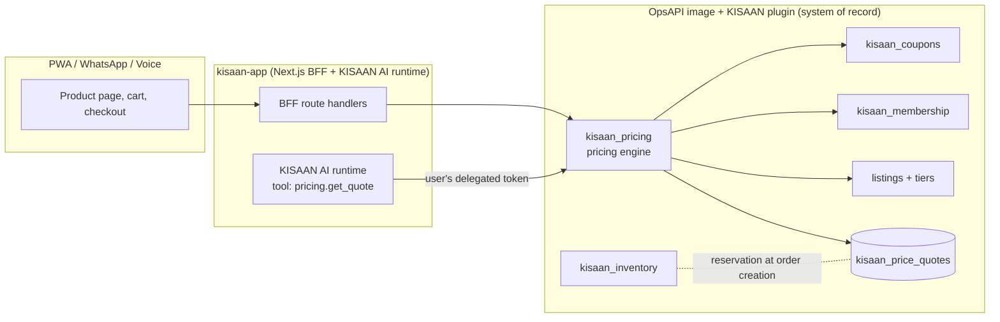
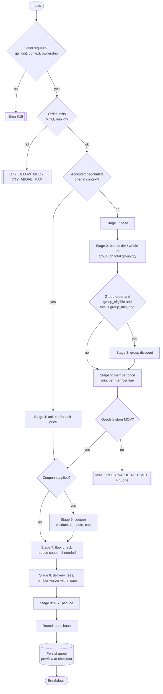
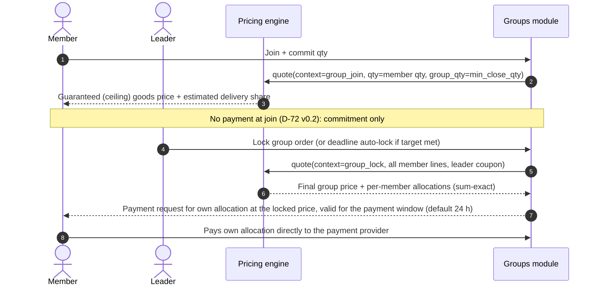
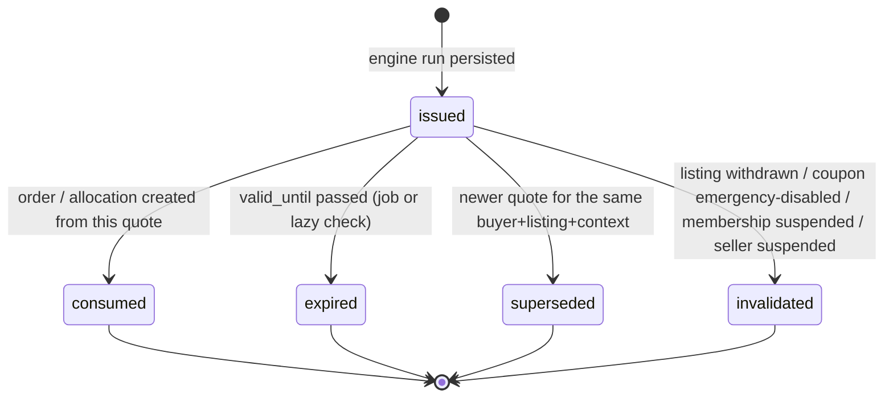

# KISAAN — Pricing Engine

> Status: Draft v0.2 · Last updated: 2026-11-14 · Owner: Commerce engineering lead (pricing) · Source of truth index: [README](README.md)

> **This is the normative owner document for pricing (Master Prompt v2 §5, §16, §27).** If any other document gives a different stacking order, rounding rule, lock period or discount interaction, this document wins. Other documents link here and must not restate the rules. [FUNCTIONAL_SPECIFICATION](FUNCTIONAL_SPECIFICATION.md) §30 is now a summary that points here.
>
> Every rupee value in this document is an **illustrative placeholder**. None of it is a price decision, a tax rate or tax advice. Items marked `[TAX REVIEW]` need a chartered accountant's opinion before launch. Items marked `[LEGAL REVIEW]` need counsel.

Related: [WHOLESALE_AND_GROUP_BUYING](WHOLESALE_AND_GROUP_BUYING.md) (tier set-up, group lifecycle) · [COUPON_AND_MEMBERSHIP](COUPON_AND_MEMBERSHIP.md) (coupon validation, membership benefit entitlements) · [PAYMENT_AND_BUSINESS_MODEL](PAYMENT_AND_BUSINESS_MODEL.md) (who funds what, commission, settlement) · [SELLER_STORE_AND_INVENTORY](SELLER_STORE_AND_INVENTORY.md) (reservations) · [MARKETPLACE_ARCHITECTURE](MARKETPLACE_ARCHITECTURE.md) (order and offer state machines) · [SINGLE_AI_ARCHITECTURE](SINGLE_AI_ARCHITECTURE.md) (pricing tools) · [DATABASE_SCHEMA](DATABASE_SCHEMA.md) · [API_SPECIFICATION](API_SPECIFICATION.md) · [TESTING_STRATEGY](TESTING_STRATEGY.md)

---

## Table of contents

1. [Purpose, principles and non-goals](#1-purpose-principles-and-non-goals)
2. [Requirements](#2-requirements)
3. [Where the engine runs (authority)](#3-where-the-engine-runs-authority)
4. [Inputs and outputs](#4-inputs-and-outputs)
5. [The stage model (normative precedence)](#5-the-stage-model-normative-precedence)
6. [Stack / no-stack matrix](#6-stack--no-stack-matrix)
7. [Wholesale tier semantics](#7-wholesale-tier-semantics)
8. [Group-order pricing and allocation](#8-group-order-pricing-and-allocation)
9. [Order limits: MOQ, maximum quantity, minimum order value](#9-order-limits-moq-maximum-quantity-minimum-order-value)
10. [Delivery charges, platform fees and the membership waiver](#10-delivery-charges-platform-fees-and-the-membership-waiver)
11. [Taxes and withholdings](#11-taxes-and-withholdings)
12. [Rounding and units](#12-rounding-and-units)
13. [Quotes, price locking and checkout re-validation](#13-quotes-price-locking-and-checkout-re-validation)
14. [Deterministic algorithm (pseudocode)](#14-deterministic-algorithm-pseudocode)
15. [Error codes](#15-error-codes)
16. [Worked examples (INR)](#16-worked-examples-inr)
17. [Display rules and the KISAAN AI](#17-display-rules-and-the-kisaan-ai)
18. [Configuration, versioning and audit](#18-configuration-versioning-and-audit)
19. [Acceptance criteria](#19-acceptance-criteria)
20. [Test cases](#20-test-cases)
21. [Mapping from v0.1 stage numbers](#21-mapping-from-v01-stage-numbers)
22. [Decisions, assumptions and risks raised here](#22-decisions-assumptions-and-risks-raised-here)

---

## 1. Purpose, principles and non-goals

**Purpose.** A single deterministic engine produces every price a KISAAN user sees or pays. Search cards, the product page, offers, the cart, checkout, group orders, invoices, seller statements and the KISAAN AI all get their numbers from it, so every surface agrees.

**Principles**

| # | Principle |
|---|---|
| P1 | **Backend authority.** The authoritative price is computed only by the KISAAN OpsAPI plugin (`kisaan_pricing` module). The frontend, the Next.js BFF and the KISAAN AI never compute a final amount. They can only display a server quote (KIS-REQ: backend authoritative for price; KIS-PRC-001). |
| P2 | **Deterministic.** The same inputs and the same rule versions always produce the same breakdown, down to the paisa. There is no randomness, no time-of-call dependence except the explicit `as_of` input, and no model inference. |
| P3 | **One benefit per family.** Within one family of benefits (quantity benefits, coupons) only the single best eligible benefit applies. Benefits from different families stack only in the fixed order in §5. |
| P4 | **Seller floor is sacred.** No combination of seller-funded discounts may take the effective unit price below the seller's floor price. |
| P5 | **Explainable.** Every line in the breakdown carries the rule that produced it, the rule version, and who funds it. These are shown to the user in their language. |
| P6 | **Honest locking.** A quote shows its expiry. A price only changes against the buyer after the lock expires, and then only with fresh consent. |

**Non-goals (MVP)**

- Dynamic or surge pricing set by KISAAN. Sellers set prices; KISAAN never changes a seller's price.
- AI-set prices. The KISAAN AI may *suggest* list prices and tiers to a seller as a draft (see [SINGLE_AI_ARCHITECTURE](SINGLE_AI_ARCHITECTURE.md)), but suggestions never enter the engine until the seller publishes them.
- Platform-funded coupons (Future, KIS-COUPON-012).
- Multi-seller carts (Future; BR-ORD-01: an MVP order is one seller and one listing).
- Currency other than INR.

---

## 2. Requirements

Existing requirements (from [PRD](PRD.md)) that this document now owns in detail:

| ID | Requirement (summary) | Scope |
|---|---|---|
| KIS-PRC-001 | One pricing engine; one breakdown used by every surface | MVP |
| KIS-PRC-002 | Normative stacking order — **superseded in detail by §5 of this document (v0.2, D-103 adds the group discount stage)** | MVP |
| KIS-PRC-003 | No negative totals; unit price never below ₹0.01/kg; seller price floor enforced | MVP |
| KIS-PRC-004 | Coupons on negotiated prices only if `allow_on_negotiated = true` | MVP |
| KIS-PRC-005 | Funding attribution on every line (seller / platform) | MVP |
| KIS-PRC-006 | Quotes have a validity (15 min) and are re-validated at payment | MVP |
| KIS-PRC-007 | Rounding: ₹0.0001/kg internally; half-up to ₹0.01 for every charged amount | MVP |

New requirements added in v0.2:

| ID | Requirement | Scope | Acceptance (summary) |
|---|---|---|---|
| KIS-PRC-008 | **Group discount stage.** A seller can define a group-buy discount (₹ per kg or %) on a listing or a group offer. It applies only on group orders, only when the listing/offer is `group_eligible`, and only when the group's total quantity ≥ the seller's `group_min_qty`. It applies after the wholesale stage. Seller-funded. | MVP | Example 7 and 8 produce the stated amounts |
| KIS-PRC-009 | **Stack/no-stack matrix (§6) is enforced** by the engine. A configuration that would violate it is rejected at save time (`PRICING_RULE_CONFLICT`), and the engine never applies two benefits of the same family. | MVP | Every cell of §6 has a test |
| KIS-PRC-010 | **Group allocation.** For group orders the engine prices the total, then allocates goods, coupon and delivery to member lines with the largest-remainder method so member lines always sum exactly to the group total. | MVP | Example 8 sums to the paisa |
| KIS-PRC-011 | **Guaranteed (ceiling) group price.** At join, each member sees the guaranteed price (no payment at join, D-72 v0.2). Members pay after the leader locks the group order, at the final locked price, which is ≤ the guaranteed price for goods and stays locked for the member payment window (default 24 h). | MVP | Example 5 |
| KIS-PRC-012 | **Order limits.** The engine enforces listing MOQ, listing maximum order quantity, available quantity (advisory at quote, authoritative at reservation), and the seller's store-level minimum order value (MOV). | MVP | Example 9 |
| KIS-PRC-013 | **Tier types and windows.** Wholesale tiers support three forms — fixed unit price, % off list, ₹/kg off list — plus optional start/end time, eligible buyer types and a group-eligibility flag. | MVP | Example 6 |
| KIS-PRC-014 | **Quote lifecycle.** Quotes are persisted, owned by one user, single-use, carry a rule-version snapshot and a breakdown hash, and move through the states in §13.2. | MVP | State machine tests |
| KIS-PRC-015 | **Checkout re-validation** at order creation, at payment initiation and at payment capture, with the checks in §13.4. | MVP | KIS-TEST-PRC-006, KIS-TEST-PRC-111 |
| KIS-PRC-016 | **Tax stage.** GST is computed per line on the post-discount taxable value using a configurable (HSN × seller registration) rate table. TCS/TDS are seller-payout withholdings and never added to the buyer total. | MVP (calc), rates `[TAX REVIEW]` | Example 10 |
| KIS-PRC-017 | **Display.** The all-inclusive total is shown before any payment; tier table, "you save" and next-tier nudge are shown from engine output only; packaged goods never exceed the captured MRP. | MVP | UI tests |
| KIS-PRC-018 | **KISAAN AI pricing.** The AI states a price only from an engine response (`pricing.get_quote`), labels it "estimate" (preview) or "locked quote" (checkout quote, with expiry), and never computes or rounds prices itself. | MVP | AI eval set |
| KIS-PRC-019 | **Replay and audit.** Every quote stores its full inputs and rule versions so support and dispute staff can replay it and get the identical breakdown. | MVP | KIS-TEST-PRC-009 |
| KIS-PRC-020 | **Buyer-side fee lines.** The engine supports a configurable platform/logistics booking fee line (default ₹0 for goods; logistics booking fee per [PAYMENT_AND_BUSINESS_MODEL](PAYMENT_AND_BUSINESS_MODEL.md)) that the membership waiver can cover. | MVP | Example 1 variant |

---

## 3. Where the engine runs (authority)



- **Authoritative engine:** the `kisaan_pricing` module in the KISAAN OpsAPI plugin (Lua). It is reached through **KISAAN-specific endpoints (OpsAPI plugin)**: `POST /api/v2/kisaan/checkout/quote` and the price breakdown on `GET /api/v2/kisaan/public/listings/:uuid?qty=&unit=` (both already in [API_SPECIFICATION](API_SPECIFICATION.md)). Group lock pricing runs inside `POST /api/v2/kisaan/groups/:uuid/lock` (preview: `/lock/preview`). No OpsAPI core endpoint computes KISAAN prices.
- **Preview library (optional):** a TypeScript package `@kisaan/pricing-preview` may reproduce the algorithm for instant UI feedback while a user moves a quantity slider. It is **never** used for amounts that are charged, invoiced or stated by the AI. Both implementations run the same golden test vectors (shared JSON fixtures, §20). If they disagree, the server wins and the mismatch is logged.
- **Inventory:** the engine reads availability for advisory messages only. Reservation happens at order creation in the inventory module ([SELLER_STORE_AND_INVENTORY](SELLER_STORE_AND_INVENTORY.md)); a quote never reserves stock.
- **Coupons:** a *checkout* quote reserves a coupon redemption slot (see [COUPON_AND_MEMBERSHIP](COUPON_AND_MEMBERSHIP.md) §2.6). A *preview* quote never does.

---

## 4. Inputs and outputs

### 4.1 Inputs

| Input | Source (trusted) | Notes |
|---|---|---|
| `listing` | DB, at the version current at `as_of` | list price/kg, floor/kg, member price/kg, MOQ, max order qty, whole-lot flag and price, `group_eligible`, group discount config, HSN code, tax category, MRP (packaged goods only), unit conversions |
| `tiers[]` | DB | per §7 |
| `qty` + `unit` | Request | converted to kg using the listing's unit table (quintal = 100 kg, tonne = 1,000 kg, crate/bag = declared kg) |
| `buyer` | Server-side identity (never from the request body) | user id, buyer type (individual / bulk / business), verification tier, membership snapshot, first-time-buyer-of-this-seller flag |
| `context` | Request, validated | `preview` · `checkout` · `offer_accept` · `group_join` · `group_lock` |
| `negotiation_id` | Request, validated | Only if the buyer is a party to an **accepted** offer on this listing that is still within its payment deadline |
| `group_id` | Request, validated | Only if the buyer is a member (or the leader for `group_lock`) |
| `coupon_code` | Request | Validated by the coupon module |
| `delivery` | Request + logistics module | delivery term (`BUYER_PICKUP`, `SELLER_DELIVERS`, `SELLER_DELIVERS_FEE`; `PLATFORM_LOGISTICS` from Phase 9) and, for platform logistics, a transport quote id |
| `store` | DB | store MOV |
| `as_of` | Server clock (IST for windows, UTC stored) | Never from the client |
| `rule_versions` | Config | pricing engine version, commission rule id, tax table version, membership benefit version |

### 4.2 Output — the price breakdown

```json
{
  "quote_id": "q_7Hk2…",
  "context": "checkout",
  "status": "issued",
  "valid_until": "2026-11-14T10:45:00Z",
  "currency": "INR",
  "qty_kg": "100.000",
  "display_unit": "kg",
  "lines": [
    { "stage": 1, "code": "BASE", "label_key": "price.base", "unit_price_per_kg": "100.0000", "amount": "10000.00", "funded_by": null },
    { "stage": 2, "code": "WHOLESALE_TIER", "rule_ref": "tier:3", "unit_price_per_kg": "90.0000", "amount": "-1000.00", "funded_by": "seller" },
    { "stage": 3, "code": "GROUP_DISCOUNT", "rule_ref": "listing:group_discount:v4", "unit_price_per_kg": "85.0000", "amount": "-500.00", "funded_by": "seller" },
    { "stage": 6, "code": "SELLER_COUPON", "rule_ref": "coupon:GROUP10", "amount": "-850.00", "funded_by": "seller" },
    { "stage": 8, "code": "DELIVERY_FEE", "amount": "300.00", "funded_by": null },
    { "stage": 8, "code": "MEMBER_DELIVERY_WAIVER", "rule_ref": "benefit:B1:v2", "amount": "-300.00", "funded_by": "platform" },
    { "stage": 9, "code": "GST_GOODS", "rate": "0.00", "amount": "0.00", "tax_note_key": "tax.nil_rated_farm_produce" }
  ],
  "totals": { "goods": "7650.00", "delivery": "0.00", "fees": "0.00", "tax": "0.00", "grand_total": "7650.00", "you_save": "2650.00" },
  "nudges": [],
  "warnings": [],
  "rule_versions": { "engine": "1.0.0", "tax_table": "2026-10", "benefits": "2", "commission_rule": "cr_12" },
  "breakdown_hash": "sha256:…"
}
```

The buyer-facing breakdown **omits** commission and withholdings (BR-PRC-05). The seller statement shows all seller-funded lines, commission and withholdings ([PAYMENT_AND_BUSINESS_MODEL](PAYMENT_AND_BUSINESS_MODEL.md) §3).

---

## 5. The stage model (normative precedence)

Decision **D-103** (v0.2). Stages run strictly in this order, per line. "Unit" means the effective ₹ per kg at that point.

| Stage | Name | Rule | Applies when | Funded by | Family |
|---|---|---|---|---|---|
| 1 | **Base** | unit = listing list price; amount = unit × qty | Always | — | — |
| 2 | **Wholesale** | best single quantity benefit: the highest qualifying tier **or** the whole-lot price, whichever gives the lower unit. For group orders the qualifying quantity is the **total group quantity**. | Non-negotiated path | Seller | Quantity |
| 3 | **Group discount** | unit = stage-2 unit − group discount (₹/kg) or × (1 − %) | Group orders only; listing or group offer `group_eligible`; group total ≥ `group_min_qty` | Seller | Group |
| 4 | **Negotiated** | unit = the accepted offer's unit price. **Replaces stages 1–3 and 5.** | Accepted offer/quotation within its payment deadline | Seller (implicitly) | Negotiated |
| 5 | **Member price** | unit = min(current unit, seller member price) | Buyer's membership snapshot is benefit-eligible (see [COUPON_AND_MEMBERSHIP](COUPON_AND_MEMBERSHIP.md) §4.6); seller set a member price; non-negotiated. In a group order, evaluated **per member line**. | Seller | Member |
| 6 | **Seller coupon** | one coupon: percentage (capped by max discount) or fixed per order; base = goods value after stages 2–5; **platform cap: discount ≤ 50 % of that goods value for any coupon type** (D-40, KIS-SEC-161) | Coupon valid ([COUPON_AND_MEMBERSHIP](COUPON_AND_MEMBERSHIP.md) §2.4). Group orders: only a `group_eligible` coupon applied once by the leader at lock and allocated pro-rata. Negotiated: only if `allow_on_negotiated`. | Seller | Coupon |
| 7 | **Floor check** | effective unit after stage 6 must be ≥ seller floor; if not, the coupon is reduced to fit and labelled "Coupon partly applied (seller minimum price)". If stages 2–5 alone breach the floor, that is a configuration error (`PRICING_RULE_CONFLICT`) because tier and member prices are validated against the floor at save time. | Always | — | — |
| 8 | **Delivery and fees** | delivery fee by mode; logistics booking fee (if configured); KISAAN Plus free-delivery **waiver** up to the caps; buyer-side platform fee line (default ₹0) | Per mode | Platform (waiver) | Delivery |
| 9 | **Taxes** | GST per line on the post-discount taxable value (goods and, where applicable, delivery and fees) `[TAX REVIEW]` | Per tax table | — | — |
| — | Commission and withholdings (TCS/TDS) | Computed on the post-stage-6 goods value; **deducted from the seller payout, never added to the buyer total** ([D-19]) | Completed orders | Seller | — |



> **Note on MOV and negotiated orders.** Store MOV applies on the non-negotiated path only. An accepted offer is already a bilateral agreement on quantity and price, so MOV is not re-checked for it.

### 5.1 Business rules

- **BR-PRC-01** — The engine is pure and deterministic. The same inputs and rule versions give the same output. Rule versions are recorded in the breakdown.
- **BR-PRC-02** — The client may preview with `@kisaan/pricing-preview`, but the **server quote is authoritative**. Checkout accepts only a server `quote_id` that is still valid, in status `issued`, and owned by the authenticated buyer.
- **BR-PRC-03** — At payment initiation or capture, an expired quote is re-quoted. If the new total is higher, the buyer must re-approve (`PRICE_CHANGED_REAPPROVE`). If it is lower, the lower total is applied automatically and the buyer is told.
- **BR-PRC-04** — Prices are never negative. Each discount line is capped so the goods value is ≥ floor × qty and > ₹0. The minimum unit price is ₹0.01/kg.
- **BR-PRC-05** — The buyer breakdown omits seller commission and withholdings. The seller statement shows every seller-funded line, the commission and the withholdings.
- **BR-PRC-06** — The KISAAN AI must call the pricing tool for every price it states about a listing, order or group and must label the result as an estimate (preview) or a locked quote with its expiry (KIS-PRC-018). *(v0.1 wording referred to "AI agents"; v0.2 has one KISAAN AI, D-101.)*
- **BR-PRC-07** — Only one benefit per family (quantity, group, negotiated, member, coupon) applies to a line. Within a family the engine picks the benefit giving the **lowest buyer total**; ties are broken by the earlier-created rule.
- **BR-PRC-08** — A seller's own purchase from their own store is priced at list price with no seller-funded discounts or coupons (self-dealing guard), and is flagged for review.
- **BR-PRC-09** — A price shown on a search card ("from ₹42/kg") is the best tier unit price and must say "for 100 kg+" (or the qualifying quantity). It is never presented as the price for any quantity.
- **BR-PRC-10** — Any change to the stage order or the stack matrix is a **major business rule change**. It needs product-owner sign-off, an engine version bump, updated golden tests, and a change-log entry here (Master Prompt v2 rule 24).

---

## 6. Stack / no-stack matrix

Benefit types: **WT** wholesale tier · **WL** whole-lot price · **GD** group discount · **NEG** negotiated price · **MP** member price · **SC** seller coupon · **SC2** a second seller coupon · **PC** platform coupon (Future) · **FD** member free-delivery waiver.

Legend: ✅ stacks (in §5 order) · ❌ never stacks · ⚠ conditional (see note) · — same item

| | WT | WL | GD | NEG | MP | SC | SC2 | PC | FD |
|---|---|---|---|---|---|---|---|---|---|
| **WT** | — | ❌ best of (n1) | ✅ (n2) | ❌ NEG replaces | ⚠ min, no compounding (n3) | ✅ | ❌ | Future | ✅ |
| **WL** | ❌ | — | ✅ (n2) | ❌ NEG replaces | ⚠ min (n3) | ✅ | ❌ | Future | ✅ |
| **GD** | ✅ | ✅ | — | ❌ NEG replaces (n4) | ⚠ min per member (n3) | ⚠ group-eligible coupon only (n5) | ❌ | Future | ✅ per member share |
| **NEG** | ❌ | ❌ | ❌ | — | ❌ | ⚠ only if `allow_on_negotiated` | ❌ | Future | ✅ |
| **MP** | ⚠ | ⚠ | ⚠ | ❌ | — | ✅ | ❌ | Future | ✅ |
| **SC** | ✅ | ✅ | ⚠ | ⚠ | ✅ | — | ❌ (n6) | Future (n7) | ✅ (coupon never reduces delivery) |
| **FD** | ✅ | ✅ | ✅ | ✅ | ✅ | ✅ | — | Future | — |

Notes:

- **n1** Tier and whole-lot are the same family (quantity). The engine takes whichever gives the lower unit, never both.
- **n2** The group discount applies to the stage-2 unit, so it stacks on top of the tier/whole-lot benefit evaluated on the total group quantity. Sellers see the combined effective group unit price before they publish and must keep it ≥ floor.
- **n3** Member price is a *replacement* unit price, not a percentage: the engine takes min(current unit, member price). It never subtracts the member benefit from an already-discounted price.
- **n4** A group can negotiate with sellers (group offer). An accepted group offer is a negotiated price for the whole group; the group discount is then already inside the offer price and stage 3 is skipped.
- **n5** On a group order, only a coupon flagged `group_eligible` can be used. The **leader** applies it once at lock. Members cannot apply coupons to their group allocation.
- **n6** Maximum one seller coupon per order (MVP orders are single-seller, single-listing — BR-ORD-01).
- **n7** Platform coupons are Future. When introduced they will apply after the seller coupon, be platform-funded and capped so the floor rule is unaffected (the seller receives the full post-SC amount).

---

## 7. Wholesale tier semantics

Owned jointly with [WHOLESALE_AND_GROUP_BUYING](WHOLESALE_AND_GROUP_BUYING.md), which owns the seller UX and validation messages; the computation rules are here.

| Rule | Detail |
|---|---|
| **T1 Tier form** (KIS-PRC-013) | Each tier has `min_qty_kg` and one of: `fixed_price_per_kg` (the "₹48/kg at 10 kg" form in Master Prompt §5), `percentage` off list, or `fixed_off_per_kg` (₹/kg off list). The engine converts every form to an effective unit price at save time and at pricing time. |
| **T2 Boundaries** | A tier qualifies when `qty_kg ≥ min_qty_kg` (inclusive lower bound, no upper bound — the next tier takes over). Up to 5 tiers per listing. |
| **T3 Monotonic** | `min_qty_kg` strictly increases with tier number; effective unit price strictly decreases. Rejected otherwise (`TIER_NOT_MONOTONIC`). |
| **T4 Floor** | Every tier's effective unit price ≥ floor (if set). Tier % ≤ 50 (D-60). |
| **T5 MOQ** | `min_qty_kg` of tier 1 ≥ listing MOQ. |
| **T6 Window** | Optional `starts_at` / `ends_at` (IST shown, UTC stored). Outside the window the tier is ignored. A quote issued inside the window keeps the tier until the quote expires (§13). |
| **T7 Eligibility** | Optional `eligible_buyer_types` (individual, bulk, business). Empty = all buyers. |
| **T8 Group eligibility** | `group_eligible` on the tier (default true). If false, the tier is ignored for group orders even when the group total qualifies. |
| **T9 Whole lot** | If `whole_lot_enabled` and the requested qty equals the listing's full available qty, the whole-lot unit price competes with the best tier (BR-PRC-07). |
| **T10 Price cliff nudge** | If buying up to the next tier threshold would cost the same or less in total than the current quantity, the engine returns a `NEXT_TIER_CHEAPER` nudge with the threshold quantity and total. The engine never changes the requested quantity itself. |
| **T11 Edits** | Tier edits never change issued quotes, reservations or orders (KIS-WHL-010). They do apply to open groups' *guaranteed* price only if the new guaranteed price is lower; a higher price never applies to members who already joined. |

---

## 8. Group-order pricing and allocation

Group lifecycle, permissions and payment timing are owned by [WHOLESALE_AND_GROUP_BUYING](WHOLESALE_AND_GROUP_BUYING.md). The pricing rules are here.

### 8.1 Two price points



| Price point | Computed at | Basis | Guarantee |
|---|---|---|---|
| **Guaranteed price** (KIS-PRC-011) | Join (context `group_join`) | Stages 1–5 assuming the group closes at exactly `min_close_qty`; member price per this member; **no coupon** (the coupon is only known at lock). **Nothing is charged at join** (D-72). | The member's final **goods** price will be ≤ this. |
| **Final price** | Lock (context `group_lock`) | Stages 1–9 on the actual committed total; leader's coupon; actual transport quote | Locked for the **member payment window** (default 24 h, configurable `group_payment_window_hours`, D-124). Each member pays their own allocation at this price within the window. |

### 8.2 Allocation rules (KIS-PRC-010)

1. **Unit price.** Stages 2 and 3 use the total group quantity, so every member gets the same pre-member unit price. Stage 5 (member price) is applied per member line, so a member's unit price can be lower than a non-member's in the same group. This is seller-funded and visible only to that member.
2. **Goods per member** = member qty × member unit, rounded half-up to ₹0.01.
3. **Coupon allocation.** The leader's coupon discount is computed once on the group goods total (stage 6). It is allocated to member lines **pro-rata by member goods value**. Each share is floored to the paisa, and leftover paise go one at a time to the lines with the largest remainders (ties: larger qty first, then earliest join). The sum always equals the coupon total exactly.
4. **Floor check per member line.** If a member's line would breach the floor after its coupon share, that line's share is reduced and the difference is **not** reallocated to others (the coupon total shrinks). It is labelled "partly applied".
5. **Delivery allocation.** The consolidated transport charge is allocated pro-rata by **quantity**, with the same largest-remainder method. Each member's own KISAAN Plus waiver applies to their share within their personal caps (per order and per month).
6. **Delivery estimate vs actual.** The delivery share shown at join is a non-binding estimate. The actual share is computed at lock and shown in the member's payment request before they pay. If it exceeds the join estimate by more than 20 %, the member may withdraw within the payment window without penalty, or the leader may switch the group to buyer pickup before members pay `[DECISION D-121]`. For **platform-logistics** delivery the final transport cost is only known after window close, so each member pays an estimated share + 10 % buffer with their allocation; the unused amount is refunded automatically, and any residual shortfall is absorbed by KISAAN (tracked as platform cost) `[DECISION D-134 — PENDING OWNER SIGN-OFF]`. Seller-delivered groups use the seller's quoted charge (`SELLER_DELIVERS_FEE`) and need no buffer; `PLATFORM_LOGISTICS` group delivery (and therefore the buffer) starts with roadmap Phase 9 (D-106).
7. **Invariant.** Σ member grand totals = group grand total, to the paisa. A failing invariant aborts the lock (`ALLOCATION_INVARIANT_FAILED`, P1 alert).
8. **No refunds at lock in MVP.** Because members pay only after lock (D-72), there is no price-difference refund. Refunds arise only from later cancellation, shortfall or disputes (PAYMENT_AND_BUSINESS_MODEL §8.5).
9. **Drop-outs after lock (D-72, D-132).** Members who do not pay within the payment window move to `released`. The locked price is **not** recomputed for members who paid. If the paid total ≥ the seller's `group_min_paid_qty` (defaults to `group_min_qty`), the group moves to `confirmed` and the seller fulfils the paid total at the locked price. If it is below, the group enters `repricing` and the seller decides within 6 h: **honour** (proceed at the locked price; the group order carries `honour_locked_price = true`), **re-offer** (new unit price for the paid quantity, re-quoted with context `group_lock`; each paid member re-confirms within 12 h or is refunded in full), or **decline** (group `cancelled`, every paying member refunded in full). No response = decline `[DECISION D-95, D-132]`. Inventory is reserved at lock for the committed total and the unpaid part is released at window end (SELLER_STORE_AND_INVENTORY). Canonical group and member states: WHOLESALE_AND_GROUP_BUYING §7.1.
10. **Coupon on drop-outs and re-offers.** A dropped member's coupon share is not redistributed to the remaining members (the coupon total shrinks). A group coupon is re-allocated only when a re-offer is re-locked. **Redemption counting:** a group coupon counts as **one** redemption against the coupon's total limit and against the **leader's** per-user limit; it does not consume any member's per-user limit unless the coupon sets `count_per_member = true` (COUPON_AND_MEMBERSHIP §2.7).

---

## 9. Order limits: MOQ, maximum quantity, minimum order value

| Limit | Owner | Rule | Error |
|---|---|---|---|
| Listing MOQ | Seller, per listing | qty ≥ MOQ (direct and per group member: member min is set by the group, ≥ 1 kg; group total ≥ listing MOQ) | `QTY_BELOW_MOQ` |
| Listing max order qty | Seller, per listing (optional) | qty ≤ max per order (ignored for whole-lot purchases) | `QTY_ABOVE_MAX` |
| Availability | Inventory | qty ≤ available is **advisory** at quote time (`INSUFFICIENT_STOCK_ADVISORY` warning); authoritative only at reservation | `INSUFFICIENT_STOCK` (at reservation) |
| Store MOV | Seller, per store (optional) | goods value after stages 2–5 (before coupon) ≥ MOV; non-negotiated path only | `MIN_ORDER_VALUE_NOT_MET` + nudge with the quantity needed |
| Coupon min order value / qty | Coupon | Same base as MOV (before coupon) | `COUPON_MIN_NOT_MET` |
| Verification threshold | Platform | Orders above the buyer's tier limit are blocked at checkout (KIS-ONB-011) | `VERIFICATION_REQUIRED` |

---

## 10. Delivery charges, platform fees and the membership waiver

| Mode | Delivery fee in the quote | Notes |
|---|---|---|
| `BUYER_PICKUP` | ₹0 | Pickup point = seller's declared pickup location (shown at district/village level until order confirmation) |
| `SELLER_DELIVERS` | ₹0 (seller includes delivery in the goods price) | MVP |
| `SELLER_DELIVERS_FEE` | Seller's delivery fee (flat, per km band, or free above a seller threshold), charged through KISAAN | MVP. KISAAN Plus free-delivery waiver **applies** within caps; the platform funds the waived amount and the seller still receives the full fee (D-106, COUPON_AND_MEMBERSHIP B1) |
| `PLATFORM_LOGISTICS` | Transport quote share + logistics booking fee (placeholder) | P2 / roadmap Phase 9 (transporter marketplace, D-106). Member waiver applies |

**Membership waiver (stage 8)** — owned by the benefits engine in [COUPON_AND_MEMBERSHIP](COUPON_AND_MEMBERSHIP.md) §4.6:

- waiver = min(delivery fee + booking fee, per-order cap remaining, monthly cap remaining);
- caps are counted per calendar month in IST, per member;
- usage is *reserved* with the checkout quote and *consumed* on payment capture; released if the quote expires or the order is cancelled before dispatch;
- the waiver is platform-funded and recorded for unit economics (KIS-MEMBER-014).

**Platform fee line.** The engine supports a buyer-side platform fee configured through commission rules with `payer = buyer` (KIS-PAY-022). The MVP default is **no buyer-side fee on goods** (commission is seller-side, D-19).

---

## 11. Taxes and withholdings

> All tax rates and treatments below are placeholders that need a chartered accountant's sign-off `[TAX REVIEW]`. The engine is built to take rates from a versioned table; it does not hard-code any rate.

| Item | Treatment in the engine | Status |
|---|---|---|
| GST on goods | rate from `tax_table[HSN][seller GST registration]`; base = line goods value after stages 2–7 (seller-funded discounts reduce the taxable value when shown on the invoice) | Unprocessed farm produce sold by farmers is generally expected to be nil/exempt; inputs (fertiliser, seeds, machinery — Phase 2 categories) are taxable `[TAX REVIEW]` |
| Price entry for taxable categories | Seller enters price **exclusive** of GST; product page shows "₹X + GST (₹Y incl. GST)"; checkout shows the all-inclusive total | `[DECISION D-120]` `[LEGAL REVIEW]` |
| MRP (packaged goods) | If an MRP is captured, the unit price **including** GST must not exceed MRP | `[LEGAL REVIEW]` Legal Metrology |
| GST on delivery / booking fee | Depends on whether KISAAN or the transporter supplies transport (GTA vs facilitator) | `[TAX REVIEW]` |
| Platform-funded waiver | Shown as a discount on the delivery line | GST treatment of a platform-funded discount `[TAX REVIEW]` |
| GST TCS (e-commerce operator) | Computed on net taxable supplies by registered sellers; **withheld from the seller payout**, never added to the buyer total | `[TAX REVIEW]` (see PAYMENT §9) |
| Income-tax TDS (e-commerce participant) | Withheld from the seller payout | `[TAX REVIEW]` |
| Rounding | GST computed per line, half-up to ₹0.01 | — |

---

## 12. Rounding and units

- **Internal unit.** All quantities are stored in kg at NUMERIC(14,3). All unit prices are ₹ per kg at NUMERIC(14,4) (₹0.0001).
- **Conversion.** quintal = 100 kg; tonne = 1,000 kg; listing-specific units (bag, crate) carry a declared kg weight. A price entered "per quintal" is divided by 100 and stored per kg at 4 decimal places.
- **Discount math** uses the full-precision unit; percentages are applied to the unit price, not to the rounded line total.
- **Line amounts** (goods, each discount line, delivery, fees, each tax line) are rounded **half-up to ₹0.01** when the line is produced. Totals are sums of rounded lines (never re-rounded).
- **Display.** Prices are shown per the listing's display unit (e.g. ₹/qtl) rounded to ₹0.01, with ₹/kg as a secondary line for comparison.
- **Allocation remainders** use largest remainder (§8.2), never "last member absorbs the difference".
- **Indian grouping** in display: ₹2,79,500.00 (lakh/crore grouping), localised digits optional per language setting.

---

## 13. Quotes, price locking and checkout re-validation

### 13.1 Quote types

| Context | Persisted? | Locks price? | Reserves coupon slot? | Reserves waiver? | Validity |
|---|---|---|---|---|---|
| `preview` | Yes (short TTL, for audit and AI replay) | No — labelled "estimate" | No | No | 15 min, not usable for checkout |
| `checkout` | Yes | Yes | Yes | Yes | **15 min** (KIS-PRC-006) |
| `offer_accept` | Yes | Yes, at the negotiated unit price | If `allow_on_negotiated` | Yes | Until the offer's payment deadline (24 h; 4 h perishables, BR-ORD-03) |
| `group_join` | Yes | Guaranteed ceiling for goods | No | No (estimate only) | Until group lock |
| `group_lock` | Yes (one per member line + one group quote) | Yes | Leader's coupon slot | Each member's | Member payment window (default 24 h) |

### 13.2 Quote state machine



On `expired`, `superseded` or `invalidated`, reserved coupon slots and waiver reservations are released in the same transaction.

### 13.3 What a lock protects (and what it doesn't)

| Event during a valid lock | Effect |
|---|---|
| Seller edits list price or tiers | Quote honoured until `valid_until` (EC-02) |
| Tier window ends | Quote honoured until `valid_until` |
| Coupon reaches its limit | Reserved slot honoured (EC-03) |
| Coupon paused by seller | Reserved slot honoured |
| Coupon **emergency-disabled by admin** (fraud/error) | Quote `invalidated`; the buyer is re-quoted without the coupon and must re-approve if the total rises |
| Membership expires | Waiver honoured for the quote validity (EC-06) |
| Membership **suspended** for misuse | Quote invalidated; re-quote without member benefits |
| Stock sold to someone else | Lock does **not** protect stock; reservation at order creation can fail (`INSUFFICIENT_STOCK`) |
| Listing withdrawn / seller suspended | Quote invalidated |

### 13.4 Checkout re-validation (KIS-PRC-015)

Run at (a) order creation, (b) payment initiation and (c) payment capture (webhook processing):

1. Quote exists, context is `checkout`/`offer_accept`/`group_lock`, status `issued` (or `consumed` by this same order at steps b and c), and `buyer_user_id` = authenticated user (`QUOTE_NOT_OWNED`).
2. Not expired; if expired → re-quote (BR-PRC-03).
3. `breakdown_hash` equals the hash bound into the order, the payment intent and any ApprovalRequest (KIS-APR-004). A mismatch → `APPROVAL_PARAMS_MISMATCH` / `PRICE_CHANGED_REAPPROVE`.
4. Payment amount requested from the payment provider = quote `grand_total` exactly (KIS-PAY-016). The amount never comes from the client.
5. Coupon slot still reserved (or re-reserved if the quote was re-issued).
6. At (a): inventory reservation succeeds atomically with order creation (owned by the inventory module).
7. At (c) late capture after cancellation/expiry: auto-refund (BR-PAYM-10); no re-pricing.

---

## 14. Deterministic algorithm (pseudocode)

> Pseudocode for clarity only. It is not an implementation.

```text
function price(input):
  assert input.buyer comes from server identity
  L  := load listing at as_of (version pinned)
  q  := to_kg(input.qty, input.unit, L.units)                       -- §12
  check_limits(q, L)                                                 -- MOQ, max, advisory stock (§9)

  if input.negotiation_id:
     O := load accepted offer; assert buyer is party; assert within payment deadline
     unit := O.unit_price_per_kg; add_line(4, NEGOTIATED, …)
     path := NEGOTIATED
  else:
     unit := L.list_price_per_kg; add_line(1, BASE, unit × q)
     qq   := input.group ? input.group.total_qty_kg : q                -- group: total qty
     cand := eligible_tiers(L, qq, buyer.type, as_of, input.group?)    -- T1..T8
     if L.whole_lot_enabled and q == L.available_kg: cand += whole_lot(L)
     best := argmin_unit(cand)  (tie: earliest created)                -- BR-PRC-07
     if best and best.unit < unit: unit := best.unit; add_line(2, …, seller)
     if input.group and group_discount_applies(L or group offer, qq):
        unit := apply_group_discount(unit); add_line(3, GROUP_DISCOUNT, …, seller)
     if member_eligible(buyer.membership_snapshot, as_of) and L.member_price:
        if L.member_price < unit: unit := L.member_price; add_line(5, MEMBER_PRICE, …, seller)
     path := STANDARD
     goods_pre_coupon := round2(unit × q)
     if store.mov and goods_pre_coupon < store.mov: fail MIN_ORDER_VALUE_NOT_MET (with nudge)

  goods := round2(unit × q)
  if input.coupon_code:
     C := coupon_module.validate(code, context, buyer, L, goods, path)  -- COUPON_AND_MEMBERSHIP §2.4
     d := C.type == percentage ? min(round2(goods × C.pct), C.max_discount) : min(C.fixed, goods)
     d := min(d, round2(goods × 0.50))                                    -- platform cap D-40 / KIS-SEC-161
     d := min(d, goods − round2(L.floor × q)) if L.floor else min(d, goods − 0.01 × q)   -- stage 7
     add_line(6, SELLER_COUPON, −d, seller, partly_applied = (d < original d))
     goods := goods − d
     if context in {checkout, offer_accept, group_lock}: coupon_module.reserve_slot(C, quote)

  delivery := delivery_fee(input.delivery) + booking_fee(input.delivery)
  w := benefits.delivery_waiver(buyer, delivery, as_of)                 -- caps
  if w > 0: add_line(8, MEMBER_DELIVERY_WAIVER, −w, platform); reserve if locking context
  fees := buyer_platform_fee(…)                                          -- default 0
  tax  := Σ round2(line_taxable × rate(HSN, seller_reg, as_of))          -- stage 9
  total := goods + (delivery − w) + fees + tax
  assert total ≥ 0 and every unit ≥ floor
  persist quote(inputs, lines, totals, rule_versions, hash(lines,totals), valid_until)
  return breakdown

function price_group_lock(group, leader_coupon):
  run price() for the group total with input.group (no member price yet) → unit_g
  for each member m: line_m := price member qty at unit_g, then stage 5 per m
  coupon_total := stage 6 on Σ line_m (group-eligible coupon only)
  allocate coupon_total by goods value (largest remainder), floor-check each line
  allocate transport by qty (largest remainder); apply each member's waiver
  tax per member line; assert Σ member totals == group total
  persist group quote + member quotes (context group_lock, valid = payment window)
```

---

## 15. Error codes

| Code | HTTP | Meaning | User message key |
|---|---|---|---|
| `QTY_INVALID` | 422 | Non-positive, non-numeric or unit unknown for listing | `price.err.qty_invalid` |
| `QTY_BELOW_MOQ` | 422 | Below listing MOQ (context has `moq_kg`) | `price.err.below_moq` |
| `QTY_ABOVE_MAX` | 422 | Above listing max per order | `price.err.above_max` |
| `MIN_ORDER_VALUE_NOT_MET` | 422 | Below store MOV (context has `mov`, `qty_needed_kg`) | `price.err.mov` |
| `INSUFFICIENT_STOCK` | 409 | At reservation only | `price.err.stock` |
| `LISTING_NOT_PURCHASABLE` | 409 | Withdrawn, paused, out of stock, seller suspended, or category checkout disabled (e.g. APMC gate D-80) | `price.err.not_purchasable` |
| `NEGOTIATION_NOT_ACCEPTED` / `NEGOTIATION_EXPIRED` | 409 | Offer not accepted or payment deadline passed | |
| `GROUP_CONTEXT_INVALID` | 403 | Caller not a member/leader of the group or group not in a priceable state | |
| `COUPON_*` | 422 | See [COUPON_AND_MEMBERSHIP](COUPON_AND_MEMBERSHIP.md) §2.10 | |
| `QUOTE_EXPIRED` | 409 | Re-quote needed | |
| `QUOTE_NOT_OWNED` | 403 | Quote belongs to another user | |
| `QUOTE_INVALIDATED` | 409 | See §13.3 | |
| `PRICE_CHANGED_REAPPROVE` | 409 | New total higher than approved total | |
| `PRICING_RULE_CONFLICT` | 422 at config save / 500 at runtime | Configuration violates §6/§7 (P1 alert at runtime) | |
| `ALLOCATION_INVARIANT_FAILED` | 500 | Group sums mismatch (P1 alert, lock aborted) | |
| `VERIFICATION_REQUIRED` | 403 | Buyer verification tier too low for order value | |

Error body follows the OpsAPI convention (`{ "error": { "code", "message", "context" } }`, see [OPSAPI_INTEGRATION](OPSAPI_INTEGRATION.md) §7.2). Messages are localised (pa/hi/en) from `Accept-Language`.

---

## 16. Worked examples (INR)

All values are placeholders. Every example is a golden test (§20) and must reproduce to the paisa in both the server engine and the preview library.

### Example 1 — Tier + coupon + member delivery (direct purchase, wheat) *(v0.1 Example 1, retained)*

Listing: list ₹2,500/qtl; tiers 50+ qtl → 5 %, 100+ qtl → 8 %; no member price. Buyer: member. Qty 120 qtl. Coupon `WHEAT2K`: flat ₹2,000 per order, min order value ₹1,00,000. Platform logistics quote ₹6,000. Member waiver cap ₹500/order.

| Stage | Computation | Amount |
|---|---|---|
| 1 Base | 120 × ₹2,500 | ₹3,00,000.00 |
| 2 Wholesale | 8 % tier → ₹2,300/qtl × 120 | ₹2,76,000.00 (saving ₹24,000) |
| 3 Group | not a group order | — |
| 5 Member price | none | — |
| 6 Coupon | flat ₹2,000 (min met) | −₹2,000.00 → goods ₹2,74,000.00 |
| 7 Floor | ₹2,283.33/qtl, no floor set | OK |
| 8 Delivery | ₹6,000 − member waiver ₹500 | ₹5,500.00 |
| 9 Tax | nil-rated farm produce `[TAX REVIEW]` | ₹0.00 |
| **Buyer pays** | | **₹2,79,500.00** |
| Commission (seller-side 1.5 %, placeholder) | 1.5 % × ₹2,74,000 | ₹4,110.00 (from seller payout) |

### Example 2 — Whole lot vs tier *(v0.1 Example 2, retained)*

Available 200 qtl; list ₹2,500; tier 100+ → ₹2,300; whole-lot price ₹2,250/qtl.
- 200 qtl: whole-lot eligible → min(₹2,300, ₹2,250) = **₹2,250** → ₹4,50,000.00.
- 199 qtl: not whole-lot → ₹2,300 → ₹4,57,700.00. Nudge: "Buy all 200 qtl for ₹4,50,000 (save ₹7,700 and get 1 qtl more)."

### Example 3 — Negotiated price replaces tiers; coupon blocked *(v0.1 Example 3, retained)*

Listing as in Example 1. Accepted offer: 80 qtl at ₹2,380/qtl. Coupon `WHEAT2K` has `allow_on_negotiated = false`.
- Stage 4 → 80 × ₹2,380 = ₹1,90,400.00. Stages 1–3 and 5 ignored.
- Coupon → `COUPON_NOT_ALLOWED_ON_NEGOTIATED`. Buyer pays ₹1,90,400.00 (+ delivery, if any).

### Example 4 — Member price vs tier (no compounding) + % coupon with cap + floor *(v0.1 Example 4, retained)*

Potato: list ₹1,500/qtl; tier 20+ → 4 % (₹1,440); member price ₹1,450; floor ₹1,350/qtl. Member buyer, 30 qtl. Coupon `ALOO10`: 10 %, max ₹2,000, min qty 10 qtl.

| Stage | Computation | Amount |
|---|---|---|
| 2 Wholesale | ₹1,440/qtl | — |
| 5 Member | min(₹1,440, ₹1,450) = ₹1,440 | 30 × 1,440 = ₹43,200.00 |
| 6 Coupon | 10 % = ₹4,320 → capped ₹2,000 | goods ₹41,200.00 |
| 7 Floor | ₹1,373.33/qtl ≥ ₹1,350 | OK |

Variant: 15 % with max ₹10,000 → ₹6,480 → ₹1,224/qtl < floor → coupon reduced to (1,440 − 1,350) × 30 = ₹2,700 → goods ₹40,500.00, "Coupon partly applied".

### Example 5 — Group order, guaranteed vs final price *(v0.1 Example 5 = FS §25.5, retained)*

Potato (Pukhraj), list ₹1,500/qtl; tiers 25+ qtl → ₹1,425, 40+ qtl → ₹1,380. Group target 40 qtl, `min_close_qty` 25 qtl. No group discount configured. 8 members commit 42 qtl.
- Guaranteed price at join = 25+ tier = ₹1,425/qtl. Member M3 commits 5 qtl and sees "at most ₹7,125.00 for goods". Nothing is charged at join (D-72 v0.2).
- At lock: total 42 qtl ≥ 40 → final ₹1,380/qtl → M3's payment request: goods **₹6,900.00** (₹225.00 below the guaranteed ceiling), valid 24 h.
- Transport ₹4,200 for 42 qtl → ₹100/qtl → M3 share ₹500. M3 is a member (cap ₹500/order) → waived. A non-member pays ₹500.

### Example 6 — Master Prompt §5 tier table (₹50 → ₹48 / ₹45 / ₹42 / ₹39)

List ₹50/kg. Tiers (fixed unit price form): 10 kg+ → ₹48; 50 kg+ → ₹45; 100 kg+ → ₹42; 500 kg+ → ₹39. MOQ 1 kg. No coupon, buyer pickup, nil-rated.

| Qty | Tier | Unit | Goods | Nudge |
|---|---|---|---|---|
| 9 kg | none | ₹50 | ₹450.00 | "Buy 10 kg for ₹480.00 at ₹48/kg" (informational: next tier costs more in total, so no `NEXT_TIER_CHEAPER`) |
| 10 kg | 10+ | ₹48 | ₹480.00 | — |
| 49 kg | 10+ | ₹48 | ₹2,352.00 | `NEXT_TIER_CHEAPER`? 50 kg = ₹2,250.00 < ₹2,352.00 → **yes**: "Buy 50 kg for ₹2,250.00 — ₹102.00 less and 1 kg more" |
| 50 kg | 50+ | ₹45 | ₹2,250.00 | — |
| 99 kg | 50+ | ₹45 | ₹4,455.00 | 100 kg = ₹4,200.00 → **yes**, save ₹255.00 |
| 100 kg | 100+ | ₹42 | ₹4,200.00 | — |
| 499 kg | 100+ | ₹42 | ₹20,958.00 | 500 kg = ₹19,500.00 → **yes**, save ₹1,458.00 |
| 500 kg | 500+ | ₹39 | ₹19,500.00 | — |

The engine never changes the quantity itself (T10). The KISAAN AI may mention the nudge but must quote it from the engine output.

### Example 7 — Master Prompt §27 (wholesale + group discount + coupon + member free delivery)

Assumptions (all placeholders): rice listing list ₹100/kg; tier 100 kg+ → ₹90/kg; group discount ₹5/kg, `group_min_qty` 50; coupon `GROUP10` = 10 %, `group_eligible = true`, max discount ₹1,000, applied by the leader at lock; group order total 100 kg from two members A (60 kg) and B (40 kg), **both KISAAN Plus members**; platform logistics transport ₹300 for the consignment; member waiver cap ₹500/order with caps not yet used; no member price; nil-rated `[TAX REVIEW]`.

Group-level breakdown:

| Stage | Computation | Amount | Funded by |
|---|---|---|---|
| 1 Base | 100 × ₹100 | ₹10,000.00 | — |
| 2 Wholesale | 100 kg+ tier → ₹90/kg | ₹9,000.00 (−₹1,000.00) | Seller |
| 3 Group discount | ₹90 − ₹5 = ₹85/kg (100 ≥ 50) | ₹8,500.00 (−₹500.00) | Seller |
| 5 Member price | none set | — | — |
| 6 Coupon | 10 % × ₹8,500 = ₹850 (< cap ₹1,000) | −₹850.00 → goods ₹7,650.00 | Seller |
| 7 Floor | ₹76.50/kg; no floor set | OK | — |
| 8 Delivery | ₹300 allocated A ₹180, B ₹120; each waived (within cap) | ₹0.00 (waiver ₹300.00) | Platform |
| 9 Tax | nil-rated | ₹0.00 | — |
| **Group pays** | | **₹7,650.00** | |

Per-member allocation:

| Member | Goods (qty × ₹85) | Coupon share (by goods value) | Delivery share | Waiver | Pays |
|---|---|---|---|---|---|
| A (60 kg) | ₹5,100.00 | −₹510.00 | ₹180.00 | −₹180.00 | **₹4,590.00** |
| B (40 kg) | ₹3,400.00 | −₹340.00 | ₹120.00 | −₹120.00 | **₹3,060.00** |
| Σ | ₹8,500.00 | −₹850.00 | ₹300.00 | −₹300.00 | **₹7,650.00** ✓ |

Variant: if B is **not** a member, B pays ₹3,060.00 + ₹120.00 = ₹3,180.00; group total ₹7,770.00; platform waiver ₹180.00.
Seller view: seller-funded discounts ₹1,000 + ₹500 + ₹850 = ₹2,350.00; commission (1.5 % placeholder) on ₹7,650 = ₹114.75 (deducted from payout).

What does **not** stack here, and why (§6): the coupon could not be applied by A or B individually (n5); if the group had negotiated a price with the seller, stages 1–3 would be replaced and the coupon would apply only if `allow_on_negotiated`.

### Example 8 — Group order with per-member member price and coupon rounding remainder

Rice listing: list ₹40/kg; tier 200 kg+ → ₹36/kg; group discount 5 %, `group_min_qty` 200; member price ₹33.50/kg; floor ₹32/kg. Leader coupon `RICE100`: flat ₹100, `group_eligible`. Members: P 100 kg (KISAAN Plus member), Q 70 kg (non-member), R 31 kg (non-member). Total 201 kg. Transport ₹1,005 (₹5/kg). P's waiver cap ₹500/order unused.

1. Stage 2 on 201 kg → ₹36.0000/kg. Stage 3 → ₹36 × 0.95 = ₹34.2000/kg.
2. Stage 5 per member: P → min(₹34.20, ₹33.50) = ₹33.50; Q, R → ₹34.20.
3. Goods: P 100 × 33.50 = ₹3,350.00; Q 70 × 34.20 = ₹2,394.00; R 31 × 34.20 = ₹1,060.20. Σ = ₹6,804.20.
4. Coupon ₹100 allocated by goods value: raw P 49.2343, Q 35.1842, R 15.5816 → floored 49.23 + 35.18 + 15.58 = 99.99 → leftover ₹0.01 to the largest remainder (P, 0.0043) → **P 49.24, Q 35.18, R 15.58** = ₹100.00.
5. Floor per line: P (3,350 − 49.24)/100 = ₹33.0076 ≥ ₹32 ✓; Q ₹33.6974 ✓; R ₹33.6974 ✓.
6. Delivery by qty: P ₹500.00, Q ₹350.00, R ₹155.00. P's waiver ₹500 → ₹0.

| Member | Goods | Coupon | Delivery (net) | Pays |
|---|---|---|---|---|
| P | ₹3,350.00 | −₹49.24 | ₹0.00 | **₹3,300.76** |
| Q | ₹2,394.00 | −₹35.18 | ₹350.00 | **₹2,708.82** |
| R | ₹1,060.20 | −₹15.58 | ₹155.00 | **₹1,199.62** |
| Σ | ₹6,804.20 | −₹100.00 | ₹505.00 | **₹7,209.20** ✓ |

### Example 9 — Tier window, minimum order value and price locking

Onion listing: list ₹30/kg; tier 50 kg+ → ₹27/kg valid until 31-Dec-2026 23:59:59 IST. Store MOV ₹2,000. Buyer pickup.

- 70 kg on 31-Dec 23:50 IST → 70 × 27 = ₹1,890.00 < ₹2,000 → `MIN_ORDER_VALUE_NOT_MET`, nudge "Add 5 kg (75 kg = ₹2,025.00)".
- 80 kg on 31-Dec 23:50 IST → 80 × 27 = ₹2,160.00 ≥ MOV → checkout quote valid until 1-Jan 00:05 IST.
  - Payment captured 1-Jan 00:03 → quote honoured → **₹2,160.00** (the tier window ended, but the lock protects it — §13.3).
  - Payment initiated 1-Jan 00:07 → quote expired → re-quote: tier expired → 80 × 30 = ₹2,400.00 > ₹2,160 → `PRICE_CHANGED_REAPPROVE`; the buyer sees both totals and must confirm again.

### Example 10 — Taxable input with GST after a seller coupon (Phase 2 category)

Packaged fertiliser bag (Phase 2 category), price **₹1,200 per bag excl. GST**, 50 kg bag, MRP ₹1,300 incl. taxes. GST rate placeholder 5 % `[TAX REVIEW]`. Qty 10 bags. Coupon 10 %, max ₹500. Seller delivery free.

| Stage | Computation | Amount |
|---|---|---|
| 1 Base | 10 × ₹1,200 | ₹12,000.00 |
| 6 Coupon | 10 % = ₹1,200 → capped ₹500 | −₹500.00 → taxable ₹11,500.00 |
| 9 GST | 5 % × ₹11,500 | ₹575.00 |
| MRP check | ₹11,500 × 1.05 / 10 = ₹1,207.50 per bag incl. GST ≤ ₹1,300 MRP | OK |
| **Buyer pays** | | **₹12,075.00** |

---

## 17. Display rules and the KISAAN AI

- **All-inclusive before payment.** The final screen (and the AI's confirmation card) shows the grand total including delivery, fees and taxes, the lock expiry, and every discount line with who funds it (KIS-PRC-017; Consumer Protection (E-Commerce) Rules price-breakup expectations `[LEGAL REVIEW]`).
- **Tier table** on the product page is generated from engine output (effective unit per tier), never from raw seller input.
- **"You save"** = base − (goods after stage 7) − waiver. It never counts a discount the buyer did not get.
- **Group pages** show the guaranteed price, the current projected final price, and "your final price can only go down" (goods).
- **AI rules (KIS-PRC-018)**: the AI uses the `pricing.get_quote` READ tool (context `preview`) for exploration. It labels results "estimate — valid till HH:MM". It never adds, multiplies, rounds or converts units itself, except to read engine output aloud. A checkout quote is only created when the user proceeds to checkout in their own client, or through an approval-gated tool (see [SINGLE_AI_ARCHITECTURE](SINGLE_AI_ARCHITECTURE.md)). If the engine returns an error, the AI explains the localised error and suggests the nudge if one is present.
- **Voice readback.** For voice checkout the readback includes quantity with unit, unit price, total ₹ and the lock expiry (KIS-VOX-006).

---

## 18. Configuration, versioning and audit

| Config | Who can change | Versioning |
|---|---|---|
| List price, floor, member price, MOQ, max qty, tiers, whole-lot, group discount | Seller (own listings) | Listing version; quotes pin the version |
| Store MOV, seller delivery charges | Seller (own store) | Effective immediately for new quotes |
| Coupons | Seller (own); admin emergency disable | See [COUPON_AND_MEMBERSHIP](COUPON_AND_MEMBERSHIP.md) |
| Membership benefit caps | Admin (`kisaan_membership.manage`), effective-dated, 30-day notice for reductions | Benefit version in breakdown |
| Commission & buyer-side fees | Finance admin, effective-dated (KIS-PAY-022) | Commission rule id in breakdown |
| Tax table | Finance admin with dual control, effective-dated | Tax table version in breakdown |
| Stage order, stack matrix, rounding | **Code only**, engine version bump (BR-PRC-10) | Engine version in breakdown |

Every quote row stores its inputs, lines, totals, rule versions and hash (KIS-PRC-019). Support and dispute staff can call an admin **replay** that recomputes a stored quote with the pinned versions and must get an identical hash. Price-relevant seller edits are written to the audit log.

---

## 19. Acceptance criteria

1. Examples 1–10 reproduce exactly (to the paisa) in the server engine and the preview library.
2. For random valid inputs (property tests): total ≥ 0; every effective unit ≥ floor; Σ member lines = group total; the buyer breakdown never contains commission or withholdings; at most one benefit per family per line.
3. A tampered client price or amount is ignored; only an owned, valid server quote can create an order or a payment intent.
4. Every cell in the §6 matrix has a passing test.
5. A coupon emergency-disabled by an admin invalidates open checkout quotes within 60 seconds, and affected buyers are re-quoted.
6. A quote expiring between quote and payment produces `PRICE_CHANGED_REAPPROVE` when the total rises, and auto-applies a lower total with a notice.
7. The AI never states a price that does not match a quote it obtained in the same conversation turn (AI eval set, KIS-TEST-AI-*).
8. p95 latency of `checkout/quote` ≤ 300 ms and of a 50-member `group_lock` ≤ 2 s at MVP load (see NFRs).

---

## 20. Test cases

Existing tests KIS-TEST-PRC-001…021 ([TESTING_STRATEGY](TESTING_STRATEGY.md)) remain valid and owned there; their v0.1 stage numbers map per §21. New tests (numbered from 101 so they never collide with TESTING_STRATEGY; TESTING_STRATEGY imports them):

| ID | Scenario | Expected | Requirements |
|---|---|---|---|
| KIS-TEST-PRC-101 | Example 6, all eight quantities | Goods and nudges exactly as tabled | KIS-PRC-013, KIS-WHL-* |
| KIS-TEST-PRC-102 | Example 7 group-level and per-member | ₹7,650.00; A ₹4,590.00, B ₹3,060.00; variant ₹7,770.00 | KIS-PRC-008, KIS-PRC-010 |
| KIS-TEST-PRC-103 | Example 8 allocation and largest remainder | P ₹3,300.76, Q ₹2,708.82, R ₹1,199.62 | KIS-PRC-010 |
| KIS-TEST-PRC-104 | Group discount below `group_min_qty` (group total 49 kg, min 50) | Stage 3 skipped | KIS-PRC-008 |
| KIS-TEST-PRC-105 | Member applies a coupon to their own group allocation | Rejected `COUPON_NOT_ELIGIBLE` (group coupon only by leader) | KIS-PRC-009 |
| KIS-TEST-PRC-106 | Non-`group_eligible` coupon applied by leader | `COUPON_NOT_APPLICABLE` | KIS-PRC-009 |
| KIS-TEST-PRC-107 | Tier + whole-lot both qualify | Lower unit chosen; only one line | KIS-PRC-009 |
| KIS-TEST-PRC-108 | Accepted group offer + group discount configured | Stage 3 skipped (offer replaces) | KIS-PRC-009 |
| KIS-TEST-PRC-109 | Example 9 MOV + window + lock (both capture times) | ₹2,160.00 honoured at 00:03; re-approve at 00:07 | KIS-PRC-012, KIS-PRC-014 |
| KIS-TEST-PRC-110 | Example 10 GST after coupon + MRP check; MRP breach variant (price ₹1,250, MRP ₹1,300, 5 %) | ₹12,075.00; variant rejected at listing save `PRICE_ABOVE_MRP` | KIS-PRC-016, KIS-PRC-017 |
| KIS-TEST-PRC-111 | Re-validation at capture with mismatched `breakdown_hash` | Payment not marked successful; refund path; alert | KIS-PRC-015 |
| KIS-TEST-PRC-112 | Admin emergency-disables a coupon with 30 open checkout quotes | All 30 invalidated, slots released, buyers re-quoted | KIS-PRC-014 |
| KIS-TEST-PRC-113 | Quote state machine: every transition and that slots/waivers are released on expire/supersede/invalidate | Counters return to prior values | KIS-PRC-014 |
| KIS-TEST-PRC-114 | Tier config validation: non-monotonic, below floor, tier-1 < MOQ, > 50 % | Each rejected with the specific code | KIS-PRC-013 |
| KIS-TEST-PRC-115 | Seller buys from own store with a coupon | List price, coupon rejected, review flag | BR-PRC-08 |
| KIS-TEST-PRC-116 | Actual delivery share at lock exceeds the join estimate by > 20 % | Member may withdraw without penalty within the window; leader may switch to buyer pickup before payment | KIS-PRC-010, D-121 |
| KIS-TEST-PRC-117 | Unpaid members dropped at window end: (a) paid ≥ `group_min_paid_qty` → `confirmed` at locked price; (b) paid < `group_min_paid_qty` → `repricing`; honour / re-offer / decline / no response each produce the D-132 outcome; unpaid reservation released | KIS-PRC-011, D-95, D-132 |
| KIS-TEST-PRC-118 | Replay of a stored quote after tiers, coupon and tax table changed | Identical hash using pinned versions | KIS-PRC-019 |
| KIS-TEST-PRC-119 | AI conversation: "100 kilo da ki bhaav?" | AI calls `pricing.get_quote`, reads engine total, labels it an estimate with expiry; never computes | KIS-PRC-018 |
| KIS-TEST-PRC-120 | Server engine vs preview library on 10,000 random vectors | 0 mismatches | BR-PRC-02 |
| KIS-TEST-PRC-121 | Member waiver monthly cap reached mid-month across two orders | Second order waiver = remaining cap only | KIS-MEMBER-006 |
| KIS-TEST-PRC-122 | Concurrency: 50 parallel checkout quotes on a coupon with 10 remaining uses | Exactly 10 quotes carry the coupon; others `COUPON_EXHAUSTED` | KIS-COUPON-005 |
| KIS-TEST-PRC-123 | Fixed ₹ coupon larger than 50 % of goods (₹600 on ₹1,000 goods) | Discount capped at ₹500.00 (50 %), labelled partly applied; config with % > 50 rejected | D-40, KIS-SEC-161 |

---

## 21. Mapping from v0.1 stage numbers

| v0.1 stage (FS §30, PRD KIS-PRC-002) | v0.2 stage |
|---|---|
| 1 Base | 1 Base |
| 2 Wholesale | 2 Wholesale |
| — | **3 Group discount (new)** |
| 3 Negotiated | 4 Negotiated |
| 4 Member price | 5 Member price |
| 5 Seller coupon | 6 Seller coupon |
| Floor check | 7 Floor check |
| 6 Delivery | 8 Delivery and fees |
| 7 Taxes / TCS | 9 Taxes (TCS moved to seller withholdings) |

---

## 22. Decisions, assumptions and risks raised here

Register entries for [RISKS_AND_ASSUMPTIONS](RISKS_AND_ASSUMPTIONS.md):

| ID | Type | Item | Proposed |
|---|---|---|---|
| D-103 | Decision | Pricing precedence including the group discount stage (canonical brief) | This document §5–§6 |
| D-120 | Decision | Taxable categories: seller enters price excl. GST; product page shows excl. and incl.; checkout shows all-inclusive | Proposed `[LEGAL REVIEW]` |
| D-121 | Decision | Group delivery share: estimate at join is a ceiling; excess at lock needs member top-up or switch to buyer pickup | Proposed |
| D-122 | Decision | Coupon clawback on buyer-initiated partial cancellation that breaks the coupon minimum (see COUPON_AND_MEMBERSHIP §2.8) | Proposed |
| D-123 | Decision | Store-level MOV is optional, seller-set, evaluated before coupon, not applied to negotiated orders | Proposed |
| D-124 | Decision | Member payment window after group lock: 24 h default (configurable 2–24 h; perishables use the low end, min 2 h) | Proposed (aligned with D-72 v0.2: pay after lock) |
| D-95 | Decision | Unpaid members after lock: locked price stands for payers; if paid total < seller `group_min_paid_qty` the group enters `repricing` and the seller honours, re-offers or declines (D-132) | Proposed (v0.2 update) |
| A-120 | Assumption | Sellers accept that tier, group and member prices are validated against their floor at save time | — |
| A-121 | Assumption | A 15-minute checkout lock is long enough for UPI on rural networks; to be validated in pilot (abandonment at expiry) | — |
| R-120 | Risk | Sellers configure stacked tier + group + coupon discounts that they later regret ("I didn't mean ₹76/kg") | Mitigation: combined-effect preview with worst-case unit before publish; floor price |
| R-121 | Risk | Preview library drift from server engine shows users wrong numbers | Mitigation: shared golden vectors in CI; server always authoritative |
