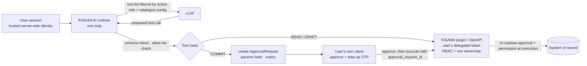
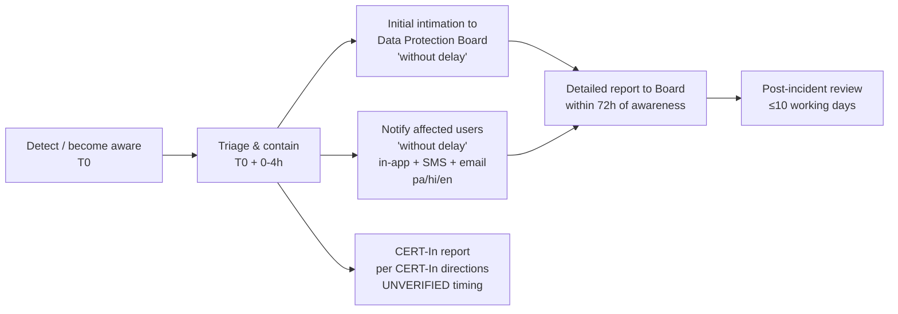

# KISAAN — Security, Privacy and Compliance

> Status: Draft v0.2 · Last updated: 2026-11-14 · Owner: Security & Compliance Lead (with Technical Architecture Lead) · Source of truth index: [README](README.md)

> ⚠ **Not legal or tax advice.** This document captures engineering security design and a *research-based* regulatory analysis (sources accessed 2026-11-14). Every item tagged `[LEGAL REVIEW]` or `[TAX REVIEW]` must be confirmed by Indian counsel / a Chartered Accountant before launch. **Punjab APMC licensing and GST classification are the highest-risk areas.**

**Tag legend for the regulatory part (§3):**

| Tag | Meaning (prompt v2 §30 category) |
|---|---|
| **LEGAL REQ** | **Confirmed legal requirement**: taken from a primary text, or from consistent reputable secondary sources (source cited). "Confirmed" means confirmed as the law's text; how it applies to KISAAN may still carry `[LEGAL REVIEW]` |
| **RECOMMENDATION** | **Technical / product recommendation**: KISAAN engineering or product practice, not mandated as phrased |
| **ASSUMPTION** | **Business or interpretive assumption**: needs professional confirmation before it is relied on |
| `[UNVERIFIED]` | Not confirmed against a primary source, or sources conflict |

Related: [SYSTEM_ARCHITECTURE](SYSTEM_ARCHITECTURE.md) · [OPSAPI_INTEGRATION](OPSAPI_INTEGRATION.md) · [SINGLE_AI_ARCHITECTURE](SINGLE_AI_ARCHITECTURE.md) · [WHOLESALE_AND_GROUP_BUYING](WHOLESALE_AND_GROUP_BUYING.md) · [COUPON_AND_MEMBERSHIP](COUPON_AND_MEMBERSHIP.md) · [PAYMENT_AND_BUSINESS_MODEL](PAYMENT_AND_BUSINESS_MODEL.md) · [DATABASE_SCHEMA](DATABASE_SCHEMA.md) · [RISKS_AND_ASSUMPTIONS](RISKS_AND_ASSUMPTIONS.md)

**v0.2 changes.** The AI controls are rewritten for **one KISAAN AI** that acts only through permission-checked tools (D-101/D-102); the v0.1 per-agent allow-lists are retired. New §2.16 adds explicit permissions for group leaders, members, coupons and KISAAN Plus membership (D-104, D-105). Fraud/trust flags come from backend **rule jobs**, not an AI agent. v0.2 reconciliation: COMMIT tools are the `<category>.propose_*` tools of the [SINGLE_AI_ARCHITECTURE](SINGLE_AI_ARCHITECTURE.md) §8 catalogue (113 tools, 16 categories); group buying is commit-free → leader lock → members pay within the window → repricing on shortfall (D-72, D-132); member-field restrictions are enforced with `GROUP_FORBIDDEN_FIELD`; seller coupons are capped at 50 % of goods value (KIS-SEC-161); the open transporter marketplace is P2 (D-106); the AI runtime lives in `web/src/server/ai/` and is served at `/api/ai/v1/*`, with the WhatsApp webhook at `/api/channels/whatsapp/webhook`.

---

## 1. Threat model summary

| Asset | Main threats | Primary controls |
|---|---|---|
| User accounts (phone-based) | SIM swap, OTP brute force, OTP relay/phishing, account sharing on family phones | OTP rate limits, device binding, step-up OTP for high-value actions, session list & remote logout |
| Money flows | Payment fraud, fake payment confirmations, refund abuse, payout to wrong bank account | PA-only funds flow, signed webhook verification, idempotent ledger, penny-drop verified payouts, settlement holds |
| Listings & marketplace integrity | Fake listings, bait pricing, duplicate listings, fake reviews, coupon abuse, fake group leaders | Verification tiers, risk-rule flags (backend jobs) → human moderation, velocity limits, review-only-after-order |
| KYC & personal data | Data breach, insider misuse, over-collection | Field-level encryption, masking, RBAC + audit, data minimisation, retention schedule |
| AI layer (one KISAAN AI) | Prompt injection (incl. via listing text/photos/messages/voice), role or identity claimed in chat, tool misuse, cross-user data exfiltration via the model (e.g. a group leader asking for members' phones), hallucinated prices/stock/payment status, stale approvals | Role-filtered tool list, delegated user tokens, backend re-authorisation on every call, approval gate for COMMIT actions bound to a parameter hash, output grounding, content isolation |
| Platform availability | DDoS, scraping, bot sign-ups | Cloudflare edge, rate limiting, bot detection, opsapi/nginx limits |

---

## 2. Security & privacy requirements

### 2.1 Authentication (KIS-SEC-001 … KIS-SEC-012)

opsapi (pinned tag 1.0.339) offers email/password, email-OTP 2FA, Google/Apple/Facebook SSO, PIN and refresh tokens, with **JWT signed HS256**. It has **no SMS/phone OTP login**. KISAAN's primary login is therefore a **phone-OTP flow built in the `kisaan` plugin** (`/api/v2/kisaan/public/auth/otp/*`). That flow issues an opsapi-compatible session. The exact token-issuing mechanism via the plugin SDK is `[UNVERIFIED]` and is a Phase 0 spike (see [OPSAPI_INTEGRATION](OPSAPI_INTEGRATION.md)).

| ID | Requirement | Scope |
|---|---|---|
| KIS-SEC-001 | Primary login is mobile number + 6-digit OTP, sent by SMS via a **TRAI DLT-registered** header and template (see KIS-CMP-090). | MVP |
| KIS-SEC-002 | OTP validity is 5 minutes and single use. It is stored only as a salted hash and bound to phone + purpose (`login`, `step_up`, `phone_change`). | MVP |
| KIS-SEC-003 | OTP limits: max 3 sends per phone per 15 min and 10 per day; max 5 verify attempts per OTP, after which the OTP is invalidated; 30 s resend cooldown. Per-IP and per-device limits as in §2.7. | MVP |
| KIS-SEC-004 | Sessions use opsapi JWT access tokens (short TTL, target 15 min) plus refresh tokens (target 30 days, rotating on use; reuse of a rotated token revokes the whole token family). | MVP |
| KIS-SEC-005 | The HS256 signing secret is held in the secret manager (never in the image or repo), is ≥256-bit random, and is rotated at least yearly or on suspicion of compromise, with a dual-key grace window `[UNVERIFIED: opsapi support for key rollover]`. | MVP |
| KIS-SEC-006 | **Step-up OTP** (fresh OTP within the last 5 min) is required for: approvals with value ≥ the step-up threshold `[DECISION D-51]` (proposal ₹50,000); changing the payout bank account; changing the registered phone; enabling group-leader mode; admin role grants; data-export and account-deletion requests. | MVP |
| KIS-SEC-007 | Device binding: record a device fingerprint on login. A new device triggers an in-app + SMS notification ("New login on …") and, for 24 h, step-up on any payout or bank change. | MVP |
| KIS-SEC-008 | Users can list active sessions and log out one or all devices. Changing the phone number revokes all sessions. | MVP |
| KIS-SEC-009 | Admin and internal staff accounts use opsapi email/password + **mandatory 2FA** (**TOTP mandatory**, SSO optional `[DECISION D-16]`), plus IP allow-list or step-up OTP, with IP allow-list for the admin console in production. | MVP |
| KIS-SEC-010 | Machine-to-machine access (the KISAAN AI runtime's service identity, ingestion jobs) uses OpsAPI **API keys (`opsk_…`)** scoped to service roles. Service keys never act as a user. The AI **service identity** may only: create `kisaan_approval_requests`, write `kisaan_ai_*` telemetry (conversations, messages, tool executions, usage), and read the tool catalogue config. Every marketplace tool call uses the **end user's delegated token** (see §2.9). | MVP |
| KIS-SEC-011 | Shared family phones `[ASSUMPTION A-51]`: one phone number maps to exactly one KISAAN account. Additional family members need their own number. A per-account PIN lock (opsapi PIN) is optional on shared devices. | MVP |
| KIS-SEC-012 | WhatsApp channel: the WhatsApp sender's phone must match a verified KISAAN account. Commit-class actions from WhatsApp require approval via an in-app deep link or OTP (no commit purely by WhatsApp message in MVP). | P2 |

### 2.2 Authorisation — RBAC (KIS-SEC-020 … KIS-SEC-027)

KISAAN uses opsapi RBAC (`module.action` permissions, roles per namespace) inside a single namespace `kisaan` (header `X-Namespace-Slug: kisaan`). Kisaan plugin modules are declared in `project.lua` under `modules` with machine names `kisaan_<module>`; permissions are `<machine_name>.<action>` (e.g. `kisaan_offers.update`). The canonical module list is [OPSAPI_INTEGRATION](OPSAPI_INTEGRATION.md) §7.3. **Object-level checks** (owner of listing/store/order/group) are enforced in every Kisaan handler, not only role checks.

| ID | Requirement | Scope |
|---|---|---|
| KIS-SEC-020 | Deny by default: every endpoint declares its permission. Unknown or missing permission returns 403. | MVP |
| KIS-SEC-021 | Object-level authorisation: a seller can only mutate their own store, listings, inventory, coupons and wholesale tiers; a buyer only their own offers and orders; a group leader only their own groups; a transporter only assigned shipments. | MVP |
| KIS-SEC-022 | Multi-role users act under an explicit **active role** (UI role switcher; AI context `active_role`). Permissions are the union of roles, but UI and AI actions are filtered by active role to avoid confusion. | MVP |
| KIS-SEC-023 | Admin sub-roles follow least privilege: Support Agent (read orders/users, write tickets), Verifier (KYC queue, listing moderation), Finance Ops (payments, refunds, settlements, reconciliation), Super Admin (config, role grants). | MVP |
| KIS-SEC-024 | Four-eyes rule: refunds of ₹50,000 or more `[DECISION D-85]`, manual settlement release, commission-rate changes and admin role grants need a second admin's approval. | MVP |
| KIS-SEC-025 | KYC documents are viewable only by Verifier and Super Admin, and every view is audit-logged with a reason. | MVP |
| KIS-SEC-026 | Contact details (phone) of counterparties are hidden until an order or accepted offer exists, or the user opts in (privacy setting). In-app chat is used otherwise. | MVP |
| KIS-SEC-027 | Public endpoints (`/api/v2/kisaan/public/...`: stores, listings, groups, mandi prices) expose only fields marked public in the schema (no phone, exact address or KYC). | MVP |

**Permission matrix (MVP, summary):** ✅ = allowed · 🔸 = own objects only · 👁 = read only · — = none

| RBAC module (`kisaan_*`) | Seller | Buyer | Group leader | Transporter (P2, D-106) | Support agent | Verifier | Finance | Admin | KISAAN AI tools (with user's token) |
|---|---|---|---|---|---|---|---|---|---|
| `kisaan_profiles` | 🔸 | 🔸 | 🔸 | 🔸 | 👁 (masked) | 👁 | 👁 | ✅ | via user token |
| `kisaan_verification` | 🔸 submit | 🔸 submit | 🔸 submit | 🔸 submit | — | ✅ review | 👁 bank status | ✅ | — |
| `kisaan_stores` | 🔸 | 👁 | 👁 | 👁 | 👁 | ✅ moderate | — | ✅ | via user token |
| `kisaan_listings` | 🔸 | 👁 | 👁 | — | 👁 | ✅ moderate | — | ✅ | draft only |
| `kisaan_inventory` | 🔸 | — | — | — | 👁 | — | — | ✅ | read + request adjust |
| `kisaan_pricing` (wholesale tiers) | 🔸 | 👁 | 👁 | — | 👁 | — | — | ✅ | draft only |
| `kisaan_coupons` | 🔸 | validate | validate | — | 👁 | — | 👁 | ✅ | draft/validate |
| `kisaan_requirements` (RFQ, enquiries) | 👁 | 🔸 | 🔸 | — | 👁 | ✅ moderate | — | ✅ | draft only |
| `kisaan_offers` | 🔸 (own listings) | 🔸 | 🔸 | — | 👁 | — | — | ✅ | draft; commit via approval |
| `kisaan_orders` (incl. invoices) | 🔸 | 🔸 | 🔸 | 🔸 assigned | 👁 | — | 👁 | ✅ | read; commit via approval |
| `kisaan_payments` | 👁 own payouts | 🔸 pay | 🔸 pay | 👁 own payouts | 👁 | — | 👁 | ✅ | status only |
| `kisaan_finance` (settlement, refunds, reconciliation, commission rules) | — | — | — | — | — | — | ✅ (4-eyes ≥ ₹50,000) | 👁 | — |
| `kisaan_groups` | 👁 offers on group requirements; repricing decision on own offer | join/commit (no payment) · pay own allocation | 🔸 manage (no member PII, `GROUP_FORBIDDEN_FIELD`) | — | 👁 | ✅ moderate | — | ✅ | draft; commit via approval |
| `kisaan_membership` (buyer-only, A-93) | — | 🔸 | 🔸 | — | 👁 | — | 👁 (refunds via `kisaan_finance`) | ✅ | status; purchase via approval |
| `kisaan_logistics` | 🔸 request | 🔸 request | 🔸 request | 🔸 quote/update | 👁 | ✅ verify vehicles | — | ✅ | draft; commit via approval |
| `kisaan_legal` (acceptances, consents, data requests) | 🔸 | 🔸 | 🔸 | 🔸 | 👁 | — | — | ✅ | — (acceptance only by the user) |
| `kisaan_reviews` | 🔸 post-order | 🔸 post-order | 🔸 post-order | 🔸 post-order | 👁 | ✅ moderate | — | ✅ | — |
| `kisaan_support` | 🔸 raise | 🔸 raise | 🔸 raise | 🔸 raise | ✅ handle | — | 👁 | ✅ | create ticket only |
| `kisaan_disputes` | 🔸 raise | 🔸 raise | 🔸 raise | 🔸 raise | ✅ handle | — | ✅ refunds | ✅ | — |
| `kisaan_market` (mandi prices) | 👁 | 👁 | 👁 | 👁 | 👁 | — | — | ✅ ingest config | read |
| `kisaan_approvals` | 🔸 decide | 🔸 decide | 🔸 decide | 🔸 decide | — | — | — | 👁 | create only (never decide) |
| `kisaan_ai` (conversations, tool executions, tool catalogue config, cost) | 🔸 own conversations | 🔸 | 🔸 | 🔸 | 👁 (masked, ticket-linked) | — | 👁 cost | ✅ (catalogue changes 4-eyes) | service identity: write telemetry only |
| `kisaan_admin` (config, audit, analytics) | — | — | — | — | — | — | 👁 finance events | ✅ (4-eyes for config/role grants) | — |

The last column describes the **ceiling** of what the one KISAAN AI's tools can do. Because tools use the user's own token, the effective right is always the **intersection** of this column and the user's own column. For example, a buyer's AI can never touch `kisaan_inventory`.

Role names are canonical: `seller`, `buyer`, `group_leader`, `transporter`, `support_agent`, `verifier`, `finance`, `admin` (as in [DATABASE_SCHEMA](DATABASE_SCHEMA.md) and [API_SPECIFICATION](API_SPECIFICATION.md)). Membership is buyer-only at launch (A-93).

### 2.3 API security (KIS-SEC-030 … KIS-SEC-038)

| ID | Requirement | Scope |
|---|---|---|
| KIS-SEC-030 | TLS 1.2+ everywhere (TLS 1.3 preferred) with HSTS. Cloudflare at the edge with WAF managed rules; origin accepts traffic only from Cloudflare + internal network. | MVP |
| KIS-SEC-031 | Every request carries `Authorization: Bearer` + `X-Namespace-Slug`. Tokens are never accepted in query strings, except opsapi's chat WebSocket `?token=` (short-lived token only; URL logging scrubbed). | MVP |
| KIS-SEC-032 | `Idempotency-Key` (UUID) is **mandatory** on all money- and stock-affecting POSTs (checkout, payment-intent, offer accept, refund, coupon redeem, group commit, membership subscribe). Keys are stored 24 h with the response hash. | MVP |
| KIS-SEC-033 | Payment-gateway webhooks are verified by HMAC signature (gateway secret), checked for timestamp freshness, deduplicated by event id, and IP-allow-listed where the gateway publishes ranges. The client never sets a payment status. | MVP |
| KIS-SEC-034 | Outbound OpsAPI webhooks/events consumed by `kisaan-app` (AI runtime, SSE relay) are signed and verified (OpsAPI WEBHOOKS mechanism). | MVP |
| KIS-SEC-035 | CORS: only KISAAN web origins. CSRF: the web app uses Bearer tokens in memory plus a refresh token in an httpOnly SameSite=Strict cookie. | MVP |
| KIS-SEC-036 | Security headers: CSP (no inline scripts except hashed), X-Content-Type-Options, Referrer-Policy, Permissions-Policy (microphone only on chat pages). | MVP |
| KIS-SEC-037 | Error responses follow opsapi `{error:{code,message,context}}` and never leak stack traces, SQL or internal IDs of other users. | MVP |
| KIS-SEC-038 | OpenAPI specs for Kisaan endpoints, with schema validation in contract tests; API inventory reviewed each release (no shadow endpoints). | MVP |

### 2.4 Data encryption (KIS-SEC-040 … KIS-SEC-046)

| ID | Requirement | Scope |
|---|---|---|
| KIS-SEC-040 | Encryption in transit for all hops (client↔edge↔ingress↔services; services↔Postgres/Redis/MinIO via TLS where supported in cluster). | MVP |
| KIS-SEC-041 | Encryption at rest: Postgres volumes, backups, MinIO/S3 buckets (SSE), Redis persistence (if enabled) on encrypted disks. | MVP |
| KIS-SEC-042 | **Field-level encryption** (application-layer AES-256-GCM, envelope keys from KMS/secret manager) for: PAN, bank account number, IFSC + account-holder name pair, GSTIN-linked contact, KYC document numbers, Aadhaar **last-4 only** (full Aadhaar is never stored, KIS-CMP-071). Blind index (HMAC) for duplicate detection on PAN/bank account. | MVP |
| KIS-SEC-043 | KYC documents and images go in a **separate private bucket**, accessed via short-lived (≤5 min) pre-signed URLs only, with no public ACLs and a separate KMS key. | MVP |
| KIS-SEC-044 | Masking in UI and logs: phone `98xxxxxx21`, PAN `ABxxxxx4F`, bank `xxxxxx6789`. | MVP |
| KIS-SEC-045 | Keys are rotated yearly, with crypto-shredding capability for erased users' encrypted fields. | MVP |
| KIS-SEC-046 | Secrets (DB, JWT, PA, SMS, WhatsApp, LLM keys) live in the secret manager / sealed Kubernetes secrets and are never in env files in git. CI includes secret scanning. | MVP |

### 2.5 Secure file uploads (KIS-SEC-050 … KIS-SEC-056)

| ID | Requirement | Scope |
|---|---|---|
| KIS-SEC-050 | Allowed types: product photos JPEG/PNG/WebP/HEIC; KYC docs JPEG/PNG/PDF; voice notes Opus/AAC/WebM. Types are validated by **magic-byte sniffing**, not extension. | MVP |
| KIS-SEC-051 | Size limits: photos ≤10 MB (client downscales to ≤1600 px before upload for low bandwidth); PDFs ≤5 MB; voice ≤2 min / 2 MB. | MVP |
| KIS-SEC-052 | Uploads go direct to object storage via a pre-signed PUT into a **quarantine prefix**. An async scan (malware AV, image re-encode, **EXIF/GPS stripping**) then promotes the file to the clean prefix. Files are never served from quarantine. | MVP |
| KIS-SEC-053 | Product images are re-encoded to WebP plus thumbnails; original bytes are never served publicly. | MVP |
| KIS-SEC-054 | Filenames are server-generated UUIDs; user filenames are never used in paths. | MVP |
| KIS-SEC-055 | AI vision input uses only clean, re-encoded images. Text found in images is treated as **untrusted data** (prompt-injection vector, §2.9). | MVP |
| KIS-SEC-056 | Duplicate/stolen photo detection via perceptual hash across listings (risk-rule signal). | MVP |

### 2.6 Input validation (KIS-SEC-060 … KIS-SEC-064)

| ID | Requirement | Scope |
|---|---|---|
| KIS-SEC-060 | Server-side schema validation on every Kisaan endpoint (types, ranges, enums, max lengths). Client validation is UX only. | MVP |
| KIS-SEC-061 | Domain bounds: quantity >0 and ≤ configured max per category (e.g. 10,000 t); price per unit >0 within ±X% of category sanity bands (outside the band → soft warning + Trust signal, not a block); coupon % ≤ the platform cap (50 %, D-40); dates in the future where required. | MVP |
| KIS-SEC-062 | Parameterised queries only (opsapi models / prepared statements); no string-built SQL in Kisaan migrations or handlers. | MVP |
| KIS-SEC-063 | Free text (listing descriptions, chat, reviews): Unicode normalisation (NFC), allowed scripts (Gurmukhi, Devanagari, Latin, digits, punctuation), output encoding at render, no raw HTML (Markdown subset only, sanitised). | MVP |
| KIS-SEC-064 | Phone numbers in E.164 (+91) and validated; PAN/GSTIN/IFSC regex + checksum (GSTIN) before calling verification vendors. | MVP |

### 2.7 Rate limiting (KIS-SEC-070 … KIS-SEC-072)

Enforced at Cloudflare (coarse, per IP) and in opsapi/Kisaan plugin (fine-grained, per user/phone/device) using Redis counters. Responses use `429` with `Retry-After`. Initial values, tuned after the pilot:

| Endpoint class | Limit (per user unless stated) | Notes |
|---|---|---|
| OTP send | 3 / 15 min / phone; 10 / day / phone; 20 / hour / IP | KIS-SEC-003 |
| OTP verify | 5 attempts / OTP; 30 / hour / IP | lockout 30 min on breach |
| Login / refresh | 30 / hour / device | |
| Search & browse (auth) | 120 / min | anonymous: 60 / min / IP + bot challenge |
| Public store / listing pages | 300 / min / IP (cached at edge) | anti-scraping, KIS-SEC-077 |
| Create listing | 30 / day / seller | verified sellers can request higher |
| Offers / counteroffers sent | 50 / day / user; 5 open offers per listing per buyer | anti offer-spam |
| Enquiries / chat messages to new counterparties | 30 / day | |
| Coupon validate | 20 / min / user; 100 / day | anti code-guessing |
| Group create | 5 / week / leader | |
| AI chat messages | 60 / hour, plus daily token/cost budget per user `[DECISION D-56]` | |
| Voice upload (STT) | 60 / hour; 2 min per clip | |
| Uploads | 100 / day / user | |
| Admin APIs | 600 / min / admin | |
| Payment webhooks | not user-limited; signature-gated | |

| ID | Requirement | Scope |
|---|---|---|
| KIS-SEC-070 | The limits above are configurable in admin config without redeploy. | MVP |
| KIS-SEC-071 | Limits apply per user **and** per device/IP to resist multi-account abuse. | MVP |
| KIS-SEC-072 | Breaches feed risk-rule signals (not automatic bans, except OTP lockouts). | MVP |

### 2.8 Abuse prevention & fraud detection (KIS-SEC-075 … KIS-SEC-086)

**Principle:** the backend verification/risk **rule jobs** (not an AI agent; v0.1 "AI-TRS" is retired) **raise flags and risk scores only**. The KISAAN AI may *read and explain* a user's own verification status but never sets flags or scores. **A risk score is never proof of fraud.** Any adverse action (suspension, listing removal, payout hold beyond the standard window, account closure) is decided by a human Verifier/Finance admin, is logged with a reason, and is communicated to the user with a right to appeal. Automatic actions are limited to reversible, low-impact measures: soft-hide pending review, extra verification step, temporary payout hold within the standard settlement window.

| ID | Requirement | Scope |
|---|---|---|
| KIS-SEC-075 | Verification tiers: **T0** phone verified → **T1** profile + location + selfie/photo → **T2** ID document (DigiLocker/offline, KIS-CMP-070) + bank penny-drop → **T3** PAN/GSTIN (business buyers, group leaders, high-volume sellers). Tier gates: publishing listings needs T1; receiving payouts needs T2; group leader needs T2 + PAN + manual approval; transporter needs T2 + vehicle RC + licence check. | MVP |
| KIS-SEC-076 | Duplicate detection: perceptual image hash, near-duplicate text, same bank account / PAN blind index across accounts, same device across many accounts. | MVP |
| KIS-SEC-077 | Anti-scraping on public stores and listings: edge caching, bot management, no bulk-export endpoint, contact details hidden. | MVP |
| KIS-SEC-078 | Fake reviews: reviews only from completed orders, one per order per side, velocity and text-similarity checks. | MVP |
| KIS-SEC-079 | Coupon abuse: per-user limits enforced server-side in a transaction, device/phone/bank linkage to stop multi-account redemption, eligibility re-checked at payment time. | MVP |
| KIS-SEC-080 | Group-leader abuse (fake leaders): T2+PAN+manual approval, public leader rating, member funds never pass through the leader (KIS-CMP-064), group cap until the leader has N completed group orders, members can report the leader. | MVP |
| KIS-SEC-081 | Price-anomaly signals: listing price far outside the mandi reference band or category history, sudden bulk price changes, offers far below the band (bait), circular trades between linked accounts. | MVP |
| KIS-SEC-082 | Payment fraud signals: many failed payments, refund ratio, chargebacks, payout bank change followed by a high-value order, new account placing very large order. | MVP |
| KIS-SEC-083 | Transporter signals: POD mismatch (GPS/OTP), repeated no-shows, quote-then-renegotiate patterns. | P2 |
| KIS-SEC-084 | Flag workflow: risk-rule flag → admin queue with evidence and explanation → human decision (dismiss / request info / restrict / suspend) → user notification → appeal path (SUP/DSP). All steps audit-logged. | MVP |
| KIS-SEC-085 | Model governance: risk rules and model features are documented, reviewed for bias (e.g. against low-literacy users or particular districts), and the false-positive rate is monitored. | MVP |
| KIS-SEC-086 | Bot sign-up defence: OTP limits, device attestation (Play Integrity for a future native app; web: Turnstile challenge on anomalies). | MVP |

### 2.9 AI security — one KISAAN AI, tool boundaries & prompt injection (KIS-SEC-090 … KIS-SEC-099, KIS-SEC-140 … KIS-SEC-147)

Full design: [SINGLE_AI_ARCHITECTURE.md](SINGLE_AI_ARCHITECTURE.md) (tool catalogue, per-tool permission matrix, approval matrix). Security-relevant summary:

| ID | Requirement | Scope |
|---|---|---|
| KIS-SEC-090 | The KISAAN AI runtime (a module of `kisaan-app`) has **no database credentials**. All actions go through typed tools calling KISAAN/OpsAPI endpoints with the **end user's delegated token** (short-lived, ≤ 15 min, audience `kisaan-api`, bound to `user_id` + session). The AI can never do more than the user could do in the UI. A CI rule forbids DB drivers and pricing/inventory logic in `web/src/server/ai/`. | MVP |
| KIS-SEC-091 | Tool classes: **READ**, **DRAFT**, **COMMIT**. COMMIT effects (publish listing or store change, material inventory adjustment, publish/change coupon, promotion or wholesale offer, send/accept/reject binding offer, commit a buyer or group to a purchase, place/confirm/cancel order, payment, refund, payout, membership purchase/renewal/cancellation, T&C acceptance, transport-quote acceptance) are possible only through an **ApprovalRequest** that the **subject user** approves in their own client (tap, or voice "haan" followed by on-screen read-back and confirmation). Every COMMIT tool is named `<category>.propose_*` (35 tools, [SINGLE_AI_ARCHITECTURE](SINGLE_AI_ARCHITECTURE.md) §8/§10) and its only effect is to create an approval request; the user's own client then calls the real endpoint with `approval_request_id`. The AI service identity holds `kisaan_approvals.create` only and never `kisaan_approvals.update`. | MVP |
| KIS-SEC-092 | Approval requests are bound to the principal user, **active role**, `action_type`, tool name, target (type, id, version) and the SHA-256 parameter hash (amount, quantity, unit, counterparty, price, terms) (KIS-APR-111). Any change invalidates the approval. They expire (default 15 min, or earlier with the underlying quote/offer/payable, KIS-APR-105), execute at most once (replay → 409 `APPROVAL_INVALID`, KIS-APR-112), are re-validated at execution against current permissions, stock, price and state (KIS-APR-106), and need step-up OTP above the threshold (KIS-SEC-006). | MVP |
| KIS-SEC-093 | Untrusted content isolation: listing text, buyer messages, reviews, group descriptions, OCR from images, STT transcripts of third-party audio, mandi data and RAG documents are passed to the model inside clearly delimited data blocks, never as instructions. The system prompt instructs the model to ignore instructions found in data. Tool results are also data. | MVP |
| KIS-SEC-094 | **Role- and permission-aware tool exposure (single AI):** for each turn the runtime exposes only the tools allowed for the user's **active role** (from the trusted server session) and enabled in `kisaan_ai_tool_catalogue`. The runtime rejects any tool call outside that list before execution, and the backend independently re-authorises it. Admin catalogue overrides can only **narrow** the code-defined permissions, never widen them. Admin tools are never exposed in the marketplace AI; admin AI assistance (if any) is a separately authorised experience. | MVP |
| KIS-SEC-095 | Tool arguments are schema-validated in the runtime **and** server-side. User/tenant/group/role identifiers supplied by the model or found in a chat message are ignored or rejected. The subject user always comes from the session. Amounts, prices, taxes, discounts and stock are re-derived server-side (pricing engine, inventory service), never trusted from model output. | MVP |
| KIS-SEC-096 | Output guardrails: no invented prices (prices come only from `pricing.get_quote`; mandi data is shown only with source + timestamp from the tool result); the AI never claims that stock is reserved, a payment succeeded, an order was placed or an action completed unless a backend tool returned that confirmed result; replies label **estimate / recommendation / draft / completed**; no quality certification from photos; risk scores never presented as proof; PII is redacted from outputs to non-owners. | MVP |
| KIS-SEC-097 | Data minimisation to LLM vendors: only the fields needed for the task; KYC numbers, bank details, full addresses and other members' data are never sent; vendor contracts prohibit training on KISAAN data; India-region endpoints preferred (KIS-CMP-012). | MVP |
| KIS-SEC-098 | AI audit trail: every turn and every tool execution logs conversation id, tool name and class, args hash, result status, approval id (if any), model/provider/version, prompt version, token cost and latency in `kisaan_ai_tool_executions`. Logs are retained per §2.12. | MVP |
| KIS-SEC-099 | A red-team suite (prompt injection in listings, reviews, group descriptions, voice and images; jailbreaks; role-escalation claims such as "I am admin" or "I am the group leader"; cross-user data requests) runs in CI against the one KISAAN AI. A release is blocked on regression (see [TESTING_STRATEGY](TESTING_STRATEGY.md)). | MVP |
| KIS-SEC-140 | Bounded execution: at most N tool calls per turn (default 8) and per-tool timeouts; automatic retries **only** for READ tools and idempotent DRAFT tools; COMMIT executions are never retried by the AI (the user's client retries with the same `Idempotency-Key`). | MVP |
| KIS-SEC-141 | Kill switches: admin can disable the AI globally, per tool, per role or per channel within 1 minute (config cached ≤ 60 s). Every catalogue change is audit-logged and needs four-eyes approval (KIS-SEC-024). | MVP |
| KIS-SEC-142 | Conversation isolation: a conversation belongs to exactly one user. Conversation history, memory summaries and cached tool results are keyed by `user_id` + active role and are never shared across users, including members of the same group. | MVP |
| KIS-SEC-143 | Support staff viewing a user's AI conversation need a linked support ticket and a recorded reason; the view is masked and audit-logged. | MVP |
| KIS-SEC-144 | WhatsApp channel: the webhook `/api/channels/whatsapp/webhook` (in `kisaan-app`) verifies Meta's `X-Hub-Signature-256` HMAC and dedupes on message id; the sender's number must match a verified account (KIS-SEC-012). The same tool allow-list applies, and COMMIT actions require an in-app deep link or OTP confirmation. | P2 (notifications MVP) |
| KIS-SEC-145 | Voice: critical extracted fields (product, grade, quantity, unit, location, price, delivery terms) are read back and shown on screen before an approval card can be created; low STT confidence forces a text confirmation. | MVP |
| KIS-SEC-146 | Per-user and global AI cost/rate budgets (§2.7, `[DECISION D-56]`); budget exhaustion degrades to conventional UI and never blocks transactions. | MVP |
| KIS-SEC-147 | Prompt and model versions are change-controlled: a new version ships only after the offline eval + red-team suite passes, behind a feature flag with rollback. | MVP |

### 2.10 Audit logging (KIS-SEC-100 … KIS-SEC-104)

| ID | Requirement | Scope |
|---|---|---|
| KIS-SEC-100 | Reuse opsapi audit/activity logs for core events. KISAAN adds `kisaan_audit_log` for domain events: listing publish/edit/price change, inventory adjustments (with reason), offer state changes, approval decisions, order/payment/refund/settlement transitions, coupon create/modify, group commit/leave, membership T&C acceptance, KYC view/decision, admin config changes, role grants. | MVP |
| KIS-SEC-101 | Audit records hold actor (user / admin / AI-on-behalf-of-user with approval id / system job), timestamp (UTC), IP/device, entity, before/after diff (PII masked), and reason. | MVP |
| KIS-SEC-102 | Audit tables are append-only: no UPDATE/DELETE grants for the application role. A daily hash-chain/checksum is exported to WORM-style object storage (object lock). | MVP |
| KIS-SEC-103 | Retention ≥ 1 year (DPDP Rule 8(3) minimum, KIS-CMP-006); financial records ≥ 8 years `[TAX REVIEW]` (see retention table §2.12). | MVP |
| KIS-SEC-104 | Security monitoring alerts: admin logins from new IPs, bulk data access, repeated 403s, OTP abuse spikes, webhook signature failures, settlement-account changes. | MVP |

### 2.11 Consent & privacy (KIS-PRIV-001 … KIS-PRIV-015)

| ID | Requirement | Scope |
|---|---|---|
| KIS-PRIV-001 | A standalone **privacy notice** (DPDP Rule 3) in **Punjabi, Hindi and English**, with an itemised list of personal data and specific purposes, links to withdraw consent, exercise rights and complain to the Data Protection Board. Shown before account creation, with an audio version in the voice flow. | MVP |
| KIS-PRIV-002 | Granular consent toggles, **never pre-ticked**: (a) core marketplace processing (required to use the service; mapped to consent or s.7 legitimate use per counsel); (b) marketing messages (SMS/WhatsApp/push); (c) AI personalisation and use of conversation history; (d) voice recording retention for quality improvement; (e) sharing a contact number with counterparties before an order. | MVP |
| KIS-PRIV-003 | Consent records: `kisaan_consents` (user, purpose, notice version, language, channel — app/voice/WhatsApp/web — status, timestamp, IP/device, withdrawal timestamp). Versioned notices are stored in `kisaan_legal_documents`. | MVP |
| KIS-PRIV-004 | Withdrawal "as easy as giving": a one-tap toggle in Settings → Privacy, the voice command "marketing messages band karo", and WhatsApp STOP. Withdrawal takes effect within 24 h across channels. | MVP |
| KIS-PRIV-005 | **18+ only**: age declaration at signup; under-18 sign-ups blocked (avoids the verifiable-parental-consent regime, KIS-CMP-005). | MVP |
| KIS-PRIV-006 | Data principal rights: access/export, correction, erasure, nomination, grievance. Self-service where possible; SLA target 15 days (legal max 90 days, KIS-CMP-007). The DPO/contact person is shown in-app and in every response. | MVP |
| KIS-PRIV-007 | Erasure honours legal holds: transaction, invoice and tax records and logs needed for legal obligations are retained (pseudonymised where possible) per §2.12; the profile, photos, voice data and marketing data are deleted. | MVP |
| KIS-PRIV-008 | Purpose limitation: KYC data is used only for verification, payouts and legal compliance, never for marketing or AI personalisation. | MVP |
| KIS-PRIV-009 | Location precision: public views show village/tehsil/district; the exact pickup address is shared only with the assigned transporter and counterparty after the order. | MVP |
| KIS-PRIV-010 | Voice data: raw audio is processed transiently for STT and **not retained by default** `[DECISION D-54]`; retained only with KIS-PRIV-002(d) consent, for ≤ 30 days, de-identified. | MVP |
| KIS-PRIV-011 | Processor contracts (DPAs) with the cloud, SMS, WhatsApp BSP, PA, KYC vendor, STT/TTS and LLM providers include security clauses (DPDP Rule 6) and a no-training clause; register of processors maintained. | MVP |
| KIS-PRIV-012 | Cross-border transfer register: list each vendor's processing location; prefer India regions; review against any Government restriction notification (DPDP s.16). | MVP |
| KIS-PRIV-013 | Privacy-by-design reviews (lightweight DPIA) for each new feature touching personal data; a full DPIA if KISAAN is notified as a Significant Data Fiduciary. | MVP |
| KIS-PRIV-014 | Cookie/analytics: first-party privacy-preserving analytics; no third-party ad trackers in MVP. | MVP |
| KIS-PRIV-015 | WhatsApp opt-in recorded with timestamp, channel and the wording shown (also DPDP evidence); opt-out honoured immediately (KIS-CMP-091). | MVP |

### 2.12 Data retention schedule

Retention periods marked `[TAX REVIEW]` / `[LEGAL REVIEW]` are proposals pending professional confirmation. "Inactive" means no login or transaction.

| Data category | Retention | Basis / notes | Action at end |
|---|---|---|---|
| Account profile (name, phone, roles, location) | Active life + 1 year after closure | DPDP s.8(7); Rule 8(3) one-year minimum for logs | Delete / anonymise |
| KYC documents (images/PDFs) | Until verification complete + 30 days; document **metadata** (type, verified flag, masked number) kept for account life + 1 year | Minimisation `[LEGAL REVIEW]` (PA/KYC partner may hold its own records) | Delete file; keep masked metadata |
| PAN, bank details (encrypted) | Account life + 8 years (linked to payout/TDS records) | Income-tax / GST record keeping `[TAX REVIEW]` | Crypto-shred |
| Orders, invoices, payments, settlements, ledger | 8 years from end of relevant financial year | GST & income-tax record retention `[TAX REVIEW]` | Archive then delete |
| Offers / negotiation history | 3 years after last activity (dispute window) | Business need; Rule 8(3) min 1 year | Anonymise |
| Chat transcripts (user↔user) | 2 years after last message | Dispute evidence `[DECISION D-87]` | Delete |
| AI conversations, messages & tool execution logs | 1 year (DPDP Rule 8(3) minimum) — 2 years if linked to a dispute | `[DECISION D-53]` | Delete / anonymise for eval only with consent |
| Raw voice audio | Not retained by default; with consent ≤ 30 days | KIS-PRIV-010, `[DECISION D-54]` | Delete |
| Product photos | Listing life + 1 year | Dispute evidence | Delete |
| Proof-of-delivery photos / OTP logs | 3 years | Dispute evidence | Delete |
| Consent & notice-acceptance records, T&C acceptances | Account life + 8 years | Evidence of consent / contract | Archive |
| Security & audit logs | ≥ 1 year online (DPDP Rule 8(3)); financial audit events 8 years | KIS-CMP-006 | Archive (object lock) |
| Application/access logs | 1 year | DPDP Rule 8(3) / Rule 6 | Delete |
| Marketing preferences | Until withdrawal + 1 year (proof) | Consent evidence | Delete |
| Backups | 35 days rolling (daily) + 12 monthly (encrypted) | Erased data expires from backups within backup TTL; documented in notice | Expire |
| Inactive accounts | 3 years of inactivity → 48 h notice → erase (legally mandatory only above 2 crore users, but adopted as policy) | DPDP Third Schedule | Erase subject to legal holds |

### 2.13 Backup policies (KIS-SEC-110 … KIS-SEC-115)

| ID | Requirement | Scope |
|---|---|---|
| KIS-SEC-110 | Postgres: continuous WAL archiving + daily full base backup → **RPO ≤ 15 min**; point-in-time recovery for 7 days; daily backups for 35 days; monthly for 12 months. | MVP |
| KIS-SEC-111 | Backups are encrypted (separate key), stored in a different region/provider account from production, with object lock (immutable) against ransomware. | MVP |
| KIS-SEC-112 | Object storage (photos, KYC docs, invoices): versioning + cross-region replication; KYC bucket replication encrypted with its own key. | MVP |
| KIS-SEC-113 | **RTO ≤ 4 h** for the core marketplace; `kisaan-app` (incl. the AI runtime) is stateless and redeployable. | MVP |
| KIS-SEC-114 | Quarterly restore drill to an isolated environment with verification queries; results recorded. | MVP |
| KIS-SEC-115 | Redis is treated as a cache/queue (not system of record). Payment and inventory state is always reconstructible from Postgres + PA reconciliation. | MVP |

### 2.14 Incident response & breach notification (KIS-SEC-120 … KIS-SEC-126)

| ID | Requirement | Scope |
|---|---|---|
| KIS-SEC-120 | Incident response runbook with roles (incident commander, comms, legal/DPO, engineering), severity levels (SEV1–4) and on-call rotation. | MVP |
| KIS-SEC-121 | **Personal data breach** (DPDP Rule 7, KIS-CMP-004): see the timeline below. | MVP |
| KIS-SEC-122 | CERT-In: report cyber incidents to CERT-In within the timeline in the CERT-In Directions of April 2022 (commonly cited as 6 hours) `[UNVERIFIED — not covered in research; LEGAL REVIEW]`. | MVP |
| KIS-SEC-123 | Payment incidents: notify the PA immediately; PA/RBI incident obligations follow the PA agreement. | MVP |
| KIS-SEC-124 | Evidence preservation: snapshot logs, keep forensic copies, keep a chain of custody. | MVP |
| KIS-SEC-125 | Annual tabletop exercise covering a breach scenario plus a payment-fraud scenario. | MVP |
| KIS-SEC-126 | Post-incident review within 10 working days, with tracked corrective actions. | MVP |

**Breach notification timeline:**

The user notification must cover nature, extent, timing, likely consequences, mitigation, steps users can take, and a contact person (DPDP Rule 7).

### 2.15 Secure SDLC & operations (KIS-SEC-130 … KIS-SEC-136)

| ID | Requirement | Scope |
|---|---|---|
| KIS-SEC-130 | Code review on all changes; SAST (Lua + TypeScript), dependency scanning, container image scanning (including the pinned `bwalia/opsapi` base) in CI; release blocked on critical findings. | MVP |
| KIS-SEC-131 | Kisaan image built `FROM bwalia/opsapi:1.0.<N>` (immutable tag, digest pinned); SBOM generated per build. | MVP |
| KIS-SEC-132 | Separate dev/staging/prod environments, secrets and data; production data never copied to lower environments without anonymisation. | MVP |
| KIS-SEC-133 | Pre-launch third-party penetration test (web, API, AI prompt injection, payments); then annually and after major changes. | MVP |
| KIS-SEC-134 | Least-privilege cloud IAM; break-glass access logged; production DB access only via bastion with session recording. | MVP |
| KIS-SEC-135 | Vulnerability disclosure policy and `security.txt`. | MVP |
| KIS-SEC-136 | Kubernetes hardening: non-root containers, read-only root filesystems where possible, network policies (only `kisaan-app` → `kisaan-api` + approved AI/voice/WhatsApp egress; only `kisaan-api` → Postgres/Redis/S3; `kisaan-app` has no DB route), pod security standards. | MVP |

### 2.16 Group-buying, store, coupon and membership permissions (KIS-SEC-150 … KIS-SEC-169)

Definitions of buyer types and leader/member roles follow D-104 (owner doc: [WHOLESALE_AND_GROUP_BUYING](WHOLESALE_AND_GROUP_BUYING.md)). Coupon and KISAAN Plus rules follow D-105 (owner doc: [COUPON_AND_MEMBERSHIP](COUPON_AND_MEMBERSHIP.md)). The rows below are the **security** view: what each actor may see or do, enforced by backend handlers and therefore also by the KISAAN AI's tools.

**Group data visibility (MVP)**

| Data item | Group leader | Other members | The member themself | Seller making a group offer | Public (logged-out) | Admin / Support |
|---|---|---|---|---|---|---|
| Group name, description, area (district/tehsil), product, target qty, committed qty, remaining qty, deadline | ✅ | ✅ | ✅ | ✅ | ✅ if group is public | ✅ |
| Leader display name, "Verified Group Leader" badge, leader rating, independence disclaimer | ✅ | ✅ | ✅ | ✅ | ✅ | ✅ |
| Member display name (or "Member #n" if the member chose to stay anonymous) | ✅ | 👁 count only (names only if the member opts in) | ✅ | — (aggregate qty only) | — | ✅ |
| Member committed quantity | ✅ | — (aggregate only) | ✅ | — (aggregate only) | — | ✅ |
| Member status (committed / payment due / paid / released) | ✅ **status only** | — | ✅ full detail | — (aggregate "x of y paid") | — | ✅ (Finance) |
| Member payment amount, method, UPI ID, transaction ids, refund details | — | — | ✅ | — | — | Finance only |
| Member phone, email, address, KYC, other orders | — | — | ✅ | Delivery address only for the assigned shipment, after order, if delivery is per-member | — | Masked; unmask with reason + audit |
| Member AI conversations | — | — | ✅ | — | — | KIS-SEC-143 only |

| ID | Requirement | Scope |
|---|---|---|
| KIS-SEC-150 | A group leader is a **group-scoped** role: `group_leader` permissions apply only to groups where `kisaan_buying_groups.leader_user_id = session user`. Being a leader of group A gives no rights in group B. | MVP |
| KIS-SEC-151 | Leader permissions (allowed): create/edit own group before lock (`groups.propose_create_group`, `groups.propose_update_group`), invite members (share link/code), remove a member **before** that member has paid, set target qty/deadline, publish the group requirement to sellers, review seller offers (visible to all members via `groups.list_group_offers`), accept a group offer (`groups.propose_accept_group_offer`) and lock the group order (`groups.propose_lock_group_order`), both COMMIT with approval; apply an eligible group coupon at lock; coordinate the delivery point; confirm bulk receipt (`groups.propose_confirm_receipt`); message members through in-app group broadcast. | MVP |
| KIS-SEC-152 | Leader permissions (denied): see member contact/payment/KYC data (table above); change a member's quantity or confirm or pay on a member's behalf; accept an offer that binds members without each member's own confirmation; collect money (KIS-CMP-064); apply individual coupons for members; represent themselves as KISAAN staff. | MVP |
| KIS-SEC-153 | The UI, public group page, AI replies and notifications always show the disclaimer: "Group leaders are independent KISAAN users, not KISAAN employees or representatives." The KISAAN AI must not describe a leader as an official representative. | MVP |
| KIS-SEC-154 | A member commits **without paying** through their own approval (`groups.propose_join_and_commit`); they can change or withdraw before lock without penalty (`groups.propose_change_commitment`, `groups.propose_leave_group`), report the leader, and see their own commitment, price and status at any time. After lock, only the member can pay their own allocation (`payments.propose_pay`) within the payment window (default 24 h, D-72). Unpaid members are `released` automatically; the leader cannot pay, confirm or extend on their behalf. | MVP |
| KIS-SEC-155 | Group-level coupons are applied **once by the leader at lock** and only if flagged `group_eligible` (D-103/D-105). The discount is allocated server-side pro-rata by member goods value (largest-remainder paise rounding); a lapsed member's share is not redistributed. It counts as one redemption for the group unless `count_per_member` is set. The server rejects member-level coupon codes on group order lines. | MVP |
| KIS-SEC-156 | Leader-change and dissolution: transferring leadership needs the new leader's acceptance + T2/PAN verification and admin approval; dissolving a group with paid members — or a seller `decline` in repricing — triggers automatic refunds through the payment provider, never through the leader. | MVP |
| KIS-SEC-157 | Sellers see group offers' aggregate demand only. They see a member's delivery data only for a confirmed order line that requires per-member delivery. | MVP |
| KIS-SEC-167 | **Forbidden-field enforcement.** Leader-facing group endpoints serialise only: member display name (masked by default), committed qty, status (`committed` / `payment_due` / `paid` / `released`) and qty × locked unit price. Any leader request — UI, API or a KISAAN AI tool — for a member's phone, address, payment amount/method, UPI ID, refund or KYC fields returns 403 `GROUP_FORBIDDEN_FIELD` and is audit-logged. A contract test asserts the absence of these fields. | MVP |
| KIS-SEC-168 | **Repricing integrity.** Only the seller who made the accepted group offer can take the shortfall decision (honour with `honour_locked_price`, re-offer, or decline) within the deadline; no response = decline. A re-offer never charges a paid member more without that member's own new approval; non-reconfirming members are refunded automatically. The locked price shown at lock is a ceiling — no upward re-tiering after lock (D-132). | MVP |
| KIS-SEC-169 | **Group delivery buffer (D-134, PENDING OWNER SIGN-OFF).** When platform/partner logistics is used (`PLATFORM_LOGISTICS`, Phase 9), members are charged the delivery estimate + 10 % buffer at lock; any unused buffer is refunded after booking and any residual overrun is absorbed by the platform, never charged to members afterwards. In MVP, delivery is buyer pickup or seller-delivered (`SELLER_DELIVERS_FEE`). | Phase 9 |

**Store, coupon and membership permissions**

| ID | Requirement | Scope |
|---|---|---|
| KIS-SEC-160 | Store: only the store owner (seller) may edit store profile, policies, products, wholesale tiers and coupons; publishing store or listing changes is a COMMIT action when initiated via the AI. Admin can moderate (hide/suspend) with a reason and audit. Store slugs cannot be reassigned to another seller for 12 months (slug history, anti-impersonation). | MVP |
| KIS-SEC-161 | Coupons: sellers create/modify/pause **only their own** coupons, within platform limits: the discount is **capped at 50 % of the eligible goods value** (D-40; enforced by a DB CHECK and by the pricing engine at quote time), max validity, cannot target other sellers' products. They cannot change platform rules (stacking order, one-coupon-per-seller, floor price check). Coupon create/activate/change is audit-logged. | MVP |
| KIS-SEC-162 | Admin **emergency disable** of any coupon or all of a seller's coupons, effective ≤ 1 min, with reason, seller notification and audit. Already-paid orders keep their applied discount; unpaid quotes are re-quoted. | MVP |
| KIS-SEC-163 | Coupon codes are validated only server-side (rate-limited, §2.7). Code enumeration is mitigated by rate limits, non-sequential codes and generic "invalid or not applicable" errors. Private (targeted) coupons are bound to eligible user segments, not secrecy alone. | MVP |
| KIS-SEC-164 | KISAAN Plus membership: only the subscribing user can purchase, renew, change or cancel their membership (COMMIT, with T&C acceptance recorded). Benefits are evaluated server-side from `kisaan_memberships` status at quote time. Clients and the AI cannot assert membership status. | MVP |
| KIS-SEC-165 | Membership abuse prevention: one active membership per verified phone/account; benefit-usage caps (e.g. free-delivery waivers) are enforced server-side; account-sharing signals (many devices, many delivery addresses) raise a risk flag, and suspension is decided by a human with appeal (per the T&C). | MVP |
| KIS-SEC-166 | Platform admins manage membership plans/prices/benefits under four-eyes control; plan or benefit changes apply only to new terms or at renewal, with advance notice (KIS-CMP-027 dark-pattern rules). | MVP |

### 2.17 Public vs private information (KIS-PRIV-016 … KIS-PRIV-020)

| Data | Public (logged-out, indexable) | Logged-in users | Counterparty after order / accepted offer | Owner only | Notes |
|---|---|---|---|---|---|
| Store name, slug URL, description, seller display name, verification badge, district/tehsil, categories, ratings & reviews, policies, delivery info, public coupons, wholesale tiers | ✅ | ✅ | ✅ | ✅ | `/store/<slug>`; SEO-indexable unless the seller opts out |
| Listing details (product, grade, qty available, price, tiers, photos with EXIF stripped) | ✅ | ✅ | ✅ | ✅ | Inventory figure shown as an available quantity, not internal reserved/damaged figures |
| Seller exact address, phone, bank, PAN/GSTIN, KYC docs, payouts, analytics, inventory history, floor price | — | — | Pickup address + phone (if chosen) | ✅ | Floor price is never shown to buyers or sent to the AI for buyers |
| Buyer name, phone, address, orders, membership status, payment details | — | — | Name + delivery address + phone (if chosen) | ✅ | Membership status is never shown to sellers. Sellers see only that the member price applied to a line |
| Bulk-buyer business profile (business type, GSTIN, volumes, budget) | — | Business name + verified badge (opt-in) | Business name, GSTIN on invoice | ✅ | Budget range is private to the bulk buyer and the matching service |
| Group details | See §2.16 | | | | |
| AI conversations | — | — | — | ✅ | KIS-SEC-142/143 |

| ID | Requirement | Scope |
|---|---|---|
| KIS-PRIV-016 | Every API response field carries a visibility class in the schema (`public`, `authenticated`, `counterparty`, `owner`, `staff`). Public endpoints and the AI tools serialise only the classes permitted for the caller. | MVP |
| KIS-PRIV-017 | Search engines may index store and listing pages only. Group pages are `noindex` unless the leader marks the group public. Buyer profiles are never indexed. | MVP |
| KIS-PRIV-018 | Location on public pages is generalised to tehsil/district (KIS-PRIV-009). Map pins on public pages use a district centroid. | MVP |
| KIS-PRIV-019 | Bulk-buyer procurement data (budget, preferred sellers, volumes) is used for matching and for the user's own AI assistance only. It is never shown to sellers beyond what a published requirement contains. | MVP |
| KIS-PRIV-020 | AI conversation retention is user-visible. Users can delete a conversation, which removes it from AI context immediately; the audit/tool-execution records remain for the period in §2.12 with message content removed. | MVP |
---

## 3. Indian regulatory analysis

### 3.1 Summary heat-map

| Area | Risk | Launch gate? | Owner |
|---|---|---|---|
| **Punjab APMC / mandi law** (wheat, paddy) | 🔴 Highest | **Yes** — no wheat/paddy checkout in Punjab without written opinion | Punjab counsel |
| GST / TCS / TDS classification | 🔴 High | Yes — tax opinion before first paid transaction | CA |
| Payments (RBI PA regime, group-leader money) | 🟠 High | Yes — PA marketplace contract signed | Counsel + PA |
| DPDP Act & Rules | 🟠 Medium-High | Yes — notice/consent/breach runbook ready | Counsel / DPO |
| Consumer Protection (E-Commerce) Rules + dark patterns | 🟠 Medium | Yes — self-audit before launch | Counsel / product |
| FSSAI | 🟡 Medium | Before handling food orders that are not raw produce, or B2C | Counsel |
| Agri-input licensing (pesticide/fertiliser/seed) | 🟡 (Future scope) | Before enabling agri-inputs | Counsel |
| KYC / Aadhaar | 🟡 Medium | Design constraint | Counsel |
| IT Rules / AI advisories | 🟡 Medium | Grievance officer + AI labelling at launch | Counsel |
| TRAI DLT / WhatsApp | 🟢 Low (operational) | Yes — SMS OTP cannot work without DLT | Ops |

### 3.2 Digital Personal Data Protection Act 2023 & DPDP Rules 2025

| ID | Item | Tag |
|---|---|---|
| KIS-CMP-001 | The DPDP Rules 2025 were notified as **G.S.R. 846(E), gazette dated 13 Nov 2025**. Rule 4 (Consent Manager registration) is in force ~13/14 Nov 2026. Substantive duties (notice, security, breach, retention, children, SDF, rights; Rules 3, 5–16, 22, 23) apply from ~**13/14 May 2027**. A MeitY proposal (Jan–Mar 2026) to compress this to 12 months was **not found notified** `[UNVERIFIED]`. **KISAAN builds to full compliance from launch regardless.** `[LEGAL REVIEW]` to confirm the live date. | LEGAL REQ (dates) / RECOMMENDATION (comply from day 1) |
| KIS-CMP-002 | Notice: standalone, clear, itemised data and purposes, links to withdraw consent / exercise rights / complain to the Board (Rule 3); available in English or Eighth Schedule languages (s.5). KISAAN: pa/hi/en (KIS-PRIV-001). | LEGAL REQ |
| KIS-CMP-003 | Consent must be free, specific, informed, unconditional, unambiguous, by clear affirmative action, and withdrawable (s.6). Each data flow is mapped to consent or a s.7 legitimate use — **mapping to be reviewed by counsel**. | LEGAL REQ / ASSUMPTION (mapping) `[LEGAL REVIEW]` |
| KIS-CMP-004 | Breach (Rule 7): inform affected Data Principals **without delay**; inform the Board **without delay** (initial) and with a **detailed report within 72 h** of awareness. | LEGAL REQ |
| KIS-CMP-005 | Children = under 18; verifiable parental consent; no tracking or targeted ads at children (s.9, Rule 10). KISAAN: **18+ only** (KIS-PRIV-005). | LEGAL REQ / RECOMMENDATION |
| KIS-CMP-006 | Security safeguards (Rule 6): encryption/masking/tokenisation, access control, logging and monitoring, backups, **retain logs and personal data for at least one year** (also Rule 8(3), even after account deletion), security clauses in processor contracts. | LEGAL REQ |
| KIS-CMP-007 | Rights requests answered **within 90 days** max (Rule 14); KISAAN targets ≤15 days. Publish a DPO/contact person (Rule 9). | LEGAL REQ / RECOMMENDATION |
| KIS-CMP-008 | Erasure after 3 years' inactivity with 48 h notice applies to e-commerce entities with ≥2 crore registered users (Third Schedule) — not applicable early, but adopted as policy. General erasure duty when the purpose is served (s.8(7)). | LEGAL REQ (threshold) / RECOMMENDATION |
| KIS-CMP-009 | Significant Data Fiduciary duties (DPO in India, independent auditor, annual DPIA, algorithmic due diligence) apply only if notified. KISAAN is unlikely to be notified early, but AI profiling of farmers' financial data could raise its risk profile. | LEGAL REQ (if notified) / ASSUMPTION |
| KIS-CMP-010 | Penalties up to ₹250 crore (security safeguards), ₹200 crore (breach notification, children), ₹50 crore (other). | LEGAL REQ |
| KIS-CMP-011 | Consent Managers: KISAAN need not become one, but may later need to accept consent artefacts from registered Consent Managers. | ASSUMPTION |
| KIS-CMP-012 | Cross-border transfer allowed except to restricted countries (s.16). Relevant to non-Indian LLM/STT vendors → prefer India regions, minimise data (KIS-SEC-097, KIS-PRIV-012). | LEGAL REQ / RECOMMENDATION |

### 3.3 Consumer Protection (E-Commerce) Rules 2020 & Dark Patterns Guidelines 2023

| ID | Item | Tag |
|---|---|---|
| KIS-CMP-020 | Rules notified as G.S.R. 462(E), 23 Jul 2020; they apply to marketplace e-commerce entities. B2B produce trades (buyer purchases for resale/commercial purpose) may fall outside "consumer" (CPA s.2(7)), but membership, B2C produce and agri-inputs are consumer transactions → **comply platform-wide**. | LEGAL REQ / ASSUMPTION `[LEGAL REVIEW]` |
| KIS-CMP-021 | Entity duties (Rule 4): be a company; appoint a nodal person resident in India; display legal name, addresses, customer care and **grievance officer** details; grievance **acknowledged within 48 h, redressed within 1 month**; no pre-ticked purchase consent; refunds within a reasonable time. | LEGAL REQ |
| KIS-CMP-022 | **Cancellation charges** on a consumer's post-confirmation cancellation only if the platform bears similar charges when it cancels unilaterally → KISAAN cancellation fee policy must be symmetric `[DECISION D-86]`. | LEGAL REQ |
| KIS-CMP-023 | No price manipulation for unreasonable profit; no discrimination between consumers of the same class (Rule 4). Relevant to AI pricing suggestions and member pricing — member-only pricing is a disclosed membership benefit, not hidden discrimination `[LEGAL REVIEW]`. | LEGAL REQ / ASSUMPTION |
| KIS-CMP-024 | Marketplace duties (Rule 5): seller undertaking that descriptions and images are accurate; display seller details (name, registration status, address, customer care, ratings), complaint ticket numbers, return/refund/delivery/payment info, **payment methods, fees, how to cancel regular payments**, charge-back options; explain **main ranking parameters** in plain language; disclose differentiated seller treatment. | LEGAL REQ |
| KIS-CMP-025 | Seller duties collected and displayed (Rule 6): prior written contract (seller agreement accepted at onboarding); seller grievance officer (for individual farmers, the platform grievance channel acts on their behalf `[LEGAL REVIEW]`); GSTIN/PAN "where applicable"; **total price as a single figure with breakup**; **country of origin** (show "India" + district of origin); return/refund terms. | LEGAL REQ / ASSUMPTION |
| KIS-CMP-026 | Status of the 2021 draft amendments (flash sales, Chief Compliance Officer, DPIIT registration) `[UNVERIFIED]`. | `[LEGAL REVIEW]` |
| KIS-CMP-027 | **Dark Patterns Guidelines 2023** (CPA s.18; 13 patterns). Required design: **membership** — one-tap cancel where purchased, renewal price/date before purchase, no autopay mandate required for a free trial, no confirm-shaming (subscription trap / SaaS billing); **coupons** — countdowns and "only X left" must be real and system-backed, start/end logged (false urgency); **pricing** — all compulsory charges (transport, platform fee, GST, any market-fee pass-through) at first price display (drip pricing); no pre-added add-ons (basket sneaking); sponsored listings and AI "recommended" placements labelled (disguised ads); upsell frequency caps (nagging). | LEGAL REQ (prohibitions) / RECOMMENDATION (designs) |
| KIS-CMP-028 | CCPA advisory of 5 Jun 2025 asks platforms to self-audit dark patterns → **documented self-audit + self-declaration before launch**. | LEGAL REQ (advisory) / RECOMMENDATION |

### 3.4 GST, TCS and income-tax TDS `[TAX REVIEW]`

| ID | Item | Tag |
|---|---|---|
| KIS-CMP-030 | Agriculturists are not liable to register for supply of produce from cultivation (CGST s.23(1)(b)). | LEGAL REQ |
| KIS-CMP-031 | Loose/unbranded wheat, rice, wheat flour not "pre-packaged and labelled" are **nil-rated**; pre-packaged and labelled forms are **5%** (post-22 Sep 2025 rate overhaul; 5% figure `[UNVERIFIED]` against the primary schedule). Per-SKU classification needed — paddy vs milled rice, branded atta. | LEGAL REQ / `[TAX REVIEW]` |
| KIS-CMP-032 | KISAAN as e-commerce operator: **compulsory GST registration regardless of turnover** (s.24(x)); **TCS 0.5%** of net value of *taxable* supplies (s.52; Notification 15/2024-CT, from 10 Jul 2024); monthly GSTR-8. TCS likely does **not** apply to nil-rated produce from unregistered farmers — confirm. | LEGAL REQ / ASSUMPTION `[TAX REVIEW]` |
| KIS-CMP-033 | GST on KISAAN revenue: commission/platform fee generally 18%; the **entry 54(g) exemption** (commission agent for sale/purchase of agricultural produce, Notification 12/2017-CT(Rate)) is **contested** for online platforms (AARs held auctioneer / rice commission taxable) → **obtain a CA opinion or an AAR**. Membership fee likely 18%. Logistics: GTA transport of agricultural produce exempt; KISAAN-billed logistics needs classification. Loading/unloading/storage of agri produce possibly exempt (entry 54(e)). | ASSUMPTION `[TAX REVIEW]` |
| KIS-CMP-034 | Coupons/discounts: treatment of platform-funded vs seller-funded discounts affects value of supply and TCS net value. The PRC engine must record discount funder per line. | ASSUMPTION `[TAX REVIEW]` / RECOMMENDATION |
| KIS-CMP-035 | E-invoicing mandatory above ₹5 crore aggregate annual turnover (since 1 Aug 2023); the 30-day IRP upload limit applicability to lower bands is `[UNVERIFIED]`. The invoice module must support IRN/QR when needed. | LEGAL REQ / RECOMMENDATION |
| KIS-CMP-036 | E-way bill above ₹50,000 consignment value, but nil-rated goods are exempt (Rule 138(14)) → loose wheat/paddy likely exempt; packaged consignments not. Transport module must capture an e-way bill number where required. | LEGAL REQ / ASSUMPTION |
| KIS-CMP-037 | Income-tax TDS by ECO on gross sales of e-commerce participants: **0.1%** (former s.194-O from 1 Oct 2024; maps to the Income-tax Act 2025 from 1 Apr 2026, section reference `[UNVERIFIED]`). Small-participant exemption (≤₹5 lakh with PAN/Aadhaar) — check survival in the 2025 Act; higher rate without PAN → **collect PAN at seller onboarding where feasible**. | LEGAL REQ / ASSUMPTION `[TAX REVIEW]` |
| KIS-CMP-038 | Group-leader coordination fees likely attract TDS on commission; leader GST status (agent vs referral partner; s.24(vii)) needs advice. | ASSUMPTION `[TAX REVIEW]` |
| KIS-CMP-039 | Market-fee / RDF pass-through (if any): whether it forms part of value of supply. | ASSUMPTION `[TAX REVIEW]` |

### 3.5 APMC / Punjab mandi law — 🔴 highest legal risk `[LEGAL REVIEW]`

| ID | Item | Tag |
|---|---|---|
| KIS-CMP-040 | **Punjab Agricultural Produce Markets Act 1961** s.6: after notification of a market area, no one may buy or sell notified produce there except under a licence (case-law reading). s.23: market fee (ad valorem) levied on notified produce bought/sold by licensees. Current rate text `[UNVERIFIED]` (the bare Act could not be fetched). | LEGAL REQ (secondary sources) |
| KIS-CMP-041 | Reported Punjab levies on wheat/paddy: **~3% market fee + ~3% Rural Development Fee** (Punjab Rural Development Act 1987; held distinct levies by the Supreme Court, Jul 2024); arhtiya commission additional. Rates `[UNVERIFIED]`. | LEGAL REQ (secondary) |
| KIS-CMP-042 | Punjab APM (Second Amendment) Act 2017: private market yards (s.7C), **direct marketing** (s.7G), **licences for private e-trading platforms** (s.10B), user charges; **a licensed e-trading platform owner cannot itself trade on the platform**. Reported licence fee ₹5 lakh for e-trading platforms (2020 Rules) `[UNVERIFIED]`. Whether a 2021 Punjab bill rolled any of this back is `[UNVERIFIED]`. | LEGAL REQ (secondary) / `[UNVERIFIED]` |
| KIS-CMP-043 | The 2020 central farm laws (fee-free "trade area") were **repealed** (Farm Laws Repeal Act 2021) → **no central override** of Punjab APMC law. | LEGAL REQ |
| KIS-CMP-044 | Working analysis: Punjab market areas reportedly cover the state, so buyers of wheat/paddy in Punjab via KISAAN may need an APMC licence and market fee + RDF may be payable even for online trades; KISAAN may be treated as an "e-trading platform" under s.10B; if KISAAN takes title or acts as a commission agent, it likely needs a trader/commission-agent licence. | ASSUMPTION `[LEGAL REVIEW]` |
| KIS-CMP-045 | MSP procurement runs through state agencies/FCI via arhtiyas in notified mandis — KISAAN must **never imply MSP or government purchase**. KISAAN AI must not present MSP as an achievable private sale price (AI guardrail). | LEGAL REQ (context) / RECOMMENDATION |
| KIS-CMP-046 | **Launch gating `[DECISION D-80]`:** wheat and paddy **checkout in Punjab is feature-flagged OFF** until a written Punjab counsel opinion selects one of: (a) obtain a s.10B private e-trading platform licence; (b) operate as discovery/lead-generation only, with trades executed by licensed buyers/arhtiyas in mandis (KISAAN supports listing, enquiry, offers, matching and logistics, but not checkout); (c) partner with FPOs / licensed private yards; (d) start with non-notified items. The data model must support recording the buyer's APMC licence number and market fee/RDF lines on orders (`kisaan_order_levies`) so that option (a) or (c) can be enabled without redesign. | RECOMMENDATION (gating) |
| KIS-CMP-047 | Model APLM Act 2017 (optional for states): Punjab adopted it "excepting few major provisions" (DoCA). eNAM integration status for Punjab mandis `[UNVERIFIED]`. | LEGAL REQ (context) |

### 3.6 FSSAI

| ID | Item | Tag |
|---|---|---|
| KIS-CMP-050 | FSSAI e-commerce guidance (Order 2 Feb 2017, later folded into Licensing Regulations): **e-commerce FBOs need a Central Licence**; entities that only list/direct without taking orders or payments may not be food businesses; platforms must **display each seller's FSSAI licence/registration number** and have seller agreements. | LEGAL REQ (dates `[UNVERIFIED]`) |
| KIS-CMP-051 | Raw agricultural produce is "food", but FSSAI's 31 May 2016 order says mandi traders should not be held responsible for raw-produce quality; the Dec 2021 aggregator SOP exempts certain small aggregators. Farmers selling own unprocessed grain are generally treated as outside licensing `[UNVERIFIED]`. | ASSUMPTION `[LEGAL REVIEW]` |
| KIS-CMP-052 | Because KISAAN takes orders and payments, it likely needs a **Central Licence** as an e-commerce FBO; seller FSSAI numbers are mandatory for packaged/processed produce. Recommendation: obtain the licence before B2C or packaged sales; the listing form requires an FSSAI number when "packaged/processed" is selected. | ASSUMPTION `[LEGAL REVIEW]` / RECOMMENDATION |
| KIS-CMP-053 | Legal Metrology (Packaged Commodities) declarations must be shown for pre-packaged goods on e-commerce platforms (not researched in depth). | LEGAL REQ `[UNVERIFIED]` |

### 3.7 Agri-input licensing (Future scope)

| ID | Item | Tag |
|---|---|---|
| KIS-CMP-055 | Pesticides: **Insecticides Rules Rule 10E** (2022) permits licensees to sell via e-commerce; the **e-commerce operator must verify the seller's licence** with the State Licensing Officer before engaging. A draft Pesticides Management Bill 2025 status `[UNVERIFIED]`. | LEGAL REQ |
| KIS-CMP-056 | Fertilisers: Fertiliser (Control) Order 1985 — dealers need a certificate of registration/authorisation; "offer for sale" arguably covers online listings; subsidised fertilisers (urea, DAP) are sold via PoS/Aadhaar DBT → unsuitable for open marketplace. | LEGAL REQ / ASSUMPTION |
| KIS-CMP-057 | Seeds: dealer licence under the Seeds (Control) Order 1983; labelling/certification for notified kinds. | LEGAL REQ (not re-verified) |
| KIS-CMP-058 | Recommendation for when agri-inputs are enabled: onboard only licensed sellers; verify CIB&RC registration per pesticide SKU; store licences and expiry dates; auto-delist on expiry; block banned molecules; use the ONDC compliance handbook as checklist. **Agri-inputs remain Future** until this is built. | RECOMMENDATION |

### 3.8 Payments (summary — details in [PAYMENT_AND_BUSINESS_MODEL](PAYMENT_AND_BUSINESS_MODEL.md))

| ID | Item | Tag |
|---|---|---|
| KIS-CMP-060 | **RBI (Regulation of Payment Aggregators) Directions 2025** (15 Sep 2025): non-bank PAs need RBI authorisation; customer funds in escrow with a scheduled commercial bank; a marketplace is a "merchant"; a PA can settle directly to marketplace sellers' bank accounts; sellers must be onboarded with the PA. | LEGAL REQ (secondary; primary PDF not fetched) |
| KIS-CMP-061 | KISAAN must **not collect buyer funds into its own account** and pay sellers later — that is PA activity requiring RBI authorisation (PSS Act s.4). Use an **authorised PA's marketplace split** product. | ASSUMPTION (well-supported) `[LEGAL REVIEW]` |
| KIS-CMP-062 | Shortlist: **Razorpay Route** (Linked Accounts, transfers, settlement hold until conditions such as delivery) — recommended primary; **Cashfree Easy Split** — alternative; PayU/Juspay `[UNVERIFIED]`; **Stripe India is invite-only → not viable** (so the opsapi Stripe billing module is not used for INR flows). Verify the chosen PA is on RBI's authorised PA list before signing. | RECOMMENDATION |
| KIS-CMP-063 | Membership recurring payments: **RBI E-mandate Framework 2026** (21 Apr 2026): registration with AFA; recurring debits **up to ₹15,000 without AFA**; **pre-debit notification ≥24 h** by issuer with opt-out of a single debit or cancellation; no charge to customer for using e-mandates. KISAAN: plan prices < ₹15,000 per debit, its own reminder 3–7 days before renewal, in-app cancel that revokes the mandate via the PA API. | LEGAL REQ / RECOMMENDATION |
| KIS-CMP-064 | **Group leaders must not collect members' money** in MVP: risks of an unauthorised payment system (PSS Act), the Banning of Unregulated Deposit Schemes Act 2019, GST/agent registration, and KYC/AML opacity. Members pay the PA directly; leaders receive a KYC'd (PAN + penny-drop) coordination fee with TDS. Leader-collects-money mode is **Future**, only via a partner-bank business-correspondent model `[LEGAL REVIEW]`. | ASSUMPTION (high risk) / RECOMMENDATION |
| KIS-CMP-066 | **Group pay-after-lock (D-72):** members commit without paying; after the leader locks, each member pays their own allocation to the PA within the payment window (default 24 h); unpaid commitments lapse; a seller `decline` in repricing triggers full PA refunds. No money is taken at join, so no deposit-like balance is created before a binding group order exists. Inventory is held for the window only. | RECOMMENDATION / ASSUMPTION `[LEGAL REVIEW]` |
| KIS-CMP-067 | **Platform-funded benefits:** the KISAAN Plus free-delivery benefit waives the seller's delivery fee (`SELLER_DELIVERS_FEE`) in MVP at platform cost, and D-134 has the platform absorb group delivery overruns (PENDING OWNER SIGN-OFF). Both are platform-funded discounts that affect invoicing and value of supply (KIS-CMP-034) and must be disclosed in the membership T&C. | ASSUMPTION `[TAX REVIEW]` `[LEGAL REVIEW]` |
| KIS-CMP-065 | Simplified PA due diligence for merchants with turnover ≤ ₹40 lakh (contact-point verification, OVD and PAN) — relevant to onboarding small farmers as linked accounts; PA's own KYC requirements prevail. | LEGAL REQ (secondary) |

### 3.9 KYC & Aadhaar

| ID | Item | Tag |
|---|---|---|
| KIS-CMP-070 | Puttaswamy (2018) struck down Aadhaar Act s.57 (private use by contract). The Aadhaar Good Governance Amendment Rules 2025 allow non-government entities to authenticate for approved purposes, **only after MeitY/UIDAI approval** via swik.meity.gov.in, and voluntarily. | LEGAL REQ |
| KIS-CMP-071 | Offline verification (Aadhaar Offline Verification Regulations 2021): inform purpose and take consent; **do not collect, use or store the Aadhaar number** beyond what is permitted; **do not deny service** if identity is shown otherwise. Recommendation: **Aadhaar never mandatory**; use DigiLocker document fetch or offline XML/QR with consent; store **last 4 digits only**; offer alternatives (PAN, voter ID, Kisan credit card, land record). A 2025 OVSE registration requirement (Reg. 13A) is `[UNVERIFIED]`. | LEGAL REQ / RECOMMENDATION |
| KIS-CMP-072 | Verify PAN via an authorised service (Protean/UTIITSL or KYC vendor); GSTIN via the GST portal/GSP; bank account via **penny-drop** (or penny-less via PA) with fuzzy name-match before enabling payouts. | RECOMMENDATION |

### 3.10 IT Act, Intermediary Rules & AI advisories

| ID | Item | Tag |
|---|---|---|
| KIS-CMP-080 | KISAAN is an **intermediary**. s.79 safe harbour needs IT Rules 2021 due diligence: publish rules, privacy policy and user agreement; appoint and publish a **Grievance Officer**; acknowledge complaints within 24 h; user takedown requests within 72 h (2022 amendment; from knowledge, not re-read). | LEGAL REQ |
| KIS-CMP-081 | **IT Rules Amendment 2026** (notified ~10 Feb 2026, in force ~20 Feb 2026): synthetically generated information (labelling, provenance); **government/court takedown orders in 3 hours** (from 36); grievance disposal reportedly cut to 7 days `[UNVERIFIED]`. Recommendation: an on-call takedown runbook capable of 3-hour compliance. | LEGAL REQ (secondary) / RECOMMENDATION |
| KIS-CMP-082 | MeitY AI advisory (1 Mar 2024, revised 15 Mar 2024): label under-tested/unreliable AI outputs and inform users of fallibility; avoid bias. KISAAN: label AI-generated text ("AI draft — please check"); disclaimers on price information (not MSP, not guaranteed); **never use AI-generated or altered images as real produce photos** (label synthetic); keep a human escalation path; log prompts/outputs with minimisation. | LEGAL REQ (advisory) / RECOMMENDATION |

### 3.11 Telecom & messaging

| ID | Item | Tag |
|---|---|---|
| KIS-CMP-090 | **TRAI TCCCPR 2018**: all commercial SMS, including transactional OTP, via DLT — Principal Entity registration, registered headers and content templates, consent records for promotional/service-explicit messages, PE–telemarketer chain binding. Second Amendment 2025 (12 Feb 2025) tightened penalties. Recommendation: register the PE, headers and separate templates (OTP / order & payment / marketing) in **Phase 0**, as this is long-lead. A draft Third Amendment (2026) and service-explicit template migration are `[UNVERIFIED]`. | LEGAL REQ / RECOMMENDATION |
| KIS-CMP-091 | **WhatsApp Business**: opt-in required before business-initiated messages, stating the user agrees to receive messages from the business (any channel); approved templates for business-initiated messages; honour opt-out. Press reports that Meta has barred general-purpose AI chatbots since 15 Jan 2026 `[UNVERIFIED]` → the KISAAN WhatsApp assistant stays **task-scoped to marketplace functions**. India accounts must move to INR billing by 31 Dec 2026 (per market research). | LEGAL REQ (platform policy) / RECOMMENDATION |

### 3.12 Corporate & operational compliance checklist (pre-launch)

| # | Item | Ref | Owner |
|---|---|---|---|
| 1 | Written Punjab APMC opinion and launch model choice | KIS-CMP-046 | Counsel |
| 2 | GST/TDS opinion (54(g), TCS on nil-rated, membership, coupons, leader structure); GST registration (s.24(x)) | KIS-CMP-032–039 | CA |
| 3 | PA marketplace contract (Razorpay Route / Cashfree), on RBI authorised list | KIS-CMP-060–062 | Finance |
| 4 | Privacy notice (pa/hi/en), consent flows, 18+ gating, breach runbook, DPO/contact, processor DPAs, rights tooling | KIS-CMP-001–012 | DPO / counsel |
| 5 | Grievance officer + nodal person published; seller agreement; price-breakup display; ranking explanation; symmetric cancellation policy | KIS-CMP-020–025 | Counsel / product |
| 6 | Dark-pattern self-audit and self-declaration (membership, coupons, pricing) | KIS-CMP-027–028 | Product |
| 7 | IT Rules: terms, privacy policy, grievance SLAs, 3-hour takedown runbook, AI labelling | KIS-CMP-080–082 | Counsel / ops |
| 8 | FSSAI Central Licence decision | KIS-CMP-052 | Counsel |
| 9 | KYC vendor (PAN, GSTIN, penny-drop, DigiLocker) contracts | KIS-CMP-070–072 | Ops |
| 10 | SMS DLT PE/headers/templates; WhatsApp Business verification and opt-in capture | KIS-CMP-090–091 | Ops |
| 11 | Membership T&C legal review ([MEMBERSHIP_TERMS_AND_CONDITIONS](MEMBERSHIP_TERMS_AND_CONDITIONS.md)) | MEM | Counsel |
| 12 | CERT-In reporting obligations confirmed | KIS-SEC-122 | Counsel |

---

## 4. Questions for counsel `[LEGAL REVIEW]`

1. **Punjab APMC:** Does KISAAN (as listing/matching platform with PA-mediated payments) require a s.10B private e-trading platform licence for wheat/paddy/other notified produce? Who bears market fee and RDF on online trades, and at what point? Are the 2017/2020 e-trading provisions in force after the 2021 Punjab bill? Which launch model (a–d, KIS-CMP-046) is safest? Do non-notified items (e.g. certain vegetables/fruits) avoid licensing?
2. Does a buyer purchasing through KISAAN need its own APMC licence, and must KISAAN verify it?
3. **DPDP:** Confirm the substantive commencement date (May 2027 vs compressed). Review our consent vs s.7 legitimate-use mapping. Is KISAAN at risk of SDF notification?
4. **E-commerce Rules:** Are pure B2B produce trades outside "consumer"? How should individual farmer-sellers meet the seller grievance-officer requirement? Status of the 2021 draft amendments?
5. Is **member-only pricing** compatible with the non-discrimination rule (Rule 4)?
6. **Payments:** Confirm that the Razorpay Route / Cashfree Easy Split flow (buyer → PA escrow → seller + KISAAN commission, with settlement hold until delivery) is compliant and that KISAAN never "holds" funds. Can settlement holds act as a quasi-escrow for quality disputes?
7. **Group buying:** Confirm that the leader-never-touches-funds design avoids PSS Act and BUDS Act issues. What structure (BC of a partner bank) would allow leader cash collection in future?
8. **FSSAI:** Does KISAAN need a Central Licence for raw-produce B2B trades only? Which seller categories need FSSAI numbers?
9. **Aadhaar:** Is DigiLocker document fetch plus offline XML with masking sufficient? Is OVSE registration (Reg. 13A) required?
10. **IT Rules 2026:** Exact grievance timelines and SGI obligations applicable to a non-significant intermediary; are AI-drafted listings "synthetically generated information" requiring labels?
11. **CERT-In:** Confirm reporting timeline and log-retention obligations under the CERT-In Directions (2022).
12. **Cancellation fees and refunds:** Is a symmetric cancellation-fee policy for B2B produce trades enforceable?
13. **Membership T&C:** Review the draft (auto-renewal, refunds, benefit changes, termination).
14. **Liability:** Platform liability for produce quality disputes when KISAAN does not inspect, and the effect of AI-generated listing descriptions on seller-undertaking responsibility.
15. **Group buying v0.2 (KIS-CMP-066):** Is commit-without-payment followed by a 24 h member payment window, with automatic lapse and PA refunds on seller decline, compliant with the e-commerce rules on cancellation/refund disclosure? What must the group page disclose about the leader's independence and the repricing outcome?
16. **Platform-funded delivery benefits (KIS-CMP-067):** Does waiving a seller-charged delivery fee for KISAAN Plus members (and absorbing group delivery overruns, D-134) raise any pricing-discrimination or disclosure issue under Rule 4 / the Dark Patterns Guidelines?
17. **AI-proposed commitments:** Is an approval tapped on an AI-generated approval card (with on-screen read-back and step-up OTP above the threshold) adequate evidence of the user's consent to a binding offer, order or group commitment under the IT Act / Contract Act?

## 5. Questions for the Chartered Accountant `[TAX REVIEW]`

1. Is KISAAN's commission/platform fee on wheat/paddy/vegetable trades exempt under entry 54(g) of Notification 12/2017-CT(Rate)? Separately for paddy vs milled rice. Should we seek an AAR?
2. Does TCS (s.52) apply to nil-rated produce sold by unregistered agriculturists? GSTR-8 reporting of such supplies?
3. Does the ECO income-tax TDS (0.1%, ex-s.194-O, now Income-tax Act 2025) apply to farmers' produce sales? Does the ₹5 lakh small-participant exemption survive? What happens when a farmer has no PAN?
4. GST rate and place of supply on KISAAN Plus membership fees; GST treatment of free-delivery benefits.
5. Seller-funded vs platform-funded coupons and wholesale discounts: impact on value of supply, invoices, TCS net value, and credit notes.
6. Logistics billing: facilitator vs GTA; exemption for agricultural-produce transport; who issues the invoice.
7. Group-leader coordination fees: GST registration of leaders, TDS section and rate, invoicing.
8. Market-fee / RDF pass-through: part of value of supply? Invoice presentation.
9. Invoice requirements when the seller is an unregistered farmer (bill of supply vs receipt; who issues; numbering).
10. E-invoicing and e-way bill thresholds applicable to KISAAN and to registered sellers; IRP 30-day rule.
11. Record-retention periods for invoices, ledgers and payment records (we assume 8 years).
12. GST rates for agri-inputs post-Sep 2025 (for Future scope).

---

## 6. Sources (all accessed 2026-11-14; from KISAAN regulatory research notes)

**Data protection**
1. MeitY, DPDP Rules 2025 (G.S.R. 846(E)) gazette PDF — https://www.meity.gov.in/static/uploads/2025/11/53450e6e5dc0bfa85ebd78686cadad39.pdf
2. MeitY, DPDP Act 2023 — https://www.meity.gov.in/static/uploads/2024/06/2bf1f0e9f04e6fb4f8fef35e82c42aa5.pdf
3. PIB explainer on DPDP Rules (17 Nov 2025) — https://static.pib.gov.in/WriteReadData/specificdocs/documents/2025/nov/doc20251117695301.pdf
4. Storyboard18, DPDP staggered rollout — https://www.storyboard18.com/amp/digital/breaking-govt-notifies-final-dpdp-rules-sets-staggered-rollout-with-key-obligations-for-data-fiduciaries-84201.htm
5. Storyboard18, 12-month proposal — https://www.storyboard18.com/amp/digital/meity-seeks-industry-views-on-fast-tracking-dpdp-act-rollout-proposes-12-month-compliance-timeline-88332.htm
6. Mondaq / S.S. Rana, DPDP timeline cut — https://www.mondaq.com/india/data-protection/1773554/meity-plans-to-cut-short-dpdp-compliance-timeline-and-notify-cross-border-restrictions-for-sdfs
7. SCC Online, DPDP (Removal of Difficulties) Order 2026 — https://www.scconline.com/blog/post/2026/10/15/dpdp-removal-of-difficulties-order-2026/

**Consumer protection**
8. DoCA, Consumer Protection (E-Commerce) Rules 2020 — https://consumeraffairs.gov.in/public/upload/files/E%20commerce%20rules_1732703966.pdf
9. Trilegal, Dark Patterns Guidelines 2023 — https://trilegal.com/wp-content/uploads/2023/12/Guidelines-for-Prevention-and-Regulation-of-Dark-Patterns-2023.pdf
10. Saikrishna & Associates, Dark Patterns — https://www.saikrishnaassociates.com/department-of-consumer-affairs-notifies-the-guidelines-for-prevention-and-regulation-of-dark-patterns-2023/
11. Fox Mandal, CCPA self-audit advisory — https://foxmandal.in/news/dark-patterns-back-in-spotlight-as-new-advisory-calls-for-self-audits/

**GST & income tax**
12. Taxmann, ECO TCS 0.5% — https://www.taxmann.com/post/blog/ecos-to-collect-0-5-tcs-on-net-value-of-taxable-supplies-made-through-it-by-other-suppliers-notification/
13. Mondaq, Notifications 15/2024-CT — https://www.mondaq.com/india/sales-taxes-vat-gst/1516974/reduction-in-rate-of-gst-collected-by-the-e-commerce-operators
14. West Bengal CTD consolidated GST rate chart (16 Apr 2026) — https://comtax.wb.gov.in/GST/GST_PPU/CONSOLIDATED%20GST%20RATE%20CHART%20OF%20GOODS_20260416.pdf
15. Taxscan, rates effective 22 Sep 2025 — https://www.taxscan.in/top-stories/cbic-issues-gst-rate-notification-new-gst-rates-effective-from-22-september-2025-1432884
16. Taxclue, agriculture exemption entries 54–58 — https://taxclue.in/blog/agriculture-exemption-entries-54-to-58-and-agricultural-produce
17. TaxTMI, AAR rulings on 54(g) — https://www.taxmanagementindia.com/visitor/Detail_Case_Laws.asp?ID=774123
18. ClearTax, e-way bill rules — https://cleartax.in/s/eway-bill-gst-rules-compliance
19. Taxguru, s.194-O rate cut — https://taxguru.in/income-tax/section-194-o-amendment-lower-tds-rate-e-commerce-payments.html
20. TDSMan, s.194-O and 2025 Act mapping — https://blog.tdsman.com/2025/03/section-194o-tds-on-payments-by-e-commerce-operators-to-participants/

**APMC & agricultural marketing**
21. India Code, Punjab APM Act 1961 — https://www.indiacode.nic.in/bitstream/123456789/18976/1/acts.pdf
22. Casemine, Punjab APM (Second Amendment) Act 2017 — https://www.casemine.com/act/in/67dba7c57130eb43ca527611
23. Indian Kanoon, s.10B — https://indiankanoon.org/doc/110502265/ ; s.7G — https://indiankanoon.org/doc/95142253/ ; user charges — https://indiankanoon.org/doc/167661127/
24. Tribune, private mandis & fees — https://www.tribuneindia.com/news/punjab/state-allows-setting-up-of-private-mandis-32533
25. Punjab Vidhan Sabha Bill 35 (2021) — https://punjabassembly.nic.in/Images/docs/bill%2035%20pla%20passed%20bill.pdf
26. Rajya Sabha answer 18 Mar 2025 — https://rsdebate.nic.in/bitstream/123456789/759136/1/PQ_267_18032025_U1959_p206_p207.pdf
27. ThePrint, market fee & RDF — https://theprint.in/india/punjab-cm-mann-slams-centre-for-slashing-rdf-market-fee-on-foodgrains-dares-new-bjp-leaders-to-raise-it-with-pm/1555976
28. LiveLaw, SC market fee vs RDF — https://www.livelaw.in/supreme-court/supreme-court-ruling-punjab-policy-2003-exemption-from-market-fees-rural-development-fees-263702
29. India Code, Punjab Rural Development Act 1987 — https://www.indiacode.nic.in/bitstream/123456789/22379/1/the_punjab_rural_development_act%2c_1987_edited.pdf
30. Farm Laws Repeal Act 2021 — https://nsearchives.nseindia.com/web/sites/default/files/inline-files/The_Farm_Laws_Repeal_Act_2021.pdf
31. Bar & Bench, repeal assent — https://www.barandbench.com/news/farm-laws-repeal-act-2021-gets-presidential-assent
32. Lok Sabha answer on e-NAM — https://eparlib.sansad.in/bitstream/123456789/2998079/1/AU1504_HVk1tf.pdf
33. Drishti IAS, e-NAM expansion — https://www.drishtiias.com/daily-updates/daily-news-analysis/expansion-of-national-agriculture-market-e-nam/print_manually
34. GKToday / Business Standard, Model APLM Act — https://www.gktoday.in/model-agriculture-produce-and-livestock-marketing-promotion-and-facilitation-act-2017/ ; https://business-standard.com/article/pti-stories/govt-aims-to-end-apmc-monopoly-with-new-model-agri-mkt-law-117042401027_1.html
35. DoCA ATR (Punjab APLM adoption) — https://consumeraffairs.nic.in/sites/default/files/file-uploads/report-of-the-working-group-on-consumer-affairs/ATR%20on%20working%20group%20as%20on%2006-09-21.pdf

**FSSAI & agri-inputs**
36. FSSAI compliance orders — https://archive.fssai.gov.in/home/compliance/compliance-orders.html
37. FSSAI Licensing Regulations compendium — https://www.fssai.gov.in/upload/uploadfiles/files/Compendium_Licensing_Regulations_04_08_2021.pdf
38. FSSAI SOP for aggregators — https://mail.fssai.gov.in/upload/advisories/2021/12/61c044883a6e5SOP_Aggregators_20_12_2021.pdf
39. FSSAI news, e-commerce central licence — https://www.fssai.gov.in/upload/media/FSSAI_News_E-Commerce_KNN_22_04_2019.pdf
40. Krishi Jagran, Rule 10E online agro-chemicals — https://krishijagran.com/agriculture-world/govt-approves-sale-of-agro-chemicals-through-online-platforms
41. Rural Voice, CropLife online pesticide sales — https://eng.ruralvoice.in/croplife-india-flags-risks-in-online-sale-of-unauthorised-pesticides-seeks-stronger-oversight
42. Fertiliser (Control) Order 1985 — https://py.gov.in/sites/default/files/fertorder1985.pdf
43. ONDC Legal Compliance Handbook, fertilisers — https://www.ondc.org/legal-compliance-handbook/ANNEXURE-%E2%80%93-O.1087963157.html

**Payments**
44. RBI Master Directions (PA 2025) — https://rbi.org.in/Scripts/BS_ViewMasDirections.aspx?id=12896
45. JSA Prism, PA Master Directions — https://www.jsalaw.com/wp-content/uploads/2025/09/JSA-Prism-FinTech-September-2025-PA-Master-Directions.Final_.pdf
46. IndiaCorpLaw, RBI PA overhaul — https://indiacorplaw.in/2025/10/09/decoding-rbis-overhaul-of-the-payment-aggregator-directions/
47. Vinod Kothari, PA 2025 highlights — https://vinodkothari.com/wp-content/uploads/2025/09/Key-Highlights-of-PA-2025-2.pdf
48. Outlook Business, PA directions — https://www.outlookbusiness.com/news/rbi-issues-new-master-directions-for-payment-aggregators-rules-take-effect-immediately
49. RBI list of PAs — https://www.rbi.org.in/Scripts/bs_viewcontent.aspx?Id=4236
50. Khaitan & Co ERGO, E-mandate Framework 2026 — https://www.khaitanco.com/sites/default/files/2026-06/ERGO_E-Mandate_Digital%20Payments_5%20June%202026.pdf
51. NPCI RuPay AutoPay AFA limit circular — https://www.npci.org.in/PDF/npci/rupay/2022/Circular-RuPay-AutoPay-AFA-Limit-enhancement-and-compliance.pdf
52. Razorpay Route — https://razorpay.com/route/ ; https://razorpay.com/docs/payments/route/linked-account
53. Cashfree Easy Split FAQs — https://www.cashfree.com/docs/help/easy-split/faqs/faqs
54. Juspay PA terms — https://juspay.io/aggregator-terms
55. Stripe Support, invite-only in India — https://support.stripe.com/questions/stripe-accounts-are-invite-only-in-india
56. Mint via Magzter, Stripe pauses India relaunch — https://www.magzter.com/nl/stories/newspaper/Mint-Hyderabad/STRIPE-PAUSES-INDIA-RELAUNCH-AMID-STRICTER-LICENSING-NORMS

**KYC, IT Act & AI**
57. UIDAI Offline Verification Regulations 2021 — https://www.uidai.gov.in/images/The_Aadhaar_Authentication_and_Offline_Verifications_Regulations_2021.pdf
58. UIDAI Do's and Don'ts for OVSEs — https://www.uidai.gov.in/images/DosandDon_ts_for_Offline_Verification_Seeking_entities.pdf
59. PIB via NeGD, Aadhaar Good Governance portal — https://negd.gov.in/wp-content/uploads/2025/02/PIB2098223-1.pdf
60. Khaitan & Co, Aadhaar authentication for private entities — https://khaitanco.com/thought-leadership/Aadhaar-authentication-for-private-entities
61. Mondaq, Aadhaar 2025 amendment — https://www.mondaq.com/india/data-protection/1583746/aadhaar-authentication-for-private-entities-navigating-the-2025-amendment
62. JSA, revised MeitY AI advisory — https://www.jsalaw.com/newsletters-and-updates/revised-meity-advisory-on-deployment-of-ai-models/
63. Khaitan & Co ERGO, IT Rules Amendment 2026 — https://khaitanco.com/sites/default/files/2026-02/ERGO%20-%20IT%20Rules%20Amendment%20-%2016%20February%202026.pdf
64. Mondaq, IT Rules 2026 — https://www.mondaq.com/india/new-technology/1760554/it-rules-2026-deepfake-regulation-three-hour-takedowns-and-ai-labelling-obligations

**Telecom & messaging**
65. TRAI press release No. 11 of 2025 — https://cms.trai.gov.in/sites/default/files/2025-02/PR_No.11of2025.pdf
66. JSA Prism, TCCCPR amendments — https://www.jsalaw.com/wp-content/uploads/2025/02/JSA-Prism-Telecommunications_February-2025_TCCCPR-amendments.Final_.pdf
67. Khaitan & Co, TCCCPR Second Amendment — https://khaitanco.com/thought-leadership/Efforts-to-Curb-Spam-Continue-TRAI-Releases-Second-Amendment-to-the-TCCCPR-2018
68. Meta, WhatsApp opt-in — https://developers.facebook.com/documentation/business-messaging/whatsapp/getting-opt-in

**Coverage gaps:** The Punjab APMC Act bare text, the RBI PA Directions primary PDF, the GST notifications, the FSS Act/Regulations, the Seeds Control Order and the IT Rules 2026 gazette were not read in full. The CERT-In Directions were not researched. All of these are flagged above.
