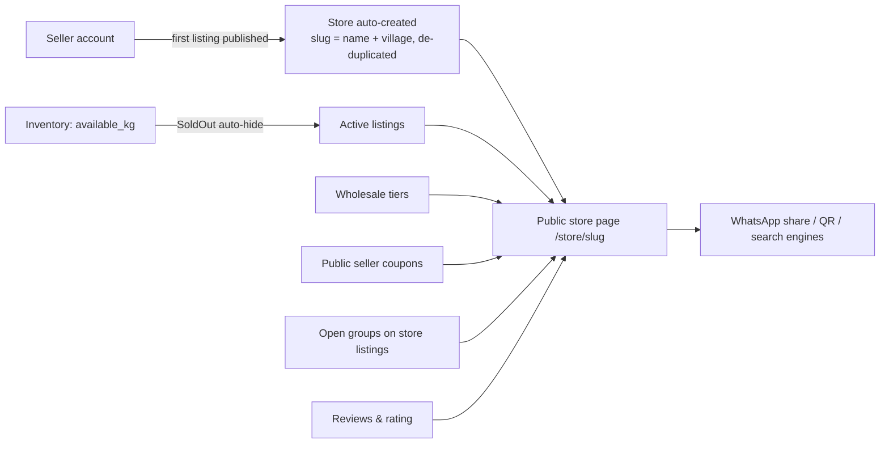
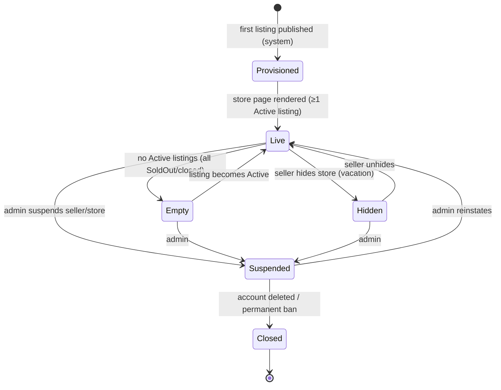
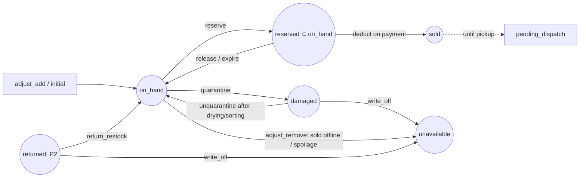
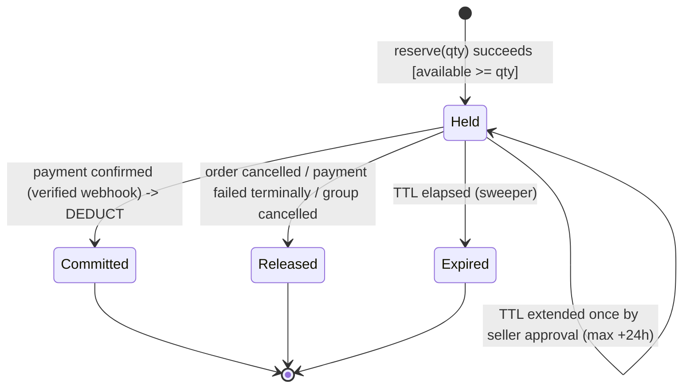
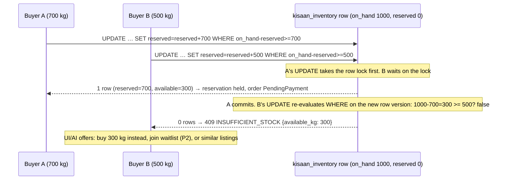

# KISAAN — Seller Store & Inventory

> Status: Draft v0.2 · Last updated: 2026-11-14 · Owner: Marketplace engineering lead (Stores & Inventory) · Source of truth index: [README](README.md)

This is the **owner document** for public seller stores and the automated inventory system (Master Prompt v2 §6, §7, §17, §18). Where [FUNCTIONAL_SPECIFICATION](FUNCTIONAL_SPECIFICATION.md) §10, §27 and §28 state the same rule, this document wins and FS should link here. These documents define the related topics:

- Pricing, discounts and price locking: [PRICING_ENGINE](PRICING_ENGINE.md). This document does not restate stacking rules.
- Group-order reservations: [WHOLESALE_AND_GROUP_BUYING](WHOLESALE_AND_GROUP_BUYING.md).
- Order and listing state machines: [MARKETPLACE_ARCHITECTURE](MARKETPLACE_ARCHITECTURE.md).
- Tables: [DATABASE_SCHEMA](DATABASE_SCHEMA.md) §5.3–5.4.
- Endpoints: [API_SPECIFICATION](API_SPECIFICATION.md).

## Table of contents

1. [Scope and ownership](#1-scope-and-ownership)
2. [Public seller store](#2-public-seller-store)
3. [Store policies](#3-store-policies)
4. [Store visibility, indexing and SEO](#4-store-visibility-indexing-and-seo)
5. [Inventory model](#5-inventory-model)
6. [Inventory flows](#6-inventory-flows)
7. [Concurrency and transaction strategy](#7-concurrency-and-transaction-strategy)
8. [Manual adjustments, audit and AI](#8-manual-adjustments-audit-and-ai)
9. [Alerts, history and seller dashboard](#9-alerts-history-and-seller-dashboard)
10. [Edge cases](#10-edge-cases)
11. [Requirements, APIs, data and tests](#11-requirements-apis-data-and-tests)
12. [Decisions, assumptions and changes requested elsewhere](#12-decisions-assumptions-and-changes-requested-elsewhere)

---

## 1. Scope and ownership

| Concern | Owner module (KISAAN OpsAPI plugin) | Reused OpsAPI capability | Scope |
|---|---|---|---|
| Store identity, slug, branding, policies | `kisaan_stores` | OpsAPI ecommerce `stores` + public store endpoints (**Existing OpsAPI endpoint** `GET /api/v2/public/stores/:slug`, verified in v0.1 [OPSAPI_INTEGRATION](OPSAPI_INTEGRATION.md)) | MVP |
| Store catalogue (listings shown in the store) | `kisaan_listings` | OpsAPI `storeproducts` (each listing is backed by one row) | MVP |
| Inventory, reservations, ledger | `kisaan_inventory` | None. OpsAPI product `stock` is a single number with no reservations, so KISAAN owns inventory and syncs a derived `stock` value into OpsAPI (A-06) | MVP |
| Store reviews and ratings | `kisaan_reviews` | OpsAPI `store_reviews` / `product_reviews` (public reads reused) | MVP |
| Store analytics | `kisaan.analytics` | — | MVP (basic) |

All KISAAN endpoints in this document are **KISAAN-specific endpoints (OpsAPI plugin)**. They are served by the KISAAN project plugin under `/api/v2/kisaan/...` (the supported OpsAPI dynamic-API mechanism, see [OPSAPI_INTEGRATION](OPSAPI_INTEGRATION.md) §7). Migrations for every `kisaan_*` table live in the KISAAN repository. Nothing here modifies OpsAPI-owned tables except through `kisaan.core_adapter`.

---

## 2. Public seller store

### 2.1 Concept

Every seller automatically gets **one public store**. It is created when the seller first publishes a listing (KIS-STORE-001). The store gets a shareable URL `/store/<slug>`, e.g. `/store/harneet-farms`. A store is a trust-building storefront, not a separate shop system. It shows the seller's live, inventory-backed listings with their wholesale tiers, public coupons, open buying groups and reviews.



### 2.2 Store fields (Master Prompt §6, §18)

| Field | Source | Public? | Notes |
|---|---|---|---|
| Store name | `stores.name` | Yes | 3–60 characters, moderated |
| Seller display name | profile | Yes | e.g. "Harneet Dhiman". The legal name is shown only if the seller opts in |
| Slug / URL | `stores.slug` | Yes | §2.4 |
| Verification status | KYC tier → badge | Yes | "Verified Seller" (T1+), "Business Verified" (T3). The badge only, never documents |
| Location | district + state, or service districts | Yes, at district level | Never village, coordinates or farm address unless the seller opts in (`location_precision = 'village'`) |
| Description / tagline | `kisaan_store_profiles.description_i18n` | Yes | pa/hi/en; machine translations flagged |
| Logo, banner | media | Yes | Image safety check; EXIF stripped |
| Products and categories | Active listings | Yes | Grouped by category; SoldOut shown only if the seller enables it |
| Availability | `available_kg` per listing | Yes | Rounded to the display unit; exact reserved/sold numbers are private |
| Ratings and reviews | reviews | Yes | Mean to 1 dp + count; "New" below 3 ratings |
| Wholesale options | tiers / whole-lot | Yes | Badge "Bulk deal: up to X % off" + tier table on each listing |
| Coupons | seller coupons with `visibility = public` | Yes | Private or targeted coupons never shown ([COUPON_AND_MEMBERSHIP](COUPON_AND_MEMBERSHIP.md)) |
| Membership benefits | member price / free-delivery eligibility | Yes | "KISAAN Plus price available" badge; amounts from [PRICING_ENGINE](PRICING_ENGINE.md) |
| Delivery information | `delivery_options`, service districts | Yes | Buyer pickup / seller delivers / platform logistics |
| Store policies | §3 | Yes | |
| Member since, completed orders (banded) | derived | Yes | Order counts banded (e.g. "50+"), never revenue |
| Phone, WhatsApp | profile | **Only per `public_contact_mode`** | Default `in_app_only`. Logged-out visitors see "Login to contact" |
| Bank / UPI / payout, KYC documents, GSTIN number | private | **Never** | GSTIN may show as "GST registered ✓" only |
| Revenue, settlements, buyer list, offer history | private | **Never** | Seller dashboard only |
| Inventory ledger, reserved quantities, low-stock thresholds | private | **Never** | Seller and admin only |

### 2.3 Store lifecycle



| State | Public page behaviour | Search/SEO |
|---|---|---|
| Live | Full page | Indexable (if §4 conditions met) |
| Empty | Page with "No produce available right now — follow this store" (follow is P2) | `noindex` after 30 days empty |
| Hidden (vacation) | "Store temporarily closed" + reopening date if set | `noindex`; listings paused (existing orders continue) |
| Suspended | "Store unavailable" | HTTP 410 to crawlers after 30 days (BR-STORE-06) |
| Closed | 410 | Removed from sitemap |

### 2.4 Slug rules

- 3–50 characters, `[a-z0-9-]`, unique per namespace. Reserved words (admin, kisaan, api, store, help, …), profanity and impersonation of KISAAN or government bodies (e.g. "enam", "apmc", "fci") are blocked.
- Auto-generated from store name + village/district, transliterated to Latin script (e.g. "ਹਰਨੀਤ ਫਾਰਮਜ਼" → `harneet-farms`). A numeric suffix is added on collision.
- The slug can change at most once per 30 days. Old slugs are kept in `kisaan_store_slug_history` and 301-redirect for 12 months. An old slug cannot be claimed by another store during those 12 months.

### 2.5 Requirements — stores

| ID | Requirement | Scope |
|---|---|---|
| KIS-STORE-001 | Auto-create a public store at `/store/<slug>` on first publish | MVP |
| KIS-STORE-002 | Store shows the §2.2 public fields | MVP |
| KIS-STORE-003 | Logged-out and crawler visibility per privacy rules | MVP |
| KIS-STORE-004 | Seller customisation (name, slug once / 30 days with redirect, banner, logo, description, policies, contact mode) | MVP |
| KIS-STORE-005 | Store QR code for offline sharing | MVP |
| KIS-STORE-006 | Follow store → new-listing notifications | P2 |
| KIS-STORE-007 | Suspended / hidden store behaviour (§2.3) | MVP |
| KIS-STORE-008 | Store analytics (views, shares, enquiries, offers and orders originating from the store) | MVP |
| **KIS-STORE-009** (new) | Structured store policies with platform minimums that sellers cannot weaken (§3) | MVP |
| **KIS-STORE-010** (new) | Indexing, sitemap, canonical, hreflang and structured-data rules (§4) | MVP |
| **KIS-STORE-011** (new) | Store-level display of wholesale, public coupon, open-group and KISAAN Plus benefit badges. Values come from server-side pricing quotes, never client-computed | MVP |
| **KIS-STORE-012** (new) | Vacation mode: hide the store and pause its listings with an optional reopen date. Existing orders and reservations are unaffected | MVP |
| **KIS-STORE-013** (new) | Public/private field boundary (§2.2) enforced by a serializer allow-list on public endpoints. Public endpoints never return private fields | MVP |

**Acceptance criteria (stores).**
- A logged-out visitor opening `/store/harneet-farms` sees every Active listing with tiers and public coupons. The response contains no phone number, address line, GSTIN, payout or reserved-quantity field (contract test against the allow-list).
- After a slug change, the old URL returns 301 to the new one. A second change within 30 days returns `SLUG_CHANGE_TOO_SOON`.
- When a listing sells out it disappears from the store's Active section within 60 seconds (edge cache invalidated).
- A WhatsApp share preview shows store name, banner and rating (Open Graph).
- In vacation mode all Active listings move to Paused. On unhide they return to Active only if `available ≥ MOQ` and they have not expired.
- Store first render ≤ 150 KB on a 3G profile (KIS-NFR budget, see [UX_UI_SPECIFICATION](UX_UI_SPECIFICATION.md)).

---

## 3. Store policies

Sellers choose policies from **templates** in their language and may add text. Platform policy is a floor: a seller can be **more generous** than the platform but never less (e.g. a seller cannot remove the buyer's right to dispute within the acceptance window).

| Policy | Seller-configurable | Platform minimum (not overridable) |
|---|---|---|
| Delivery | Delivery modes offered, service districts, dispatch time (hours after confirmation), seller-delivery radius and charge basis | Dispatch SLA ≤ 48 h (12 h perishables) or the buyer may cancel free (BR-ORD-08) |
| Cancellation | Whether to allow buyer cancellation after confirmation and before dispatch, without reason | Free cancellation in PendingPayment; full refund if the seller cancels |
| Returns / refunds | "No returns for produce except quality/quantity disputes" (default) or "Returns accepted within N hours of delivery if unopened" | Dispute rights within the acceptance window; weight reconciliation ±2 % (KIS-ORD-007) |
| Quality | Grade declaration, sample photos, inspection allowed (P2) | AI observation is never a certification |
| Payment | On-platform prepaid only (MVP) | Off-platform payment requests prohibited (contact masking) |

Policies are versioned (`kisaan_store_profiles.policies` + `policies_version`). Each order snapshots the policy version in force at checkout, and disputes are judged against that snapshot. `[LEGAL REVIEW]`: consumer-protection e-commerce rules on seller return and refund disclosure ([SECURITY_AND_COMPLIANCE](SECURITY_AND_COMPLIANCE.md)).

**Acceptance.** Saving a policy weaker than the floor is rejected with `POLICY_BELOW_PLATFORM_MINIMUM`, naming the field. An order created before a policy edit still shows the old policy in its detail view.

---

## 4. Store visibility, indexing and SEO

| Rule | Detail |
|---|---|
| Indexable when | store state Live, seller ≥ T1, ≥ 1 Active listing, not flagged by moderation |
| `noindex` when | Empty > 30 days, Hidden, under moderation review, or seller at T0 |
| Sitemap | `sitemap-stores.xml` regenerated hourly; Live stores only; `lastmod` = latest listing change |
| Canonical | `/store/<current-slug>`; old slugs 301 |
| Languages | `?lang=pa|hi|en` variants with `hreflang`; default by `Accept-Language` |
| Structured data | Store as `Organization` with `address` at district level only. Listings as `Product` + `Offer` (price per display unit, `availability` from inventory). `AggregateRating` only when ≥ 3 ratings. No structured-data price may differ from the server quote for MVP quantity |
| Caching | Server-rendered; edge TTL 60 s; purge on listing/inventory state change, slug change or suspension |
| Ranking | No paid store boosting in MVP (featured stores are Future, labelled "Sponsored", see [PAYMENT_AND_BUSINESS_MODEL](PAYMENT_AND_BUSINESS_MODEL.md)) |
| Robots | Group pages, RFQs and buyer profiles are `noindex`. Only stores and Active listing pages are indexable |

---

## 5. Inventory model

### 5.1 Principles

1. **Inventory is computed from events, not typed in.** Normal marketplace activity (checkout, offer acceptance, group lock, payment, cancellation, expiry) changes stock automatically. Manual entry is only for real-world events the platform cannot see (harvest added, spoilage, sold offline), and always needs a reason (KIS-INV-006).
2. **One row per listing is the concurrency point.** `kisaan_inventory` is 1:1 with a listing. Each listing has one pickup location (BR-PRD-05); multi-location stock is Future (KIS-INV-011).
3. **Append-only ledger.** Every change writes a movement row. Balances are reproducible from the ledger and are verified nightly (BR-INV-09).
4. **Backend-only authority.** Neither the frontend nor KISAAN AI ever writes stock directly. AI can only create a **draft adjustment** that the seller approves (§8).

### 5.2 Quantity buckets (Master Prompt §7)

All quantities are in kg, `NUMERIC(14,3)`.

| Bucket | Meaning | Stored / derived | Sellable? |
|---|---|---|---|
| `on_hand_kg` | Physical stock the seller says is in the lot and sellable, **including** reserved quantity | Stored | Yes (minus reserved) |
| `reserved_kg` | Held for a buyer pending payment or completion of a group lock (live reservations) | Stored, = Σ held reservations | No |
| `available_kg` | `on_hand_kg − reserved_kg`; what search, store and AI show | Generated column | Yes |
| `sold_kg` | Cumulative quantity deducted on confirmed payment | Stored | — |
| `pending_dispatch_kg` | Sold (deducted) but not yet picked up or handed over; physically still with the seller | Derived from confirmed orders in `Confirmed`/`ReadyForPickup` | No (already sold) |
| `damaged_kg` (new) | Quarantined stock: damaged, wet or pest-affected, awaiting a seller decision (write-off or restock after drying/cleaning) | Stored | No |
| `unavailable_kg` (new) | Expired, spoiled or withdrawn quantity written off this lot. Cumulative, for analytics | Stored | No |
| `returned_kg` (new, P2) | Returned goods awaiting inspection before restock or write-off | Stored | No |
| `low_stock_threshold_kg` | Alert threshold | Stored | — |

**Invariants (DB CHECK + nightly job):**
- `0 ≤ reserved_kg ≤ on_hand_kg` ⇒ `available_kg ≥ 0`.
- `on_hand_kg = Σ(initial, adjust_add, return_restock, unquarantine) − Σ(adjust_remove, deduct, quarantine)`.
- `reserved_kg = Σ(reserve) − Σ(release, expire, deduct)` over the reservations of the listing.
- `damaged_kg = Σ(quarantine) − Σ(unquarantine, write_off_damaged)`.



### 5.3 Reservation model

| Field | Meaning |
|---|---|
| `source_type` | `checkout` (buy now), `offer` (accepted offer/quotation), `group_order` (group lock) |
| `status` | `held` → `committed` (deducted) / `released` / `expired` |
| `expires_at` | TTL (§6.1) |
| UNIQUE `(source_type, source_id) WHERE status='held'` | At most one live hold per source; makes retries idempotent |

Reservation lifecycle:



A Committed reservation is never reopened. A post-deduct cancellation restocks through a separate `adjust_add`-type movement with reason `order_cancelled_restock` (§6.4), so the ledger stays append-only.

---

## 6. Inventory flows

### 6.1 Triggers and TTLs

| Trigger | Movement | TTL / timing |
|---|---|---|
| Buy-now checkout created | `reserve` | 15 min (quote validity; [PRICING_ENGINE](PRICING_ENGINE.md) price lock) |
| Offer/quotation accepted | `reserve` | Payment deadline: 24 h, perishables 4 h (D-07) |
| Group order locked by leader | `reserve` (group total) | Member payment window, default 24 h, max 24 h ([WHOLESALE_AND_GROUP_BUYING](WHOLESALE_AND_GROUP_BUYING.md)) |
| Payment captured (verified PA webhook) | `deduct` | Immediate, in the webhook transaction |
| Group payment window closes | `deduct` paid allocations, `release` unpaid remainder | At window close |
| Order cancelled before payment | `release` | Immediate |
| Payment fails terminally | `release` | Immediate |
| TTL elapsed | `expire` | Sweeper every 60 s |
| Order cancelled after payment, before dispatch | `adjust_add` (`order_cancelled_restock`) | Immediate, automatic |
| Order cancelled after dispatch | none automatically; goods are in transit | Dispute decides (§6.5) |
| Seller adds harvest | `adjust_add` (`harvest_added`) | Manual, audited |
| Spoilage / sold offline | `adjust_remove` | Manual, audited |
| Seller marks damaged | `quarantine` | Manual, audited |

### 6.2 Normal purchase (reserve → deduct)

```mermaid
sequenceDiagram
  autonumber
  participant B as Buyer app
  participant K as KISAAN plugin (orders + inventory)
  participant DB as PostgreSQL
  participant PA as Payment provider
  B->>K: POST /kisaan/checkout/orders {quote_id, Idempotency-Key}
  K->>DB: BEGIN; conditional UPDATE inventory (reserve); INSERT reservation(held, 15m); INSERT movement; INSERT order(PendingPayment); COMMIT
  K-->>B: order + payment intent
  B->>PA: pay
  PA->>K: webhook payment.captured (signature verified)
  K->>DB: BEGIN; lock reservation FOR UPDATE; status held→committed; on_hand-=q, reserved-=q, sold+=q; movement deduct; order→Confirmed; outbox events; COMMIT
  K-->>B: notification "Order confirmed"
```

**Example (Master Prompt §7).** Wheat on_hand 1,000 kg. The buyer buys 100 kg: at checkout reserved = 100 and available = 900. On payment on_hand = 900, reserved = 0, available = 900, sold = 100. If instead the buyer abandons the checkout, the reservation expires after 15 minutes and available returns to 1,000.

### 6.3 Payment arrives after the reservation expired

The deduct transaction finds the reservation `expired`. It attempts a **fresh atomic reserve + deduct** in the same transaction:

- If stock is still available, the order is Confirmed normally (movement `reserve` + `deduct`, flagged `late_payment`).
- If stock is gone, the order moves to `payment_received_stock_unavailable`, an automatic full refund is initiated (idempotent), and buyer, seller and finance are notified (FS EC-05).

### 6.4 Cancellation and refund

| Order state at cancel | Inventory effect | Automatic? |
|---|---|---|
| PendingPayment | `release` the held reservation | Yes |
| Confirmed / ReadyForPickup (goods not handed over) | `adjust_add` reason `order_cancelled_restock` for the order quantity → available rises | Yes |
| InTransit / Delivered | No automatic change. Goods are not at the lot | No (dispute outcome) |
| Refund without return (quality partial refund, weight shortfall) | None. Money only | — |

**Rule — restock on cancellation is the default.** The seller can override within 2 hours ("this stock was already loaded/sold elsewhere") with an audited `adjust_remove`. Otherwise produce cancelled before dispatch is assumed to still be physically present.

### 6.5 Returns (agricultural reality)

Most produce is not returned. Disputes usually end in a partial refund. When a dispute outcome is "full refund with return logistics" (BR-DSP-04):

1. The goods arrive back at the seller and the seller confirms receipt (OTP).
2. **MVP:** the seller chooses *restock* (`return_restock` movement, available increases) or *write off* (`unavailable_kg`). Both are audited, with an optional photo.
3. **P2:** a formal `returned_kg` inspection bucket (KIS-INV-014).

### 6.6 Partial fulfilment and partial cancellation (P2, with KIS-ORD-009)

| Case | Inventory rule |
|---|---|
| Seller can supply only part of a confirmed order (e.g. 80 of 100 kg) | Seller records a partial-fulfilment proposal; buyer approves. 20 kg is refunded (pro-rata per [PRICING_ENGINE](PRICING_ENGINE.md)). No inventory change unless the seller also records the shortfall cause (`adjust_remove` with `count_correction`/`spoilage`) |
| Buyer cancels part of a confirmed order before dispatch | `adjust_add` (`order_cancelled_restock`) for the cancelled part; snapshot recalculated by the pricing engine. A tier lost because quantity fell below a threshold is re-priced at the lower tier, never higher than the original unit price |
| Split deliveries | Inventory was deducted at payment; shipments only track `pending_dispatch_kg` |
| Weight reconciliation within ±2 % | No inventory change (difference is measurement) |

### 6.7 Group orders

Inventory is **not** reserved while a group is collecting commitments. The live `available_kg` is shown on the group page. At the leader's lock step the group total is reserved atomically with TTL = payment window. At window close, paid allocations are deducted and the unpaid remainder is released. Full rules: [WHOLESALE_AND_GROUP_BUYING](WHOLESALE_AND_GROUP_BUYING.md) §7.

### 6.8 Listing visibility hooks (same transaction)

- `available_kg < moq_kg` → listing `Active → SoldOut` (out_of_stock) and removed from search/store Active section. Exception: a whole-lot remainder below MOQ stays buyable as "whole remaining lot".
- `available_kg ≥ moq_kg` and listing is SoldOut → `Active`, unless it has meanwhile been paused, expired or removed.
- Downward crossing of `low_stock_threshold_kg` → outbox event `kisaan.inventory.low_stock`.
- Any change → search reindex event (≤ 60 s) and edge-cache purge for the store page.

---

## 7. Concurrency and transaction strategy

### 7.1 Strategy

| Technique | Where | Why |
|---|---|---|
| **Single conditional UPDATE** (`… WHERE on_hand_kg - reserved_kg >= :qty RETURNING`) | Reserve | Row lock + check in one statement; no read-then-write race; no explicit `SELECT … FOR UPDATE` needed |
| `SELECT … FOR UPDATE` on the reservation row | Deduct, release, expire | Prevent double-finalisation (`RESERVATION_ALREADY_FINALISED`) |
| `FOR UPDATE SKIP LOCKED` | Expiry sweeper (every 60 s, multiple workers) | Safe parallel sweeping |
| DB CHECK `reserved_kg <= on_hand_kg`, `on_hand_kg >= 0` | Table | Last line of defence: a bug cannot persist an oversell |
| `Idempotency-Key` header (required) on checkout, accept, group lock, adjustment | API | A retried request returns the original result (`Idempotent-Replayed: true`) |
| UNIQUE `(source_type, source_id) WHERE status='held'` | Reservations | One live hold per checkout/offer/group even under client retries |
| Optimistic `version` + `If-Match` | Seller edits to threshold, listing qty | Lost-update protection for human edits |
| Transactional outbox | Events (search, notifications, AI context) | Events are only emitted for committed changes |
| Isolation level | READ COMMITTED (Postgres default) is sufficient because of the conditional UPDATE; no SERIALIZABLE needed | Lower contention |

**Hot-row consideration.** A popular listing serialises reservations on one row. Each reserve transaction is short (one UPDATE + two INSERTs, target p95 < 20 ms), so throughput is far above expected agricultural demand (lots are large and buyers few). Sharding stock rows is not needed `[ASSUMPTION A-130]`.

### 7.2 Worked race (Master Prompt §17)

Available = 1,000 kg. Buyer A checks out 700 kg and Buyer B checks out 500 kg at the same instant.



Postgres re-checks the `WHERE` clause against the newly committed row version after the lock is released (READ COMMITTED update re-check), so exactly one succeeds. Whichever request takes the lock first wins. If B wins, A gets `INSUFFICIENT_STOCK` with `available_kg: 500`. Total reserved never exceeds 1,000.

**Variants:**
- A's payment fails → `release` 700 → available 1,000 → B can retry and succeed.
- A pays after its 15-minute reservation expired and B has since reserved 500 → late-payment path (§6.3): fresh reserve of 700 fails (available 500) → auto-refund to A.

### 7.3 Acceptance tests (concurrency)

- KIS-TEST-INV-101: 50 parallel reserves of 10 qtl against 100 qtl → exactly 10 succeed; final available 0; ledger balanced.
- KIS-TEST-INV-102: The §7.2 race repeated 1,000 times with random ordering → never both succeed; Σ reserved ≤ 1,000 kg every time.
- KIS-TEST-INV-103: Duplicate webhook delivery (same event 5 times, concurrently) → exactly one `deduct` movement.
- KIS-TEST-INV-104: Sweeper running on 3 workers concurrently with payment webhooks → no reservation both expired and committed.
- KIS-TEST-INV-105: Client retries checkout with the same Idempotency-Key after a timeout → one reservation, one order, replay header set.

---

## 8. Manual adjustments, audit and AI

### 8.1 Adjustment types

| Type | Reason codes | Constraint |
|---|---|---|
| `adjust_add` | `harvest_added`, `count_correction`, `order_cancelled_restock` (system), `return_restock` | qty > 0 |
| `adjust_remove` | `spoilage`, `sold_offline`, `count_correction`, `quality_downgrade`, `other` (≥ 10 chars text) | Cannot take `on_hand_kg` below `reserved_kg` → `ADJUSTMENT_BELOW_RESERVED` |
| `quarantine` / `unquarantine` | `damaged`, `wet`, `pest`, `contaminated`; `cleaned_dried` | Quarantine qty ≤ available |
| `write_off` | `expired`, `spoiled`, `destroyed` | From damaged or available |

**Material adjustment** (requires explicit confirmation and step-up if large): any adjustment ≥ 20 % of on_hand **or** ≥ 1,000 kg `[DECISION D-130]`. The UI shows a before → after readback. For material removals while open offers exist, affected offer holders are notified (BR-LST-05).

Every adjustment writes: movement row (actor_type `user|system|ai_on_behalf|admin`, actor id, channel `ui|voice|whatsapp|ai|admin`, reason, approval id if any) **and** an audit-log entry. Admin adjustments additionally require a ticket reference and are visible to the seller.

### 8.2 KISAAN AI and inventory

The single KISAAN AI ([SINGLE_AI_ARCHITECTURE](SINGLE_AI_ARCHITECTURE.md)) has these inventory tools:

| Tool | Class | Behaviour |
|---|---|---|
| `inventory.get_listing_inventory` / `inventory.get_summary` | READ | On hand / reserved / available / sold / damaged / unavailable for one or all of the caller's own listings |
| `inventory.get_movements` | READ | Ledger page for the caller's own listing |
| `inventory.propose_adjustment` | COMMIT | Creates an ApprovalRequest with before/after (**no stock change**). The adjustment executes only when the seller approves in their own client; the approval is bound to listing, type, qty and reason, and the backend re-validates `ADJUSTMENT_BELOW_RESERVED` at execution |
| `inventory.set_low_stock_threshold` | DRAFT (non-material setting; catalogue class) | Confirmed in-chat; audited |

Example: "Mera 20 quintal aur wheat aa gaya" → AI: "Wheat (PBW-826) stock 60 quintal → 80 quintal ho jayega, reason: harvest added. Confirm karo?" → seller approves in their own client → the client executes the approved adjustment. The AI must never say "stock updated" until the tool returns the committed movement id. Reservation, deduction and release are **never** AI tools; they happen only as side effects of order and payment flows.

---

## 9. Alerts, history and seller dashboard

| Feature | Rule | Scope |
|---|---|---|
| Low-stock alert | Fires once per downward crossing; re-arms above threshold. Channels: in-app + WhatsApp/SMS per opt-in. Text in seller language ("Sirf 8 quintal bacha hai") | MVP |
| Sold-out notice | When the listing auto-hides | MVP |
| Reservation expiring | Seller sees holds expiring in < 1 h; may extend once (+24 h max) with approval | MVP |
| Ledger mismatch | Nightly job → P1 ops alert (not shown to seller) | MVP |
| Inventory history | Paginated ledger per listing, filter by type/date, CSV export (P2) | MVP (export P2) |
| Dashboard | Per listing: on hand, reserved (with sources and expiry), available, sold, pending dispatch, damaged; low-stock list; stock value at list price | MVP |

---

## 10. Edge cases

| # | Scenario | Expected behaviour |
|---|---|---|
| SI-01 | Seller reduces on_hand below reserved | Rejected `ADJUSTMENT_BELOW_RESERVED`; UI shows which orders hold stock |
| SI-02 | Seller closes a listing with held reservations | Holds and orders continue; new checkouts blocked; open offers auto-rejected (BR-LST-02) |
| SI-03 | Payment webhook arrives twice | Second is a no-op (`RESERVATION_ALREADY_FINALISED` internally, 200 to PA) |
| SI-04 | Sweeper and webhook race on the same reservation | Row lock order guarantees one outcome; the loser takes the late-payment path (§6.3) |
| SI-05 | Quantity unit mistake by voice ("100" heard as "1000") | Draft readback shows before/after and the material-adjustment warning; nothing changes without confirmation |
| SI-06 | Seller sold 30 qtl offline and forgot to update; a buyer then buys | Seller records `sold_offline` remove; if it would go below reserved, seller must cancel an order (reliability penalty) |
| SI-07 | Perishable lot passes `available_until` with stock left | Listing → Expired; stock stays on the record; seller may renew or write off |
| SI-08 | Store suspended with open orders | Orders continue under admin watch; store hidden; inventory frozen for new reservations |
| SI-09 | Group lock reserves 2,500 kg but only 2,100 kg is available | Reserve fails atomically; leader chooses proceed-reduced or cancel ([WHOLESALE_AND_GROUP_BUYING](WHOLESALE_AND_GROUP_BUYING.md) §9) |
| SI-10 | Clock skew between app servers | TTLs are computed with DB `now()`, never app time |
| SI-11 | Slug collision during concurrent store creation | UNIQUE constraint; retry with numeric suffix |
| SI-12 | Seller deletes account with reserved stock | Blocked until open orders complete (`OPEN_OBLIGATIONS_EXIST`) |

---

## 11. Requirements, APIs, data and tests

### 11.1 Inventory requirements

| ID | Requirement | Scope |
|---|---|---|
| KIS-INV-001 | Inventory record per listing: on hand, reserved, available | MVP |
| KIS-INV-002 | Automatic reservation on checkout, offer acceptance and group lock, with TTL | MVP |
| KIS-INV-003 | Automatic deduction on verified payment | MVP |
| KIS-INV-004 | Automatic release on cancellation, payment failure or expiry | MVP |
| KIS-INV-005 | Overselling prevention under concurrency (§7) | MVP |
| KIS-INV-006 | Manual adjustment with reason codes, audited | MVP |
| KIS-INV-007 | Low-stock alert | MVP |
| KIS-INV-008 | Out-of-stock auto-hide | MVP |
| KIS-INV-009 | Append-only movement ledger | MVP |
| KIS-INV-010 | Voice/AI adjustments are drafts until approved | MVP |
| KIS-INV-011 | Multi-location stock | Future |
| **KIS-INV-012** (new) | Damaged (quarantine) and unavailable (write-off) buckets with movements and invariants (§5.2) | MVP |
| **KIS-INV-013** (new) | Pending-dispatch quantity derived and shown on the dashboard | MVP |
| **KIS-INV-014** (new) | Returns: restock or write-off after seller confirms receipt (MVP manual); formal returned/inspection bucket (P2) | MVP / P2 |
| **KIS-INV-015** (new) | Automatic restock on cancellation after payment and before dispatch, with a 2-hour seller override | MVP |
| **KIS-INV-016** (new) | Partial cancellation / partial fulfilment inventory effects (§6.6) | P2 (with KIS-ORD-009) |
| **KIS-INV-017** (new) | Material adjustment threshold with confirmation and step-up (D-130) | MVP |
| **KIS-INV-018** (new) | Late-payment-after-expiry handling: fresh reserve or auto-refund (§6.3) | MVP |

### 11.2 API endpoints used (all KISAAN-specific endpoints, OpsAPI plugin)

| Endpoint | Purpose |
|---|---|
| `GET /api/v2/kisaan/public/stores/:slug`, `/:slug/listings` | Public store (allow-listed fields) |
| `GET/PATCH /api/v2/kisaan/me/store` | Seller store settings, slug, policies |
| **New** `POST /api/v2/kisaan/me/store/visibility` `{hidden, reopen_on}` | Vacation mode (KIS-STORE-012) |
| `GET /api/v2/kisaan/listings/:uuid/inventory` | Buckets |
| `POST /api/v2/kisaan/listings/:uuid/inventory/adjustments` | Adjust (types extended: quarantine, unquarantine, write_off) |
| `GET /api/v2/kisaan/listings/:uuid/inventory/movements` · `/reservations` | Ledger, holds |
| **New** `POST /api/v2/kisaan/inventory/reservations/:uuid/extend` | One-time TTL extension (seller approval) |
| `PUT /api/v2/kisaan/listings/:uuid/inventory/threshold` | Threshold |
| `GET /api/v2/kisaan/inventory/summary` | Seller dashboard |
| Existing OpsAPI endpoint `GET /api/v2/public/stores/:slug` (+ `/products`, `/reviews`) | Reused base store / reviews fallback |

### 11.3 Data model changes (requested in DATABASE_SCHEMA)

- `kisaan_inventory`: add `damaged_kg`, `unavailable_kg`, `returned_kg` (P2), with the §5.2 CHECKs.
- `kisaan_inventory_movements.movement_type`: add `quarantine`, `unquarantine`, `write_off`, `return_restock`; reason codes `order_cancelled_restock`, `quality_downgrade`; add `channel` column.
- `kisaan_store_profiles`: add `policies_version`, `location_precision` (`district|village`), `hidden_until`, `vacation_reopen_on`.
- `kisaan_order_details`: add `store_policy_version` snapshot.

### 11.4 Tests

| ID | Covers |
|---|---|
| KIS-TEST-INV-101…105 | Concurrency (§7.3) |
| KIS-TEST-INV-106 | Ledger invariant after randomised 10,000-operation property test (reserve/release/deduct/adjust/quarantine) |
| KIS-TEST-INV-107 | Cancellation after payment restocks; seller override within 2 h records adjust_remove |
| KIS-TEST-INV-108 | Late payment after expiry: stock available → confirmed; stock gone → auto-refund |
| KIS-TEST-INV-109 | Execution of an `inventory.propose_adjustment` request without approval → `APPROVAL_REQUIRED`; with stale approval → `APPROVAL_EXPIRED`; with changed qty → `APPROVAL_PARAMS_MISMATCH` |
| KIS-TEST-INV-110 | Material-adjustment threshold triggers confirmation + step-up |
| KIS-TEST-STORE-101 | Public store response contains only allow-listed fields (contract test, logged out) |
| KIS-TEST-STORE-102 | Slug change redirect and 30-day limit; old slug unclaimable for 12 months |
| KIS-TEST-STORE-103 | Vacation mode pauses/resumes listings correctly; orders unaffected |
| KIS-TEST-STORE-104 | Policy weaker than platform minimum rejected; order snapshot keeps old policy version |
| KIS-TEST-STORE-105 | SEO: noindex rules, sitemap content, structured-data price equals server quote |
| KIS-TEST-STORE-106 | Store page ≤ 150 KB first render on 3G profile; edge purge within 60 s of sell-out |

---

## 12. Decisions, assumptions and changes requested elsewhere

| ID | Item | Status |
|---|---|---|
| D-130 | Material inventory adjustment threshold: ≥ 20 % of on_hand or ≥ 1,000 kg | Proposed — v0.2 |
| D-131 | Default restock on post-payment, pre-dispatch cancellation, with a 2-hour seller override | Proposed — v0.2 |
| A-130 | One inventory row per listing is enough for throughput (no stock sharding) at MVP scale | Proposed — v0.2 |

**Requested changes elsewhere:**
- DATABASE_SCHEMA: §11.3.
- API_SPECIFICATION: §11.2 new endpoints and adjustment types.
- FUNCTIONAL_SPECIFICATION §10/§27/§28: link here as the owner. Replace "Returned (manual RESTOCK, P2)" with KIS-INV-014 (MVP manual restock).
- RISKS_AND_ASSUMPTIONS: register D-130, D-131, A-130.
- TESTING_STRATEGY / REQUIREMENTS_TRACEABILITY: add the KIS-TEST-INV-101…110 and KIS-TEST-STORE-101…106 tests and the new requirement IDs.
