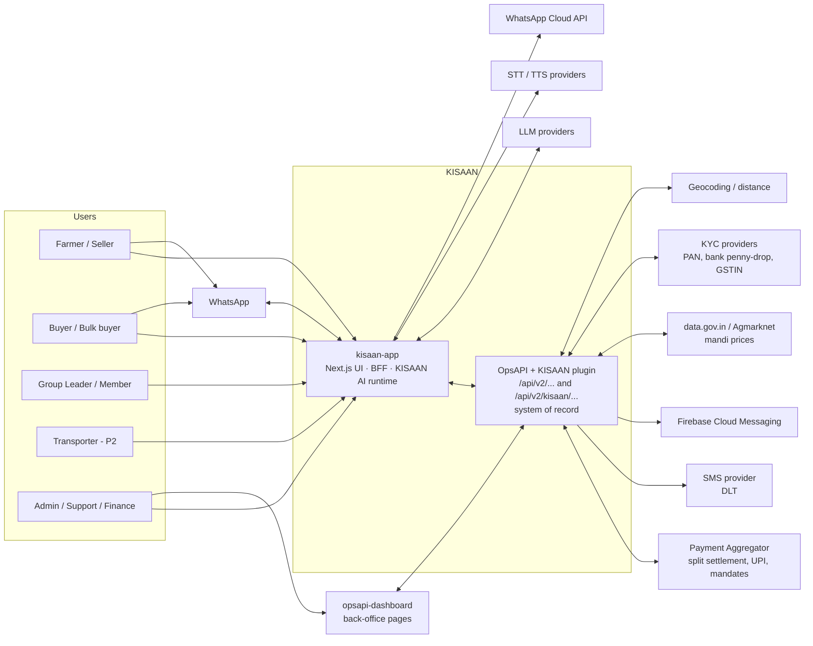
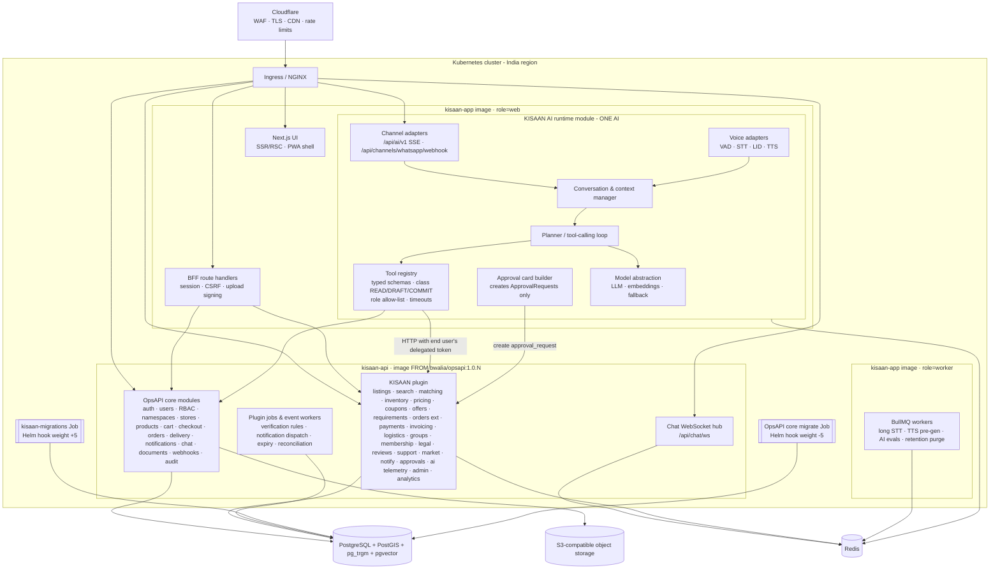
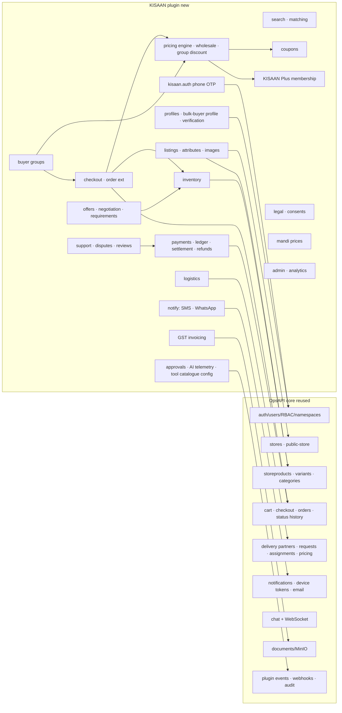
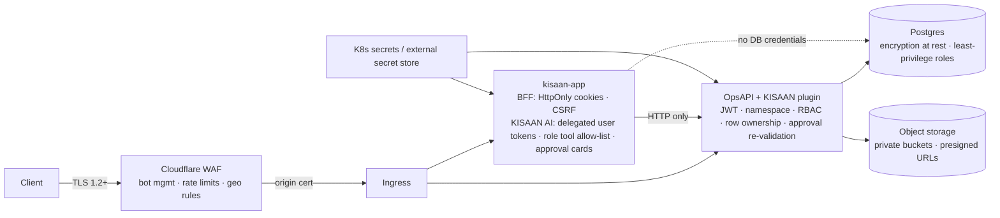
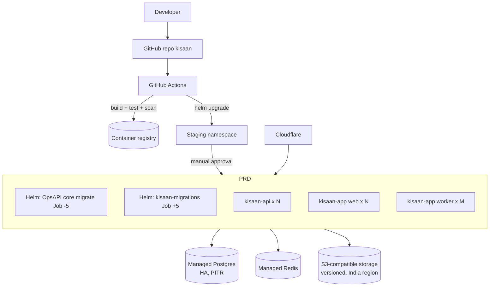

# KISAAN — System Architecture

> Status: Draft v0.2 · Last updated: 2026-11-14 · Owner: Technical Architecture Lead · Source of truth index: [README](README.md)

Related: [OPSAPI_INTEGRATION](OPSAPI_INTEGRATION.md) (backend reuse map, plugin, migrations) · [SINGLE_AI_ARCHITECTURE](SINGLE_AI_ARCHITECTURE.md) · [MARKETPLACE_ARCHITECTURE](MARKETPLACE_ARCHITECTURE.md) · [PRICING_ENGINE](PRICING_ENGINE.md) · [SELLER_STORE_AND_INVENTORY](SELLER_STORE_AND_INVENTORY.md) · [DATABASE_SCHEMA](DATABASE_SCHEMA.md) · [API_SPECIFICATION](API_SPECIFICATION.md) · [SECURITY_AND_COMPLIANCE](SECURITY_AND_COMPLIANCE.md)

**v0.2 changes.** The v0.1 design had a separate "KISAAN AI Gateway" service running an orchestrator and specialist agents. v0.2 replaces it. There is **one KISAAN AI**, implemented as a runtime module **inside the single KISAAN TypeScript application** (`kisaan-app`, Next.js), per decisions **D-101** and **D-102**. It calls narrowly scoped tools. Background trust and notification work is ordinary backend jobs, not AI. D-25, D-32 and D-50 are superseded (see §13).

---

## 1. Architectural drivers

| Driver | Consequence |
|---|---|
| OpsAPI is the mandatory backend foundation (prompt v2 §20–23) | Modular monolith = OpsAPI image + KISAAN OpsAPI plugin in one deployable; no greenfield backend, no edits to the OpsAPI repo |
| AI-first, voice, **exactly one KISAAN AI** (D-101) | One AI runtime module (intent → plan → typed tool calls → approval cards) inside `kisaan-app`. It is not a separate service and has no sub-agents. Business logic stays in the backend |
| Rural, low-bandwidth, low-end Android | PWA, server-rendered first paint, small JS bundles, aggressive image compression, offline drafts/queue, Opus audio |
| Money and stock correctness | Postgres transactions, conditional row updates, idempotency keys, double-entry ledger, outbox events |
| Indian compliance (DPDP, e-commerce rules, GST, RBI PA rules) | India data residency, consent records, audit trails, licensed payment aggregator |
| Small team, uncertain demand | **Two application images** (OpsAPI+plugin, `kisaan-app`) plus managed data stores; scale by replicas before splitting anything |

**Deliberately not done:**
- no microservice per domain;
- no separate AI/agent service;
- no Kafka in MVP;
- no separate search cluster in MVP;
- no native apps in MVP.

---

## 2. Technology stack

| Layer | Choice | Status / notes |
|---|---|---|
| Web client | **Next.js (App Router) + React + TypeScript + Tailwind CSS**, installable **PWA** (service worker, Web App Manifest) | Prompt v2 §24 |
| Application layer | **`kisaan-app`**: the same Next.js codebase hosts the UI, the **BFF route handlers** (session cookies, token refresh, upload signing) and the **KISAAN AI runtime module** (`web/src/server/ai/`: conversation, planner loop, tool registry, tool policy engine, approvals client, model abstraction, voice adapters, WhatsApp channel adapter). Routes: AI API `/api/ai/v1/*`, WhatsApp webhook `/api/channels/whatsapp/webhook` (provenance `KISAAN-APP` in [API_SPECIFICATION](API_SPECIFICATION.md)) | D-102 |
| Client i18n | `next-intl` (or equivalent) with ICU messages for `pa-IN`, `hi-IN`, `en-IN`; Noto Sans Gurmukhi / Devanagari | — |
| Backend (system of record) | **OpsAPI** image `bwalia/opsapi:1.0.N` (Lua, Lapis, OpenResty) + **KISAAN plugin** at `/app/projects/kisaan/` (the OpsAPI project-plugin mechanism, which is KISAAN's "dynamic API" mechanism) | Verified mechanism, see OPSAPI_INTEGRATION §2 and §7 |
| Database | **PostgreSQL 16** + **PostGIS** + `pg_trgm` (+ `unaccent`) | PostGIS is already used by OpsAPI delivery (`migrations/geolocation-delivery-system.lua`) |
| Vector store | `pgvector` in the same Postgres for RAG (help/policy corpus, category guides) `[ASSUMPTION A-31: extension can be enabled on the managed DB]` | New |
| Cache / queues | **Redis**: OpsAPI chat pub/sub (reuse), rate limits, OTP throttles, AI session cache, safe read-only tool-result cache, BullMQ queues for `kisaan-app` worker jobs | OpsAPI uses Redis for chat (`lib/chat-ws.lua`) |
| Background jobs | OpsAPI plugin **jobs** (`FOR UPDATE SKIP LOCKED`) for domain jobs (reservation expiry, settlement, reconciliation, mandi ingestion, verification rules, notification dispatch). `kisaan-app` **worker role** (BullMQ) for AI/voice tasks only: async STT of long notes, TTS pre-generation, AI evaluation runs, conversation retention purge | Verified (`PLUGINS.md:582-621`) |
| Events | OpsAPI plugin **transactional outbox** (at-least-once, 8 retries) | Verified (`PLUGINS.md:488-572`) |
| Object storage | **S3-compatible** (MinIO in dev/self-hosted; managed S3-compatible storage in an Indian region in prod) via OpsAPI documents | OpsAPI `helper/minio.lua` |
| Payments | Indian **payment aggregator** with marketplace split/route settlement + UPI AutoPay/e-mandate | Provider decided in [PAYMENT_AND_BUSINESS_MODEL](PAYMENT_AND_BUSINESS_MODEL.md) |
| SMS | DLT-registered SMS provider (OTP + transactional) | Provider TBD `[DECISION D-33]` |
| WhatsApp | WhatsApp Business Platform **Cloud API** (direct or via BSP); webhook handled by `kisaan-app` | See §7 |
| STT / TTS | Pluggable adapters in the AI runtime. Candidates: Sarvam (`pa-IN`), Azure AI Speech (`pa-IN` STT; `pa-IN-OjasNeural`/`VaaniNeural` TTS), AI4Bharat IndicConformer (self-hosted, MIT), Google `pa-Guru-IN` (Preview), Bhashini (public API POC-only) | Choose by Phase 0 benchmark `[DECISION D-34]` |
| LLM | Provider-agnostic model abstraction; at least two providers for fallback; one tool-calling model serves the one KISAAN AI (a cheaper model may be used for **non-agentic** sub-steps such as language ID or summarising old turns, not as another agent) | `[DECISION D-35]` |
| Maps / geocoding | Pincode → district/lat-lng table (open data) + a commercial geocoding/distance API for road distance | `[DECISION D-36]` |
| Mandi prices | data.gov.in "Current Daily Price of Various Commodities from Various Markets (Mandi)" (Agmarknet), resource `9ef84268-d588-465a-a308-a864a43d0070`, OGDL-India | API availability `[UNVERIFIED]` |
| Edge | **Cloudflare** (DNS, TLS, WAF, rate limiting, bot management, CDN for static/images) | — |
| Runtime | Docker; **Kubernetes (k3s)** with **Helm**, as OpsAPI deploys today | OpsAPI `deploy-k3s.yml`, Helm charts |
| CI/CD | GitHub Actions: build, test, scan, push, Helm deploy; environment promotion dev → staging → prod | — |
| Observability | Prometheus + Grafana (reuse OpsAPI `/metrics` + dashboards), Loki (logs), OpenTelemetry traces (Tempo/Jaeger), Sentry (frontend + `kisaan-app` server errors), LLM tracing (Langfuse or equivalent, self-hosted in India) `[DECISION D-37]` | OpsAPI metrics verified |

---

## 3. System context



---

## 4. Container / component architecture



The AI runtime has **no database connection for marketplace data**. It persists conversations, messages and tool-execution telemetry only through KISAAN plugin endpoints (`kisaan_ai` module), using its service identity, which is limited to those writes plus creating approval requests (see [SECURITY_AND_COMPLIANCE](SECURITY_AND_COMPLIANCE.md) KIS-SEC-010, KIS-SEC-090).

### 4.1 Deployables

| Deployable | Image | Scales by | Notes |
|---|---|---|---|
| `kisaan-app` (role `web`) | KISAAN Next.js app | HPA on CPU / RPS / open SSE streams | Stateless; session tokens in HttpOnly cookies; AI conversation state in Postgres (via plugin) + Redis cache |
| `kisaan-app` (role `worker`) | **same image**, `ROLE=worker` | BullMQ queue depth | Only needed once async voice/eval load exists; can be disabled in local/dev. Same code, **not** a separate service or agent |
| `kisaan-api` | `FROM bwalia/opsapi:1.0.N` + KISAAN plugin | HPA on CPU/RPS | Readiness `/ready` (503 if plugin fails to load), liveness `/live` |
| `kisaan-api` (role `worker`, optional) | same image | job queue depth | Jobs/event workers only, if job load starts to affect API latency (P2) |
| `kisaan-migrations` | same as `kisaan-api` | Helm hook Job | Weight +5, after OpsAPI core (−5) |
| Postgres, Redis, object storage | Managed services (preferred) | Vertical first; read replica P2 | India region |

---

## 5. Backend architecture (OpsAPI + KISAAN plugin)

The backend is a **modular monolith**: OpsAPI core modules plus the KISAAN plugin modules run in one process and share one Postgres database. Module boundaries are enforced by code structure (`plugins/kisaan/lib/<module>/`), table prefixes and RBAC modules, not by network calls. Ownership of schema and migrations: [OPSAPI_INTEGRATION](OPSAPI_INTEGRATION.md) (OpsAPI-owned vs KISAAN-owned).

### 5.1 Module map



### 5.2 Key backend patterns

| Concern | Pattern |
|---|---|
| Transactions | Each command handler runs one DB transaction; domain events are written to the OpsAPI outbox **in the same transaction** (via `publishes`/`sdk.emit`) |
| Inventory concurrency | `UPDATE kisaan_inventory SET reserved = reserved + $q WHERE listing_id = $id AND on_hand - reserved >= $q` → 0 rows = insufficient stock (409). Never read-then-write. Owner doc: [SELLER_STORE_AND_INVENTORY](SELLER_STORE_AND_INVENTORY.md) |
| Pricing | One deterministic engine in the plugin (`kisaan_pricing`) produces every quote; the precedence is defined in [PRICING_ENGINE](PRICING_ENGINE.md) (D-103). The frontend, BFF and AI only **display** quotes returned by the backend |
| Idempotency | `Idempotency-Key` on all commit-class POSTs (SDK `sdk.idempotent`); provider webhooks are deduped on the provider event id |
| State machines | Pure Lua transition tables in `lib/` (listing, offer, order ext, payment, shipment, group, group order, membership, coupon, dispute) with unit tests; illegal transitions → 409. Owner doc: [MARKETPLACE_ARCHITECTURE](MARKETPLACE_ARCHITECTURE.md) |
| Money | `numeric(14,2)` INR (unit prices `numeric(14,4)`); computed server-side only; the pricing breakdown is persisted on the order |
| Read models | Denormalised `kisaan_search_documents` updated by event listeners; KPI materialised views refreshed by jobs |
| Matching | Deterministic scored query (`matching` in `kisaan.search`) over requirements ↔ listings (product, grade, quantity, distance, price band, seller trust). Exposed as API (`POST /api/v2/kisaan/matching/run`) and as AI tool `matching.find_matches`. The AI explains and ranks results; it never invents a match |
| Real-time | Buyer↔seller messages use the OpsAPI chat WebSocket. Order/offer/approval updates reach clients via the `kisaan-app` SSE stream, which subscribes to KISAAN events in Redis (P2: a dedicated realtime relay if load requires) |
| Group buying | Members commit **without paying**; the leader locks via `groups.propose_lock_group_order` (approval); the pricing engine computes the final group price and inventory is reserved for the locked total; members pay their own allocation within the payment window (default 24 h). Unpaid members are `released`; if paid quantity falls below the seller's minimum the group enters `repricing` and the seller honours, re-offers or declines (D-72, D-132). Pay-out never passes through the leader (KIS-CMP-064). Owner doc: [WHOLESALE_AND_GROUP_BUYING](WHOLESALE_AND_GROUP_BUYING.md) |
| External calls | All outbound HTTP from Lua goes through `sdk.http` (SSRF-safe), with timeouts, retries with jitter and circuit-breaker flags in Redis |

---

## 6. AI architecture (summary)

Full design: [SINGLE_AI_ARCHITECTURE.md](SINGLE_AI_ARCHITECTURE.md). Summary of the architecture-level rules:

```mermaid
sequenceDiagram
  autonumber
  participant U as User (voice/text, web or WhatsApp)
  participant R as KISAAN AI runtime (in kisaan-app)
  participant M as LLM provider (via model abstraction)
  participant K as KISAAN plugin / OpsAPI
  participant C as User's client app (PWA / WhatsApp buttons)
  U->>R: audio "Mere paas 100 quintal wheat hai…"
  R->>R: VAD → STT → language ID (pa/hi/en, code-mixed)
  R->>R: load trusted context from server session (user id, roles, namespace, language) — never from the message
  R->>M: prompt + allowed tool schemas for this user's roles
  M-->>R: tool call catalogue.create_listing_draft (DRAFT)
  R->>K: POST /api/v2/kisaan/listings (status=draft) with the user's delegated token
  K-->>R: draft id + validation gaps
  R->>K: pricing.get_quote / market.get_mandi_prices (READ)
  M-->>R: tool call catalogue.propose_publish_listing (COMMIT)
  R->>K: create approval_request (pending, params hash, user, active role, expiry) — runtime can only CREATE
  R-->>U: text + TTS read-back in Punjabi + approval card
  U->>C: taps Approve (or says "haan" → device shows read-back → explicit confirm)
  C->>K: POST /approvals/:id/approve (user's own token; step-up OTP if required)
  C->>K: POST /api/v2/kisaan/listings/:id/publish { approval_request_id }
  K->>K: re-validate approval (approved, unexpired, params hash, same user, permission) → execute
  K-->>R: event listing.published → runtime confirms "published" only after this event
```

Architectural rules:
1. **One AI, one loop.** A single planner/tool-calling loop per conversation turn, with a bounded number of tool calls per turn (default 8) and a per-turn timeout. There are no sub-agents, no agent-to-agent messages and no per-domain prompts. Tools are grouped by category only for code organisation (D-101).
2. **No direct marketplace DB access.** Every tool is a typed wrapper over a KISAAN/OpsAPI HTTP endpoint, called with the **end user's delegated, short-lived token** (on-behalf-of), so the backend applies the same RBAC, row ownership and validation as for UI calls.
3. **Tool classes** `READ` / `DRAFT` / `COMMIT` (113 tools in 16 categories, [SINGLE_AI_ARCHITECTURE](SINGLE_AI_ARCHITECTURE.md) §8). Every COMMIT tool is named `<category>.propose_*` and **only creates** an approval request. The effect runs only when the user's own client calls the real endpoint with `approval_request_id`; the API then re-checks that the approval is `approved`, unexpired, unused (single use, replay → 409), bound to the same user, active role and parameter hash, and that the user still holds the permission (KIS-SEC-094…096).
4. **Model abstraction:** one internal interface (`chat`, `tool_call`, `embed`, `transcribe`, `speak`) with provider adapters, fallbacks, per-user/day budgets and token limits.
5. **Voice:** the client records Opus (16 kHz mono) with push-to-talk → `kisaan-app` → STT vendor. TTS is cached per (text hash, voice). Low-bandwidth mode uses text + short TTS only.
6. **RAG corpora:** help centre, policies/T&C, category guides, mandi-name/commodity glossary (pgvector). Retrieved text is treated as untrusted data.
7. **Observability:** every turn and every tool execution produces a trace (prompt version, model, tokens, cost, tools called, latency, approval outcome) stored in `kisaan_ai_tool_executions` / the LLM trace store.
8. **Kill switches:** admin can disable the AI globally, per tool or per role from the tool catalogue (`kisaan_ai_tool_catalogue`). Overrides can only **narrow** the code-defined permissions.

---

## 7. External integrations

| Integration | Purpose | Approach | Status |
|---|---|---|---|
| Payment aggregator (marketplace/split product) | Collect buyer payments, split to seller/platform (and logistics partner/transporter where applicable; open transporter marketplace is P2, D-106), refunds, settlement reports, UPI AutoPay/e-mandate for KISAAN Plus | KISAAN `kisaan_payments` adapter + webhooks | Provider + contract `[DECISION]`; RBI rules in SECURITY_AND_COMPLIANCE |
| SMS (DLT) | OTP, transactional alerts | Adapter in `kisaan.auth`/`kisaan.notify`; DLT entity + template registration | Provider `[DECISION D-33]`; DLT lead time is a Phase 0 item |
| WhatsApp Business Platform (Cloud API) | Notifications (MVP), conversational marketplace (P2) | Webhook → `kisaan-app` channel adapter → the same KISAAN AI; templates for business-initiated messages | Verified constraints (market research, Meta docs): opt-in naming the business is required; per-message pricing since Jul 2025; free-form messages only inside the 24-h customer-service window; India accounts must move to INR billing by 31 Dec 2026. Press reports a ban on general-purpose AI chatbots from 15 Jan 2026 (Meta terms not read `[UNVERIFIED]`) → KISAAN AI on WhatsApp must stay task-specific to the marketplace |
| STT / TTS | Voice | Adapter in the AI runtime; Phase 0 benchmark on field recordings | Verified availability: Azure `pa-IN` STT + 2 Punjabi neural voices; AWS Transcribe `pa-IN`; Google `pa-Guru-IN` **Preview**; Sarvam `pa-IN` STT (₹0.49/min listed); AI4Bharat IndicConformer (22 languages, MIT, self-hostable); Bhashini public API **proof-of-concept only** (production needs a paid arrangement) |
| LLM providers | KISAAN AI | Model abstraction; ≥ 2 providers | `[DECISION D-35]` |
| data.gov.in (Agmarknet mandi prices) | Price intelligence | `mandi_ingest` plugin job: `GET https://api.data.gov.in/resource/9ef84268-d588-465a-a308-a864a43d0070?api-key=…&format=json&filters[state]=Punjab…`; store every snapshot (the resource reportedly holds only the latest day) | Endpoint pattern from developer usage; **live status `[UNVERIFIED]`** (site unreachable during research). Known quality issues: 2–3 day delays, missing markets, duplicates. Licence OGDL-India (commercial use with attribution) |
| KYC providers | PAN verify, bank penny-drop, GSTIN lookup (bulk buyers, sellers) | Adapter `kisaan_verification` | Provider `[DECISION]`; Aadhaar restrictions in SECURITY_AND_COMPLIANCE |
| Firebase Cloud Messaging | Push | OpsAPI `device_tokens` + `helper/push-notification.lua` (FCM HTTP v1) | Verified reuse |
| Geocoding / distance | Search radius, freight estimates | Pincode table + API | `[DECISION D-36]` |
| IMD weather (P2) | Advisory context | `api.imd.gov.in` requires IP whitelisting | Researched; P2 |

All outbound credentials live in Kubernetes secrets → `PLUGIN_KISAAN_*` env vars (API) or `kisaan-app` env. They are never in the repo, and platform-wide keys are never in per-workspace settings. LLM/STT keys exist **only** in `kisaan-app`; payment/KYC/SMS keys exist **only** in `kisaan-api`.

---

## 8. Frontend architecture

### 8.1 Structure

```text
web/                                  # KISAAN Next.js app → image kisaan-app
├── app/
│   ├── [locale]/                     # pa | hi | en
│   │   ├── (public)/                 # landing, search, listing detail, store/[slug], groups (public), membership, legal pages
│   │   ├── (auth)/                   # phone OTP login, role selection, onboarding, /signup/bulk-buyer, leader signup
│   │   ├── (seller)/seller/...       # dashboard, listings, inventory, offers, orders, store, coupons, wholesale, payouts
│   │   ├── (buyer)/buyer/...         # dashboard, requirements, offers, cart/checkout, orders, groups joined, KISAAN Plus
│   │   ├── (leader)/leader/...       # groups, members (privacy-limited), group offers, group orders
│   │   ├── (transporter)/transporter/...  # P2 (D-106): requests, quotes, trips, vehicles, earnings
│   │   ├── (admin)/admin/...         # moderation, verification, disputes, payments, coupons, memberships, AI config & tool catalogue, AI executions & cost, analytics, audit
│   │   └── assistant/                # full-screen KISAAN AI chat (also a drawer on every screen)
│   └── api/                          # BFF route handlers: session cookies, token refresh, upload signing; ai/v1/* (AI SSE stream); channels/whatsapp/webhook
├── src/server/ai/                    # KISAAN AI runtime module (D-102): conversation, loop, tools/<category>/*.ts, policy, approvals, model, voice, channels
├── src/worker/                       # BullMQ entrypoint for ROLE=worker (same image)
├── components/ (design system: tokens, Button, Card, PriceTag, TierTable, ApprovalCard, VoiceButton, LeaderBadge …)
├── lib/ (OpsAPI client @opsapi/client, generated KISAAN client from the plugin OpenAPI, i18n, offline queue)
├── messages/ (pa.json, hi.json, en.json)
└── public/ (manifest.webmanifest, icons, offline.html)
```

AI tool wrappers in `web/src/server/ai/tools/` **must** use the generated KISAAN client. A CI lint rule forbids importing DB drivers or calling pricing/inventory logic inside `web/src/server/ai/` (KIS-SEC-090).

### 8.2 Decisions

| Concern | Approach |
|---|---|
| Rendering | React Server Components + SSR for public pages (SEO for stores/listings, fast first paint on 3G); client components only where interactive |
| Role experiences | Route groups per role. Middleware checks the session's roles; multi-role users switch roles explicitly (role switcher) |
| Auth | Phone OTP via BFF; access token in an HttpOnly cookie; refresh via BFF; CSRF protection on BFF mutations |
| Data fetching | TanStack Query for the client cache; server actions/route handlers for mutations with an `Idempotency-Key` generated per user action |
| State | Server state in TanStack Query; small UI state in React context/Zustand; AI chat streamed from the `kisaan-app` SSE route |
| AI not mandatory | Every AI-assisted workflow has a conventional screen; the AI drawer pre-fills the same forms/approval cards the UI uses |
| i18n | Locale in URL; user preference stored in profile; numbers/currency via `Intl` with `en-IN` grouping (₹1,00,000); units shown as quintal by default for grains |
| Offline / PWA | Service worker (Workbox) caches the shell and last-viewed listings/orders. An **IndexedDB outbox** holds drafts (listing drafts, voice notes, messages), replayed with the same idempotency key when online. Commit actions (payments, accepts) are never queued offline; the user must be online to approve |
| Performance budgets | Per KIS-NFR-040/006 (§12) |
| Accessibility | WCAG 2.1 AA; 48 px touch targets; icon + text labels; voice everywhere; see [UX_UI_SPECIFICATION](UX_UI_SPECIFICATION.md) |
| Admin | KISAAN admin lives in the same Next.js app (route group, separate auth policy: email + 2FA, optional IP allow-list). opsapi-dashboard plugin pages cover raw back-office CRUD |

---

## 9. Security architecture (summary)

Full controls: [SECURITY_AND_COMPLIANCE.md](SECURITY_AND_COMPLIANCE.md).



| Layer | Controls |
|---|---|
| Edge | Cloudflare WAF, DDoS, bot management, per-route rate limits (OTP, search, public APIs, AI turns), block unused OpsAPI routes (Stripe, unused modules) |
| Identity | Phone OTP (rate-limited, hashed, 5-min TTL); admins use email + 2FA; short-lived JWTs (HS256, OpsAPI) + rotating refresh tokens; AI uses delegated user tokens ≤ 15 min |
| Authorisation | OpsAPI RBAC `module.action` + KISAAN row-ownership checks + approval gating for COMMIT actions |
| AI | One AI with a role-filtered tool list, prompt-injection defences, untrusted-content tagging, output filters, no secrets in prompts, PII minimisation before LLM calls |
| Network | NetworkPolicies: `kisaan-app` → `kisaan-api` + egress to LLM/STT/WhatsApp only; `kisaan-api` → Postgres/Redis/S3 + payment/KYC/SMS egress; nothing else reaches Postgres |
| Data | TLS everywhere; encryption at rest; KYC docs in a private bucket with field-level encryption for identifiers; PII access logged |
| Supply chain | Pinned OpsAPI tag/digest; image scanning (Trivy); SBOM; dependency updates |
| Audit | OpsAPI audit trail (plugin events auto-audited) + `kisaan_audit_log` for financial, AI and approval actions |

---

## 10. Deployment architecture



- **Deployment order:** OpsAPI core migrations (−5) → KISAAN migrations (+5) → `kisaan-api` rollout → `kisaan-app` rollout. `kisaan-app` tolerates an older API for one release (additive API changes only; see OPSAPI_INTEGRATION for migration versioning and rollback).
- **Hosting region:** India (e.g. Mumbai/Hyderabad) for latency and data-residency expectations `[ASSUMPTION A-32]`.
- **Kubernetes where justified:** a single small cluster with 3 nodes for prod; staging smaller. Docker Compose on one VM is acceptable for local/dev only.
- **Rollouts:** rolling updates with readiness gates; migrations as pre-upgrade hooks; feature flags (plugin settings + Next.js flags) for dark launches; AI prompt/model versions released behind flags with eval gates.
- **Secrets:** Kubernetes secrets populated from an external secret manager; rotated quarterly or on incident.

### 10.1 Environments

| Env | Purpose | Data | OpsAPI tag | Integrations |
|---|---|---|---|---|
| `local` | Developer machines (docker compose: OpsAPI+plugin, Postgres/PostGIS, Redis, MinIO, `kisaan-app`) | Seeded fake data | Pinned tag | Provider sandboxes/mocks; LLM mock/recorded fixtures; OTP printed to logs (non-prod only) |
| `dev` | Integration of merged work | Synthetic | Pinned tag (or candidate during an upgrade branch) | Sandboxes |
| `staging` | Release candidate, UAT, load tests, AI eval runs | Synthetic + anonymised production-like data (no real PII) | Same as next prod | Sandboxes; real SMS to allow-listed test numbers |
| `prod` | Live pilot | Real | Pinned tag | Live |

Environments are strictly separated: separate databases, buckets, secrets, payment accounts (test vs live keys), WhatsApp numbers, LLM API keys and budgets, and Cloudflare zones/routes. Production data is never copied to lower environments without anonymisation.

### 10.2 Backup and recovery

| Asset | Backup | RPO | RTO |
|---|---|---|---|
| PostgreSQL | Managed automated backups + continuous WAL / PITR (35 days); daily logical dump to a separate account/bucket (encrypted) | ≤ 5 min | ≤ 4 h (MVP target) |
| Object storage | Versioning + lifecycle; cross-region replica for KYC/invoices | ≤ 24 h (≤ 1 h for invoices/KYC) | ≤ 8 h |
| Redis | Not a source of truth (cache, queues). Queued jobs can be rebuilt from the Postgres outbox / AI job tables | n/a | ≤ 1 h |
| Config & secrets | IaC + Helm values in Git; secrets in a secret manager with versioning | n/a | ≤ 2 h |

- **DR drill** before launch (Phase 10) and quarterly: restore PITR to a scratch instance, run the migrations check and smoke tests.
- Before every OpsAPI upgrade: take an on-demand snapshot (see OPSAPI_INTEGRATION).
- Payment truth can be rebuilt from the PA's settlement reports + the `kisaan_payment_events` raw webhook store.

---

## 11. Observability

| Signal | Tooling | Key content |
|---|---|---|
| Metrics | Prometheus scraping OpsAPI `/metrics` (`lib/prometheus_metrics.lua`, reuse) and `kisaan-app`; Grafana dashboards | RED metrics per route, DB pool, job lag, outbox lag, reservation expiry counts, payment webhook failures, STT latency/WER sample, LLM tokens/cost **per tool and per turn** |
| Logs | Structured JSON → Loki (or equivalent); PII redaction at source | `request_id`, `user_id` (hashed in AI logs), `namespace_id`, `approval_id`, `conversation_id`, `tool_execution_id` |
| Traces | OpenTelemetry from browser → `kisaan-app` (incl. AI turn) → API → jobs (`traceparent`) | One span per AI turn, child spans per tool execution and per provider call |
| AI tracing | LLM trace store (Langfuse or equivalent, self-hosted in India region) | Prompt version, model, tokens, cost, eval scores, approval outcome |
| Alerts | Alertmanager → on-call (PagerDuty/Slack) | `/ready` failing, error rate > 2 %, p95 latency breach, payment webhook backlog, outbox lag > 2 min, reconciliation mismatch, AI cost budget > 80 %, AI tool error rate > 5 % per tool, OTP send failure rate |
| Uptime | External probes (Gatus is in the OpsAPI repo; or Cloudflare health checks) | Public pages, OTP request, search, checkout health endpoint, AI health endpoint |

---

## 12. Non-functional requirements → architecture mechanisms

Normative NFR statements and IDs live in [PRD](PRD.md) §NFR (`KIS-NFR-*`). This table shows how the architecture meets each measurable target (prompt v2 §33). The targets are restated for convenience; the PRD wins if the two differ.

| Area | Measurable target (PRD ID) | Architecture mechanism |
|---|---|---|
| Performance | Read APIs p95 ≤ 300 ms (KIS-NFR-001); search p95 ≤ 500 ms, quote p95 ≤ 400 ms (KIS-NFR-002); commits p95 ≤ 800 ms (KIS-NFR-003) | Postgres indexes (GiST/trigram), denormalised search documents, CDN caching of public pages, single-transaction command handlers |
| AI latency | First token p95 ≤ 2 s; simple turn ≤ 3 s; multi-tool turn ≤ 8 s; runtime overhead excl. model ≤ 300 ms (KIS-NFR-004) | One loop in-process with the BFF (no extra network hop to an AI service); parallel READ tool calls where independent; cached safe read-only results (mandi prices, categories) |
| Voice | Speech end → TTS start p95 ≤ 6 s on 4G, ≤ 10 s on 3G (KIS-NFR-005) | Streaming STT, text shown before audio, TTS cache |
| Availability | Core ≥ 99.5 %/month (KIS-NFR-020); AI ≥ 99.0 % with graceful degradation (KIS-NFR-021); payment webhooks ≥ 99.9 % (KIS-NFR-022) | ≥ 2 replicas per deployable, managed HA Postgres, provider fallback in the model abstraction, AI failure never blocks conventional UI |
| Scalability | 5× pilot peak with latency targets met (KIS-NFR-010); stateless scale-out (KIS-NFR-011) | Stateless `kisaan-app` and `kisaan-api`; growth path §13 |
| Reliability | Idempotent writes (KIS-NFR-030); outbox lag ≤ 2 min p95 (KIS-NFR-031); 5xx ≤ 0.5 %/day (KIS-NFR-032) | `sdk.idempotent`, outbox, dead-letter queues, AI COMMIT never retried automatically |
| Data consistency | Zero overselling (KIS-NFR-033); payment integrity (KIS-NFR-034); ledger balanced (KIS-NFR-035); approved price = charged price (KIS-NFR-036) | Conditional reservation update; webhook + status fetch; double-entry ledger; approval parameter hash |
| Low bandwidth | Farmer first load ≤ 300 KB, JS ≤ 170 KB gz (KIS-NFR-040); usable at 250 kbps / 800 ms RTT (KIS-NFR-041) | RSC/SSR, route-level code splitting, lazy chat/voice bundles, AVIF/WebP thumbnails ≤ 15 KB, Opus audio, text-first AI replies |
| Offline | Shell + last-viewed data offline (KIS-NFR-042); commits never offline (KIS-NFR-043); server wins on sync (KIS-NFR-044); SMS/WhatsApp fallback (KIS-NFR-045) | Workbox + IndexedDB outbox; notify module |
| Mobile | 360 × 640 baseline, no horizontal scroll (KIS-NFR-050); Android 9+, 2 GB RAM (KIS-NFR-051) | Mobile-first Tailwind layouts, device lab tests |
| Accessibility | WCAG 2.1 AA, axe zero serious (KIS-NFR-060); low-literacy support (KIS-NFR-061); full pa/hi/en (KIS-NFR-062) | Design system tokens, voice on every field, CI i18n key check |
| Security | KIS-NFR-070/071 | §9 + SECURITY_AND_COMPLIANCE |
| Maintainability | Coverage ≥ 80 % on pricing/inventory/payments/approvals (KIS-NFR-080); OpsAPI pinned + contract suite (KIS-NFR-081); release ≤ 30 min, rollback ≤ 15 min (KIS-NFR-082); config over code (KIS-NFR-083) | Two images, Helm hooks, effective-dated settings |
| Observability | RED + business metrics (KIS-NFR-090); traces ≥ 10 % sampled, 100 % for errors/commits (KIS-NFR-091); per-turn AI telemetry (KIS-NFR-092) | §11 |
| Disaster recovery | RPO ≤ 5 min, RTO ≤ 4 h for the core (KIS-SEC-113) | §10.2 |

---

## 13. Scalability path

| Stage | Trigger | Change |
|---|---|---|
| MVP (pilot, ≤ ~10k MAU, ≤ ~1k orders/day `[ASSUMPTION A-33]`) | — | 2–3 replicas of `kisaan-api` and `kisaan-app` web; worker role 0–1 replicas; one managed Postgres (HA); one Redis |
| Growth 1 | DB CPU > 60 % sustained or search p95 > 500 ms | Postgres read replica for search/analytics; enable `kisaan-api` worker role; more aggressive CDN caching of public pages |
| Growth 2 | Search complexity (typo tolerance across scripts, facets at scale) | Dedicated search engine (OpenSearch/Meilisearch) fed by outbox events |
| Growth 3 | AI/voice load | More `kisaan-app` worker replicas for STT/TTS; self-hosted Indic STT on GPU nodes if cheaper than an API at volume. Still one AI, still the same codebase |
| Growth 4 | Multi-state expansion | Partition large tables (`kisaan_mandi_prices`, analytics events, notification log, AI messages) by month; event streaming (Kafka/Redpanda) only if outbox throughput is insufficient |

A KISAAN module is split into its own service only when one of these holds: independent scaling needs, a separate team, or isolation for compliance (e.g. payments). It is never split merely for scale or to create "agents". The plugin module boundaries make a later split possible.

---

## 14. Architecture decisions summary

| ID | Decision | Status |
|---|---|---|
| D-21 | `PROJECT_CODE=ecommerce_chat,billing` | Proposed |
| D-25 | ~~Marketplace assistant runs in a separate KISAAN AI Gateway~~ → superseded by **D-102** | Superseded (v0.2) |
| D-32 | ~~AI Gateway language/framework: TypeScript/Node~~ → TypeScript retained as the `kisaan-app` language; the separate service is superseded by **D-102** | Superseded (v0.2) |
| D-33 | SMS provider (DLT) | Open |
| D-34 | STT/TTS vendor(s) after Phase 0 benchmark | Open |
| D-35 | LLM providers (primary + fallback) | Open |
| D-36 | Geocoding/distance provider | Open |
| D-37 | Observability stack specifics (Loki/Tempo/Sentry/Langfuse) | Proposed |
| **D-101** | Exactly one KISAAN AI; capabilities are tool categories, not agents | Proposed — v0.2 |
| **D-102** | KISAAN AI runtime is a module inside the single `kisaan-app` (Next.js) image, with `web`/`worker` roles; OpsAPI + plugin stays the system of record | Proposed — v0.2 |
| **D-103** | Pricing precedence incl. group discount, owned by PRICING_ENGINE | Proposed — v0.2 |
| D-72 | Group members commit without paying; pay own allocation after the leader locks (24 h window); shortfall → seller repricing decision (D-132) | Proposed — v0.2 |
| D-106 | Open transporter marketplace is P2; MVP delivery is buyer pickup, seller-delivered (`SELLER_DELIVERS_FEE`) or partner-arranged | Proposed — v0.2, pending owner sign-off |
| D-134 | Platform-logistics group delivery: estimate + 10 % buffer charged at lock; platform absorbs any residual | **PENDING OWNER SIGN-OFF** |

More decisions, assumptions and risks: [RISKS_AND_ASSUMPTIONS.md](RISKS_AND_ASSUMPTIONS.md).
