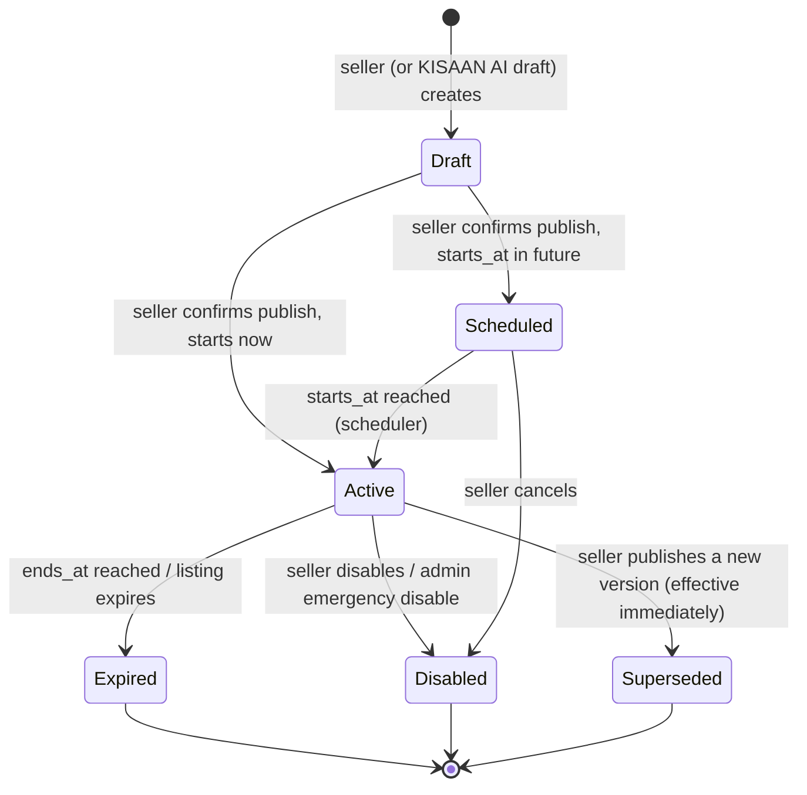
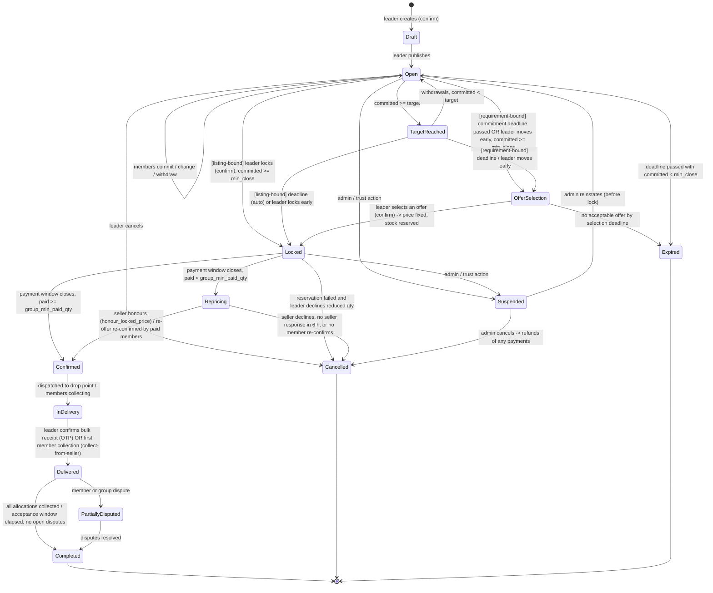
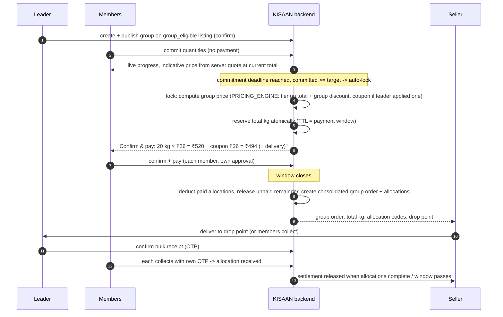

# KISAAN — Wholesale, Bulk Buyers & Group Buying

> Status: Draft v0.2 · Last updated: 2026-11-14 · Owner: Product lead, Wholesale & Community Buying · Source of truth index: [README](README.md)

This is the **owner document** for wholesale (quantity-based) pricing configuration, bulk buyers, buying groups, group leaders and group members (Master Prompt v2 §3, §4, §5, §15). [FUNCTIONAL_SPECIFICATION](FUNCTIONAL_SPECIFICATION.md) §24–§25 should link here; where they differ, this document wins.

Related documents:
- **Price calculation** (how tiers, group discount, member price, coupons, delivery and taxes combine) is owned by [PRICING_ENGINE](PRICING_ENGINE.md). This document only defines the **configuration** and the **workflow**.
- Inventory reservation mechanics: [SELLER_STORE_AND_INVENTORY](SELLER_STORE_AND_INVENTORY.md).
- Offer and negotiation state machines: [MARKETPLACE_ARCHITECTURE](MARKETPLACE_ARCHITECTURE.md).
- Coupons and KISAAN Plus: [COUPON_AND_MEMBERSHIP](COUPON_AND_MEMBERSHIP.md).
- AI tools: [SINGLE_AI_ARCHITECTURE](SINGLE_AI_ARCHITECTURE.md).

## Table of contents

1. [What changed in v0.2](#1-what-changed-in-v02)
2. [Buyer types](#2-buyer-types)
3. [Bulk buyers](#3-bulk-buyers)
4. [Wholesale pricing configuration](#4-wholesale-pricing-configuration)
5. [Buying groups — model](#5-buying-groups--model)
6. [Group leaders — verification, display and disclaimer](#6-group-leaders--verification-display-and-disclaimer)
7. [Group lifecycle and workflow](#7-group-lifecycle-and-workflow)
8. [Permissions and privacy](#8-permissions-and-privacy)
9. [Edge cases](#9-edge-cases)
10. [Abuse and fraud cases](#10-abuse-and-fraud-cases)
11. [Worked examples](#11-worked-examples)
12. [KISAAN AI support](#12-kisaan-ai-support)
13. [Requirements, APIs, data and tests](#13-requirements-apis-data-and-tests)
14. [Decisions, assumptions, risks and changes requested elsewhere](#14-decisions-assumptions-risks-and-changes-requested-elsewhere)

---

## 1. What changed in v0.2

| Topic | v0.1 | v0.2 (this document) | Why |
|---|---|---|---|
| Bulk buyer vs group leader | One combined "Bulk Buyer / Group Leader" signup (KIS-GROUP-001) | **Two separate paths**: bulk-buyer onboarding (KIS-BULK-*) and group-leader application (KIS-GROUP-001) (D-104) | Prompt v2 §3.3: bulk buyers are a distinct user type |
| Group types in MVP | Listing-bound only; RFQ-bound in P2 | **Both** listing-bound ("join a deal") and requirement-bound ("group requirement → seller offers") in MVP | Prompt v2 §15 group flow and the §32 E2E scenario start from a group requirement |
| Member payment | Capture at join at a guaranteed price, refund differences | **Commit, then confirm and pay after lock.** No money moves while a group is collecting commitments. At lock the price is fixed and members pay within a payment window | Prompt v2 §15 ("member commitments → seller offers → group pricing → member confirmation → payment"). Also removes most refunds and makes "target not met" free of charge (D-72 as updated in v0.2; shortfall specifics D-132) |
| Group discount | Only tiers on the aggregated quantity | Tiers on the aggregated quantity **plus** an optional seller-defined group discount (PRICING_ENGINE stage 3) | Prompt v2 §4, §27 |
| Wholesale validity | Tiers always on | Tier sets have start/end dates, buyer-type eligibility, max order quantity and group eligibility | Prompt v2 §5 |

---

## 2. Buyer types

| Aspect | Normal (individual) buyer | Bulk buyer | Buyer group leader | Buyer group member |
|---|---|---|---|---|
| How you become one | Default buyer sign-up (phone OTP) | Separate `/signup/bulk-buyer` path, or upgrade from buyer profile | Apply via "Become a Group Leader"; verifier approves | Join any open group (must be a phone-verified buyer) |
| Role in RBAC | `buyer` | `buyer` + `bulk_buyer_profile` (capability flag, not a separate login) | `group_leader` (per user) + leadership of specific groups | `buyer`; membership is a per-group relationship |
| Verification | T0 phone; T1 for higher limits | T1 minimum; T3 business verification above ₹2,00,000 per order (BR-ONB-10, D-02); GSTIN optional (needed for GST invoice ITC) | T1 identity + leader application + leader T&C; T2 for Phase-2 incentives | T0 phone verified; one membership per verified phone per group |
| Can buy at list price | Yes | Yes | Yes (as a buyer) | Yes (outside the group) |
| Can get wholesale tier prices | **Yes**, for any qualifying quantity, unless the seller restricted the tier set to bulk buyers (§4.2) | Yes, including tier sets restricted to bulk buyers | Not as leader. Leaders get prices as members of their group, or as buyers | Yes, via the group's **aggregated** quantity |
| Buyer requirements (RFQs) | Up to 3 open | Up to 20 open; multi-seller split acceptance; preferred-seller RFQs | Creates **group requirements** | — |
| Recurring procurement | — | Saved RFQ templates (P2), scheduled RFQs (P2) | — | — |
| Shown to sellers as | "Individual buyer, <district>" + badge | "Verified Business Buyer" + business type + district (name revealed on acceptance, D-04) | "Verified Group Leader" + group aggregates | Never shown individually; only counts and allocation codes |
| Handles others' money | No | No | **No** (MVP; leader-collects-money is Future, KIS-GROUP-013) | No |

A user can hold several of these at once (e.g. a Moga farmer who sells wheat, buys seed as a member of a group, and leads another group). Permissions are always evaluated **per action and per resource** from the server-side session, never from what the client or the AI conversation claims (KIS-SEC, [SINGLE_AI_ARCHITECTURE](SINGLE_AI_ARCHITECTURE.md)).

---

## 3. Bulk buyers

### 3.1 Onboarding path

```mermaid
flowchart TD
  A[Landing: "Buying in bulk? / ਥੋਕ ਵਿੱਚ ਖਰੀਦ?"] --> B[Phone OTP / existing login]
  B --> C[Business type]
  C --> D[What you buy: commodities + varieties + quality]
  D --> E[Typical quantity per purchase + frequency]
  E --> F[Delivery areas: districts / addresses]
  F --> G[Budget range per purchase - optional]
  G --> H[Preferred sellers - optional, searchable]
  H --> I[Business details: name, GSTIN optional, APMC licence if required]
  I --> J{Order value need > ₹2,00,000?}
  J -- yes --> K[T3 business verification]
  J -- no --> L[Done: Bulk buyer dashboard]
  K --> L
```

The same flow is available by voice or chat: "Main Ludhiana mein atta chakki chalata hoon, har mahine 50 quintal wheat chahiye" → KISAAN AI fills a **draft** bulk-buyer profile and reads it back for confirmation.

### 3.2 Bulk-buyer profile fields

| Field | Type | Required | Visibility |
|---|---|---|---|
| Business type | enum: retailer, wholesaler, distributor, processor (mill, chakki, dal mill), restaurant/caterer, exporter, agri-business, institution (hostel, gurudwara langar, school), cooperative/FPO, other | Yes | Shown to sellers (type only) |
| Business name | text | Yes unless individual-trader | Revealed to a seller after the buyer accepts their quotation |
| Required products | commodity + variety list, each with quality specs (attribute ranges from the category schema, e.g. moisture ≤ 12 %) | Yes (≥ 1) | Used for matching; shown in RFQs |
| Typical quantity | per commodity, in display unit | Yes | Matching; shown as a band ("50–100 qtl") |
| Purchase frequency | one-off, weekly, fortnightly, monthly, seasonal | Yes | Matching |
| Delivery areas | district codes + saved addresses | Yes | District shown; addresses private |
| Budget range | min–max ₹ per unit or per purchase | Optional | **Private**: used only to filter and rank results for the buyer. Never shown to sellers |
| Required quality | per product spec, optional "certified organic only" | Optional | Matching |
| Preferred sellers | list of stores | Optional | Private; enables direct RFQs and alerts |
| GSTIN | text, verified via provider | Optional | "GST registered ✓" badge only |
| APMC/trader licence | text + state | Where category state rules require it (D-80) | Badge only |

### 3.3 Requirements

| ID | Requirement | Scope |
|---|---|---|
| **KIS-BULK-001** | Separate bulk-buyer onboarding path (`/signup/bulk-buyer`), plus upgrade from an existing buyer profile, by form, chat or voice | MVP |
| **KIS-BULK-002** | Bulk-buyer profile with the §3.2 fields; editable; draft-then-confirm when filled by AI | MVP |
| **KIS-BULK-003** | Verification and limits: T1 to activate; T3 for orders above ₹2,00,000; GSTIN verification for GST invoices (links KIS-ONB-011/012) | MVP |
| **KIS-BULK-004** | "Verified Business Buyer" badge on offers, RFQs and quotations seen by sellers | MVP |
| **KIS-BULK-005** | Higher RFQ limits (20 open), multi-seller split acceptance (BR-ENQ-05), RFQ directly to preferred sellers | MVP |
| **KIS-BULK-006** | Profile-driven matching: new listings matching required products, quality and delivery areas trigger alerts to the bulk buyer; new bulk RFQs reach matching sellers via the deterministic matching service | MVP |
| **KIS-BULK-007** | Budget range used only for the buyer's own filtering and ranking; never disclosed to sellers or used to raise prices | MVP |
| **KIS-BULK-008** | Recurring procurement: saved RFQ templates and scheduled RFQs (e.g. "every month 50 qtl PBW-826") | P2 |
| **KIS-BULK-009** | Bulk-buyer dashboard: open RFQs, quotations comparison, orders, spend by commodity, preferred sellers | MVP (spend analytics P2) |
| **KIS-BULK-010** | Business accounts with multiple users (purchaser, approver, accounts) | Future |
| **KIS-BULK-011** | Access to wholesale tier sets restricted to bulk buyers (§4.2 `eligible_buyer_types`) | MVP |

**Acceptance (bulk buyers).**
- A user who completes `/signup/bulk-buyer` has a bulk profile, sees the bulk dashboard and can open up to 20 RFQs. A normal buyer opening a 4th RFQ gets `RFQ_LIMIT_REACHED` with an "upgrade to bulk buyer" prompt.
- A seller viewing a bulk buyer's offer sees business type, district and badges, but not business name, budget or phone until acceptance.
- The budget range never appears in any seller-facing API response (contract test).
- A T1 bulk buyer checking out ₹3,00,000 is blocked with `BUYER_TIER_LIMIT_EXCEEDED` and a "Verify business" CTA.

---

## 4. Wholesale pricing configuration

### 4.1 Concepts

- **Wholesale tier set** (the "seller bulk offer" of Master Prompt §15): a versioned set of up to 5 quantity tiers for one listing, with a validity window, eligibility and group options. A listing has at most **one active tier set** at any time. Sellers can schedule the next one.
- **Tier**: `min_qty` plus one of: percentage discount, fixed ₹ discount per unit, or an explicit wholesale unit price.
- **Whole-lot price**: a special price for buying the entire available quantity (KIS-WHL-004).
- **Group options**: group eligibility, minimum group quantity, and the optional group discount (stage 3 in [PRICING_ENGINE](PRICING_ENGINE.md)).

### 4.2 Configuration fields (Master Prompt §5)

| Field | Type / rule | Notes |
|---|---|---|
| `listing_id` | applicable product | "Apply this tier set to all my Wheat listings" is a P2 template (KIS-WHL-016) |
| `min_bulk_qty` | = first tier `min_qty`; must be > listing MOQ | The "minimum bulk quantity" of the prompt |
| `tiers[]` (1–5) | `min_qty` (display unit → kg), `discount_type` ∈ {`percentage`, `fixed_per_unit`, `unit_price`}, `value` | `percentage` 0 < v ≤ 50 (D-60); `fixed_per_unit` 0 < v < list; `unit_price` 0 < v < list |
| `moq` | listing MOQ (minimum order quantity) | Applies to all buyers |
| `max_order_qty` | optional per-order cap | e.g. reserve volume for many buyers; `QTY_ABOVE_MAX` |
| `starts_at`, `ends_at` | IST timestamps; `ends_at` optional (≤ listing expiry) | Tier set `Scheduled` until start |
| `eligible_buyer_types` | {`all`} (default) or subset of {`individual`, `bulk_buyer`, `group`} | Restricting to `bulk_buyer` requires the bulk profile (KIS-BULK-011) |
| `group_eligible` | boolean (default true when tiers exist) | Whether groups may target this listing |
| `group_min_qty` | kg, ≥ MOQ | Minimum aggregated group quantity the seller accepts |
| `group_discount` | optional: `per_unit` ₹ or `percentage` | Applied after the tier (PRICING_ENGINE stage 3); seller-funded |
| `group_min_paid_qty` | kg, default = `group_min_qty` | The quantity the seller commits to ship at the locked group price even if some members do not pay (§7.5, D-132) |
| `whole_lot_enabled`, `whole_lot_price` | listing fields | Whole-lot vs tier: best single benefit (KIS-WHL-006) |
| `price_floor` | optional listing field | No tier, member price or coupon may take the price below it |

### 4.3 Validation rules

| Rule | Error |
|---|---|
| ≤ 5 tiers; `min_qty` strictly increasing; first tier `min_qty` > MOQ | `TIER_LIMIT_EXCEEDED`, `TIER_ORDER_INVALID`, `TIER_MIN_BELOW_MOQ` |
| Effective ₹/kg discount non-decreasing across tiers (a higher tier is never worse) | `TIER_DISCOUNT_NOT_MONOTONIC` |
| Effective tier price ≥ price floor and > 0 | `TIER_BELOW_FLOOR` |
| `starts_at` < `ends_at` ≤ listing `expires_at`; no overlap with another active/scheduled tier set | `TIER_SET_WINDOW_INVALID`, `TIER_SET_OVERLAP` |
| `group_min_paid_qty` ≤ `group_min_qty` | `GROUP_MIN_PAID_INVALID` |
| Group discount keeps the price ≥ floor at every tier | `GROUP_DISCOUNT_BELOW_FLOOR` |

### 4.4 Tier set lifecycle (seller bulk offer flow)



Publishing or materially changing a tier set is a **COMMIT** action. In the UI the seller's own tap is the confirmation. Via KISAAN AI it needs an ApprovalRequest the seller confirms (KIS-APR-001). Changes affect **new quotes only**. Existing quotes (until `valid_until`), reservations, locked groups and orders keep their snapshot (KIS-WHL-010).

**Seller bulk offer flow (Master Prompt §15):** Seller → listing → tiers → discount → start/end dates → preview (server-computed effective prices per tier, plus an example group price) → confirm → Scheduled/Active → visible on search card badge, product page tier table, store page, and to matching bulk buyers/groups.

### 4.5 Display

- Search card badge: "Bulk deal: up to 8 % off" (max effective discount of the active tier set).
- Product page: tier table with the buyer's current tier highlighted, plus a nudge ("Add 20 kg more to save ₹40"). The nudge amounts are from the server quote.
- Group-eligible badge: "Group buying available — min group 300 kg, extra ₹1/kg off".
- Restricted tier sets show "Bulk-buyer price" with a lock icon and a "Become a bulk buyer" CTA for others.

### 4.6 Requirements

| ID | Requirement | Scope |
|---|---|---|
| KIS-WHL-001…012 | v0.1 wholesale requirements (enable per listing, tiers, validation, whole-lot, eligibility at reservation, single best benefit, display, group aggregate, PRC stacking, snapshot, AI suggestions, seller-funded) | MVP (011 P2) |
| **KIS-WHL-013** (new) | Group options per tier set: `group_eligible`, `group_min_qty`, `group_discount`, `group_min_paid_qty` | MVP |
| **KIS-WHL-014** (new) | Tier-set validity window (start/end), scheduling, one active set per listing, versioning | MVP |
| **KIS-WHL-015** (new) | `eligible_buyer_types` restriction (all / individual / bulk buyer / group) | MVP |
| **KIS-WHL-016** (new) | Apply a tier-set template to several listings of the same commodity | P2 |
| **KIS-WHL-017** (new) | Per-order `max_order_qty` | MVP |
| **KIS-WHL-018** (new) | `unit_price` tier type (seller enters ₹48/kg directly instead of a discount) | MVP |
| **KIS-WHL-019** (new) | Admin emergency disable of a tier set, with seller notification and audit | MVP |
| **KIS-WHL-020** (new) | KISAAN AI turns a spoken or typed pricing intent (e.g. "20 quintal se zyada pe discount") into a **draft** tier set via the catalogue draft tool; the seller reviews and confirms (✋ `wholesale.publish`) before anything is published | MVP |

**Acceptance (wholesale).**
- Prompt §5 example: list ₹50/kg with unit-price tiers 10 kg → ₹48, 50 kg → ₹45, 100 kg → ₹42, 500 kg → ₹39. A server quote gives 9 kg @ ₹50, 10 kg @ ₹48, 75 kg @ ₹45, 100 kg @ ₹42 and 600 kg @ ₹39. A tier set with 100 kg → ₹44 after 50 kg → ₹45 is valid (better); 100 kg → ₹46 is rejected (`TIER_DISCOUNT_NOT_MONOTONIC`).
- A tier set scheduled for 1 Dec shows no badge on 30 Nov and is active at 00:00 IST on 1 Dec (scheduler ≤ 60 s).
- A quote taken at 10:00 with an active tier set remains valid at 10:10 even if the seller disables the set at 10:05.
- A non-bulk buyer requesting a bulk-only tier quantity gets the list (or next eligible) price, and the response explains why.

---

## 5. Buying groups — model

### 5.1 Group types

| Type | Starts from | Seller | Price basis | MVP |
|---|---|---|---|---|
| **Listing-bound** ("Join a deal") | A specific `group_eligible` Active listing | Fixed (that listing's seller) | Listing tiers evaluated on the aggregated quantity, plus the group discount (stage 3) | Yes |
| **Requirement-bound** ("Group requirement") | A group requirement (an RFQ owned by the group): product, quality, quantity, area, needed-by | Chosen by the leader from seller **group offers** | Either `listing_terms` (seller points to a listing → its tiers + group discount apply) or `custom_price` (a negotiated price that replaces stages 1–3, PRICING_ENGINE stage 4) | Yes (new in v0.2, D-133) |

### 5.2 Group fields (Master Prompt §4)

| Field | Description | Public? |
|---|---|---|
| Group name | e.g. "Moga Agriculture Buying Group — Wheat Nov" | Yes |
| Description | Leader-written, moderated | Yes |
| Area / location | Area name + district + geo-centre + radius (1–25 km) | Area name + district only |
| Leader | Display name + "Verified Group Leader" badge + rating + groups completed | Yes, with disclaimer (§6.3) |
| Group members | Member list | **Count only** publicly. The leader sees masked display names, quantities and paid/pending (§8) |
| Member verification | Phone-verified required; optional "verified members only" setting (T1) | Rule shown publicly |
| Required product | Listing (listing-bound) or commodity + variety + quality spec (requirement-bound) | Yes |
| Target quantity | e.g. 500 kg | Yes |
| Current committed quantity | Σ active commitments | Yes |
| Remaining quantity | target − committed (floored at 0) | Yes |
| Minimum quantity to proceed | `min_close_qty` ≤ target; ≥ seller `group_min_qty` (listing-bound) | Yes |
| Per-member min / max | e.g. 5–50 kg | Yes |
| Commitment deadline | join deadline | Yes |
| Seller offers | Requirement-bound: received group offers | Members see offers **the leader shared**; public sees "3 offers received" |
| Group pricing | Indicative price at current committed quantity (server quote); locked price after lock | Indicative yes; locked price members only |
| Group order | Consolidated order created at window close | Members/leader/seller |
| Individual member quantities | Each member's commitment and allocation | Member: own only. Leader: all (masked names). Seller: allocation codes only |
| Individual member payment status | paid / pending / not paid | Member: own. Leader: status only, no amounts or methods |
| Delivery strategy | §5.4 | Mode public; drop-point address members only |
| Group order status | §7 state | Members, leader, seller |

### 5.3 Commitments

- A **commitment** is a member's non-binding, unpaid statement of quantity while the group is Open. The member can change or withdraw it freely until the commitment deadline.
- A **confirmation** is binding. After lock the member reviews the locked price, their exact goods amount, coupon share, delivery share and total, and confirms with payment (COMMIT action, member's own approval). The leader cannot confirm or pay for a member.
- Commitments count towards `committed_qty` immediately. Overfill is allowed up to 120 % of target (D-61), and capped by seller `available_kg` (listing-bound) or the selected offer's maximum.
- Commitment updates are atomic (conditional UPDATE on the group row), as in [DATABASE_SCHEMA](DATABASE_SCHEMA.md) §9.

### 5.4 Delivery strategies

| Strategy | Description | Who pays | MVP |
|---|---|---|---|
| **Common drop point** (default) | One consolidated delivery to a drop point the leader sets (village chaupal, shop, gurudwara, cooperative godown). The leader confirms bulk receipt; each member collects with their own OTP | Delivery share pro-rata by quantity (PRICING_ENGINE); KISAAN Plus members' own waivers apply to their share | Yes |
| **Collect from seller** | Members (or the leader as a convenience, with each member's OTP) collect from the seller's pickup point | No delivery fee | Yes |
| **Seller delivers to drop point** | Seller-quoted delivery charge in the group offer (₹ flat or ₹/kg) | Pro-rata | Yes |
| **Platform logistics to drop point** (roadmap Phase 9 / P2, D-106) | Transport request after window close based on paid quantity; members pre-pay an **estimated** share + 10 % buffer at confirmation; unused amount refunded automatically | Pro-rata | Yes [D-134 — PENDING OWNER SIGN-OFF] |
| **Multi-drop to each member** | Door delivery per member | Per member | P2 |

The drop-point address is visible to confirmed members and the seller/transporter only, never on the public page.

---

## 6. Group leaders — verification, display and disclaimer

### 6.1 Leader application (KIS-GROUP-001)

1. Entry: "Become a Group Leader / ਗਰੁੱਪ ਲੀਡਰ ਬਣੋ / ग्रुप लीडर बनें" from the buyer profile or landing page. This is **separate from** bulk-buyer onboarding.
2. Steps: leader profile (leader type: individual, cooperative, FPO, RWA, shopkeeper, other; area name, area type, geo-centre + radius 1–25 km, short bio) → identity KYC (T1 minimum) → optional proof of association (cooperative/FPO/RWA/panchayat letter) → **leader T&C acceptance** (versioned, same legal-acceptance mechanism as KISAAN Plus T&C) → submit.
3. The deterministic Trust rules engine pre-screens: duplicate identity, prior suspensions, contact-sharing history. A human verifier approves (SLA 48 h). The verifier sees risk annotations; KISAAN AI does not decide.
4. Granted: `group_leader` role, badge "Verified Group Leader", public leader profile `/leader/<handle>`.

### 6.2 Leader limits (D-71, unchanged)

| Leader level | Open groups | Max group value (at indicative price) |
|---|---|---|
| New (< 3 completed groups) | 2 | ₹2,00,000 |
| Established (≥ 3 completed, completion rate ≥ 80 %, rating ≥ 4.0) | 10 | ₹20,00,000 |

### 6.3 Display and disclaimer (KIS-GROUP-019)

The group page header shows the leader exactly like this example:

> **Harneet Dhiman** · ✓ Verified Group Leader · ★ 4.7 (12 groups)
> **Moga Agriculture Buying Group**
> Current group demand: **2,500 kg**

Directly under the leader block, always visible and never collapsible:

| Language | Disclaimer text `[translation review]` |
|---|---|
| English | "Group leaders are independent KISAAN users, not KISAAN employees or representatives. Pay only through KISAAN. Never pay a leader directly." |
| Hindi | "ग्रुप लीडर स्वतंत्र KISAAN उपयोगकर्ता हैं, KISAAN के कर्मचारी या प्रतिनिधि नहीं। भुगतान केवल KISAAN के माध्यम से करें। लीडर को सीधे पैसे कभी न दें।" |
| Punjabi | "ਗਰੁੱਪ ਲੀਡਰ ਆਜ਼ਾਦ KISAAN ਵਰਤੋਂਕਾਰ ਹਨ, KISAAN ਦੇ ਮੁਲਾਜ਼ਮ ਜਾਂ ਨੁਮਾਇੰਦੇ ਨਹੀਂ। ਭੁਗਤਾਨ ਸਿਰਫ਼ KISAAN ਰਾਹੀਂ ਕਰੋ। ਲੀਡਰ ਨੂੰ ਕਦੇ ਵੀ ਸਿੱਧੇ ਪੈਸੇ ਨਾ ਦਿਓ।" |

The same disclaimer is spoken by KISAAN AI the first time a user joins a group through chat or voice, and is printed on group invoices/receipts. The word "official" and KISAAN logos must not appear in group names (moderation rule).

### 6.4 Leader obligations (leader T&C summary, `[LEGAL REVIEW]`)

Accurate group information; no off-platform collection of money; be present (or appoint a confirmed co-leader) at the drop point; fair distribution per allocations; respond to members within 24 h during an active group; no misuse of member information.

---

## 7. Group lifecycle and workflow

### 7.1 Group state machine (KIS-GROUP-018)



**Canonical state names (used by PRICING_ENGINE, COUPON_AND_MEMBERSHIP, PAYMENT_AND_BUSINESS_MODEL, API and DB).** The diagram's detailed states group into these top-level states:

| Top-level group state | Detailed states (DB `status`) | Money |
|---|---|---|
| `forming` | `draft`, `open`, `target_reached`, `offer_selection` | None (commitments are unpaid) |
| `locked` | `locked` (payment window running) | Members paying own allocations |
| `repricing` | `repricing` (paid < `group_min_paid_qty`; seller decision ≤ 6 h; re-confirmation ≤ 12 h) | Paid amounts held |
| `confirmed` | `confirmed` | Captured; group order created |
| `fulfilling` | `in_delivery`, `delivered`, `partially_disputed` | — |
| `completed` | `completed` | Settlement released |
| `cancelled` | `cancelled` (leader/admin/seller decline) | Full automatic refunds of any payments |
| `expired` | `expired` (deadline passed below `min_close_qty`; or no offer selected by the selection deadline) | None |
| (overlay) | `suspended` (admin/trust action) | Frozen |

| Member state | Meaning |
|---|---|
| `committed` | Unpaid quantity commitment while forming |
| `payment_due` | Group locked; own allocation payable within the window |
| `paid` | Own allocation paid (then per allocation: `received` / `disputed` / `refunded`) |
| `released` | Left the group: `release_reason` = `withdrawn` · `removed` · `lapsed` (did not pay) · `declined_reoffer` |

`group_min_paid_qty` is the seller's minimum paid quantity for the group terms (defaults to `group_min_qty`). `min_close_qty` is the group's minimum committed quantity to lock.

Because members pay only after lock, a group cancelled or expired **before** lock involves no money. A group cancelled **after** some members paid triggers automatic full refunds (idempotent, PA refund API, target ≤ 1 h to initiate).

### 7.2 Timeline parameters

| Parameter | Default | Range | Notes |
|---|---|---|---|
| Commitment deadline | set by leader | 1 h – 7 days after publish; before listing expiry | |
| Offer collection (requirement-bound) | runs from publish to commitment deadline + 24 h | leader may extend once by ≤ 48 h | Sellers can submit group offers as soon as the group is Open |
| Offer selection deadline | commitment deadline + 48 h | — | Otherwise auto-Expired (no money involved) |
| Auto-lock (listing-bound) | at commitment deadline if committed ≥ target | — | If min_close ≤ committed < target, leader must lock within 6 h or the group cancels |
| Member payment window | 24 h after lock (perishables 6 h) | 2–24 h, config | Reservation TTL = window (SELLER_STORE_AND_INVENTORY §6.1) |
| Seller shortfall decision | 6 h after window close | — | Only when paid < `group_min_paid_qty` |
| Member collection / acceptance window | 48 h after leader receipt (perishables 12 h) | — | As BR-GROUP-14 |

### 7.3 Listing-bound flow



### 7.4 Requirement-bound flow (Master Prompt §15 group purchase)

Group creation → member commitments → group requirement (published RFQ owned by the group) → seller group offers → leader shortlist and share → leader selects (group pricing fixed) → member confirmation + payment → consolidated order → delivery.

| Step | Detail |
|---|---|
| 1. Group requirement | The leader defines product, variety, quality spec, target qty, min_close, per-member min/max, area, drop point, needed-by. Publishing is COMMIT (leader confirms) |
| 2. Matching | The deterministic matching service (`matching.find_matches`) notifies sellers with matching Active listings and available quantity in or near the area (cap 20, widen after 24 h like BR-ENQ-03). KISAAN AI explains and ranks results for the leader; it does not invent matches |
| 3. Group offers | A seller submits an offer of kind `listing_terms` (link to a listing; its active tier set and group options apply) or `custom_price` (₹/unit for a quantity range `[min_total, max_total]`, validity, delivery option and charge, `group_min_paid_qty`). An offer is a negotiation (MARKETPLACE_ARCHITECTURE §6) between the seller and the **leader** |
| 4. Negotiation | The leader can counter (max 10 rounds). Members see only offers the leader shares, with a comparison table: landed price per kg at current committed qty, seller rating/badges, distance, delivery date |
| 5. Selection | The leader selects one offer (COMMIT, leader confirm). For `listing_terms` the backend reserves on that listing. For `custom_price` the seller's acceptance of the final round is required first (normal negotiation acceptance) |
| 6. Lock | Price fixed, stock reserved for committed total (capped at offer max), payment window opens |
| 7–9 | As listing-bound (confirm & pay → window close → consolidated order → delivery) |

Members who disagree with the selected offer simply do not confirm. Their commitment lapses with no money involved. Member voting on offers is P2 (KIS-GROUP-024).

### 7.5 Payment window close and shortfall rule (D-132)

At window close: `paid_qty = Σ confirmed & paid allocations`.

| Situation | Outcome |
|---|---|
| `paid_qty ≥ group_min_paid_qty` (seller minimum) | Proceed. Group order created for `paid_qty` at the **locked** unit price. Unpaid commitments lapse; their reserved quantity is released |
| `paid_qty < group_min_paid_qty` | Group enters `repricing`. The seller decides within 6 h: **honour** (proceed at the locked price; group order flag `honour_locked_price = true`), **re-offer** (a new unit price for the paid quantity; each paid member re-confirms within 12 h, and anyone who does not re-confirm is refunded in full), or **decline** (group Cancelled, all payments refunded automatically). No response = decline |
| Any case | A member's unit price, coupon share and goods amount are **final at lock**. They never increase unless the member explicitly re-confirms a seller re-offer. A fixed-amount group coupon share not used because of non-payers is not redistributed |

Members who confirm but fail to pay 2 times in 90 days must pay at commitment time (capture-at-commit, v0.1 BR-GROUP-06 behaviour) for their next 3 groups (`member_reliability`, KIS-GROUP-021).

### 7.6 Consolidated order and allocations

- One **group order** per locked group: seller, listing/offer, total kg, locked price snapshot (PRICING_ENGINE quote id), delivery strategy, transport request (if any).
- One **allocation** per paying member: qty, goods amount, coupon share, delivery share, waiver, tax, payable, payment id, child order id (for individual receipts/invoices `[TAX REVIEW]`), status (`paid → received | disputed → refunded`).
- Invariant: Σ allocation qty = group order total kg (deferred trigger).
- The seller sees allocation **codes** (A1…An) with quantities for packing, never member names or phones. Packing per allocation is optional (seller choice shown in the offer).
- Settlement to the seller is released per BR-GROUP-15: when all allocations are Completed or their windows pass, minus amounts frozen for member disputes.

### 7.7 Requirements (groups)

| ID | Requirement | Scope |
|---|---|---|
| KIS-GROUP-001…012, 015, 016 | v0.1 group requirements (leader signup, badge, create, public visibility, join, per-member payment, leave, close, group order + allocations, drop point, disputes, anti-abuse, chat, discovery). **KIS-GROUP-006 and KIS-GROUP-008 are revised** by KIS-GROUP-018 (commit → lock → confirm & pay) | MVP |
| KIS-GROUP-013, 014 | Leader-collects-money mode; leader incentives | Future |
| **KIS-GROUP-017** (new) | Requirement-bound groups with seller group offers, leader shortlist/share/select (§7.4) | MVP |
| **KIS-GROUP-018** (new) | Commit-then-pay lifecycle with lock, payment window, reservation at lock, shortfall rule (§7.1, §7.5) | MVP |
| **KIS-GROUP-019** (new) | Leader display block and mandatory independence disclaimer in pa/hi/en, in UI, AI speech and receipts | MVP |
| **KIS-GROUP-020** (new) | Group permission and privacy matrix enforced server-side (§8) | MVP |
| **KIS-GROUP-021** (new) | Member verification rules (phone; optional T1-only groups; one membership per verified phone per group) and member reliability (no-pay penalty) | MVP |
| **KIS-GROUP-022** (new) | Leader handover to a co-leader before lock; leader exit/suspension handling (§9) | MVP |
| **KIS-GROUP-023** (new) | Delivery strategies (§5.4): common drop point, collect from seller, seller delivers, platform logistics with estimate + buffer; multi-drop P2 | MVP / P2 |
| **KIS-GROUP-024** (new) | Member voting/polls on offers | P2 |
| **KIS-GROUP-025** (new) | Leader may remove a member before lock with a reason code (max 3 per group, audited, member notified) | MVP |
| **KIS-GROUP-026** (new) | Leader announcements to all members (masked, moderated, rate-limited 5/day) | MVP |

**Acceptance (groups).**
- A listing-bound group with target 500 kg, min_close 300 kg and 520 kg committed auto-locks at the deadline, reserves 520 kg, and every member sees their own exact payable from the server quote.
- A group that reaches its deadline with 250 kg committed (< min_close 300) is Expired. No payment records exist; members are notified.
- After window close with 500 of 520 kg paid (`group_min_paid_qty` 300), the group order is for 500 kg at the locked price and 20 kg is released to available stock within 60 s.
- The leader's member-list API response contains no phone, address, payment amount or payment method fields (contract test); requesting them returns `GROUP_FORBIDDEN_FIELD`. The public group page exposes only counts.
- The leader cannot call the member confirm/pay endpoint for another member (`FORBIDDEN_NOT_MEMBER_SELF`), including via KISAAN AI.
- The disclaimer is present on the group page in all three languages (UI snapshot tests) and on member receipts.

---

## 8. Permissions and privacy

### 8.1 Permission matrix (KIS-GROUP-020)

✓ = allowed · ✗ = denied · "own" = only their own record. KISAAN AI acting for a user has **exactly** that user's permissions and no more.

| Action | Public (logged out) | Any buyer | Member | Leader (of this group) | Seller (targeted / offering) | Admin / support |
|---|---|---|---|---|---|---|
| View public group page (name, leader block, area, product, target, committed, remaining, member count, deadline, indicative price) | ✓ | ✓ | ✓ | ✓ | ✓ | ✓ |
| Join / commit / change / withdraw commitment | ✗ (login) | ✓ | own | own (leader may also be a member once) | ✗ (no self-dealing) | ✗ |
| Confirm & pay allocation | ✗ | ✗ | **own only** | own only | ✗ | ✗ (support may resend payment link) |
| View member list | ✗ | ✗ | ✗ (count only) | masked display names + qty + paid/pending status | allocation codes + qty only | ✓ (audited) |
| View member phone, address, email | ✗ | ✗ | ✗ | **✗** (contact only via masked in-app chat if member opted in) | ✗ | support: only with an open ticket, audited |
| View member payment amount, method, payment id, refund details | ✗ | ✗ | own | **✗** | ✗ | finance role, audited |
| View drop-point address | ✗ | ✗ | ✓ after joining | ✓ | ✓ after lock | ✓ |
| Edit group (description, deadlines) | ✗ | ✗ | ✗ | ✓ before first commitment; afterwards only extend deadline once and edit description | ✗ | ✓ |
| Invite members (link, WhatsApp share) | — | — | ✓ (share link) | ✓ | ✗ | — |
| Remove a member | ✗ | ✗ | ✗ | ✓ before lock, reason code, max 3 | ✗ | ✓ |
| Post announcements | ✗ | ✗ | ✗ | ✓ (rate-limited) | ✗ | ✓ |
| Publish group requirement / receive offers | ✗ | ✗ | ✗ | ✓ | submit offers | ✓ |
| See all received offers | ✗ | ✗ | only shared offers | ✓ | own offer only | ✓ |
| Negotiate / select offer / lock | ✗ | ✗ | ✗ | ✓ (confirm) | negotiate own offer | ✗ (cannot act for leader) |
| Apply a group coupon (capped at 50 % of goods value, D-40 / KIS-SEC-161) | ✗ | ✗ | ✗ | ✓ (one, before lock) | creates coupon | emergency disable |
| Confirm bulk receipt at drop point | ✗ | ✗ | ✗ | ✓ (OTP) or confirmed co-leader | handover OTP | ✗ |
| Confirm own collection | ✗ | ✗ | own OTP | only with that member's OTP | ✗ | ✗ |
| Raise dispute | ✗ | ✗ | own allocation | group-level, with member consent recorded | own order side | resolve |
| Cancel group | ✗ | ✗ | ✗ | ✓ before lock | decline at shortfall | ✓ any time (refunds) |
| Rate leader | ✗ | ✗ | ✓ after completion | ✗ | ✗ | moderate |
| Export member data | ✗ | ✗ | own data (DPDP access request) | ✗ | ✗ | DPO process only |

### 8.2 Privacy rules

1. Public pages show **aggregates only**. Member names are never public.
2. Member display names shown to the leader are masked by default ("Harpreet K."). A member may opt to show their full name to the leader.
3. Leader–member contact uses in-app masked chat. Phone numbers are never revealed by the platform. Contact details typed into chat are masked (BR-ENQ-06).
4. The leader sees each member's payment **status** only (`paid` / `payment_due` / `released`), never amounts beyond qty × locked unit price, methods, UPI IDs or refunds. Any request by the leader (UI, API or KISAAN AI) for a member's phone, address, payment instrument or refund fields is rejected with `GROUP_FORBIDDEN_FIELD` and audited.
5. The seller sees allocation codes and quantities only, never member identities. Exceptions: collect-from-seller mode shows the collector's first name at handover, and the drop-point address after lock.
6. KISAAN AI answering a member about the group uses only group aggregates and that member's own data ("Aapka 20 kg confirm hai, payment pending; group ka total 480 kg"). It cannot reveal another member's data even to the leader beyond §8.1.
7. Group data retention: per [SECURITY_AND_COMPLIANCE](SECURITY_AND_COMPLIANCE.md) retention table. Masked member lists are deleted from leader views 90 days after group completion.

---

## 9. Edge cases

| # | Scenario | Expected behaviour |
|---|---|---|
| GB-01 | Member withdraws before deadline | Commitment removed; committed and remaining recomputed; no money involved |
| GB-02 | Member does not confirm/pay within window | Commitment lapses; reserved quantity released; reliability strike; others unaffected (§7.5) |
| GB-03 | Target not met but ≥ min_close at deadline | Listing-bound: leader must lock within 6 h (price at the tier the committed qty reaches) or the group cancels. Requirement-bound: proceed to offer selection |
| GB-04 | Below min_close at deadline | Expired, no money moved; members offered "join a similar group" |
| GB-05 | Overfill beyond 120 % or seller available | Commit rejected `GROUP_FULL`, with remaining quantity shown |
| GB-06 | Seller stock insufficient at lock (sold elsewhere) | Atomic reserve fails → leader chooses within 6 h: proceed with available qty (allocations reduced pro-rata, rounded to 1 kg, smallest commitments protected first up to member min) or cancel. Members confirm their reduced quantities |
| GB-07 | Seller changes tiers/group discount while group Open | Indicative price updates; members notified if it worsens by > 2 %. Seller may not worsen group terms within 24 h of the deadline (`GROUP_TERMS_LOCKED`) |
| GB-08 | Seller cancels after members paid | All allocations refunded in full automatically; seller reliability −2; leader offered "re-open with another seller" (requirement-bound) |
| GB-09 | Partial fulfilment at delivery (short weight) | Weight reconciliation per allocation (±2 % pro-rata refund; beyond that, dispute). Shortfall is allocated pro-rata unless the leader records per-allocation actual weights |
| GB-10 | Leader leaves before lock | Leader may hand over to a confirmed co-leader (verified leader + group member, who accepts). Otherwise the group is cancelled with no money involved |
| GB-11 | Leader unavailable after lock / at delivery | Co-leader if appointed. Otherwise support contacts the leader; after 24 h the delivery strategy switches to "collect from seller" or seller delivers to members (seller agreement); each member's OTP still governs collection |
| GB-12 | Leader suspended (fraud report) | Group → Suspended. Before lock: admin cancels or appoints a support-run close. After lock: admin completes delivery with seller; refunds where needed |
| GB-13 | Member's payment succeeds after the window closed | Allocation not created; automatic refund; member notified |
| GB-14 | Member disputes quality of own allocation | Member-level dispute freezes that allocation's share of settlement only (BR-GROUP-15) |
| GB-15 | Whole delivery rejected at drop point | Leader raises a group-level dispute with ≥ 50 % of paid members' recorded consent; settlement frozen |
| GB-16 | Coupon becomes exhausted between leader applying it and lock | Lock re-quotes without the coupon; leader notified before lock completes (coupon redemption reserved at lock, COUPON_AND_MEMBERSHIP) |
| GB-17 | KISAAN Plus expires during payment window | The waiver computed at lock is honoured until window close (quote snapshot) |
| GB-18 | Two groups target the same listing | Allowed. Inventory is reserved first-come at each lock; the second may hit GB-06 |
| GB-19 | Member joins two groups for the same product | Allowed (different needs); a warning is shown |
| GB-20 | Perishable listing expires during an Open group | Group auto-cancels if not locked (no money); a locked group continues to delivery |

---

## 10. Abuse and fraud cases

| # | Abuse | Control |
|---|---|---|
| AB-01 | Leader collects money off-platform | Leader UI has no money-receiving capability; disclaimer; contact-sharing detection in chat; "Report leader"; suspension + legal T&C breach |
| AB-02 | Fake members to unlock a tier (sock puppets) | One membership per verified phone per group; device-fingerprint clustering; flag if > 50 % of members are < 7 days old; with commit-then-pay, unpaid fakes lapse and `group_min_paid_qty` protects the seller |
| AB-03 | Seller creates a group to self-buy and inflate demand/ratings | Sellers cannot lead groups on their own listings or join them (`SELF_DEALING_NOT_ALLOWED`); ratings only from completed allocations |
| AB-04 | Leader impersonates KISAAN ("KISAAN official group") | Name moderation; reserved terms; disclaimer |
| AB-05 | Leader harvests member data | Masked names, no phones; announcement rate limits; export disabled |
| AB-06 | Commit-and-abandon griefing of a group | Member reliability strikes → capture-at-commit; repeated griefers blocked from groups for 30 days |
| AB-07 | Leader removes members to favour friends | Max 3 removals per group, reason codes, audit, member can appeal to support |
| AB-08 | Collusion: leader + seller inflate the custom price | Comparison table shows other offers and mandi reference; members can decline to confirm; anomaly check against mandi band flags the group for review |
| AB-09 | Coupon abuse via many small groups | Coupon total and per-user limits apply at group level: a group coupon counts as one redemption against the coupon and the leader's per-user limit; members' per-user limits are consumed only if the seller sets `count_per_member` (COUPON_AND_MEMBERSHIP §2.1) |

---

## 11. Worked examples

### 11.1 Farmer wholesale configuration from speech (Master Prompt §2)

Farmer: "Mere paas 100 quintal wheat hai Moga mein. Main poora maal ek buyer ko dena chahta hoon, lekin agar koi 20 quintal ya usse zyada leta hai toh discount dena hai."

KISAAN AI extracts and **drafts** (nothing is published):

| Field | Extracted | Needs confirmation |
|---|---|---|
| Product | Wheat | Variety? (asks: "PBW-826, HD-3086, ya koi aur?") |
| Quantity | 100 qtl = 10,000 kg | Read back |
| Location | Moga (seller's pickup address) | Confirm address |
| Whole lot preferred | `whole_lot_enabled = true` | Whole-lot price? (asks; offers the mandi reference with date and source) |
| Bulk tier | tier 1 `min_qty` = 20 qtl | Discount %, ₹/qtl or price? (asks) |
| Group buying | not mentioned → default `group_eligible = true` | Asks "Groups ko bhi dena hai?" |

Readback: "Wheat PBW-826, 100 quintal, Moga. Price ₹2,500/quintal. 20 quintal ya zyada: ₹2,425/quintal (3 % off). Poora 100 quintal: ₹2,400/quintal. Publish karein?" → seller confirms → the listing and tier set are published through COMMIT tools with the seller's approval. Prices shown are the seller's numbers; the AI shows any mandi reference only with source and date (no invented market data).

### 11.2 Prompt §4 group example: 25 households in Moga need 500 kg wheat (requirement-bound) — also the §32 end-to-end scenario

Setup (illustrative numbers; **calculation rules are in [PRICING_ENGINE](PRICING_ENGINE.md)**, which is authoritative):

- Seller "Harneet Farms", Moga: wheat listing on_hand 1,000 kg, list ₹30.00/kg. Tier set: 100 kg → ₹29.00, 250 kg → ₹28.00, 500 kg → ₹27.00 (`unit_price` tiers). Group options: `group_eligible`, `group_min_qty` 300 kg, `group_discount` ₹1.00/kg, `group_min_paid_qty` 300 kg. Coupon `GROUP5`: 5 %, group-eligible, max ₹1,000. (Every seller coupon is also capped at 50 % of the goods value, D-40 / KIS-SEC-161.)
- Leader Harneet Dhiman (Verified Group Leader) creates "Moga Agriculture Buying Group — Wheat": target 500 kg, min_close 300 kg, per-member 5–50 kg, commitment deadline 3 days, drop point (gurudwara hall), delivery: seller delivers to drop point at ₹0.

| Step | What happens | System of record |
|---|---|---|
| 1 | Leader publishes the group requirement (confirm) | groups, requirements |
| 2 | Matching service notifies Harneet Farms (and others); KISAAN AI tells the seller "Moga group 500 kg wheat chahta hai" | matching, notifications |
| 3 | Seller submits a `listing_terms` group offer pointing to the wheat listing (confirm) | offers |
| 4 | 25 members commit 520 kg in total (no payment) | group members |
| 5 | Deadline → OfferSelection; leader shares and selects the offer (confirm) → **Lock** | groups |
| 6 | Pricing engine: tier on 520 kg = ₹27.00; group discount −₹1.00 → ₹26.00; coupon 5 % applied once at group level and allocated pro-rata; delivery ₹0; tax illustrative exempt `[TAX REVIEW]` | pricing quote (locked) |
| 7 | Inventory reserves 520 kg atomically (available 1,000 → 480) with TTL 24 h | inventory |
| 8 | Member M1 (20 kg) sees: 20 × ₹26.00 = ₹520.00 − coupon share ₹26.00 = **₹494.00** → confirms and pays | payments |
| 9 | Window closes: 24 members paid 500 kg; M7 (20 kg) did not pay → 500 ≥ 300 → proceed; 20 kg released (available 500) | inventory, groups |
| 10 | Group order 500 kg created with 24 allocations; deduct 500 kg (on_hand 1,000 → 500, sold 500) | orders, inventory |
| 11 | Seller delivers to drop point; leader confirms bulk receipt (OTP); members collect with own OTPs | logistics |
| 12 | Allocations Completed → seller settlement released (minus commission, seller-side) → group Completed → leader rated | payments, reviews |

Final inventory: on_hand 500 kg, reserved 0, available 500 kg, sold 500 kg.

---

## 12. KISAAN AI support

One KISAAN AI ([SINGLE_AI_ARCHITECTURE](SINGLE_AI_ARCHITECTURE.md)), with tools from the `pricing`, `groups`, `offers`, `matching` and `account` categories. Tools (names are exactly those in the SINGLE_AI_ARCHITECTURE §8 catalogue):

| Tool | Class | Who |
|---|---|---|
| `pricing.get_quote` | READ | anyone (own context) |
| `pricing.get_wholesale_tiers` | READ | anyone (public tiers) |
| `pricing.draft_wholesale_tiers` / `pricing.propose_wholesale_tiers` | DRAFT / COMMIT | seller (own listing) |
| `account.get_bulk_buyer_profile` / `account.prefill_bulk_buyer_onboarding` | READ / DRAFT | self — the user saves the prefilled onboarding form in the app; there is no AI write tool for the profile |
| `groups.search_groups`, `groups.get_group` | READ | anyone (public fields) |
| `groups.draft_group` / `groups.propose_create_group` / `groups.propose_update_group` | DRAFT / COMMIT / COMMIT | verified leader |
| `groups.propose_join_and_commit` / `groups.propose_change_commitment` / `groups.propose_leave_group` | COMMIT (non-financial, confirm) | member self |
| `groups.get_my_commitment` | READ | member self |
| `groups.get_leader_summary` | READ | leader (masked, §8) |
| `groups.list_group_offers` | READ | leader and members (offers are visible to all members of the group; there is no separate "share" tool) |
| `groups.propose_accept_group_offer` → `groups.propose_lock_group_order` | COMMIT, COMMIT | leader (two separate approvals: accept the offer, then lock with optional group coupon) |
| `payments.propose_pay` (payable = own group allocation) | COMMIT (financial; creates payment intent; member approves in own client) | member self |
| `groups.propose_confirm_receipt` | COMMIT | leader / member per §10 |
| `matching.find_matches` | READ | leader/seller/bulk buyer |
| `offers.draft_offer` / `offers.propose_send_offer` (with `context_type = group_offer`) | DRAFT / COMMIT | seller |

The AI must not state a price, saving, reservation or payment as fact unless the corresponding tool returned it. Indicative group prices are labelled "indicative until lock".

---

## 13. Requirements, APIs, data and tests

### 13.1 API endpoints (all KISAAN-specific endpoints, OpsAPI plugin; API_SPECIFICATION is canonical for paths — this table mirrors it)

| Method + path | Status | Purpose |
|---|---|---|
| `POST /api/v2/kisaan/bulk-buyer/onboarding` | new | Bulk-buyer onboarding (KIS-BULK-001) |
| `GET/PATCH /api/v2/kisaan/me/bulk-buyer-profile` · `POST …/verification` | new | Bulk-buyer profile and business verification (KIS-BULK-002) |
| `GET/PUT /api/v2/kisaan/me/preferred-sellers` | new | Preferred sellers |
| `POST /api/v2/kisaan/listings/:uuid/tier-sets` | new | Create draft tier set |
| `POST /api/v2/kisaan/tier-sets/:uuid/publish` ✋ · `/disable` | new | Publish (COMMIT) / disable |
| `GET /api/v2/kisaan/listings/:uuid/tier-sets` | new | Current + scheduled + history |
| `POST /api/v2/kisaan/groups` ✋ | v0.1 | Create group in `draft` (listing- or requirement-bound) |
| `POST /api/v2/kisaan/groups/:uuid/publish` | new | `draft` → `forming`; publishes the group requirement |
| `GET/PATCH /api/v2/kisaan/groups/:uuid` | revised | Role-filtered detail / edit in `draft`/`forming` |
| `POST /api/v2/kisaan/groups/:uuid/join` ✋ | **revised** | Commit quantity, **no payment** (D-72) |
| `GET /api/v2/kisaan/groups/:uuid/my-commitment` | new | Member's own commitment, price basis, payable, payment status |
| `PATCH /api/v2/kisaan/groups/:uuid/membership` ✋ · `POST …/leave` ✋ | revised | Change/withdraw commitment before lock (nothing charged) |
| `GET /api/v2/kisaan/groups/:uuid/offers` · `POST …/offers` | new | Offers with engine-computed group price / seller submits group offer |
| `POST /api/v2/kisaan/groups/:uuid/offers/:offer_uuid/share` | new | Leader shares an offer with members |
| `POST /api/v2/kisaan/groups/:uuid/offers/:offer_uuid/accept` ✋ | new | Leader accepts a group offer as the price basis |
| `POST /api/v2/kisaan/groups/:uuid/coupon` | new | Leader sets/clears the one group coupon (before lock) |
| `POST /api/v2/kisaan/groups/:uuid/lock/preview` | new | READ: per-member indicative quote at current committed total |
| `POST /api/v2/kisaan/groups/:uuid/lock` ✋ | **replaces `/close`** | Lock: final price, reserve stock, open payment window |
| `POST /api/v2/kisaan/group-allocations/:uuid/confirm-and-pay` ✋ | new | Member confirms own line at the locked price and gets the payment order |
| `POST /api/v2/kisaan/groups/:uuid/shortfall-decision` ✋ | new | Seller's decision in `repricing`: honour / re-offer / decline (§7.5, D-132) |
| `POST /api/v2/kisaan/groups/:uuid/cancel` ✋ | new | Leader cancels in `draft`/`forming`, or after lock before any payment |
| `POST /api/v2/kisaan/groups/:uuid/co-leader` · `/handover` | new | Co-leader appointment / handover |
| `POST /api/v2/kisaan/groups/:uuid/members/:member_uuid/remove` | new | Leader removes member before lock (reason) |
| `GET/POST /api/v2/kisaan/groups/:uuid/announcements` | new | Leader announcements |
| `GET /api/v2/kisaan/group-orders/:uuid` | v0.1 | Group order + allocations (member sees own allocation only) |
| `POST /api/v2/kisaan/group-orders/:uuid/leader-receipt` ✋ | new | Leader bulk receipt at the drop point (OTP) |
| `POST /api/v2/kisaan/group-allocations/:uuid/collect` | new | Member collection with own OTP |
| `POST /api/v2/kisaan/group-allocations/:uuid/confirm-receipt` ✋ | v0.1 | Member confirms or disputes own allocation |
| `GET /api/v2/kisaan/groups/:uuid/members` | v0.1 | Leader masked view (§8) |
| `GET /api/v2/kisaan/public/groups/:slug`, `/public/groups`, `/public/group-leaders/:user_uuid` | v0.1 | Public pages (aggregates only) |

All COMMIT endpoints require `Idempotency-Key`. AI-initiated calls must carry `approval_request_id` in the body, validated by the backend at execution.

### 13.2 Data model changes (requested in DATABASE_SCHEMA)

- **New** `kisaan_wholesale_tier_sets` (id, uuid, namespace_id, listing_id, version, status `draft|scheduled|active|expired|disabled|superseded`, starts_at, ends_at, eligible_buyer_types TEXT[], max_order_qty_kg, group_eligible, group_min_qty_kg, group_discount_type, group_discount_value, group_min_paid_qty_kg, publish_approval_id, timestamps). Exclusion constraint: no overlapping active/scheduled windows per listing. `kisaan_wholesale_tiers` gets `tier_set_id` FK; add `discount_type = 'unit_price'`.
- `kisaan_buyer_profiles`: add `is_bulk_buyer`, `purchase_frequency`, `budget_min/max` (🔒 private), `quality_requirements JSONB`, `delivery_district_codes`, `required_products JSONB`, `typical_qty_kg JSONB`. **New** `kisaan_buyer_preferred_sellers`.
- `kisaan_buying_groups`: statuses → `draft, forming, locked, repricing, confirmed, fulfilling, completed, cancelled, expired` (canonical, as in DATABASE_SCHEMA; "target reached" is a derived flag and suspension is `suspended_at`, not a status) (top-level mapping in §7.1); add `honour_locked_price BOOLEAN`. Add `locked_at`, `payment_window_ends_at`, `locked_quote_id`, `selected_offer_id`, `min_close_qty_kg` (rename of `min_qty_to_proceed_kg`), `delivery_strategy`, `co_leader_user_id`, `coupon_id`, `verified_members_only`. Remove the "pays at join" assumption from `payment_deadline`.
- `kisaan_buying_group_members.status` → `committed, payment_due, paid, released` with `release_reason` (`lapsed_unpaid|withdrew|removed_by_leader|group_cancelled|declined_reoffer`, as in DATABASE_SCHEMA); allocation status `paid, received, disputed, refunded`; add `confirmed_at`, `removal_reason`, `name_visible_to_leader BOOLEAN`.
- `kisaan_negotiations.context_type` add `group_offer`; `kisaan_offers` add `offer_kind` (`listing_terms|custom_price`), `min_total_qty_kg`, `max_total_qty_kg`, `group_min_paid_qty_kg`.
- **New** `kisaan_group_announcements`, `kisaan_member_reliability` (user_id, no_pay_strikes, capture_at_commit_until).
- `kisaan_group_order_allocations`: add `allocation_code`, `coupon_share`, `delivery_buffer`, `waiver_amount`.

### 13.3 Tests

| ID | Covers |
|---|---|
| KIS-TEST-WHL-101 | Prompt §5 tier example (unit-price tiers) quotes exactly; monotonic validation |
| KIS-TEST-WHL-102 | Tier-set scheduling, expiry, supersede; quotes honoured across changes |
| KIS-TEST-WHL-103 | Buyer-type restriction (bulk-only tiers) |
| KIS-TEST-WHL-104 | `max_order_qty` enforcement; whole-lot vs tier best-benefit |
| KIS-TEST-WHL-105 | AI-drafted tier set from §11.1 speech is not published without seller approval |
| KIS-TEST-BULK-101 | Bulk onboarding path end-to-end (form and voice draft) |
| KIS-TEST-BULK-102 | RFQ limits normal (3) vs bulk (20) |
| KIS-TEST-BULK-103 | Budget range never in seller-facing responses (contract) |
| KIS-TEST-BULK-104 | T3 gating above ₹2,00,000 |
| KIS-TEST-BULK-105 | Profile-driven matching alerts (deterministic matching service) |
| KIS-TEST-GROUP-101 | Listing-bound happy path, auto-lock, pro-rata coupon, payables exact (§11.2 numbers) |
| KIS-TEST-GROUP-102 | Requirement-bound: offers, share, select, lock, consolidated order (§32 E2E segment) |
| KIS-TEST-GROUP-103 | Below min_close at deadline → expired, zero payment records |
| KIS-TEST-GROUP-104 | Non-payer lapses; paid ≥ min paid → proceed; released kg back in stock |
| KIS-TEST-GROUP-105 | Paid < min paid → seller decline/no response → full refunds; honour → proceed |
| KIS-TEST-GROUP-106 | Stock insufficient at lock → reduced pro-rata or cancel |
| KIS-TEST-GROUP-107 | Permission matrix (§8.1) for every role × action, including KISAAN AI acting as leader trying member-only actions |
| KIS-TEST-GROUP-108 | Privacy contract tests: public page, leader member list, seller allocation view |
| KIS-TEST-GROUP-109 | Disclaimer rendered in pa/hi/en and on receipts; spoken on first AI join |
| KIS-TEST-GROUP-110 | Leader handover / leader unavailable / leader suspended paths |
| KIS-TEST-GROUP-111 | Concurrent commits near the 120 % cap never exceed it |
| KIS-TEST-GROUP-112 | Late payment after window → auto-refund, no allocation |
| KIS-TEST-GROUP-113 | Abuse: self-dealing seller, duplicate phone, reliability strikes → capture-at-commit |
| KIS-TEST-GROUP-114 | Platform-logistics delivery estimate + buffer refund correctness |

---

## 14. Decisions, assumptions, risks and changes requested elsewhere

| ID | Item | Status |
|---|---|---|
| D-72 (updated v0.2) | Members commit at join (no payment). After the leader locks, each member pays at the locked price within a payment window (default 24 h, configurable). Unpaid commitments lapse. The order proceeds with the paid quantity if it still meets the seller minimum; otherwise the group enters repricing and the seller chooses honour / re-offer / decline (D-132; no response = decline) | Registered by RISKS_AND_ASSUMPTIONS |
| D-132 | Shortfall specifics for D-72: seller `group_min_paid_qty`; honour / re-offer / decline within 6 h; no response = decline; a member's unit price never increases without their re-confirmation | Proposed — v0.2 |
| D-133 | Requirement-bound groups move from P2 to MVP | Proposed — v0.2 |
| D-134 | Platform-logistics group delivery: estimated share + 10 % buffer at confirmation, refund of unused amount; platform absorbs any residual shortfall (tracked) | Proposed — v0.2 · **PENDING OWNER SIGN-OFF** |
| D-135 | Normal-buyer RFQ limit 3 open; bulk buyer 20 open | Proposed — v0.2 |
| D-136 | Seller may not worsen group terms within 24 h of a group's deadline | Proposed — v0.2 |
| A-131 | Rural group members will complete payment within a 24 h window (UPI availability) — validate in pilot | Proposed — v0.2 |
| R-130 | Commit-then-pay increases no-pay dropouts vs capture-at-join; mitigated by `group_min_paid_qty`, reliability strikes and capture-at-commit for repeat offenders | Open |
| R-131 | Platform absorbs delivery shortfalls in groups (D-134) — cost exposure | Open |

**Requested changes elsewhere:**
- FUNCTIONAL_SPECIFICATION §24–§25: link here as the owner. Revise BR-GROUP-05/06/08 (guaranteed price, capture-at-join) and BR-GROUP-02 (RFQ-bound now MVP). Update §0.1 group scope.
- PRD: add KIS-BULK-001…011, KIS-WHL-013…019 and KIS-GROUP-017…026. Mark KIS-GROUP-006/008 as revised and split the KIS-GROUP-001 text (leader only; the bulk buyer moves to KIS-BULK-001).
- API_SPECIFICATION: §13.1 (notably `/join` no longer pays; `/close` replaced by `/lock`).
- DATABASE_SCHEMA: §13.2.
- PRICING_ENGINE: confirm the group-order lock quote, pro-rata coupon allocation, fixed-coupon non-redistribution, and the delivery estimate + buffer (D-134).
- COUPON_AND_MEMBERSHIP: how group coupons count against per-user and total limits (AB-09).
- SINGLE_AI_ARCHITECTURE: the tool names in §12.
- UX_UI_SPECIFICATION: leader block + disclaimer, bulk-buyer onboarding screens, the lock/confirm-and-pay screen.
- RISKS_AND_ASSUMPTIONS: register D-132…136, A-131, R-130, R-131. Reference D-72 as updated (do not mark it superseded).
- TESTING_STRATEGY / REQUIREMENTS_TRACEABILITY: the tests in §13.3.
