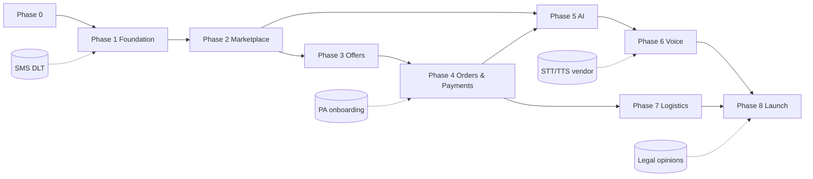

# KISAAN — Development Roadmap

> Status: Draft v0.1 · Last updated: 2026-11-14 · Owner: KISAAN product & architecture · Source of truth index: [README](README.md)

Durations are **indicative** for a core team of ~6–8 engineers (2 backend Lua/opsapi, 2 frontend, 1–2 AI, 1 QA, 1 DevOps shared) plus product/design `[ASSUMPTION A-10]`. Phases overlap where dependencies allow. Scope tiers: **MVP** = every item tagged MVP, built in Phases 1–6 plus launch hardening in Phase 8 (this includes the core transporter marketplace in Phase 4 and the core Logistics agent in Phase 5); **Phase 7** = P2 items, which may run in parallel with or after launch.

## 0. Timeline overview

```mermaid
gantt
    title KISAAN indicative roadmap (weeks from kickoff)
    dateFormat  X
    axisFormat  W%s
    section Foundation
    P0 Discovery & planning            :p0, 0, 3
    P1 Foundation & auth (opsapi image):p1, 3, 5
    section Marketplace
    P2 Core marketplace                :p2, 6, 7
    P3 Offers & negotiation            :p3, 11, 4
    P4 Orders & payments               :p4, 13, 6
    section AI
    P5 AI assistant & core agents      :p5, 9, 9
    P6 Voice & regional languages      :p6, 14, 6
    section Scale
    P7 Logistics & advanced intelligence :p7, 18, 6
    P8 Production readiness & launch   :p8, 22, 5
```

## 1. Placement of confirmed §2A features

| §2A feature | Phase | Notes |
|---|---|---|
| 2A.4 Public seller stores (`STR`) | **Phase 2** | Built on opsapi stores / public-store capabilities (verify in [OPSAPI_INTEGRATION](OPSAPI_INTEGRATION.md)) |
| 2A.5 Automated inventory (`INV`) | **Phase 2** (stock, manual adjustments, low-stock, auto-hide) → **Phase 3/4** (reservations on offer acceptance / checkout, deduction on payment) | Concurrency tests are a Phase 4 exit criterion |
| 2A.1 Wholesale pricing (`WHL`) | **Phase 2** (tiers on listings, display) → **Phase 4** (applied in checkout pricing engine `PRC`) | |
| 2A.6 Seller coupons (`CPN`) | **Phase 4** | Needs pricing engine & checkout |
| 2A.3 Membership + T&C (`MEM`) | **Phase 4** (plans, recurring payment, T&C acceptance, free delivery on the core transporter marketplace) → **Phase 7** (priority delivery, P2, D-96) | Free-delivery benefit live at launch; T&C legal review is a Phase 8 gate |
| 2A.2 Group buying (`GRP`) | **Phase 1** (separate leader signup) → **Phase 3** (groups, joining, commitments) → **Phase 4** (group order, per-member payment) | Leader-collects-money mode: **Future**, blocked by legal review — flagged, not silently dropped |

## 2. Phases

### Phase 0 — Discovery & planning (≈3 weeks)

| Item | Detail |
|---|---|
| Deliverables | This documentation set signed off; answers to `D-*` decisions; legal/tax opinions commissioned; design prototypes (Figma) for farmer chat + listing + buyer search; pilot district list; opsapi tag selection |
| Features | — |
| Technical dependencies | Access to opsapi source & Docker Hub images |
| Development tasks | Spike: run `bwalia/opsapi:<tag>` locally with a hello-world Kisaan project module and one migration; spike: Punjabi/Hindi STT accuracy on 50 recorded farmer utterances across candidate providers; spike: mandi price dataset ingestion |
| Testing requirements | Usability tests of clickable prototype with ≥10 farmers (Punjabi), ≥5 buyers |
| Completion criteria | Decisions D-01…D-n answered or explicitly deferred; spikes reported; backlog for P1–P4 groomed |
| Risks | Unclear legal position on trading outside APMC in Punjab; STT accuracy for rural Punjabi |
| External dependencies | Legal counsel, CA, payment aggregator sales/onboarding, SMS DLT registration lead time |

### Phase 1 — Project foundation & authentication (≈5 weeks)

| Item | Detail |
|---|---|
| Deliverables | Kisaan repo scaffold: `Dockerfile` `FROM bwalia/opsapi:<pinned-tag>`, `projects/kisaan/project.lua`, `migrations/`, `api/`; migration pipeline (pre-upgrade hook); `PROJECT_CODE` configured; Next.js PWA shell (i18n pa/hi/en, design tokens); CI/CD (build, test, image scan, deploy to dev/staging); observability baseline |
| Features | `AUTH` phone-OTP login, `PROF` multi-role profiles, `ONB` seller/buyer/transporter onboarding + **separate group-leader (bulk buyer) signup**, consent capture (`PRIV`), basic admin user management |
| Technical dependencies | opsapi auth/users/roles modules; SMS OTP provider with DLT templates |
| Development tasks | Kisaan migrations for profile extensions; role model; consent & notice versioning tables; audit log wiring; env separation (dev/staging/prod); secrets management |
| Testing requirements | Unit tests for migrations (up on clean DB + on DB at previous version), API tests for auth, role/permission matrix tests, accessibility smoke |
| Completion criteria | A user can sign up by OTP in pa/hi/en, pick roles, complete profile; group-leader signup flow distinct; image builds reproducibly; migrations tracked in `project_migrations` |
| Risks | opsapi (tag 1.0.339) has **no phone/SMS OTP login** (email/password, email-OTP 2FA, social SSO only) → Kisaan builds phone-OTP auth in the `kisaan` plugin; the mechanism for issuing opsapi-compatible sessions must be proven in the Phase 0 spike (see OPSAPI_INTEGRATION) |
| External dependencies | Docker Hub image availability, SMS gateway + DLT, domain/TLS/Cloudflare |

### Phase 2 — Core marketplace (≈7 weeks)

| Item | Detail |
|---|---|
| Deliverables | Categories with category-specific attributes; listings with photos; search & filters; product details; **public seller stores**; **inventory module** (stock, manual adjustments with reasons, low-stock alerts, auto-hide when 0); **wholesale tier configuration & display**; enquiries; reviews (read); admin moderation & verification queue |
| Features | `CAT`, `PRD`, `SRCH`, `STR`, `INV` (non-reservation part), `WHL` (config/display), `ENQ`, `ADM` moderation |
| Technical dependencies | Phase 1; S3-compatible storage; image resizing/CDN |
| Development tasks | Attribute schema per category; search indexing (Postgres FTS + trigram + geo first; dedicated search engine only if needed); store public URLs & SEO; image upload security (type sniffing, EXIF strip, malware scan) |
| Testing requirements | Search relevance tests in pa/hi/en transliterations; upload security tests; store visibility tests (logged out, privacy settings) |
| Completion criteria | Seller can create store + listing with tiers; buyer can find it via search filters (location radius, price, qty, grade) and see tier prices; logged-out user can browse store |
| Risks | Search across scripts (Gurmukhi/Devanagari/romanised) |
| External dependencies | Object storage, CDN |

### Phase 3 — Offers & negotiation (≈4 weeks, overlaps P4)

| Item | Detail |
|---|---|
| Deliverables | Offers/bids/quotations; counteroffers with history; offer expiry; buyer requirements (bulk purchase requests / RFQ); multi-offer comparison; **inventory reservation on offer acceptance**; **buying groups** (create, public listing of groups, join/leave, quantity commitments, leader verification & ratings) |
| Features | `OFR`, `ENQ` (requirements), `INV` reservations, `GRP` (non-payment) |
| Technical dependencies | Phase 2 listings & inventory; notifications |
| Development tasks | Offer state machine; reservation TTL jobs; group aggregation; anti-abuse limits (offer spam) |
| Testing requirements | State-machine tests; concurrent acceptance of two offers on the same lot; group threshold edge cases |
| Completion criteria | Farmer receives ≥2 offers, counters, accepts one (explicit approval), stock reserved, others auto-notified |
| Risks | Negotiation abuse / bait offers |
| External dependencies | Notification channels |

### Phase 4 — Orders & payments (≈6 weeks)

| Item | Detail |
|---|---|
| Deliverables | Order lifecycle; checkout with **pricing engine (`PRC`)** applying base → wholesale tier/whole-lot → negotiated price (replaces list + tier) → member price (seller opt-in) → one seller coupon, plus the membership free-delivery waiver on the delivery fee (FS §30.1); **seller coupons**; payment aggregator integration with split/route settlement; refunds; reconciliation jobs; GST-compliant invoices/receipts; **membership** plans, recurring payment, **versioned T&C acceptance**; **group order** with per-member payment; inventory deduction on payment & release on failure/cancel |
| Features | `ORD`, `PAY`, `INVC`, `PRC`, `CPN`, `MEM`, `GRP` (orders), `INV` (deduct/release), `DSP` (basic), **`LOG` core transporter marketplace** (transport requests, quotes, accept, pickup/delivery status, POD; LOG-002/003) |
| Technical dependencies | Payment aggregator account (marketplace/route product), webhooks, invoice numbering, tax rules from CA |
| Development tasks | Idempotent payment webhooks; ledger tables; settlement holds; coupon validation service; membership entitlement checks; T&C versioning |
| Testing requirements | Payment sandbox tests incl. failures, duplicates, partial refunds; overselling concurrency test (N parallel checkouts on last unit); coupon abuse tests; recurring mandate tests |
| Completion criteria | End-to-end paid order with correct split, invoice, and settlement record; order → transport request → ≥1 quote → accept → POD → settlement release; zero overselling under load test; membership purchase blocked without T&C acceptance |
| Risks | PA onboarding delays; marketplace KYC of sellers for payouts; opsapi payments are **Stripe-only** → Indian PA adapter (UPI, split settlement) and payment ledger are new Kisaan plugin work |
| External dependencies | Payment aggregator, bank account verification provider |

### Phase 5 — AI assistant & core agents (≈9 weeks, starts during P2)

| Item | Detail |
|---|---|
| Deliverables | AI Gateway service; orchestrator; tool layer over opsapi/Kisaan APIs with scoped tokens; **ApprovalRequest** system; agents: Listing (text + photo), Discovery, Price Intelligence (mandi data ingestion), Matching, Negotiation Assistant, Notification, Support; Trust & Verification (flagging, risk scores with reasons); **Logistics agent core** (find transporters, compare quotes, labelled cost estimates where reliable data exists, shipment status); chat UI with approval cards; AI admin monitoring (cost, latency, failure, escalations) |
| Features | `AI-*`, `APR`, `MKT` |
| Technical dependencies | Phases 2–4 APIs (agents can only do what APIs allow); LLM provider(s); mandi data source |
| Development tasks | Prompt/tool schemas; evaluation harness with golden conversations; prompt-injection defences; RAG over help/policy docs; cost budgets per user/day |
| Testing requirements | Agent eval suites (intent accuracy, tool-call correctness, approval never bypassed), red-team prompt injection, hallucinated-price tests |
| Completion criteria | Text chat in pa/hi/en completes: create listing draft → approve → publish; find suppliers; compare offers; check order status; 0 commit actions without approval in eval |
| Risks | Hallucination, cost overrun, latency |
| External dependencies | LLM providers, mandi price data source |

### Phase 6 — Voice & regional languages (≈6 weeks)

| Item | Detail |
|---|---|
| Deliverables | Voice input/output in chat; language detection; code-mixed handling; voice-based listing & discovery; read-back confirmation; low-bandwidth audio (Opus, push-to-talk); full UI localisation pa/hi/en; **WhatsApp MVP core**: opt-in, template notifications, and conversational listing creation, responding to offers via interactive approval buttons, and order status (PRD WA-003) |
| Features | `VOX`, `WA` (core), `NOTF` |
| Technical dependencies | STT/TTS provider selection from P0 spike; WhatsApp Business Platform onboarding |
| Development tasks | Audio pipeline; domain vocabulary (crop names, varieties, mandi names, units); numeral normalisation ("sau quintal" → 100 quintal) |
| Testing requirements | WER per language on field-recorded test set; task success rate with ≥20 farmers; noisy-environment tests |
| Completion criteria | ≥85% task success on voice listing with read-back in field test `[ASSUMPTION A-11]` |
| Risks | Dialect accuracy, noisy audio, low-end Android performance |
| External dependencies | STT/TTS vendors, Meta WhatsApp BSP/Cloud API |

### Phase 7 — Advanced logistics & intelligence (≈6 weeks; P2)

| Item | Detail |
|---|---|
| Deliverables | Advanced logistics on top of the Phase 4 core: multi-quote optimisation, cost-estimation v2, backup-transporter automation; membership priority delivery (D-96); seller performance insights; demand discovery; multi-buyer quotation comparison v2; full WhatsApp flows (negotiation, group buying, membership, WhatsApp Flows) |
| Features | `LOG` (advanced), `AI-LGX` (advanced), `ANL`, `MEM` (priority delivery), `WA` (full) |
| Technical dependencies | opsapi delivery modules (verify); maps/distance API |
| Testing requirements | Shipment state tests, POD photo/OTP tests, transporter no-show scenarios |
| Completion criteria | Priority dispatch for members works end to end; insights and comparison v2 pass UAT (the core order → transport request → quote → accept → POD → settlement flow is a Phase 4 exit criterion) |
| Risks | Transporter supply in pilot; cost estimation reliability |
| External dependencies | Maps/geocoding provider |

> **Note:** The core transporter marketplace (LOG-002/003) is **MVP** per the PRD and is delivered in Phase 4, with the Logistics agent core in Phase 5. Membership free delivery (§2A.3) depends on it. Phase 7 adds only the advanced/P2 logistics features.

### Phase 8 — Production readiness & launch (≈5 weeks)

| Item | Detail |
|---|---|
| Deliverables | Security audit & pen-test; load test; DR drill; legal sign-off on T&C, privacy notice, membership T&C, seller agreement; grievance officer published; runbooks; support training; pilot launch in selected Punjab districts |
| Testing requirements | Full E2E regression (see [TESTING_STRATEGY](TESTING_STRATEGY.md) E2E scenarios), UAT with pilot users |
| Completion criteria | All MVP requirements passing; no open critical/high security findings; NFR targets met; legal sign-offs recorded |
| Risks | Marketplace liquidity at launch (cold start) |
| External dependencies | Pen-test vendor, legal counsel |

## 3. Critical path & dependencies

Longest-lead external items to start in Phase 0: payment aggregator marketplace onboarding, SMS DLT registration, legal opinions (APMC, PA/escrow, group buying), WhatsApp Business verification.

## 4. MVP prioritisation rules

1. If schedule slips, cut in this order: full WhatsApp flows (P2) → seller insights → multi-buyer comparison v2 → photo-to-listing (keep text/voice listing) → priority delivery (keep free delivery).
2. Never cut: approvals, inventory consistency, payment reconciliation, consent/privacy, any §2A feature (flag instead).
