# KISAAN — Functional Specification

> Status: Draft v0.1 · Last updated: 2026-11-14 · Owner: KISAAN product & architecture · Source of truth index: [README](README.md)

Related: [PRD](PRD.md) (requirement IDs) · [AI_AGENT_ARCHITECTURE](AI_AGENT_ARCHITECTURE.md) · [DATABASE_SCHEMA](DATABASE_SCHEMA.md) · [API_SPECIFICATION](API_SPECIFICATION.md) · [PAYMENT_AND_BUSINESS_MODEL](PAYMENT_AND_BUSINESS_MODEL.md) · [OPSAPI_INTEGRATION](OPSAPI_INTEGRATION.md) · [TESTING_STRATEGY](TESTING_STRATEGY.md)

---

## 0. Conventions

- This document specifies **behaviour**. Endpoints are defined in the API specification and tables in the database schema. Backend modules are referred to by name only. "opsapi ecommerce", "opsapi delivery" and so on are reused modules; "Kisaan pricing module", "Kisaan inventory module" and so on are new Kisaan plugin modules (see [OPSAPI_INTEGRATION](OPSAPI_INTEGRATION.md)).
- Business rules are numbered `BR-<AREA>-NN`. Functional requirement IDs refer to the [PRD](PRD.md).
- Every feature section uses the same template: **Purpose · Roles · Journey · FRs · Business rules · Validation · Errors · Dependencies · Acceptance · Scope**.
- Error codes are written as `UPPER_SNAKE`. They are returned in the opsapi error envelope `{error:{code,message,context}}`, with the message localised to the user's language.
- Time zone is IST (Asia/Kolkata) for every user-facing date and time; storage is in UTC.
- Quantities are stored in kg. Money is in INR, `numeric(14,2)`.
- **Commit-class actions** need an approved ApprovalRequest when they are initiated by AI or by a delegated actor (APR-001). When a user taps a conventional UI button directly, that tap is the approval, but the action still writes an approval and audit record with `channel = ui`.

### 0.1 Feature index

| # | Feature | Section | PRD IDs | Scope |
|---|---|---|---|---|
| F01 | Authentication & registration | §1 | AUTH-001…009 | MVP |
| F02 | User profiles | §2 | PROF-001…007 | MVP |
| F03 | Seller onboarding | §3 | ONB-001…005 | MVP |
| F04 | Buyer / transporter onboarding | §4 | ONB-010…014 | MVP |
| F05 | Product management | §5 | PRD-001…010 | MVP (PRD-009/010 P2) |
| F06 | Product listings (lifecycle) | §6 | PRD-020…024 | MVP |
| F07 | Product search | §7 | SRCH-001…006 | MVP |
| F08 | Filters & sorting | §8 | SRCH-010…012 | MVP |
| F09 | Product details | §9 | SRCH-020…023 | MVP |
| F10 | Inventory management | §10 | INV-001…011 | MVP |
| F11 | Buyer enquiries & requirements | §11 | ENQ-001…006 | MVP |
| F12 | Bidding & quotations | §12 | OFR-001…007 | MVP |
| F13 | Negotiation & counteroffers | §13 | OFR-010…015 | MVP |
| F14 | Order management | §14 | ORD-001…009 | MVP |
| F15 | Payment processing | §15 | PAY-001…012 | MVP |
| F16 | Invoices & receipts | §16 | INVC-001…006 | MVP |
| F17 | Delivery management | §17 | LOG-001…009 | MVP |
| F18 | Reviews & ratings | §18 | REV-001…005 | MVP |
| F19 | Notifications | §19 | NOTF-001…005 | MVP |
| F20 | Customer support | §20 | SUP-001…005 | MVP |
| F21 | Disputes & refunds | §21 | DSP-001…007 | MVP |
| F22 | Admin dashboard | §22 | ADM-001…013 | MVP |
| F23 | Analytics & reporting | §23 | ANL-001…005 | MVP |
| F24 | Wholesale / bulk pricing (§2A.1) | §24 | WHL-001…012 | **MVP** |
| F25 | Group buying & area leaders (§2A.2) | §25 | GRP-001…016 | **⚠ Partial MVP** — leader-collects-money is Future |
| F26 | Membership & T&C (§2A.3) | §26 | MEM-001…014 | **MVP** |
| F27 | Public seller stores (§2A.4) | §27 | STR-001…008 | **MVP** |
| F28 | Automated inventory (§2A.5) | §10 + §28 | INV-001…010 | **MVP** |
| F29 | Seller coupons (§2A.6) | §29 | CPN-001…012 | **MVP** |
| X1 | Pricing & discount stacking engine | §30 | PRC-001…007 | MVP |
| X2 | Approvals (human-in-the-loop) | §31 | APR-001…007 | MVP |

### 0.2 Module dependency overview

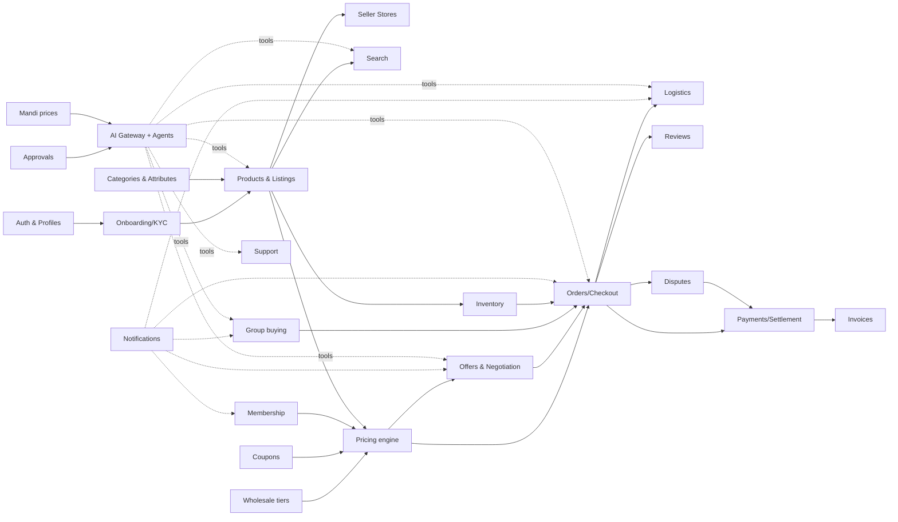

---

## 1. F01 — Authentication & registration

**Purpose.** Give low-literacy users a secure, low-friction way to identify themselves using a mobile number and OTP, with optional business and admin credentials.

**Roles.** All. Admin sub-roles require MFA.

**Journey (farmer, voice).**
1. The user opens the PWA or messages the WhatsApp number. The language picker shows three large buttons with audio labels: ਪੰਜਾਬੀ / हिन्दी / English.
2. "Apna mobile number boliye." The number is spoken or typed and read back, then an OTP is sent by SMS. Auto-read is used where the browser supports the WebOTP API.
3. The OTP is verified. If the number is new, the registration conversation collects name, village, district and role(s). The AI reads the summary back, and the account is created only after the user confirms.
4. The consent screen shows the privacy notice in the chosen language with audio playback. Mandatory service purposes are accepted and marketing opt-in is offered separately. The consent record is written.
5. The user lands on the role home: the seller home is AI-first, the buyer home is search-first.

**FRs.** AUTH-001…009.

**Business rules.**
- BR-AUTH-01: One account per verified mobile number. The number can be changed by verifying both the old and new numbers, or through a support-assisted flow with KYC re-check.
- BR-AUTH-02: OTP is 6 digits, valid for 5 minutes, max 5 verification attempts, max 5 sends per 15 minutes per number, and max 20 per day per device fingerprint.
- BR-AUTH-03: Access token lifetime is 15 minutes; refresh token lifetime is 30 days with rotation. Reusing a revoked refresh token revokes the whole token family.
- BR-AUTH-04: Admin, verifier, finance and support roles require TOTP MFA and a login from an allow-listed IP range or a step-up OTP `[DECISION D-16]`.
- BR-AUTH-05: Registration by an AI or assisted actor needs the user's OTP and an explicit confirmation of the read-back details.
- BR-AUTH-06: A deletion request deactivates the account immediately and is blocked while there are open orders or disputes. Personal data is erased or anonymised after 30 days, except records held for legal or tax retention `[LEGAL REVIEW]`.

**Validation.** The mobile number must match `^[6-9]\d{9}$` after the `+91` prefix is stripped. Names are 2–80 characters in Unicode letters from Gurmukhi, Devanagari or Latin scripts. The district must come from the master list.

**Errors.** `OTP_RATE_LIMITED` (shows retry-after), `OTP_EXPIRED`, `OTP_INVALID` (shows attempts left), `OTP_LOCKED`, `PHONE_ALREADY_REGISTERED`, `SMS_PROVIDER_UNAVAILABLE` (falls back to WhatsApp OTP if the user has opted in), `MFA_REQUIRED`, `ACCOUNT_SUSPENDED`, `DELETION_BLOCKED_OPEN_ORDERS`.

**Dependencies.** A DLT-registered SMS provider and the WhatsApp Business Platform. The Kisaan phone-OTP module issues an opsapi-compatible session (mechanism `[UNVERIFIED]`). opsapi users, roles and RBAC are reused.

**Acceptance.** PRD AUTH acceptance criteria apply, plus: E2E-01 registers a farmer entirely by voice in Punjabi in under 3 minutes.

**Scope.** MVP, except AUTH-008 (device alerts, P2) and buyer SSO (P2).

---

## 2. F02 — User profiles & multi-role

**Purpose.** A single identity with role-specific profiles, privacy controls and payout details.

**Roles.** All.

**Journey.** Profile → "My roles" → enable a role (Buyer, Seller, Transporter, or apply for Group Leader) → fill the role profile → the role switcher appears in the header and in the AI context ("Abhi aap seller ke roop mein hain").

**FRs.** PROF-001…007.

**Business rules.**
- BR-PROF-01: The active role determines the default home page, the AI tool set and the notifications shown. Permissions are always the union of the user's roles, but UI context comes from the active role only.
- BR-PROF-02: Phone numbers are hidden by default on public pages. Contact goes through masked in-app chat; a call relay is P2.
- BR-PROF-03: The payout account holder name must match the KYC name (fuzzy match ≥ 0.85 using a normalised transliteration). Below that threshold the account goes to manual review.
- BR-PROF-04: The reputation score is recomputed nightly from completed orders, ratings, on-time percentage, cancellation rate and median response time. The formula is in ANL; it is never shown as a single opaque number without its components.
- BR-PROF-05: Changing the payout bank account puts payouts on hold for 24 hours and notifies the user on all channels, as protection against account takeover.

**Validation.** IFSC must match `^[A-Z]{4}0[A-Z0-9]{6}$`. UPI IDs must match `^[\w.\-]{2,256}@[a-zA-Z]{2,64}$`. GSTIN uses the 15-character format plus checksum. PAN must match `^[A-Z]{5}\d{4}[A-Z]$`.

**Errors.** `PAYOUT_NAME_MISMATCH`, `PENNY_DROP_FAILED`, `INVALID_GSTIN`, `ROLE_NOT_ALLOWED`.

**Dependencies.** A penny-drop / bank verification provider `[UNVERIFIED provider]`, the GSTIN verification provider, and opsapi users.

**Acceptance.** A multi-role user switches role without logging out, and the AI tool set changes with it (verified in tests).

**Scope.** MVP.

---

## 3. F03 — Seller onboarding & verification

**Purpose.** Bring farmers and sellers to a publish-ready, payout-ready state with proportionate KYC.

**Roles.** Seller, Verifier, Field/Support agent, AI-TRS.

**Journey.**
1. The checklist shows: Profile ✔ → Pickup address → Bank/UPI → Identity → First listing.
2. Identity is verified by DigiLocker-based or offline document verification, or by uploading a masked document plus a selfie `[LEGAL REVIEW]` for lawful Aadhaar use.
3. AI-TRS pre-screens the submission for legibility, name match, duplicates across accounts (same document hash or face match P2) and device risk. It then assigns a risk score with reasons.
4. Low-risk submissions with all checks passed are approved automatically if an admin has enabled this per tier `[DECISION D-17]`. Otherwise they go to the verifier queue, with a 24-hour SLA.
5. On approval the user receives a badge and a notification, and listing publishing is unlocked.

**FRs.** ONB-001…005.

**Business rules.**
- BR-ONB-01 (tiers):

| Tier | Requirements | Seller capability |
|---|---|---|
| T0 | Phone verified | Draft listings, browse, chat |
| T1 | Identity verified | Publish listings; open-order value ≤ ₹5,00,000 `[DECISION D-18]` |
| T2 | T1 + payout account verified | Receive payouts (required before any order can be confirmed) |
| T3 | T2 + PAN/GSTIN business verification | No order-value limit; can issue GST tax invoices |

- BR-ONB-02: Raw Aadhaar numbers, and Aadhaar images that show the full number, are never stored. Only the masked number, a verification reference and the verification method are kept.
- BR-ONB-03: The AI risk score is advisory. A rejection always requires a human verifier and a reason code that the user can see.
- BR-ONB-04: Assisted onboarding records `assisted_by` and requires the user's OTP for consent and for the first publish.
- BR-ONB-05: A rejected applicant may resubmit at most 3 times in 30 days. After that the case goes to support.

**Validation.** Document images are JPG/PNG/PDF, at most 10 MB, with at least 800 px on the short side; malware scanning is mandatory.

**Errors.** `KYC_DOCUMENT_UNREADABLE`, `KYC_NAME_MISMATCH`, `KYC_DUPLICATE_IDENTITY`, `KYC_RESUBMISSION_LIMIT`, `TIER_INSUFFICIENT`.

**Dependencies.** A KYC provider (DigiLocker/aggregator) `[UNVERIFIED]`, opsapi documents (MinIO/S3), AI-TRS, and the admin verification queue.

**Acceptance.** A T0 seller cannot publish (`TIER_INSUFFICIENT`). A T1 seller can publish but cannot confirm an order until T2. A verifier rejection shows the reason to the user in their language.

**Scope.** MVP.

---

## 4. F04 — Buyer, transporter & leader onboarding

**Purpose.** Verify buyers proportionately to order value, and verify transporters and their vehicles. Leader onboarding is in §25.

**Journey (buyer).** Choose buyer_type → business name (optional for individuals) → delivery address → optional GSTIN (fetches the legal name) → done. Verification is asked for only when a threshold is reached (BR-ONB-11).

**Journey (transporter).** Identity → driving licence → vehicles (type, capacity in tonnes, registration number, RC upload, insurance expiry, permit) → service districts → bank → verifier approval.

**FRs.** ONB-010…014.

**Business rules.**
- BR-ONB-10: Buyer tiers mirror BR-ONB-01. A buyer at T0 may make enquiries and offers up to ₹50,000 total open value. T1 raises this to ₹2,00,000. Above ₹2,00,000 per order the buyer needs T3 business verification `[DECISION D-02]`.
- BR-ONB-11: A GST tax invoice for input tax credit is generated only if the buyer's GSTIN has been verified.
- BR-ONB-12: A vehicle is assignable only while its RC is verified and its insurance has not expired. An expiry alert goes out 15 days before, and the vehicle is auto-suspended on expiry.
- BR-ONB-13: Transporters must be at T2 (payout verified) before accepting assignments.

**Errors.** `BUYER_TIER_LIMIT_EXCEEDED`, `VEHICLE_DOCS_INVALID`, `VEHICLE_INSURANCE_EXPIRED`.

**Dependencies.** The GSTIN provider, opsapi delivery partners (reused for transporter vehicles, areas and verification), and the KYC provider.

**Acceptance.** A ₹3,00,000 checkout by a T1 buyer is blocked with `BUYER_TIER_LIMIT_EXCEEDED` and a "Verify business" call to action.

**Scope.** MVP.

---

## 5. F05 — Product management

**Purpose.** Create structured, category-correct product listings from any channel.

**Roles.** Seller, AI-LST, Moderator.

**Journey (voice/AI).**
1. The seller says: "Mere paas 100 quintal wheat hai, Moga mein. PBW-826, nami 11 percent."
2. AI-LST extracts commodity = Wheat, variety = PBW-826, qty = 100 qtl (10,000 kg), moisture = 11 %, and location = Moga (the seller's default pickup address in Moga).
3. AI-LST asks for any missing required fields, one at a time: expected price (with a mandi reference from AI-PRI, for example "Moga mandi modal ₹2,4xx/qtl on <date>, source AGMARKNET"), harvest date and packaging.
4. It suggests uploading photos ("2–3 photo kheecho, dhoop mein").
5. The draft summary is read back. Approval publishes the listing (APR), or the seller can choose "Save draft".

**Journey (form).** Category → variety → quantity + unit → attributes (rendered from the schema) → price, MOQ and availability → photos → preview → publish.

**Journey (photo).** Photos → AI-LST suggests commodity, variety (low confidence), visible defects and packaging. All of these are labelled "AI observation" → the seller confirms or edits.

**FRs.** PRD-001…010, AI-010.

**Business rules.**
- BR-PRD-01: Required attributes come from the category schema. Publishing is blocked until every required field is present.
- BR-PRD-02: Quantity is entered in kg, qtl or tonne and stored in kg. Display shows the entered unit plus one alternative.
- BR-PRD-03: Grade is seller-declared. AI photo output is stored separately as `ai_observation` with a confidence value and is always shown with the disclaimer "AI observation — not a quality certification".
- BR-PRD-04: The expected price is per display unit. It is stored both as per-kg (numeric 14,4) and per display unit for presentation.
- BR-PRD-05: Each listing has exactly one pickup address. To sell from two locations, the seller creates two listings.
- BR-PRD-06: Photos have EXIF and GPS stripped and are re-encoded. A perceptual hash is stored for duplicate detection.
- BR-PRD-07: Descriptions are generated in the seller's language and machine-translated to the other two languages. Translations are flagged `machine_translated` until edited.
- BR-PRD-08: Items on the prohibited list are blocked from publishing (`LISTING_PROHIBITED`).

**Validation.** Quantity is > 0 and ≤ 5,000 tonnes per listing. MOQ is ≥ 1 kg and ≤ quantity. The price is greater than ₹0 and within 0.2×–5× the 30-day mandi modal price for the commodity and state. Outside that band the listing is not blocked but is flagged for moderation. Moisture must be within the schema range. Harvest date must be no later than today + 60 days (future harvest is allowed only with `availability = upcoming`, P2). Each listing allows 1–10 photos.

**Errors.** `ATTRIBUTE_REQUIRED`, `ATTRIBUTE_OUT_OF_RANGE`, `UNIT_UNSUPPORTED`, `PHOTO_TOO_LARGE`, `PHOTO_UNSAFE`, `LISTING_PROHIBITED`, `AI_EXTRACTION_LOW_CONFIDENCE` (asks the user to confirm field by field).

**Dependencies.** CAT schema, opsapi products, variants and categories (reused; Kisaan attributes are stored in an extension table), object storage, AI-LST, AI-PRI and MKT.

**Acceptance.** E2E-01 step "list 100 qtl wheat by voice" produces a valid draft with all required wheat attributes, and it is published only after approval.

**Scope.** MVP, except PRD-009 and PRD-010 (P2).

---

## 6. F06 — Product listing lifecycle

**Purpose.** Govern listing visibility, moderation and expiry.

**State machine — listing lifecycle.**

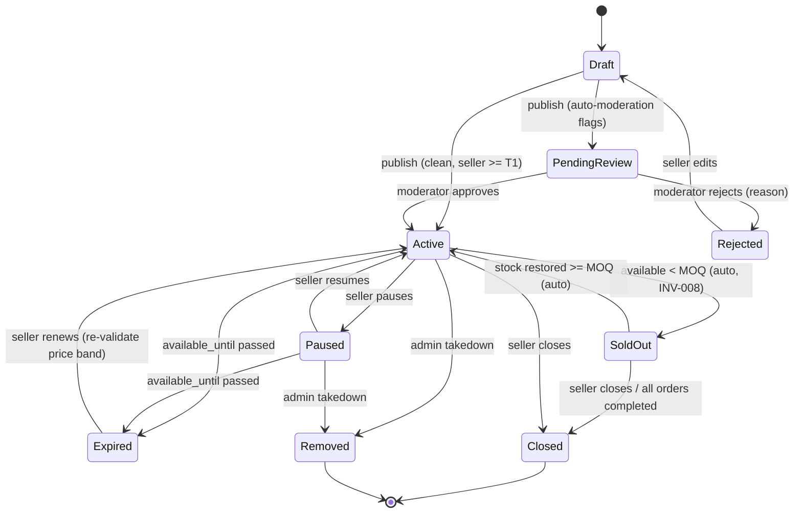

**Business rules.**
- BR-LST-01: Only listings in the Active state are returned in search, matching or AI discovery. Store pages show SoldOut listings only if the seller enables this.
- BR-LST-02: Closing, pausing or removing a listing does not cancel existing reservations or orders. Open offers (not yet accepted) are auto-rejected with the reason `LISTING_UNAVAILABLE`, and the buyers are notified.
- BR-LST-03: Default expiry is 30 days for non-perishables and 7 days for perishables (Vegetables, Fruits) `[DECISION D-03]`. A reminder is sent 48 hours before expiry. Renewal re-runs the price-band moderation.
- BR-LST-04: Auto-moderation rules (versioned):
  - (a) The price is outside the band in §5.
  - (b) The photo pHash or a near-duplicate text matches another seller's listing.
  - (c) The same seller posts more than 5 listings of the same commodity within 24 hours.
  - (d) The listing contains prohibited terms.
  - (e) A new seller (T1 for less than 7 days) lists more than 1,000 qtl.
- BR-LST-05: Edits to price, quantity or tiers while offers are open trigger notifications to the affected buyers. Already-accepted offers and orders keep their snapshot.
- BR-LST-06: A moderator rejection requires a reason code, and the seller sees the reason in their language.

**Errors.** `INVALID_STATE_TRANSITION`, `LISTING_UNAVAILABLE`, `LISTING_UNDER_REVIEW`.

**Acceptance.** Every state-machine transition is covered by a test (TC-PRD-*). Invalid transitions return `INVALID_STATE_TRANSITION`.

**Scope.** MVP (PRD-024 featured listings: Future).

---

## 7. F07 — Product search

**Purpose.** Help buyers find relevant, available supply in any language.

**Journey.** The buyer types or speaks a query. The query is normalised (transliteration → synonyms → commodity/variety entity recognition), filters are inferred (location, quantity) and results are shown as cards. The AI path additionally explains the top results ("Ye 3 seller 40 km ke andar hain, sab verified").

**FRs.** SRCH-001…006, AI-011.

**Business rules.**
- BR-SRCH-01: The index contains only Active listings with `available ≥ MOQ` (BR-LST-01). The index is updated within 60 seconds of any inventory or state change, and a stale entry is re-checked live before display.
- BR-SRCH-02: The synonym dictionary is managed by admins, for example kanak/gehun/ਕਣਕ/गेहूं → wheat; aloo/ਆਲੂ → potato; jhona/dhan/ਝੋਨਾ → paddy.
- BR-SRCH-03: The default radius is 100 km from the buyer's default address, expanding to the whole state if there are fewer than 5 results. Every expansion is disclosed to the user.
- BR-SRCH-04: Relevance ranking is a text match combined with a verification boost, rating, freshness and distance. There is no paid boosting in MVP, and the ranking factors are disclosed on a help page, as required by the e-commerce rules on ranking transparency `[LEGAL REVIEW]`.
- BR-SRCH-05: Anonymous users can search and view listings. Seller contact is not shown; offers require login.
- BR-SRCH-06: Saved-search alerts fire at most once per listing per saved search, and at most 10 alerts per user per day (digest beyond that).

**Validation.** Query length is 1–200 characters. The radius is 5–500 km.

**Errors.** `SEARCH_UNAVAILABLE` (the system falls back to a basic database query), `LOCATION_REQUIRED` (for radius sort without a location).

**Dependencies.** The search index (Postgres full-text search with trigram and PostGIS in MVP; a dedicated search engine is considered at P2 scale), CAT synonyms and AI-DSC.

**Acceptance.** Search for "kanak" in Gurmukhi, Devanagari and romanised script returns the same set of wheat listings. No listings with available below MOQ are ever returned (property-based test).

**Scope.** MVP.

---

## 8. F08 — Filters & sorting

**Purpose.** Precise narrowing using category-specific attributes.

**FRs.** SRCH-010…012.

**Business rules.**
- BR-SRCH-10: Filter facets are generated from attributes where `filterable = true` for the selected category. Common facets are always shown.
- BR-SRCH-11: **Price sort and price filter use the effective unit price** for the buyer's requested quantity, computed with the PRC engine at the wholesale stage (stage 2). Membership and coupons are not applied in ranking. If no quantity is given, the price is the list price.
- BR-SRCH-12: "Verified sellers only" means seller tier ≥ T1. The "Business verified" filter means T3.
- BR-SRCH-13: Filter state is preserved in the URL so it can be shared.

**Errors.** `FILTER_INVALID` (unknown attribute or bad range).

**Acceptance.** For 120 qtl requested, a listing at ₹2,500 with an 8 % tier at 100+ (effective ₹2,300) ranks above a listing at ₹2,350 with no tier in an ascending price sort.

**Scope.** MVP.

---

## 9. F09 — Product details

**Purpose.** Give buyers everything they need to decide, and a clear next action.

**Contents.** Photo gallery (lazy-loaded, low-res first) · title in the user's language · attribute table · seller-declared grade · AI observation with disclaimer · available quantity and MOQ · pickup district (an exact village only after an order is placed, unless the seller makes it public) · **wholesale tier table** · active public coupons · member price badge (if any) · **live price calculator** · seller card (badges, rating, store link) · mandi reference (market, modal price, date, source) · active groups for this listing · CTAs.

**FRs.** SRCH-020…023.

**Business rules.**
- BR-SRCH-20: The price calculator calls the PRC engine and shows the breakdown: list price, wholesale saving, member price (if eligible), coupon (if applied), delivery estimate and total. Client-side preview uses the tier table; the server quote is authoritative.
- BR-SRCH-21: "Buy now" is available only if the seller has enabled `allow_direct_purchase` (default on). Otherwise only offers are accepted.
- BR-SRCH-22: The mandi reference is shown only if data is ≤ 7 days old. If it is 3–7 days old it is labelled stale (MKT-003).
- BR-SRCH-23: Public pages carry structured data for SEO and an Open Graph preview for WhatsApp sharing.

**Errors.** `LISTING_NOT_FOUND`, `LISTING_UNAVAILABLE` (shows similar listings).

**Acceptance.** Changing the quantity across a tier boundary updates the price within 200 ms (client preview). Server quote totals equal the client preview in 100 % of cases in the test suite.

**Scope.** MVP.

---

## 10. F10 + F28 — Inventory management & automated inventory (§2A.5)

**Purpose.** Keep stock accurate without manual work, and make overselling impossible.

**Roles.** Seller, System, Admin.

**Model.** Each listing has an inventory record: `on_hand_kg`, `reserved_kg`, `available_kg = on_hand_kg − reserved_kg`, `low_stock_threshold_kg`. It is backed by a **reservation** table (one row per hold, with a TTL) and an append-only **movement ledger**. Kisaan owns this inventory, because opsapi ecommerce stock is a single quantity with no reservations. The Kisaan module syncs a derived `stock` value into the opsapi product for compatibility `[OPSAPI: new]`.

**Journey (automated).**
1. The seller accepts a buyer's 40-qtl offer. A reservation `R1` is created for 4,000 kg with TTL = the payment deadline. Available drops from 100 to 60 qtl.
2. The buyer pays and the PA webhook confirms it. Reservation `R1` is consumed: on_hand drops from 10,000 to 6,000 kg, reserved drops from 4,000 to 0, and ledger entries `DEDUCT` are written.
3. Alternatively, if the payment deadline passes, `R1` expires: reserved drops from 4,000 to 0, available is back to 100 qtl, and both parties are notified.
4. When available falls below the low-stock threshold, a low-stock alert goes to the seller ("Sirf 8 quintal bacha hai").
5. When available falls below MOQ, the listing goes to SoldOut and is hidden from search automatically. When stock returns it becomes Active again.

**State machine — inventory reservation lifecycle.**

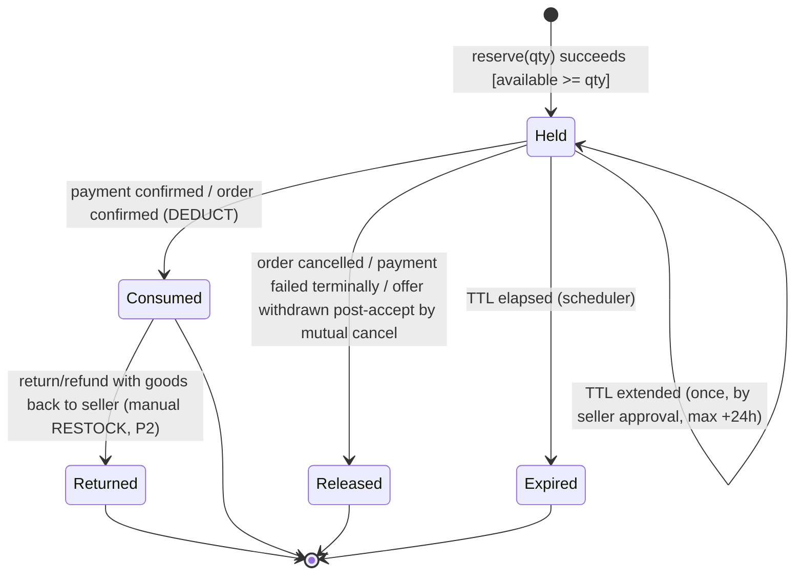

**FRs.** INV-001…011.

**Business rules.**
- BR-INV-01 (atomic reserve): A reservation executes as a single conditional update, `UPDATE … SET reserved = reserved + :q WHERE listing_id = :id AND on_hand - reserved >= :q`, inside a transaction that inserts the reservation and ledger rows. If 0 rows are affected it returns `INSUFFICIENT_STOCK`. No read-then-write pattern is allowed.
- BR-INV-02 (reservation triggers and TTLs):

| Trigger | TTL |
|---|---|
| Buy-now checkout started | 15 min (the quote validity) |
| Offer/quotation accepted | Payment deadline: 24 h, or 4 h for perishables `[DECISION D-07]` |
| Group reaches "ready" (§25) | Until the group payment-completion deadline, max 24 h |

- BR-INV-03 (deduct): Deduction happens only when payment is confirmed through a verified PA webhook (PAY-004), or when an order is confirmed by an admin in an approved offline-payment exception (Future).
- BR-INV-04 (release): Cancellation, terminal payment failure, reservation expiry or dispute-cancel before dispatch all release the reservation idempotently. A reservation already Consumed or Released is never released twice.
- BR-INV-05: An expiry scheduler runs every minute. It must be idempotent and safe under concurrent workers (`FOR UPDATE SKIP LOCKED`).
- BR-INV-06 (manual adjustments): `ADD` and `REMOVE` adjustments need a reason code: `HARVEST_ADDED`, `SPOILAGE`, `SOLD_OFFLINE`, `COUNT_CORRECTION`, `QUALITY_DOWNGRADE`, or `OTHER` with at least 10 characters of text. `REMOVE` may not take on_hand below reserved (`ADJUSTMENT_BELOW_RESERVED`). Every adjustment is audit-logged with the actor and channel.
- BR-INV-07: The low-stock threshold defaults to max(10 % of the initial quantity, MOQ), and the seller can edit it. The alert fires once per downward crossing and re-arms when available goes above the threshold again.
- BR-INV-08 (auto-hide): available below MOQ moves the listing to SoldOut. available ≥ MOQ moves it back to Active, unless it was Paused, Expired or Removed in the meantime.
- BR-INV-09 (ledger integrity): `on_hand = Σ(ADD) − Σ(REMOVE) − Σ(DEDUCT) + Σ(RESTOCK)`. A nightly job verifies this for every listing and raises a P1 alert on mismatch.
- BR-INV-10: Voice and AI adjustments are drafts until approved (APR). The readback includes the before and after quantity.
- BR-INV-11: For quantities the system treats 1 kg as the indivisible unit, and quantities are rounded to 0.001 kg in storage.

**Validation.** Reservation quantity is > 0 and ≥ MOQ, unless it is the whole remaining lot, which may be below MOQ. Adjustment quantity is > 0.

**Errors.** `INSUFFICIENT_STOCK` (returns the current available quantity), `RESERVATION_EXPIRED`, `RESERVATION_ALREADY_FINALISED`, `ADJUSTMENT_BELOW_RESERVED`, `REASON_REQUIRED`.

**Dependencies.** The PAY webhook, ORD, the scheduler or queue (Redis, or opsapi's job runner `[UNVERIFIED]`), NOTF and the search indexer.

**Acceptance.**
- A concurrency test sends 50 parallel reservations of 10 qtl against 100 qtl. Exactly 10 succeed and the final available quantity is 0.
- An expired reservation restores the available quantity and the listing returns to search within 60 seconds.
- An adjustment without a reason is rejected.
- The nightly ledger check passes on seeded data.

**Scope.** MVP (INV-011 multi-location: Future).

---

## 11. F11 — Buyer enquiries & buyer requirements (RFQ)

**Purpose.** Let buyers ask questions and pull supply through requirements (Smart Bulk Purchase Requests).

**Journey (enquiry).** On the product page the buyer taps "Ask" or speaks a question. A chat thread opens using opsapi chat, linked to the listing. The seller is notified and replies, by voice note or text (voice note is P2). Contact stays masked.

**Journey (RFQ).**
1. The buyer says: "Mujhe 500 quintal PBW-826, nami 12% se kam, Khanna delivery, 20 tareekh tak chahiye."
2. AI-DSC builds an RFQ draft, the buyer approves it (APR, because publishing an RFQ is commit-class), and the RFQ is published.
3. AI-MAT ranks eligible sellers by commodity, variety, available quantity, distance, verification and rating, and notifies the top N = 20 (BR-ENQ-03).
4. Sellers respond with quotations (§12). The buyer sees the multi-seller comparison.

**FRs.** ENQ-001…006, AI-013.

**Business rules.**
- BR-ENQ-01: A T0 buyer may have at most 10 open enquiries per day, and new accounts (< 7 days old) at most 5.
- BR-ENQ-02: An RFQ is valid for 1–30 days (default 7) and closes automatically at its needed-by date or when the buyer marks it fulfilled.
- BR-ENQ-03: Matching notifies at most 20 sellers initially, and widens to the next 20 after 24 hours if fewer than 3 quotations have arrived. A seller receives at most 5 RFQ alerts per day.
- BR-ENQ-04: In public RFQs the buyer's name is shown only as buyer_type plus district and verification badge, until the buyer accepts a quotation `[DECISION D-04]`.
- BR-ENQ-05: An RFQ may split across multiple sellers. The buyer can accept several quotations whose quantities sum to no more than the RFQ quantity.
- BR-ENQ-06: Contact information (phone numbers, UPI IDs) in enquiry messages is detected and masked, with a warning to keep payments on-platform for protection.

**Validation.** RFQ quantity is ≥ 1 qtl. needed_by is ≥ today. The delivery location is required. The target price is optional and > 0.

**Errors.** `ENQUIRY_LIMIT_REACHED`, `RFQ_EXPIRED`, `RFQ_QTY_EXCEEDED`.

**Acceptance.** An RFQ for 500 qtl notifies at most 20 matching sellers within 2 minutes. Quotations appear in the buyer's comparison view.

**Scope.** MVP (ENQ-005: P2).

---

## 12. F12 — Bidding & quotations

**Purpose.** Structured price discovery through offers (buyer to listing) and quotations (seller to RFQ), with side-by-side comparison.

**Offer contents.** Quantity · unit price (₹ per display unit) · delivery terms (`BUYER_PICKUP`, `SELLER_DELIVERS`, `PLATFORM_LOGISTICS`) · pickup/delivery date window · payment terms (MVP: `PREPAID_VIA_PLATFORM` only) · validity · optional message.

**FRs.** OFR-001…007, AI-014.

**Business rules.**
- BR-OFR-01: Offer quantity must be ≥ MOQ and ≤ available at the time of submission. Offers do not reserve stock (OFR-005).
- BR-OFR-02: One open offer per buyer per listing. A new offer supersedes the old one, which becomes Superseded.
- BR-OFR-03: Validity defaults to 24 hours for non-perishables and 6 hours for perishables, within a range of 1 hour to 72 hours `[DECISION D-05]`.
- BR-OFR-04: Seller comparison view: for each offer it shows the gross amount, estimated commission, estimated transport (if the seller bears it), **net realisation**, buyer verification and rating, delivery date, and expiry. Rows are sorted by net realisation. AI-NEG can explain the trade-offs, and its explanation is labelled as AI.
- BR-OFR-05: The AI warns a buyer if their offer price is **higher** than the effective wholesale price they would get by buying now (e.g. offering ₹2,400 when the tier gives ₹2,300).
- BR-OFR-06: Offers with a price more than 40 % below the list price are allowed but are tagged "low offer". Sellers can mute low offers (P2: auto-reject floor, OFR-015).
- BR-OFR-07: Offers on a listing auto-expire if the listing leaves Active (BR-LST-02).

**Errors.** `OFFER_BELOW_MOQ`, `OFFER_EXCEEDS_AVAILABLE`, `OFFER_EXPIRED`, `OFFER_SUPERSEDED`, `LISTING_UNAVAILABLE`, `SELF_OFFER_NOT_ALLOWED` (a seller making an offer on their own listing).

**Acceptance.** A seller with 3 offers sees them sorted by net realisation with correct commission estimates. A buyer's second offer supersedes their first.

**Scope.** MVP (auctions OFR-007: Future).

---

## 13. F13 — Negotiation & counteroffers

**Purpose.** Bounded, transparent negotiation that converts into a binding order.

**State machine — offer / negotiation.**

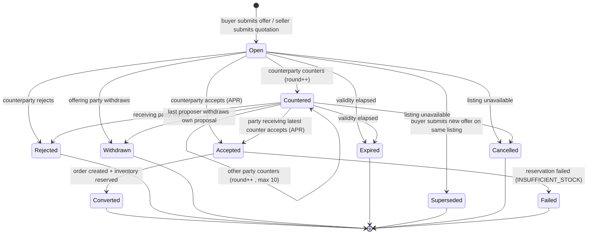

**Journey (seller with AI).**
1. "Teen offer aaye hain wheat te." The AI compares them: Offer A ₹2,420/qtl for 100 qtl, buyer pickup, rating 4.6. Offer B ₹2,450/qtl for 40 qtl, platform logistics (seller pays transport ≈ ₹55/qtl based on 3 quotes). Offer C ₹2,380/qtl for 100 qtl, but the buyer is new and unverified.
2. The AI explains: "A gives the highest total net amount…". The seller says "A nu 2,450 da counter bhejo."
3. The AI drafts the counter and reads it back ("Offer A: 100 quintal, ₹2,450 per quintal, buyer pickup, valid 24 ghante — bhejan?"). The seller says "haan", and the counter is sent.
4. The buyer accepts in the app. The system atomically reserves stock and creates the order (Pending payment), and both parties are notified.

**FRs.** OFR-010…015, AI-014, APR-001…004.

**Business rules.**
- BR-OFR-10: Each counter is an immutable negotiation event recording proposer, price, quantity, terms, validity, channel and `ai_drafted` (boolean).
- BR-OFR-11: The maximum is 10 rounds (one round = one counter). Each counter resets the validity to the counter's own validity, capped at 72 hours from the original offer.
- BR-OFR-12: Only the party who received the latest proposal can accept or reject it. The latest proposer can withdraw it.
- BR-OFR-13: **Acceptance is atomic:**
  1. Lock the negotiation.
  2. Re-validate the listing is Active and quantity ≤ available.
  3. Reserve inventory (BR-INV-01).
  4. Create the order with a price snapshot (negotiated price, see PRC-002 stage 3).
  5. Set the payment deadline.
  If step 3 fails, the negotiation is marked Failed with `INSUFFICIENT_STOCK`. The parties may renegotiate on the reduced quantity through a new offer.
- BR-OFR-14: The AI never executes accept, reject, counter or withdraw without an approved ApprovalRequest bound to the exact parameters (APR-004). AI-drafted messages are tagged as AI-drafted to the counterparty.
- BR-OFR-15: The negotiation history is visible to both parties and to admins (for disputes). Messages within a negotiation are moderated for abuse and contact sharing (BR-ENQ-06).
- BR-OFR-16: The seller's auto-counter rules (P2) may only auto-reject or auto-reply with a floor price. They can never auto-accept `[DECISION D-06]`.

**Errors.** `NEGOTIATION_ROUND_LIMIT`, `NOT_YOUR_TURN`, `OFFER_EXPIRED`, `INSUFFICIENT_STOCK`, `APPROVAL_REQUIRED`, `APPROVAL_EXPIRED`, `APPROVAL_PARAMS_MISMATCH`.

**Acceptance.**
- E2E-01 negotiation step: three offers, one counter and one acceptance produce an order in the Pending payment state with stock reserved.
- An attempt by the AI to accept without approval returns `APPROVAL_REQUIRED`.
- Round 11 is rejected.

**Scope.** MVP (OFR-015: P2).

---

## 14. F14 — Order management

**Purpose.** A single order lifecycle for direct purchase, accepted offers and group allocations.

**State machine — order.**

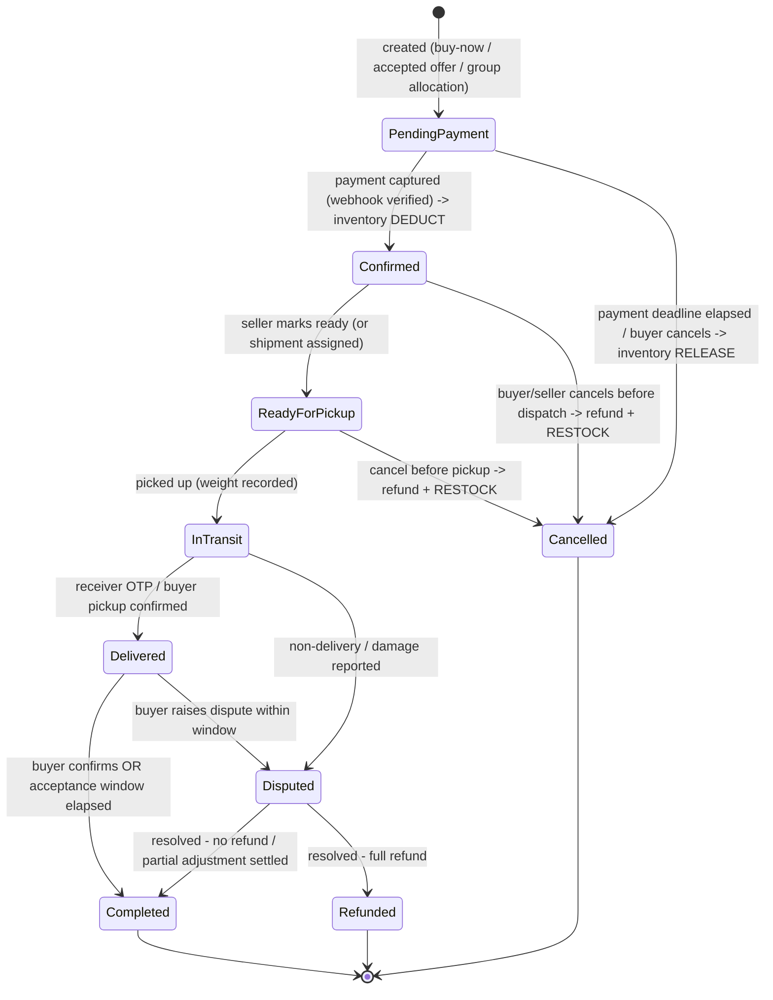

`BUYER_PICKUP` orders skip InTransit. Seller and buyer confirm the handover with an OTP and the order moves straight to Delivered.

**Journey (buy now).**
1. On the product page the buyer chooses a quantity and delivery mode.
2. The PRC quote is fetched. The buyer enters a coupon if they have one, and the quote is recomputed.
3. Checkout reserves inventory (15-minute TTL) and creates the order in PendingPayment.
4. The buyer pays through the PA and the webhook moves the order to Confirmed.
5. The seller is notified ("Naya order: 40 qtl wheat, ₹96,000. Ready karo.").
6. Logistics runs (§17), the goods are delivered and the order is Completed after the acceptance window.
7. Settlement follows (§15).

**FRs.** ORD-001…009.

**Business rules.**
- BR-ORD-01: An order belongs to exactly one seller and one listing in MVP (single-line orders). Multi-seller carts are Future. A buyer may place parallel orders.
- BR-ORD-02: The **price snapshot** is immutable once the order is Confirmed. It stores: list price, wholesale tier/whole-lot applied, negotiated price, member price, coupon (code, amount), delivery fee, membership delivery waiver, platform commission (rate and amount), taxes and TCS (if any), and the payable total. Changing any component means cancelling and re-creating the order.
- BR-ORD-03: Payment deadlines are 15 minutes for buy-now, 24 hours for accepted offers (4 hours for perishables), and the group deadline for groups (BR-GRP-08).
- BR-ORD-04 (cancellation):

| Who | When | Effect |
|---|---|---|
| Buyer | PendingPayment | Free cancel, inventory released |
| Buyer | Confirmed, before ReadyForPickup | Full refund minus the non-refundable fees disclosed at checkout (default ₹0 in MVP) `[LEGAL REVIEW]` |
| Seller | Before pickup | Full refund to buyer; seller reliability −1; three cancellations in 30 days trigger a review |
| Anyone | After pickup | Dispute only |

- BR-ORD-05 (acceptance window): 48 hours after Delivered for non-perishables and 12 hours for perishables `[DECISION D-08]`. The buyer can confirm early. At the end of the window the order auto-completes.
- BR-ORD-06 (weight reconciliation): The delivered net weight is recorded from a weighbridge slip or a buyer-side weighing photo.
  - Within ±2 % of the ordered weight: the final amount is adjusted pro-rata and any shortfall difference is refunded automatically. An excess is never charged extra without the buyer's approval.
  - More than 2 % short: the case goes to dispute, unless the buyer accepts the pro-rata adjustment.
- BR-ORD-07: Order documents are the invoice / bill of supply, the payment receipt, the weighbridge slip, the delivery proof photo and the e-way bill reference (if generated, P2).
- BR-ORD-08: The seller must mark the order ReadyForPickup or assign a transporter within 48 hours of Confirmed (perishables: 12 hours). Otherwise the system escalates to support and the buyer may cancel free of charge.

**Errors.** `ORDER_NOT_FOUND`, `INVALID_STATE_TRANSITION`, `PAYMENT_DEADLINE_PASSED`, `CANCELLATION_NOT_ALLOWED`, `QUOTE_EXPIRED`, `PRICE_CHANGED_REAPPROVE`.

**Dependencies.** opsapi orders, buyer-orders and status history (reused; Kisaan extension columns for source, snapshot, weights and deadlines), the Kisaan pricing module, the Kisaan inventory module, PAY and LOG.

**Acceptance.** An order cannot reach Confirmed without a verified payment event. Auto-complete fires within 5 minutes of the window ending. Weight reconciliation with a 1.5 % shortfall produces the correct partial refund (TC-ORD-*).

**Scope.** MVP (partial fulfilment ORD-009: P2).

---

## 15. F15 — Payment processing

**Purpose.** Safe, reconciled money movement through a licensed Payment Aggregator (PA) with marketplace split settlement. The platform never holds seller proceeds itself.

**State machine — payment.**

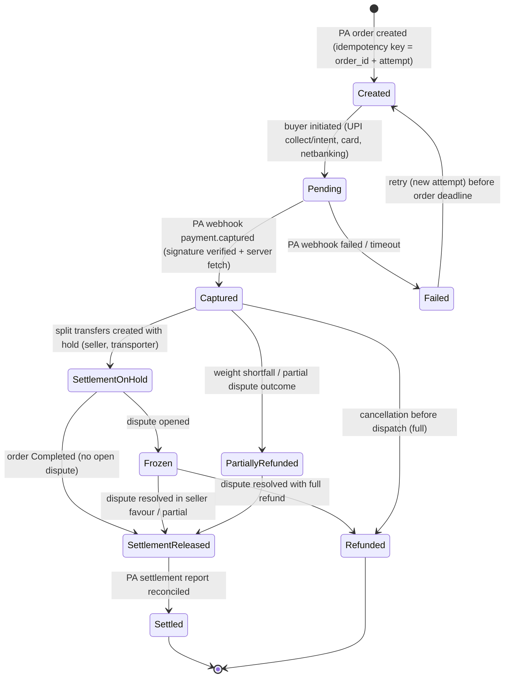

**FRs.** PAY-001…012.

**Business rules.**
- BR-PAY-01: The PA is integrated through a Kisaan payment-adapter interface so the provider can be swapped. The recommended primary PA is Razorpay (Route), with Cashfree as the alternative `[DECISION D-09]`. opsapi payments are Stripe-only and are **not** used for INR marketplace payments `[OPSAPI: new]`.
- BR-PAY-02: An order is paid **only** when (a) a webhook with a valid signature is received, **and** (b) a server-to-server fetch confirms the status and amount. Client-side success callbacks only trigger a status poll.
- BR-PAY-03: Every payment create, refund and transfer call carries an idempotency key. Webhook events are deduplicated by provider event ID, and repeated events are no-ops.
- BR-PAY-04: Splits are computed from the order snapshot:
  - seller share = goods value − platform commission − seller-borne fees
  - transporter share = accepted transport quote (when platform logistics is used and the buyer pays transport)
  - platform = commission + buyer fees, with membership-funded delivery waivers deducted from platform revenue
  Commission rates are configured per category and effective-dated (ADM-006). Illustrative rate: 1.5 % of goods value `[DECISION D-19]`.
- BR-PAY-05: Seller and transporter transfers are created **on hold** and released when the order is Completed (BR-ORD-05), using the PA's hold/release feature. Funds stay in the PA's regulated nodal/escrow arrangement `[LEGAL REVIEW]`.
- BR-PAY-06: Refunds go to the original instrument. A partial refund amount is never greater than the captured amount minus prior refunds. A refund after settlement release needs a seller recovery (offset against future payouts), with finance approval.
- BR-PAY-07: Large B2B payments (> ₹2,00,000) are offered through a NEFT/RTGS virtual account if the PA supports it `[UNVERIFIED]`. Otherwise UPI and net banking are used, within instrument limits.
- BR-PAY-08: Daily reconciliation matches PA settlement reports to payments, transfers and refunds. Mismatches go to the finance queue with a 1-business-day SLA. Manual actions above ₹50,000 need dual approval (ADM-004).
- BR-PAY-09: AI agents can **initiate** a payment link only after approval. The actual payment always requires the buyer's own authentication with the PA (UPI PIN, OTP). The AI never handles card or bank credentials.
- BR-PAY-10: Membership recurring payments use UPI AutoPay or card e-mandate with pre-debit notification per RBI rules `[LEGAL REVIEW]` (see §26).
- BR-PAY-11: Cash on delivery and off-platform payments are not supported. A detected off-platform payment request (BR-ENQ-06) is flagged to AI-TRS.

**Errors.** `PAYMENT_FAILED` (with a PA reason mapped to the user's language), `PAYMENT_AMOUNT_MISMATCH` (P1 alert), `PAYMENT_ALREADY_CAPTURED`, `REFUND_EXCEEDS_CAPTURED`, `SETTLEMENT_FROZEN`, `PA_UNAVAILABLE` (the order deadline is extended once by 30 minutes).

**Dependencies.** The PA, the Kisaan payment ledger, ORD, DSP, finance tooling, and opsapi webhooks infrastructure (reused for inbound webhook handling if compatible `[UNVERIFIED]`).

**Acceptance.** A duplicate webhook does not double-confirm the order. A forged webhook (bad signature) is rejected and alerted. The reconciliation job flags a synthetic mismatch. A settlement is released only after Completed.

**Scope.** MVP (PAY-011 credit: Future).

---

## 16. F16 — Invoices & receipts

**Purpose.** Compliant documents for every money event.

**FRs.** INVC-001…006.

**Business rules.**
- BR-INVC-01: For each order the platform generates, **on behalf of the seller**, a document whose type depends on the seller's GST status `[TAX REVIEW]`:
  - **Bill of supply / sale memo** for an unregistered farmer selling exempt agricultural produce.
  - **Tax invoice** for a GST-registered seller supplying taxable goods.
- BR-INVC-02: The platform issues its **own** GST invoices for commission (to the seller), membership fees (to the buyer) and any platform delivery or convenience fee (to the buyer) `[TAX REVIEW]`.
- BR-INVC-03: Numbering is sequential and gap-free per issuer per financial year (e.g. `KS/<sellerShort>/2026-27/000123`), allocated inside the order-confirmation transaction.
- BR-INVC-04: Documents are rendered in the buyer's language plus English. PDFs are stored in object storage and are immutable. A correction requires a credit or debit note.
- BR-INVC-05: TCS under GST section 52, where applicable to the platform as an e-commerce operator, is calculated per transaction and shown in seller statements. Whether TCS applies to exempt farm produce sold by unregistered farmers requires `[TAX REVIEW]`.
- BR-INVC-06: HSN codes are mapped per category and maintained by admins.

**Errors.** `INVOICE_GENERATION_FAILED` (retried through a queue; the order is not blocked).

**Dependencies.** opsapi invoices (reused for the document record and rendering where compatible; Kisaan extension for GST fields `[OPSAPI: extend]`), PAY and ORD.

**Acceptance.** Every Confirmed order has a seller document and a receipt within 5 minutes. Invoice numbers have no gaps across a 1,000-order test.

**Scope.** MVP (INVC-005 e-invoice/e-way bill: P2).

---

## 17. F17 — Delivery management (logistics)

**Purpose.** Reliable movement of goods through a transporter marketplace, with proof of pickup and delivery.

**State machine — shipment.**

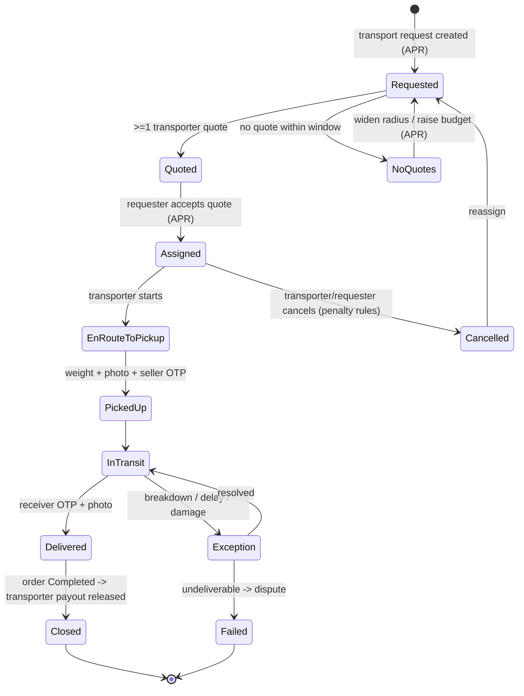

**Journey.**
1. After the order is Confirmed, the seller (or buyer, per the delivery terms) says "Transport arrange karo." AI-LGX drafts a transport request: pickup, drop, weight, commodity, date window and vehicle type (it suggests a 10-tonne truck for 100 qtl).
2. After approval, the request is broadcast to verified transporters whose service areas cover the pickup district and whose vehicles have enough capacity.
3. Quotes arrive. AI-LGX compares price, ETA, rating and vehicle, and the requester accepts one (APR).
4. The transporter updates status by one tap, voice ("maal utha liya") or WhatsApp button. Pickup requires the weighbridge weight and a photo, plus the seller's OTP.
5. On delivery the receiver's OTP is required, plus a photo. The order moves to Delivered.

**FRs.** LOG-001…009, AI-015.

**Business rules.**
- BR-LOG-01: Delivery terms are fixed at order time. Who pays for transport:

| Delivery term | Who pays transport |
|---|---|
| `BUYER_PICKUP` | Buyer arranges and pays off-platform; no platform transport |
| `SELLER_DELIVERS` | Seller bears the cost, included in the price |
| `PLATFORM_LOGISTICS` | Requester chosen in the terms; the buyer by default pays the quote through the order total or a follow-up payment |

- BR-LOG-02: The quote window is 4 hours by default (1 hour for perishables). Without quotes the request moves to NoQuotes and the AI suggests widening the radius.
- BR-LOG-03: Transporter eligibility requires an active vehicle (BR-ONB-12), capacity ≥ the shipment weight (or a multi-vehicle split, P2), a service-area match and payout tier T2.
- BR-LOG-04: Transport cost estimates are shown only when derived from at least 3 historical completed shipments on a similar lane (± 30 km, same vehicle class) or from live quotes, as a range with that basis stated. Otherwise the estimate says "estimate unavailable" (AI-015).
- BR-LOG-05: A transporter who cancels after Assigned gets −1 reliability. Two cancellations in 30 days suspend new assignments for 7 days. A requester who cancels after EnRouteToPickup owes a cancellation fee (configurable, disclosed in the quote) `[DECISION D-70]`.
- BR-LOG-06: For membership priority delivery, member orders are broadcast to transporters first, 30 minutes before non-member requests, and are flagged "priority" (MEM-002).
- BR-LOG-07: Live location is P2, needs the transporter's consent and is shared only while a shipment is active.
- BR-LOG-08: Transporter payout uses a held split released at Closed (BR-PAY-05).

**Errors.** `NO_ELIGIBLE_TRANSPORTERS`, `VEHICLE_CAPACITY_INSUFFICIENT`, `PICKUP_OTP_INVALID`, `DELIVERY_OTP_INVALID`, `SHIPMENT_INVALID_TRANSITION`.

**Dependencies.** opsapi delivery partners, areas, requests, assignments and pricing (reused, with Kisaan extensions for vehicle class, quotes and weights `[OPSAPI: extend]`), NOTF, AI-LGX and PAY.

**Acceptance.** E2E-01 transport step: the request is quoted by 2 transporters, one is accepted, and pickup with weight 9,960 kg triggers weight reconciliation (−0.4 %, within tolerance). Delivery OTP moves the order to Delivered.

**Scope.** MVP (live location P2; 3PL integration Future).

---

## 18. F18 — Reviews & ratings

**Purpose.** Reputation that reflects real, completed transactions.

**FRs.** REV-001…005.

**Business rules.**
- BR-REV-01: A review is allowed only for Completed orders (or Refunded orders, as a dispute-outcome review), once per reviewer per counterparty per order, within 14 days.
- BR-REV-02: Rating dimensions:

| Who is rated | Dimensions |
|---|---|
| Seller | Overall, quality as described, communication, timeliness |
| Buyer | Overall, payment and pickup reliability |
| Transporter | Overall, punctuality, care |
| Group leader | Overall, coordination |

- BR-REV-03: Text and voice reviews are moderated automatically for abuse and personal data. Flagged reviews are held for review. A seller may reply once.
- BR-REV-04: Aggregates are shown as a mean to one decimal place plus the count. "New" is shown below 3 ratings.
- BR-REV-05: Reviews cannot be edited after 48 hours. Admins may remove a review only for a policy violation, with an audit record.

**Errors.** `REVIEW_NOT_ELIGIBLE`, `REVIEW_WINDOW_CLOSED`, `REVIEW_DUPLICATE`.

**Dependencies.** opsapi reviews tables (reused for storage and public reads; **Kisaan adds create and moderate APIs** `[OPSAPI: extend]`).

**Scope.** MVP.

---

## 19. F19 — Notifications

**Purpose.** Timely, non-spammy, multilingual updates on the right channel.

**FRs.** NOTF-001…005, AI-017.

**Business rules.**
- BR-NOTF-01: Every notification is created from a **typed event** (e.g. `offer.received`, `order.confirmed`, `shipment.delivered`, `group.target_reached`, `membership.renewal_due`, `inventory.low_stock`, `price.alert`) and a **template** per channel and language. The AI may personalise only within template slots. WhatsApp outside the 24-hour window and SMS use pre-approved templates only.
- BR-NOTF-02: Channel priority by severity:

| Severity | Examples | Channels |
|---|---|---|
| Critical | Payment captured, order cancelled, OTP, dispute opened | In-app + SMS/WhatsApp, quiet hours ignored |
| Standard | Offer received, shipment update | In-app + push + WhatsApp (opted in) |
| Low | Price alerts, saved-search matches, promotions | In-app + digest |

- BR-NOTF-03: Dedup key = (user, event type, entity id, state). A duplicate within 24 hours is suppressed. Per user, at most 10 Low notifications per day, with the rest batched into a digest.
- BR-NOTF-04: Quiet hours default to 21:00–07:00 IST for Standard and Low notifications, which are queued until 07:00.
- BR-NOTF-05: Marketing or promotional messages require a separate opt-in (consent). Transactional messages do not.
- BR-NOTF-06: Opt-out ("STOP") on WhatsApp disables WhatsApp non-critical notifications immediately. Critical messages fall back to SMS.

**Dependencies.** opsapi notifications, FCM push and email (reused; note the ecommerce `notifications` table clash risk, see OPSAPI_INTEGRATION), the SMS provider (Kisaan adapter, DLT templates), the WhatsApp Business Platform (Kisaan adapter) and AI-NTF.

**Acceptance.** Replaying the same `order.confirmed` event 3 times produces exactly one notification per channel. Quiet-hour queueing is verified.

**Scope.** MVP (voice notifications NOTF-005: P2).

---

## 20. F20 — Customer support

**Purpose.** Fast self-service through AI, with a reliable human escalation path.

**Journey.** The user asks "Mera paisa kab aayega?". AI-SUP checks the user's orders and settlements (scoped tools) and answers with specifics and dates. If the user is unsatisfied or says "insaan se baat", a ticket is created with the conversation summary, and a callback is offered.

**FRs.** SUP-001…005, AI-018.

**Business rules.**
- BR-SUP-01: Ticket categories are account, KYC, listing, order, payment, delivery, membership, group, technical and complaint/grievance.
- BR-SUP-02: Priority is derived from the category and the money at stake. First response targets: P1 (payment or money at risk) 1 business hour; P2 4 business hours; P3 1 business day.
- BR-SUP-03: AI answers about policies must cite the help article version. Without retrieval support the AI says it doesn't know and escalates.
- BR-SUP-04: Grievances follow the statutory grievance-officer process: acknowledgement within 48 hours and resolution within 1 month, unless the law requires shorter timelines `[LEGAL REVIEW]`.
- BR-SUP-05: Support agents can view user data only for the ticket's linked entities (scoped access, audit-logged). Commit actions on behalf of a user require the user's OTP (APR-007).

**Errors.** `TICKET_NOT_FOUND`, `ESCALATION_UNAVAILABLE` (outside hours: callback scheduled).

**Dependencies.** opsapi enquiries/CRM or a Kisaan ticket module (decided in OPSAPI_INTEGRATION), RAG knowledge base and NOTF.

**Scope.** MVP.

---

## 21. F21 — Disputes & refunds

**Purpose.** Fair, evidence-based resolution that protects both sides and freezes money in the meantime.

**State machine — dispute.**

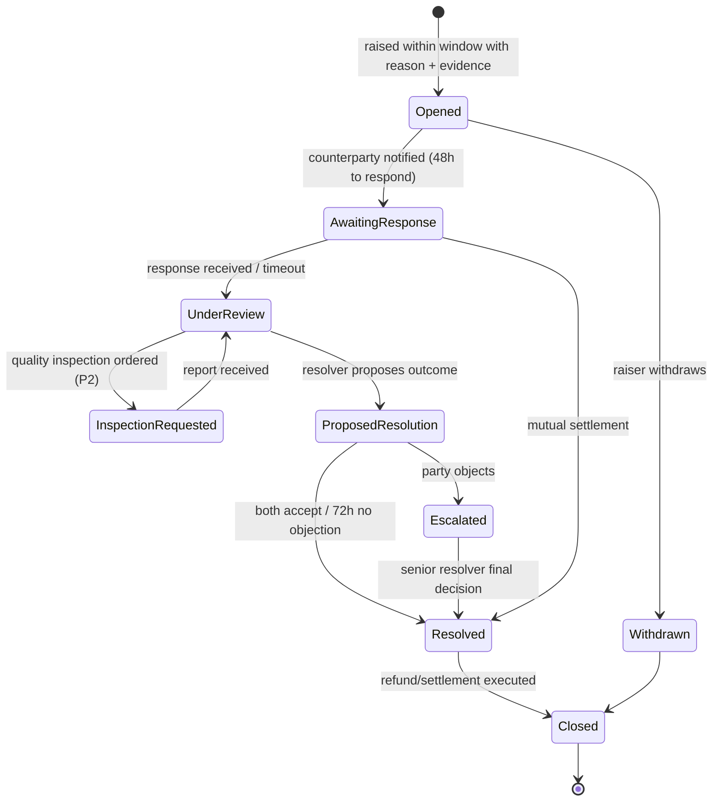

**FRs.** DSP-001…007, AI (AI-SUP summarisation).

**Business rules.**
- BR-DSP-01: Buyer reasons are `QUALITY_MISMATCH`, `QUANTITY_SHORT`, `NOT_DELIVERED`, `DAMAGED`, `WRONG_VARIETY` and `OTHER`. Seller reasons are `BUYER_REJECTED_WITHOUT_CAUSE`, `BUYER_NO_SHOW` and `OTHER`. Transporters may raise `PAYMENT_ISSUE` and `LOADING_DELAY`.
- BR-DSP-02: Evidence is required: at least 2 photos for quality or damage, a weighbridge slip or weighing photo for quantity. Lab reports are optional.
- BR-DSP-03: Opening a dispute freezes the order's held settlements (BR-PAY-05) and blocks auto-completion.
- BR-DSP-04: Outcomes are full refund (with return logistics paid by the party at fault), partial refund / price adjustment, re-delivery, or no refund. Outcomes execute refunds and transfers through PAY idempotently.
- BR-DSP-05: The AI prepares a neutral evidence summary and timeline for the resolver. **The AI never decides or recommends a winner in MVP.** Resolution is always by a human admin with a written reason.
- BR-DSP-06: SLA: initial response within 24 hours, target resolution within 7 days, escalation within 14 days.
- BR-DSP-07: Dispute outcomes feed reputation. A seller or buyer losing 3 disputes in 90 days triggers a trust review.
- BR-DSP-08: For group orders, member-level disputes concern the member's allocation. Group-level disputes (whole delivery) are raised by the leader on behalf of the group, with the members' consent recorded.

**Errors.** `DISPUTE_WINDOW_CLOSED`, `EVIDENCE_REQUIRED`, `DISPUTE_ALREADY_OPEN`.

**Scope.** MVP (inspection DSP-007: P2).

---

## 22. F22 — Admin dashboard

**Purpose.** Operational control with least privilege and full auditability.

**Modules.** Users · Verification queues (KYC, business, leader, transporter) · Listing moderation · Orders · Payments and settlements · Disputes · Support tickets · Fraud and risk · Categories and attributes · Synonyms · Commission and fees · Membership plans and T&C versions · Feature flags and configuration · AI monitoring · Mandi data health · Audit logs · Reports.

**FRs.** ADM-001…013.

**Business rules.**
- BR-ADM-01: The admin RBAC sub-roles (verifier, moderator, support_agent, finance, admin, super_admin) map to opsapi RBAC `module.action` permissions. Kisaan permissions are declared in the plugin manifest.
- BR-ADM-02: These actions need **dual control** (maker-checker): manual settlement release or hold above ₹50,000, refunds above ₹50,000, commission changes, user role elevation to admin, and T&C version publishing.
- BR-ADM-03: Impersonation is read-only, time-boxed to 30 minutes, needs a reason and is visible to the user in their activity log.
- BR-ADM-04: Every admin action writes an immutable audit record (actor, action, before/after, reason, IP).
- BR-ADM-05: AI monitoring shows, per agent: invocations, tool-call success rate, approval acceptance rate, edits-before-approval, escalation rate, latency, token cost, model and prompt version, and flagged conversations (prompt-injection attempts, user complaints).
- BR-ADM-06: Configuration changes (TTLs, thresholds, rates) are effective-dated and versioned.

**Dependencies.** The opsapi dashboard framework or a Kisaan Next.js admin route group (see SYSTEM_ARCHITECTURE), opsapi RBAC and the audit log.

**Scope.** MVP (platform coupons ADM-009: Future).

---

## 23. F23 — Analytics & reporting

**Purpose.** Measure marketplace health, AI value and unit economics.

**FRs.** ANL-001…005.

**Business rules.**
- BR-ANL-01: Event taxonomy follows `object.action` (e.g. `listing.published`, `offer.accepted`, `ai.approval.approved`). The common properties are user role, channel (pwa/whatsapp/voice), language, district and AI-assisted (boolean).
- BR-ANL-02: Product analytics events are captured only under the analytics consent purpose. Operational metrics (orders, payments) are kept regardless, because they are needed for service.
- BR-ANL-03: Funnel definitions:

| Funnel | Steps |
|---|---|
| Seller activation | Registered → T1 → first listing → first order |
| Buyer conversion | Search → product view → offer/checkout → paid → completed |
| AI | Intent → draft → approved |

- BR-ANL-04: Seller insights compare the seller's realised price with the mandi modal price for the same commodity, district and date range, labelled with the data source.
- BR-ANL-05: Forecasting (Future) is enabled only after at least 2 seasons of validated data, and is always labelled indicative.

**Scope.** MVP basic; P2 insights; Future forecasting.

---

## 24. F24 — Wholesale / bulk pricing offers (§2A.1) — MVP

**Purpose.** Let sellers move volume faster by rewarding larger purchases, and let buyers and groups see and get bulk prices automatically.

**Roles.** Seller (configures), Buyer and Group (consume), PRC engine, AI-LST (suggests tiers, P2).

**Journey (seller).**
1. On the listing, the seller turns on "Bulk deal / ਥੋਕ ਛੋਟ".
2. They add tiers with "+ Tier": min quantity (unit), discount type (% or ₹ per unit) and value. A live preview shows the effective price per tier.
3. Optionally they turn on "Buy the whole lot" and set a whole-lot price (₹/unit) or a whole-lot discount.
4. Save. By voice: "50 quintal ton upar 5 percent, 100 ton upar 8 percent chhoot" produces a draft tier set and readback.

**Journey (buyer).** The search card shows a "Bulk deal: up to 8% off" badge. The product page shows the tier table with the buyer's current tier highlighted and a nudge ("Add 20 qtl more to save ₹X"). The quantity selector updates the effective price. "Buy whole lot" is a one-tap button showing the whole-lot quantity and price.

**FRs.** WHL-001…012, PRC-001…007.

**Business rules.**
- BR-WHL-01: There are at most 5 tiers per listing. Tier `min_qty` values must be strictly increasing, and the first tier's `min_qty` must be greater than MOQ.
- BR-WHL-02: Discount types are `PERCENT` (0 < v ≤ 50) and `FIXED_PER_UNIT` (₹ per display unit, 0 < v < list price).
- BR-WHL-03: The effective discount (as ₹/kg) must be **non-decreasing** across tiers. A higher tier can never be worse than a lower tier.
- BR-WHL-04: Tier eligibility uses the **ordered quantity** for a single order, or the **aggregated group quantity** for group orders (BR-GRP-10).
- BR-WHL-05: The best single benefit applies (no compounding). Effective price = min(list price after the highest qualifying tier, whole-lot price if whole-lot is eligible).
- BR-WHL-06: **Whole-lot eligibility**: the ordered quantity equals `available_kg` at the moment of reservation, with a tolerance of +0 / −0.5 % to allow for rounding of display units. Reserving the whole lot makes available = 0, and the listing moves to SoldOut.
- BR-WHL-07: If available changes between quote and reservation (another buyer reserved), whole-lot eligibility is re-evaluated. The buyer gets `PRICE_CHANGED_REAPPROVE` with the new whole-lot quantity, or a tier price.
- BR-WHL-08: Tier and whole-lot changes apply to new quotes only. Existing reservations, accepted offers and orders keep their snapshot (BR-ORD-02).
- BR-WHL-09: Wholesale discounts are **seller-funded**. Commission is computed on the post-wholesale goods value.
- BR-WHL-10: Seller price floor (optional, PRC-003): no combination of tier, member price and coupon may take the unit price below the floor. Tiers themselves may not be configured below the floor.
- BR-WHL-11: Interaction with negotiation: an accepted negotiated price **replaces** list and wholesale pricing (PRC stage 3). During negotiation the AI shows both parties the current tier price for the quantity as a reference (BR-OFR-05).
- BR-WHL-12: Interaction with membership: if the seller offers a member-only price, the buyer gets the **lower** of (tier price, member price), never both (PRC stage 4).
- BR-WHL-13: Interaction with coupons: a seller coupon applies **after** wholesale (stage 5) unless the coupon has `exclude_wholesale = true`, in which case it applies only when no tier qualifies.

**Validation.** Tier quantities are in the listing's display unit and converted to kg. Errors are reported per field.

**Errors.** `TIER_ORDER_INVALID`, `TIER_DISCOUNT_NOT_MONOTONIC`, `TIER_BELOW_FLOOR`, `TIER_MIN_BELOW_MOQ`, `TIER_LIMIT_EXCEEDED`, `WHOLE_LOT_NOT_ELIGIBLE`, `PRICE_CHANGED_REAPPROVE`.

**Dependencies.** The Kisaan pricing module (new), the Kisaan wholesale tier tables (new `[OPSAPI: new]`), INV, SRCH and GRP.

**Acceptance.**
- With tiers 50+ → 5 % and 100+ → 8 %, list ₹2,500: 49 qtl costs ₹2,500, 50 qtl ₹2,375, and 120 qtl ₹2,300 per qtl.
- A whole-lot price of ₹2,250 with available 200 qtl: buying 200 qtl costs ₹2,250, while 199 qtl costs ₹2,300 (tier).
- A non-monotonic tier set is rejected.
- Search cards show the badge.

**Scope.** MVP (AI tier suggestions WHL-011: P2).

---

## 25. F25 — Group buying with area leaders (§2A.2) — ⚠ Partial MVP

> ⚠ **Partial MVP. Reason:** a leader collecting money from members on the platform's behalf creates payment-aggregation, escrow and fraud exposure. **MVP mode is "member-direct payment"**: each member pays the platform's PA for their own allocation, and the leader never handles money. "Leader-collects-money" mode (GRP-013) is **Future**, pending `[LEGAL REVIEW]` of RBI Payment Aggregator rules, KYC obligations and consumer-protection liability.

**Purpose.** Let an area leader aggregate demand so that small buyers unlock wholesale pricing, with transparent public groups.

**Roles.** Group Leader (`group_leader`), Members (buyers), Seller, Admin, AI-TRS, AI-MAT.

### 25.1 Leader signup (separate flow)

1. Entry is "Become an Area Leader / ਇਲਾਕਾ ਲੀਡਰ ਬਣੋ", which is separate from buyer signup and reached from the buyer profile or a landing page.
2. Steps: leader profile (area name, area type such as village, colony, mandi or cooperative, geo-centre + radius 1–25 km, description) → identity KYC (min T1; T2 is also required for refunds and incentives later) → optional proof of association (cooperative/RWA letter, gram panchayat letter) → leader T&C acceptance (versioned, same mechanism as MEM T&C) → submit.
3. AI-TRS pre-screens the application, a verifier approves it (SLA 48 hours), and the leader badge is granted.

### 25.2 Group lifecycle

```mermaid
stateDiagram-v2
  [*] --> Draft: leader creates (APR)
  Draft --> Open: leader publishes (public)
  Open --> Open: member joins / leaves / changes qty
  Open --> TargetReached: committed >= target (stays open until deadline or leader closes early)
  TargetReached --> Open: members leave, committed < target
  Open --> DeadlineReached: join deadline passes
  TargetReached --> Closing: deadline passes OR leader closes early (APR)
  DeadlineReached --> Closing: leader chooses proceed at achieved tier (APR) and committed >= min_close_qty
  DeadlineReached --> Cancelled: committed < min_close_qty OR leader cancels (APR) -> full refunds
  Closing --> OrderPlaced: inventory reserved for total + group order created; final price computed
  Closing --> Cancelled: reservation fails (seller stock gone) -> full refunds
  OrderPlaced --> InDelivery: shipment to delivery point
  InDelivery --> Delivered: leader confirms receipt at delivery point (OTP)
  Delivered --> Distributed: all members confirmed OR 48h acceptance window
  Distributed --> Completed: settlements released, refunds of price difference done
  Delivered --> PartiallyDisputed: member/leader disputes
  PartiallyDisputed --> Completed: disputes resolved
  Open --> Suspended: admin/Trust action
  Suspended --> Cancelled: admin cancels -> full refunds
  Completed --> [*]
  Cancelled --> [*]
```

### 25.3 Journey (member)

1. The member finds a group through the public group page (shared link), the store, the product page "Groups buying this" section, search, or the AI ("Sarabha Nagar vich aloo da group?").
2. They see the leader's badge and rating, target and progress bar ("28/40 qtl"), deadline, current price tier, guaranteed price, and the delivery point and date.
3. They tap Join, enter a quantity (within min/max per member), and pay the **guaranteed price** for their quantity plus their estimated delivery share, via the PA. This is a commit action with approval.
4. They get updates on progress, tier unlocked, group closing and delivery.
5. At delivery the member collects from the delivery point and confirms with an OTP. Any price difference is refunded.

**FRs.** GRP-001…016, WHL-008.

### 25.4 Business rules

- BR-GRP-01: Only an approved `group_leader` can create groups. A new leader (fewer than 3 completed groups) may run at most 2 open groups at once, with a max group value of ₹2,00,000. Established leaders may run up to 10 open groups and up to ₹20,00,000 `[DECISION D-71]`.
- BR-GRP-02: Group type in MVP is **listing-bound**: the group targets one specific Active listing. **RFQ-bound groups**, where the leader runs an RFQ for the aggregated demand, are P2.
- BR-GRP-03: Group parameters:
  - target_qty ≥ the listing's first wholesale tier min_qty, or ≥ MOQ when there are no tiers
  - min_close_qty ≤ target_qty (the leader's minimum to proceed)
  - per-member min/max
  - join deadline: 1 hour to 7 days from publish, and before the listing's available_until
  - delivery point (address + geo) and delivery mode (PLATFORM_LOGISTICS or SELLER_DELIVERS in MVP)
- BR-GRP-04 (public visibility): The public group page shows the leader's display name, badge, rating, area, product, target, committed quantity, member count, deadline and pricing. **Members' identities are not public.** Only counts are shown publicly. The leader sees member display names and quantities, but never phone numbers by default.
- BR-GRP-05 (guaranteed price): The **guaranteed price** is the PRC price at the tier that min_close_qty qualifies for (or the list price if none). Members pay the guaranteed price at join. **The final price can only be equal or lower, never higher.**
- BR-GRP-06 (member payment): MVP uses capture-at-join with automatic refund when a member leaves before the deadline, the group is cancelled, or there is a price difference at close. Pre-authorisation or UPI block mandates are evaluated as an improvement `[DECISION D-72]` `[UNVERIFIED PA capability]`.
- BR-GRP-07 (stock): The seller's inventory is **not** reserved while the group is Open. The group page shows "seller availability: X qtl" from live data. The seller can opt in to a **soft hold** (P2). At Closing, the system reserves the group total atomically (BR-INV-01). If it fails, the group is Cancelled with full refunds, unless the leader approves proceeding with the available quantity. In that case allocation is reduced pro-rata, rounded to 1 kg, and the excess is refunded.
- BR-GRP-08: Closing must complete within 2 hours of the deadline. The leader's approval to proceed is required if committed < target. If committed ≥ target, the group proceeds automatically at the deadline because members already agreed, and the leader is notified.
- BR-GRP-09: A **group order** is created as one order to the seller (single delivery, single pickup), with **allocations** per member that link to each member's payment. Seller-facing documents show the total quantity. Each member gets an individual receipt or invoice for their allocation `[TAX REVIEW]`.
- BR-GRP-10: Wholesale eligibility (WHL) is evaluated on the **total group quantity**. The final unit price is the same for every member.
- BR-GRP-11 (delivery cost split): The transport quote is split pro-rata by allocation weight. Members with active membership get their share waived within their free-delivery cap. The waived amount is platform-funded (PRC stage 6).
- BR-GRP-12 (coupons in groups): Only the **leader** may apply one seller coupon to the group, and only coupons with eligibility `GROUP_ORDERS` or `ALL`. The coupon discount is distributed pro-rata. Members cannot apply individual coupons to group allocations.
- BR-GRP-13 (leaving): Members may leave or reduce their quantity until the join deadline, with a full or partial refund. After the deadline they cannot leave. Disputes stay available.
- BR-GRP-14 (receipt and distribution): The leader confirms the bulk receipt at the delivery point (seller or transporter OTP handover). Each member confirms collection of their allocation with their own OTP. The leader may confirm on a member's behalf only with that member's OTP. The member acceptance window is 48 hours (12 hours for perishables) after the leader's receipt.
- BR-GRP-15: Seller settlement for the group order is released when all allocations are Completed or the window has passed, minus any amounts frozen for member disputes. Frozen amounts are pro-rata to the disputed allocations.
- BR-GRP-16 (anti-abuse):
  - Leaders cannot join their own groups as multiple members.
  - Members must be phone-verified, and at most one membership per verified phone/PAN per group.
  - AI-TRS flags groups where more than 50 % of members are less than 7 days old, groups whose members share device fingerprints, leaders with high cancellation rates, and a leader requesting money off-platform (contact-sharing detection).
  - Members can "Report leader".
  - Admins can suspend a group, which refunds everyone.
- BR-GRP-17 (leader liability, MVP): The leader never holds money, so their liability is limited to coordination. The leader T&C defines obligations (accurate information, presence at the delivery point, fair distribution) and prohibits collecting payments off-platform `[LEGAL REVIEW]`.
- BR-GRP-18 (Future, GRP-013): Leader-collects-money mode would require at minimum leader T3 business KYC, PA sub-merchant onboarding for the leader or an escrow-backed collection link, member-level receipts and statutory analysis. It is **not built in MVP**.

### 25.5 Worked example

| Item | Value |
|---|---|
| Listing | Potato (Pukhraj), list ₹1,500/qtl; tiers 25+ qtl → 5 % (₹1,425), 40+ qtl → 8 % (₹1,380); MOQ 2 qtl |
| Group | target 40 qtl, min_close_qty 25 qtl, per-member 2–10 qtl |
| Guaranteed price | ₹1,425/qtl (the 25+ tier) |
| Members | 8 members commit 42 qtl total, e.g. member M3 commits 5 qtl and pays 5 × 1,425 = ₹7,125 plus delivery share |
| At close | Total 42 qtl ≥ 40 → final ₹1,380/qtl → M3's goods = ₹6,900 → **refund ₹225** |
| Transport | Quote ₹4,200 for 42 qtl → ₹100/qtl → M3's share ₹500. M3 is a member with cap ₹500/order, so the share is waived. A non-member pays ₹500 |

**Validation.** All quantities are > 0 and within member min/max. The sum of commitments may exceed target, up to max_qty = min(120 % of target_qty `[DECISION D-61]`, seller available at publish, leader cap). The deadline must lie within the bounds above.

**Errors.** `LEADER_NOT_APPROVED`, `LEADER_GROUP_LIMIT`, `GROUP_FULL`, `GROUP_CLOSED`, `MEMBER_QTY_OUT_OF_RANGE`, `ALREADY_MEMBER`, `GROUP_LEAVE_NOT_ALLOWED`, `GROUP_STOCK_UNAVAILABLE`, `GROUP_SUSPENDED`.

**Dependencies.** opsapi groups (evaluated for reuse as the membership container `[UNVERIFIED fit]`; Kisaan group tables are the source of truth `[OPSAPI: new]`), PRC, INV, ORD, PAY (multi-payment to one order), LOG, NOTF and AI-TRS.

**Acceptance.**
- A worked-example test produces exact refunds.
- A failed reservation at close triggers full refunds within 1 hour of cancellation.
- Logged-out users can view the public group page, and no member PII is exposed.
- The leader UI has no capability to receive money.

**Scope.** MVP (member-direct). P2: RFQ-bound groups, soft hold. Future: leader-collects-money, leader incentives (GRP-013/014).

---

## 26. F26 — Membership programme & T&C (§2A.3) — MVP

**Purpose.** A paid "KISAAN Plus" membership for buyers that improves retention through delivery and deal benefits, with legally robust consent, renewal and cancellation.

**Roles.** Buyer (incl. group members and leaders), Admin, Finance, PRC, LOG.

### 26.1 Plans & benefits (MVP)

| Plan | Price (placeholder) | Trial |
|---|---|---|
| Plus Monthly | ₹199 / month incl. GST `[DECISION D-11]` | 30 days, once per user and per PAN/GSTIN |
| Plus Yearly | ₹1,999 / year incl. GST `[DECISION D-11]` | Same trial (if not used) |

| Benefit | Rule | Funding | Scope |
|---|---|---|---|
| Free delivery | Waiver of the platform-logistics delivery fee up to ₹500 per order and ₹2,000 per calendar month; the excess is payable | Platform | MVP |
| Priority delivery | Priority broadcast to transporters (BR-LOG-06) plus a member flag; no guaranteed delivery time | Platform | P2 (Phase 7, D-96) |
| Member-only deals | Seller-configured member price per listing (opt-in) | Seller | MVP |
| Early access | New listings ≥ 100 qtl and new groups are visible to members 2 hours before the public | — | MVP |
| Priority support | Member tickets one priority level higher | Platform | MVP |
| Quality inspection credits | — | Platform | P2 |
| Extended acceptance window | — | — | P2 |

### 26.2 Lifecycle

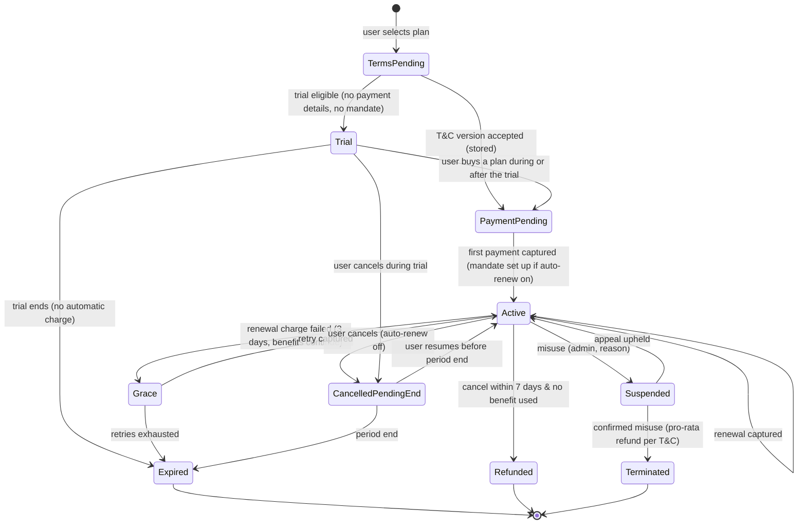

**FRs.** MEM-001…014, PAY-010.

### 26.3 Business rules

- BR-MEM-01: The plan, its benefits and the T&C version are linked. A membership record stores `plan_id`, `terms_version_id`, `status`, `current_period_start/end`, `auto_renew`, `mandate_id`, and `trial_used`. Plans and memberships live in Kisaan tables, not opsapi billing (`[DECISION D-24]`; opsapi billing is Stripe/GBP-based), and **charging uses the Kisaan INR PA adapter**.
- BR-MEM-01a (trial): The free trial needs **no payment details and no mandate**. It ends automatically, with a reminder 3 days before, and is never converted into a paid plan without the user separately buying one (dark-pattern guidelines; MEMBERSHIP T&C §4).
- BR-MEM-02 (**T&C acceptance mandatory**):
  - Activation is impossible without a `terms_acceptance` row: user_id, terms_version_id, accepted_at (UTC), language shown, channel (pwa/whatsapp/voice/assisted), IP, user agent or device id, and a hash of the rendered text.
  - The checkbox is unticked by default.
  - The summary of key terms (price, renewal, cancellation, refund) is shown **above** the accept button, with audio playback.
  - On the voice channel the AI reads a key-terms summary and needs an explicit "haan, main sharten maanta/maanti hoon" plus OTP confirmation.
- BR-MEM-03 (T&C changes): A new version is published with dual control and marked `material: true|false`.
  - Material changes need re-acceptance before the next renewal. Without it, auto-renewal is skipped and the member is notified 30, 7 and 1 days before.
  - Non-material changes are notified, and re-acceptance is not required.
- BR-MEM-04 (auto-renew):
  - Opt-in at purchase of a paid plan (never at trial start), never pre-selected.
  - Uses a UPI AutoPay or card e-mandate.
  - A pre-debit notification is sent at least 24 hours before each debit, per RBI rules `[LEGAL REVIEW]`.
  - A renewal reminder is sent 7 days before.
  - The price shown at renewal equals the price at purchase unless notified 30 days in advance.
- BR-MEM-05 (cancellation): Cancelling takes one screen and two taps, or one voice command plus confirmation, with no retention maze (dark-pattern guidelines) `[LEGAL REVIEW]`. Cancellation turns off auto-renew and revokes the mandate. Benefits continue until the end of the period.
- BR-MEM-06 (refunds) `[DECISION D-12]` `[LEGAL REVIEW]`:
  - (a) Cancelled within 7 days of first paid activation and no benefit used: full refund.
  - (b) Monthly plan otherwise: no refund, benefits until the period end.
  - (c) Yearly plan after 7 days: pro-rata refund of unused full months minus the value of benefits used (free delivery waived amounts), floor ₹0.
  - (d) Platform termination without misuse: pro-rata refund.
- BR-MEM-07 (eligibility): Benefits apply only if the membership is Trial, Active, Grace or CancelledPendingEnd **at order placement** (snapshot). Free delivery applies only to PLATFORM_LOGISTICS deliveries within the service area. Caps are counted per calendar month in IST.
- BR-MEM-08: A membership is personal to one user and is not transferable. Business accounts get one membership per user (team plans are Future).
- BR-MEM-09 (misuse): Account sharing (logins from more than 3 devices in different districts within 24 hours), ordering on behalf of non-members in a pattern, or abusing free delivery (e.g. many tiny orders to exploit waivers) can lead to suspension after review.
- BR-MEM-10 (benefit changes): Benefits are effective-dated, and members are notified 30 days in advance of reductions. Improvements may apply immediately.
- BR-MEM-11 (unit economics): Every waived delivery amount is recorded as a platform-funded discount (MEM-014) for finance reporting.

**Validation.** One active membership per user. Trial once per user and per PAN/GSTIN. Plan must be active.

**Errors.** `TERMS_NOT_ACCEPTED`, `TERMS_VERSION_OUTDATED`, `TRIAL_NOT_ELIGIBLE`, `MEMBERSHIP_ALREADY_ACTIVE`, `MANDATE_SETUP_FAILED`, `MEMBERSHIP_SUSPENDED`.

**Dependencies.** The Kisaan membership module and T&C/terms modules (new; the opsapi `shop` T&C is **not** used), the PA adapter (mandates), PRC, LOG, NOTF, and the draft T&C in [MEMBERSHIP_TERMS_AND_CONDITIONS](MEMBERSHIP_TERMS_AND_CONDITIONS.md).

**Acceptance.**
- Activation without a terms acceptance fails (`TERMS_NOT_ACCEPTED`).
- Cancel is reachable in ≤ 2 taps.
- A material T&C change without re-acceptance blocks renewal.
- Free delivery caps are enforced at ₹500 per order and ₹2,000 per month.
- Pre-debit notification is sent at least 24 hours before renewal.

**Scope.** MVP (benefits marked P2 later).

---

## 27. F27 — Public seller stores (§2A.4) — MVP

**Purpose.** Each seller has a shareable, discoverable storefront, which builds trust and drives traffic from WhatsApp and offline QR codes.

**Journey.** The first publish auto-creates the store (slug from the seller name + village, de-duplicated). The seller is prompted: "Aapki dukaan tayaar hai — share karo" (WhatsApp share sheet + QR download). Customisation is under Store settings: name, banner, logo, description in each language, policies.

**FRs.** STR-001…008.

**Business rules.**
- BR-STR-01: Store = the opsapi ecommerce store plus its public store page (reused). Kisaan extension fields are slug history, policies, service-area districts and the QR asset `[OPSAPI: reuse/extend]`.
- BR-STR-02: Slugs are 3–50 characters, `[a-z0-9-]`, unique, from a reserved-words blocklist and a profanity filter. A slug may change once per 30 days, and old slugs 301-redirect for 12 months.
- BR-STR-03: Public content: store name, banner, description, badges, rating and count, member since, district or service area (never the exact farm location unless the seller opts in), Active listings, a SoldOut section (optional), active public coupons, wholesale badges, open groups on the store's listings, and policies.
- BR-STR-04: Contact visibility follows PROF-004. Logged-out users see "Login to contact".
- BR-STR-05: Store pages are server-rendered, cacheable at the edge (TTL 60 seconds, invalidated on listing change) and ≤ 150 KB for the first render. Open Graph tags support WhatsApp previews.
- BR-STR-06: A suspended seller's store returns "Store unavailable" (HTTP 410 for crawlers after 30 days).
- BR-STR-07: Store content (banner, description) is moderated: auto image safety checks plus a profanity filter, and a manual queue on flags.
- BR-STR-08: Store analytics count views, unique visitors, shares, enquiries and offers originating from the store.

**Errors.** `SLUG_TAKEN`, `SLUG_CHANGE_TOO_SOON`, `SLUG_INVALID`, `STORE_UNAVAILABLE`.

**Acceptance.** A logged-out visitor opens `/store/<slug>` and sees all Active listings, without the phone number. A slug change redirects the old URL. The WhatsApp preview shows name, banner and rating.

**Scope.** MVP (follow store STR-006: P2).

---

## 28. F28 — Automated inventory (§2A.5) — MVP

The full specification is in **§10**. Confirmed behaviours and where they are specified:

| §2A.5 requirement | Rule |
|---|---|
| Reserve on order or offer acceptance | BR-INV-01, BR-INV-02 |
| Deduct on confirmation | BR-INV-03 |
| Release on cancellation or expiry | BR-INV-04, BR-INV-05 |
| No manual adjustment for normal flows | Every flow above is automatic |
| Manual adjustment with reasons, audit logged | BR-INV-06, BR-INV-09 |
| Low-stock alerts | BR-INV-07 |
| Out-of-stock auto-hide | BR-INV-08 |
| Overselling prevention under concurrency | BR-INV-01 (atomic conditional update) |
| Group orders | BR-GRP-07 |

---

## 29. F29 — Seller-controlled discount coupons (§2A.6) — MVP

**Purpose.** Give sellers a self-service, limited-time promotional tool with strong abuse controls.

**Roles.** Seller (creates and manages), Buyer and Leader (apply), PRC, AI-TRS.

**Journey (seller).** Store → Coupons → Create:
1. Code, or auto-generate.
2. Type (% / ₹ flat per order), value, and max discount (required for %).
3. Minimum order value and/or minimum quantity.
4. Applies to: all store listings / selected listings / selected categories.
5. Start and end date/time (IST).
6. Total uses and per-user uses.
7. Eligible users: All / Members only / Group leaders only (group orders) / First-time buyers of this store.
8. Flags: allow on negotiated offers (default off); exclude when a wholesale tier applies (default off); public (shown on store and product page) or private (code only).
9. Preview the impact: "₹2,000 max per order, 50 uses → max liability ₹1,00,000".
10. Activate (APR if AI-drafted).

By voice: "Kinnow te 10 percent di coupon, 20 tareekh tak, ik banda ik vaar" produces a draft and readback.

**Journey (buyer).** Public coupons appear as a chip on the product page and store. The buyer applies one at checkout and sees the discount in the breakdown. Invalid coupons show a precise reason in the user's language.

### 29.1 Coupon validation flow

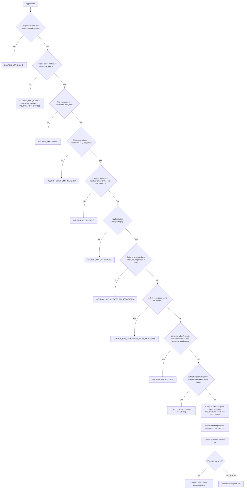

**FRs.** CPN-001…012, PRC-002…005.

### 29.2 Business rules

- BR-CPN-01: Codes are 4–20 characters, `A-Z0-9`, stored upper-case, and unique **per seller**. Different sellers may use the same code text; the checkout context (the seller) disambiguates.
- BR-CPN-02: Discount computation (base = goods value after PRC stages 1–4):
  - `percentage`: min(base × v %, max_discount), with v in (0, 50] % — hard cap, no admin override in MVP `[DECISION D-40]`.
  - `fixed` (₹ per order): min(v, base).
- BR-CPN-03: At most **one seller coupon per order**. Platform coupons are Future (CPN-012).
- BR-CPN-04 (time window): Coupons are active only when `start_at ≤ now < end_at` (IST shown, UTC stored). Validation runs at apply time **and** at payment capture. If the coupon expired in between, the order is re-quoted and the buyer must re-approve (`PRICE_CHANGED_REAPPROVE`). A payment captured within 15 minutes of a quote honours that quote's coupon (quote validity, PRC-006).
- BR-CPN-05 (atomic limits): Redemption slots are reserved by a conditional update on counters: `redeemed + reserved < total_limit` and the per-user equivalent, keyed on the verified user **and** their PAN/GSTIN where available. Slots are committed on capture and released on expiry or cancel. A refund of the order after completion **does not** restore the usage count, unless an admin overrides it.
- BR-CPN-06 (funding): Coupon discounts are 100 % **seller-funded**. Commission is computed on the post-coupon goods value `[DECISION D-13]`. The seller statement shows the coupon cost per order.
- BR-CPN-07 (stacking): A coupon applies after wholesale and member pricing (stage 5), and not on negotiated orders unless `allow_on_negotiated`. A coupon never reduces the delivery fee in MVP. It may not breach the price floor: the discount is capped at the floor and labelled "Coupon partly applied (seller minimum price)".
- BR-CPN-08 (eligibility semantics):

| Eligibility | Rule |
|---|---|
| `MEMBERS_ONLY` | Active membership at order time |
| `GROUP_LEADERS` | Only applicable by a leader to a group order (BR-GRP-12) |
| `FIRST_TIME_BUYER` | Buyer has no Completed or Confirmed order with this seller (checked by user and PAN) |
| `ALL` | Any buyer |

- BR-CPN-09 (abuse): Self-redemption is blocked. AI-TRS flags many accounts redeeming from one device or one UPI handle, and redemption bursts above 10× baseline. Coupons with flagged redemptions can be auto-paused by **deterministic** Trust rules (velocity/abuse thresholds such as the 10× burst), and the seller is notified. AI-TRS never pauses a coupon itself; it only flags for these rules and for human review (AI risk scores are not proof).
- BR-CPN-10 (honest urgency): Countdown and "limited" claims must reflect the real end_at and remaining usage. No fake scarcity `[LEGAL REVIEW]` (dark-patterns guidelines).
- BR-CPN-11 (editing): An active coupon may have its end_at extended, limits increased, or status paused or resumed. Its code, type and value **cannot** be changed once it has been redeemed; the seller must create a new coupon. Pausing does not affect already-reserved slots.
- BR-CPN-12: Seller statuses are `DRAFT`, `ACTIVE`, `PAUSED`, `EXPIRED` (auto at end_at) and `EXHAUSTED` (auto at the limit). A seller may have at most 20 active coupons.

**Validation.**

| Field | Rule |
|---|---|
| end_at | > start_at, and ≤ start_at + 365 days |
| total_limit | 1–100,000 |
| per_user_limit | 1–100 and ≤ total_limit |
| max_discount | Required for `percentage` |
| min order value | ≥ 0 |
| Applicable listings | Must belong to the seller |

**Errors.** The codes in the flow above, plus `COUPON_CODE_TAKEN`, `COUPON_LIMIT_ACTIVE_REACHED`, `COUPON_IMMUTABLE_AFTER_REDEMPTION`.

**Dependencies.** The Kisaan coupon module (new; opsapi billing coupons are platform-level subscription coupons and are not reused `[OPSAPI: new]`), PRC, ORD, PAY and AI-TRS.

**Acceptance.**
- A concurrency test sends 100 parallel applies against total_limit = 10 at payment capture. Exactly 10 redemptions are committed.
- An expired coupon between quote and capture is honoured within 15 minutes and re-quoted after that.
- A self-redemption attempt is blocked.
- A members-only coupon is rejected for a non-member with `COUPON_NOT_ELIGIBLE`.

**Scope.** MVP (platform coupons CPN-012: Future).

---

## 30. X1 — Pricing engine & discount stacking (PRC) — MVP

**Purpose.** One deterministic engine produces every price the user sees, so the search, product page, AI, checkout, invoice and settlement always agree.

**Inputs.** listing (list price, tiers, whole-lot, member price, floor), quantity (kg), buyer (membership status, eligibility facts), context (direct / negotiated offer id / group id), coupon code (optional), delivery mode and quote (optional), and time.

**Output.** A **price breakdown** with a `quote_id` and `valid_until` (15 minutes): line items with amounts, funding source (seller / platform) and the rule applied, plus totals. These values are persisted as the order snapshot on order creation.

### 30.1 Stacking order (normative)

| Stage | Name | Rule | Funded by |
|---|---|---|---|
| 1 | Base | list unit price × qty | — |
| 2 | Wholesale | best single benefit: highest qualifying tier OR whole-lot price if eligible and better (BR-WHL-05/06). Group: tier on total group qty | Seller |
| 3 | Negotiated | if the context is an accepted offer/quotation: the unit price **replaces** stages 1–2 (and 4) entirely | Seller (implicitly) |
| 4 | Member price | if the buyer is a member and the seller set a member price: unit = **min**(stage-2 unit, member unit). Not applied on negotiated orders | Seller |
| 5 | Seller coupon | one coupon, rules BR-CPN-02/07; base = stage 2/3/4 goods value | Seller |
| — | Floor check | the effective unit price after stage 5 must be ≥ the seller floor; the coupon is reduced to fit | — |
| 6 | Delivery | delivery fee (transport quote share or seller-delivered = 0); member free-delivery waiver up to the caps (BR-MEM-07) | Platform (waiver) |
| 7 | Taxes / TCS | GST on goods only if the seller supply is taxable `[TAX REVIEW]`; platform fees invoiced separately (BR-INVC-02) | — |
| — | Commission | platform commission on the goods value after stage 5 (illustrative 1.5 %) — deducted from the seller payout, not added to the buyer total `[DECISION D-19]` | Seller |

Rounding (PRC-007): unit prices are kept at ₹0.0001/kg internally and computed per kg. Line totals are rounded half-up to ₹0.01. The display shows ₹ per display unit, rounded to ₹0.01.

### 30.2 Worked examples (INR)

**Example 1 — Tier + coupon + member delivery (direct purchase, wheat)**

Listing: list ₹2,500/qtl; tiers 50+ qtl → 5 %, 100+ qtl → 8 %; no member price. Buyer: member. Qty 120 qtl. Coupon `WHEAT2K`: flat ₹2,000 per order, min order value ₹1,00,000. Platform logistics quote ₹6,000.

| Stage | Computation | Amount |
|---|---|---|
| 1 Base | 120 × ₹2,500 | ₹3,00,000.00 |
| 2 Wholesale | 8 % tier → ₹2,300/qtl → 120 × 2,300 | ₹2,76,000.00 (saving ₹24,000) |
| 4 Member price | none | — |
| 5 Coupon | flat ₹2,000 (min ₹1,00,000 met) | −₹2,000.00 → goods ₹2,74,000.00 |
| Floor | effective ₹2,283.33/qtl ≥ floor (none set) | OK |
| 6 Delivery | ₹6,000 − member waiver ₹500 (per-order cap) | ₹5,500.00 |
| 7 Tax | exempt farm produce by unregistered farmer `[TAX REVIEW]` | ₹0.00 |
| **Buyer pays** | | **₹2,79,500.00** |
| Commission | 1.5 % × ₹2,74,000 | ₹4,110.00 (from seller) |
| Seller payout (held) | ₹2,74,000 − ₹4,110 | ₹2,69,890.00 |
| Transporter payout | ₹6,000 (₹500 platform-funded) | ₹6,000.00 |

**Example 2 — Whole lot vs tier**

Available 200 qtl; list ₹2,500; tier 100+ → 8 % (₹2,300); whole-lot price ₹2,250/qtl.
- Buyer selects 200 qtl: whole-lot eligible → min(₹2,300, ₹2,250) = **₹2,250** → ₹4,50,000.00.
- Buyer selects 199 qtl: not whole-lot → ₹2,300 → ₹4,57,700.00. The UI nudges: "Buy all 200 qtl for ₹4,50,000 (save ₹7,700 and get 1 qtl more)."

**Example 3 — Negotiated price replaces tiers; coupon blocked**

Listing as in Example 1. The accepted offer is 80 qtl at ₹2,380/qtl (the 50+ tier would give ₹2,375). The buyer tries coupon `WHEAT2K` (allow_on_negotiated = false).
- Stage 3 → 80 × ₹2,380 = ₹1,90,400.00. Stages 2 and 4 are ignored.
- Coupon → `COUPON_NOT_ALLOWED_ON_NEGOTIATED`.
- Buyer pays ₹1,90,400 (+ delivery, if any).
- Note: when this offer was submitted, BR-OFR-05 warned the buyer that buy-now at the tier price (₹2,375) was cheaper. The buyer proceeded knowingly.

**Example 4 — Member price vs tier (no compounding) + % coupon with cap + floor**

Potato listing: list ₹1,500/qtl; tier 20+ → 4 % (₹1,440); member price ₹1,450; seller floor ₹1,350/qtl. Member buyer, 30 qtl. Coupon `ALOO10`: 10 %, max ₹2,000, min qty 10 qtl.

| Stage | Computation | Amount |
|---|---|---|
| 2 Wholesale | ₹1,440 | — |
| 4 Member | min(₹1,440, ₹1,450) = ₹1,440 (member price not better) | 30 × 1,440 = ₹43,200.00 |
| 5 Coupon | 10 % = ₹4,320 → capped at ₹2,000 | goods ₹41,200.00 |
| Floor | ₹41,200 / 30 = ₹1,373.33 ≥ ₹1,350 | OK |

**Variant:** if the coupon were 15 % with max ₹10,000, then 15 % = ₹6,480 and goods = ₹36,720 → ₹1,224/qtl < floor. The coupon is reduced to (₹1,440 − ₹1,350) × 30 = ₹2,700, so goods = ₹40,500 (₹1,350/qtl), labelled "Coupon partly applied".

**Example 5 — Group order**

See §25.5. Stage 2 is evaluated on the group total of 42 qtl, giving ₹1,380/qtl for all members. Each member's refund = paid guaranteed price − final price. The delivery share has the member waiver applied per member (stage 6).

### 30.3 Business rules

- BR-PRC-01: The engine is pure and deterministic. Given the same inputs and the same rule versions it gives the same output. Rule versions are recorded in the breakdown.
- BR-PRC-02: The client may preview with the same algorithm (a shared TypeScript package), but the **server quote is authoritative**. Checkout accepts only a server `quote_id` that is still valid and owned by the buyer.
- BR-PRC-03: Re-quote happens at payment capture if the quote has expired. If the total changed, the buyer must re-approve (`PRICE_CHANGED_REAPPROVE`). A lower total is applied automatically, with a notice.
- BR-PRC-04: Prices are never negative. Each discount line is capped so the goods value is ≥ floor × qty and > ₹0.
- BR-PRC-05: The breakdown shown to the buyer omits the seller commission. The seller statement shows all seller-funded lines and the commission.
- BR-PRC-06: AI agents must call the PRC engine for every price they state about a listing, and must quote `quote_id`-backed numbers.

**Errors.** `QUOTE_EXPIRED`, `QUOTE_NOT_OWNED`, `PRICE_CHANGED_REAPPROVE`, `PRICING_RULE_CONFLICT` (configuration error, P1 alert).

**Acceptance.** All five examples are implemented as golden tests (TC-PRC-001…005) and produce exactly these amounts. Property tests check that totals are never negative and the floor is never breached.

**Scope.** MVP.

---

## 31. X2 — Approvals (human-in-the-loop)

**Purpose.** Guarantee that AI and delegated actors cannot commit users to anything without explicit consent.

**Flow.**

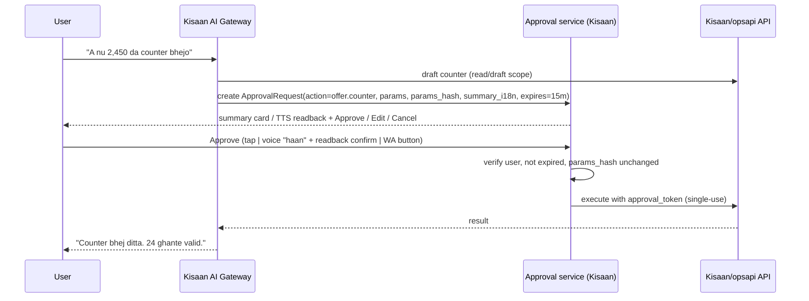

**Business rules.**
- BR-APR-01: Commit-class actions are listed in PRD APR-001. Kisaan APIs for commit actions **require** either an approval token (AI or delegated origin) or a direct user session with `channel = ui` (the user's own tap is the approval). The AI gateway's service identity can **never** call commit endpoints without an approval token.
- BR-APR-02: Approval tokens are single-use, bound to user_id, action, params_hash and expiry (15 minutes). Replay returns `APPROVAL_ALREADY_USED`.
- BR-APR-03: The voice approval needs a readback of the critical parameters (quantity with unit, price, total ₹, counterparty) and an affirmative reply. For payments, membership purchase and T&C acceptance, an additional OTP or PA authentication is needed.
- BR-APR-04: Rejected and expired approvals are logged. Three consecutive rejected AI drafts in one task trigger the AI to offer the conventional screen.
- BR-APR-05: Delegated actors (support or field agents) need the user's OTP for each commit (APR-007).

**Errors.** `APPROVAL_REQUIRED`, `APPROVAL_EXPIRED`, `APPROVAL_PARAMS_MISMATCH`, `APPROVAL_ALREADY_USED`, `APPROVAL_DENIED`.

**Scope.** MVP.

---

## 32. Cross-feature edge cases (selected)

| # | Scenario | Expected behaviour |
|---|---|---|
| EC-01 | Two buyers accept/checkout the last 50 qtl simultaneously | One reservation succeeds (BR-INV-01). The other gets `INSUFFICIENT_STOCK`, with the AI suggesting similar listings |
| EC-02 | The seller edits the price while a buyer is on checkout with a valid quote | The quote is honoured until valid_until. After that it is re-quoted |
| EC-03 | The coupon reaches its limit while a buyer is paying | The reserved slot is honoured. A new apply gets `COUPON_EXHAUSTED` |
| EC-04 | The group closes but the seller sold stock offline (adjusted down) | Reservation fails → leader approval to proceed with reduced quantity or cancel. Full or partial refunds |
| EC-05 | A PA webhook arrives after the order was cancelled for a deadline | Auto-refund the captured amount. The order stays Cancelled. Finance is notified |
| EC-06 | Membership expires between quote and payment | The waiver stays for the quote validity (15 minutes). After that, re-quote |
| EC-07 | The voice STT mishears "100" as "1000" | The readback catches it (VOX-006). The user corrects, and no commit happens without approval |
| EC-08 | The transporter reports breakdown in transit | Shipment → Exception. AI-LGX proposes reassignment and the requester approves. The acceptance window starts only at Delivered |
| EC-09 | A buyer disputes after auto-complete | `DISPUTE_WINDOW_CLOSED`. A support ticket is still possible (goodwill, admin discretion) |
| EC-10 | Mandi data is unavailable for 4 days | Prices are labelled stale. The price-band moderation falls back to the last 30-day median. The AI says data is not current |
| EC-11 | A group member's payment fails | The member is not counted in committed quantity until captured. A pending-payment hold lasts 15 minutes |
| EC-12 | A seller is suspended with open orders | Open orders continue to completion under admin watch. New offers are blocked. The store is hidden |

---

## 33. Decisions & assumptions introduced in this document

Consolidated in [RISKS_AND_ASSUMPTIONS](RISKS_AND_ASSUMPTIONS.md). In addition to D-01…D-15 from the PRD:

| ID | Text |
|---|---|
| D-16 | Admin roles require an IP allow-list or step-up OTP in addition to TOTP |
| D-17 | Whether low-risk KYC may be auto-approved (per tier, admin-enabled) |
| D-18 | Seller T1 open-order value limit (proposed ₹5,00,000) |
| D-19 | Commission rate (illustrative 1.5 % of post-discount goods value, per category) |
| D-70 | Transport cancellation fee policy |
| D-71 | Group leader limits (new: 2 groups / ₹2 lakh; established: 10 / ₹20 lakh) |
| D-72 | Group member payment: capture-at-join vs pre-authorisation/UPI block (depends on PA) |
| A-04 | The PA supports split transfers with on-hold/release for marketplace settlement `[UNVERIFIED]` |
| A-05 | Weighbridge slips are commonly available for grain lots in Punjab; a buyer-side weighing photo is an acceptable fallback |
| A-06 | Kisaan inventory is the source of truth; opsapi product stock is a derived, synced value |
