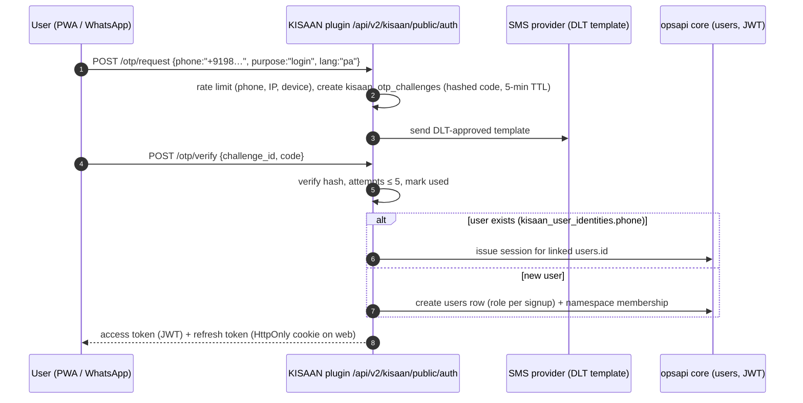
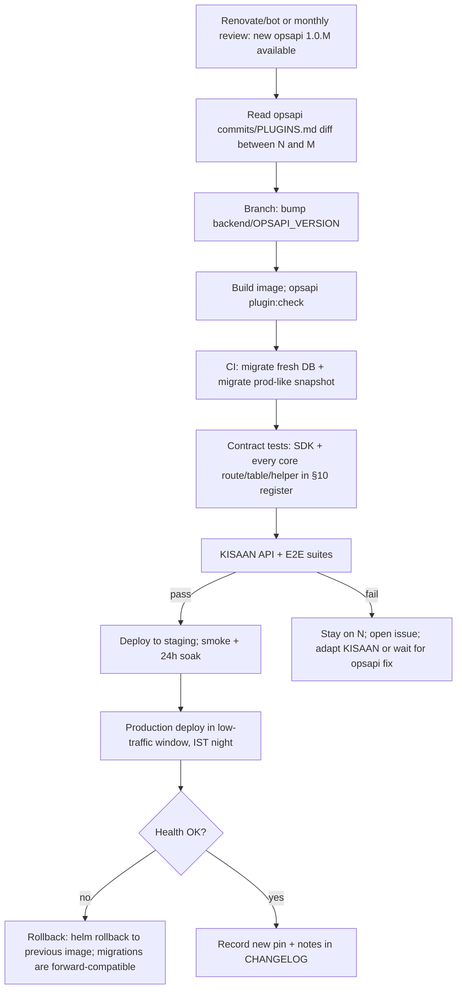

# KISAAN — opsapi Integration

> Status: Draft v0.1 · Last updated: 2026-11-14 · Owner: KISAAN product & architecture · Source of truth index: [README](README.md)

This document explains how KISAAN uses **opsapi** as its backend. The rule is that opsapi is **consumed, not modified**: KISAAN pulls the published image `bwalia/opsapi:<tag>` and adds its own **plugin** (opsapi calls it a "project module") from the KISAAN repository.

**Verification baseline:** every opsapi claim below was checked against `origin/main` @ `0544d487` (`git describe` = `1.0.339-8-g0544d487`, latest release tag **`1.0.339`**), read with `git show origin/main:<path>`. Paths are relative to the opsapi repository root; `file:line` points at that commit. Anything that could not be confirmed is marked `[UNVERIFIED]`. The local opsapi working tree (branch `fix/crm-json-bodies`) is 151 commits behind main and **must not** be used as a reference.

---

## 1. Integration principles (binding)

| # | Rule | Why |
|---|---|---|
| OI-1 | **No change to the opsapi repository.** KISAAN builds `FROM bwalia/opsapi:<pinned 1.0.N>` | Master Prompt §9A rule 1 |
| OI-2 | **All KISAAN migrations live in the KISAAN repo** under `plugins/kisaan/migrations/` and are run by opsapi's project migrator (tracked in `project_migrations`) | §9A rule 2 |
| OI-3 | **New APIs are KISAAN plugin routes** under `/api/v2/kisaan/...`, written against the plugin SDK (`helper.plugin-sdk`, `sdk_version = 1`) | §9A rule 3 |
| OI-4 | **Never `ALTER` an opsapi table.** To extend an opsapi entity, KISAAN creates a side table `kisaan_<entity>_ext` (or a domain table) with a foreign key to the opsapi row's `id` and its own `namespace_id`. No triggers on opsapi tables either | opsapi plugin convention (`PLUGINS.md:630-632`: "Don't alter OpsAPI tables"); keeps upgrades safe |
| OI-5 | **All KISAAN tables are prefixed `kisaan_`**, carry `namespace_id INTEGER NOT NULL REFERENCES namespaces(id) ON DELETE CASCADE`, and have an index that starts with `namespace_id` | `PLUGINS.md:630-632` |
| OI-6 | **Prefer the SDK over core internals.** Only `helper.plugin-sdk` is compatibility-guaranteed (`PLUGINS.md:752-756`). Every place KISAAN calls a core REST route or `require`s a core helper outside the SDK is listed in the [§10 core-dependency register](#10-core-dependency-register) and covered by a contract test | Stops a silent break on upgrade |
| OI-7 | **Pin an immutable tag** (`1.0.N`), never `latest` | opsapi pushes `:latest` on every merge to main (`.github/workflows/deploy-k3s.yml:286-314`) |
| OI-8 | **Read core tables, write through core APIs.** KISAAN code may `SELECT` from opsapi tables it depends on (e.g. `storeproducts`, `orders`). Writes to opsapi-owned rows go through opsapi routes or the SDK, never raw `UPDATE`. The one exceptions are the sanctioned direct writes W-1 `storeproducts` mirror fields incl. stock, W-2 `store_reviews`/`product_reviews` inserts and W-3 `orders`/`orderitems` creation (§6.4, register §10, D-28), all through `kisaan.core_adapter` | Keeps opsapi's own invariants, history tables and events correct |

---

## 2. How the plugin mechanism works (verified)

| Aspect | Verified behaviour | Evidence |
|---|---|---|
| Discovery | The loader scans `$OPSAPI_PROJECTS_DIR` (default `/app/projects`) for folders containing `project.lua` | `lapis/helper/project-loader.lua:105-116` |
| Wiring | After all core routes load, `ProjectLoader.init(...)` → `loadRoutes`. Plugins load **whatever `PROJECT_CODE` is**; only the manifest `enabled` flag gates them | `lapis/app.lua:816-819`; `helper/project-config.lua:672`; `project-loader.lua:389,451` |
| Route prefix | `api/*.lua` mounted at `/api/v2/<code>` (hyphens→underscores in code). A plugin cannot override an existing route | `project-loader.lua:284` |
| Public routes | Anything under `/api/v2/<code>/public/` skips login. Guard with `sdk.handler({ namespace = false }, fn)` and resolve the workspace yourself | `PLUGINS.md:317-319`; `app.lua:355-370` |
| Code rules | `^[a-z][a-z0-9_]*$`; cannot be a built-in preset/feature name. **`kisaan` is valid** | `project-loader.lua:92-99,140-143` |
| SDK | `SDK_VERSION = 1`. A manifest that asks for a newer SDK is refused | `project-loader.lua:32,145-149` |
| Readiness | A plugin that fails to load makes `/ready` return 503 | `project-loader.lua:16-22` |
| Folder layout | `project.lua`, `api/*.lua`, `migrations/*.lua`, `events/*.lua`, `jobs/*.lua`, `ui/*.html` | `PLUGINS.md:5-18` |
| Migrations | `project_migrations(id, project_code, migration_name, executed_at, checksum, UNIQUE(project_code, migration_name))`; one transaction per migration + tracking row; advisory lock `opsapi.project_migrations`; checksum drift detection; failures fail the deploy | `helper/project-migrator.lua:11-61`; `PLUGINS.md:625-642` |
| Migrate side-effects | Upserts the manifest's RBAC `modules`, sidebar `menu_items`, `plugins` row, jobs and event subscriptions. On first install, admin/owner roles in every namespace get `manage` on plugin modules | `PLUGINS.md:649` |
| Events | Transactional outbox, at-least-once, up to 8 retries; `publishes` tables emit `<plugin>.<name>.created/updated/deleted` plus declared verbs; `sdk.emit` for custom events; all are audit-logged automatically | `PLUGINS.md:488-572` |
| Jobs | `every`/`at`, per-workspace or global, claimed with `FOR UPDATE SKIP LOCKED` | `PLUGINS.md:582-621` |
| Per-workspace switch | `PUT /api/v2/namespace/plugins/:code`; settings declared in manifest | `PLUGINS.md:654-698` |
| Env vars | `PLUGIN_<CODE>_*` → `sdk.env(...)` | `PLUGINS.md:700-713` |
| CLI | `opsapi plugin:new`, `make:resource`, `make:listener`, `make:job`, `make:page`, `events`, `plugin:check`, `migrate`, `reload` | `lapis/bin/opsapi`; `PLUGINS.md:824-840` |

> Note: the official `bwalia/opsapi` image already contains four first-party plugins (`property-deals`, `property-pa`, `ai-runner`, `opsapi-marketing`) under `/app/projects/` (`lapis/Dockerfile:21-24,118-124`). KISAAN copies into its own sub-folder `/app/projects/kisaan/` and must **not** use `COPY plugins/ /app/projects/` in a way that removes them. They are harmless, but each can be switched off per workspace with `PUT /api/v2/namespace/plugins/:code` `[DECISION D-20]`.

> Note: an old, disabled workflow `.github/workflows/build-and-deploy-opsap-kisaan.yml` exists in opsapi (trigger branch `dummy`, commit `316c2ea8 "Disable kisaan workflow"`). It is legacy and is **not** the pattern KISAAN follows.

---

## 3. PROJECT_CODE selection

### 3.1 How it works (verified)

- `PROJECT_CODE` is a comma-separated list of **presets**, unioned; `core` is always added; default `all` (`helper/project-config.lua:280-349`).
- A bare feature name such as `chat` is **not** a valid code and is skipped with a warning (`:335-338`).
- It is process-wide. Disabled features answer **404** for everyone (`CLAUDE.md:73`).
- The **plugin code is not placed in `PROJECT_CODE`**. `scripts/setup-namespace.lua:101-103` raises `Unknown project_code` for unknown codes, and the migrate Job runs it.

### 3.2 Relevant presets

| Preset | Features |
|---|---|
| `ecommerce` | core, ecommerce, delivery, notifications, reviews, menu, **shop**, forms, themes |
| `ecommerce_chat` | core, ecommerce, delivery, **chat**, notifications, reviews, menu, forms, themes (**no shop**) |
| `billing` | core, billing, notifications, menu, forms, themes |
| Always on (core) | auth, users, groups, roles, permissions, namespaces, **chat-agent**, **voice**, **ai-usage**, ai-providers, documents, enquiries, api-keys, webhooks, activity/audit, email, plugins, crm-leads (`app.lua:466-520,733-734`) |

### 3.3 Decision

**`PROJECT_CODE=ecommerce_chat,billing`** `[DECISION D-21]`

| Why | Detail |
|---|---|
| Gives everything KISAAN reuses | Multi-store ecommerce, delivery, chat (+WebSocket), notifications (+FCM), reviews tables, forms; billing plans/subscriptions (loaded but **not used for membership** — D-24) |
| Leaves out `shop` | `shop` is a single-merchant, GBP/VAT module tuned for a hardware shop. KISAAN does not depend on it. Its stock-reservation, quote and T&C designs are used only as **design references** |
| Avoids `all` | `all` loads kanban, hospital, academy, field service, accounting etc. More attack surface and migrations for no benefit |
| `invoicing` not included | opsapi `invoices` are generic and have no GST/GSTIN/HSN support. KISAAN builds GST tax invoices in the plugin (§6.7). Revisit if invoicing gains GST `[DECISION D-22]` |

### 3.4 Risk: `notifications` table clash

opsapi warns that the ecommerce feature's "legacy notifications table clashes with core in-app notifications" (`project-config.lua:212-217`), and `migrations/order-management-enhancement.lua` also creates a `notifications` table.

**Mitigation `[RISK R-30]`:**
1. Phase 0 spike: run `lapis migrate` on an empty DB with `PROJECT_CODE=ecommerce_chat,billing` at the pinned tag. Record the resulting `notifications` schema and check `GET /api/v2/notifications` and FCM push work.
2. KISAAN never writes `notifications` directly. All user notifications go through the KISAAN notification service (§6.8), which calls the opsapi notifications API and keeps its own `kisaan_notification_log` (dedupe, channel, delivery status).
3. A contract test asserts the columns KISAAN reads from `notifications`.

---

## 4. Reuse map

Classification: **Reuse** = use the opsapi module unchanged · **Extend** = opsapi module plus KISAAN side tables/APIs (no opsapi change) · **New** = new KISAAN plugin module. Status: ✅ verified at `0544d487` · ⚠ partial/caveat · ❓ `[UNVERIFIED]`.

### 4.1 Core marketplace (Master Prompt §4 items 1–23)

| # | KISAAN area (req. prefix) | opsapi module / routes / tables (evidence) | Class | KISAAN work | Status |
|---|---|---|---|---|---|
| 1 | Authentication & registration (`AUTH`) | `routes/auth.lua` (email+password, email-OTP 2FA, Google/Apple/Facebook, refresh tokens, `POST /auth/refresh`, `GET /auth/me`), `routes/pin.lua`, `routes/register.lua` (roles `buyer`, `seller`, `delivery_partner`, `member`); JWT HS256 (`helper/jwt-verify.lua`) | **Extend** | **No phone/SMS OTP login exists** (`helper/otp.lua` sends by email only). New `kisaan.auth` module: phone OTP via DLT SMS (and WhatsApp OTP later), issuing opsapi-compatible tokens (§6.1) | ⚠ |
| 2 | User profiles & multi-role (`PROF`) | `users`, `user__roles`, `roles` (`routes/users.lua`); namespace roles `namespace_user_roles` | **Extend** | `kisaan_user_identities` (phone, preferred language, voice preferences), `kisaan_user_roles`, `kisaan_addresses` (district, village), `kisaan_seller_profiles`, `kisaan_buyer_profiles` (buyer_type, GSTIN), `kisaan_transporter_profiles` (link to `delivery_partners`), `kisaan_group_leader_profiles` | ✅ |
| 3 | Seller onboarding (`ONB`) | `register.lua` role `seller`; `stores` (owner `user_id`, `is_verified`) | **Extend** | KYC workflow `kisaan_verification_records` (PAN, bank penny-drop, optional GSTIN, land/FPO docs), store auto-creation | ✅ |
| 4 | Buyer onboarding (`ONB`) | `register.lua` role `buyer`; `customers` | **Extend** | Buyer type, GSTIN for B2B invoices, business verification | ✅ |
| 4a | Transporter onboarding (`ONB`) | `delivery_partners` (vehicle_types, service_radius_km, pricing, **bank_ifsc_code**, verification_documents), `delivery_partner_areas` (postal_codes), PostGIS; `POST /api/v2/delivery-partners/register` | **Reuse + Extend** | `kisaan_vehicles` (RC no., capacity in tonnes, body type), Punjab-specific docs. Partner phone OTP route is a stub: "No SMS provider is wired in" (`routes/delivery-partner-verification.lua:17,97`), so use the KISAAN phone OTP | ⚠ |
| 4b | Group-leader signup (`GRP`, `ONB`) | — | **New** | Separate flow `kisaan.leaders` with extra verification | ✅ (absent confirmed) |
| 5 | Product management (`PRD`) | `storeproducts` (sku, price, compare_price, cost_price, track_inventory, inventory_quantity, low_stock_threshold, weight, images, tags) (`ecommerce-migrations.lua:79`); `routes/storeproducts.lua`, `products.lua` | **Extend** | `kisaan_listings` attribute JSON validated by `kisaan_category_attributes` (variety, grade, moisture %, harvest date, packaging, storage, MOQ, unit, location point), `kisaan_listings` (lifecycle, expected price, AI-draft provenance) linked 1:1 to `storeproducts.id` | ✅ |
| 6 | Product listings / photos (`PRD`) | `storeproducts.images`; `documents` + MinIO (`routes/documents.lua`, `helper/minio.lua`) | **Reuse + Extend** | Image pipeline: EXIF strip, resize, moderation flags in `kisaan_listing_media` | ✅ |
| 7 | Product search (`SRCH`) | Only list filters; no global product search for ecommerce (shop has RAG search) | **New** | `kisaan.search`: Postgres FTS + `pg_trgm` + PostGIS radius over `kisaan_search_documents` (denormalised, multi-script, transliterated) | ⚠ (opsapi search depth ❓) |
| 8 | Filters & sorting (`SRCH`) | — | **New** | Part of `kisaan.search` | ✅ |
| 9 | Product details (`SRCH`) | `GET /api/v2/public/stores/:slug/products/:product_id` | **Extend** | Public detail endpoint adds attributes, wholesale tiers, member price, live coupons, sourced mandi reference | ✅ |
| 10 | Inventory (`INV`, §2A.5) | `storeproducts.inventory_quantity` only; stock checks in `checkout_enhanced.lua:142-164`; `inventory_transactions` exists but no route uses it ❓. Reservations exist only in the `shop` module (`shop_stock_reservations`), which KISAAN does not enable | **New** | `kisaan_inventory`: `kisaan_inventory`, `kisaan_inventory_reservations` (held/committed/released, `expires_at`), `kisaan_inventory_movements` (reason, actor, audit). Syncs `storeproducts.inventory_quantity` (§6.4) | ⚠ |
| 11 | Buyer enquiries (`ENQ`) | `enquiries` (core, `routes/enquiries.lua`) | **Extend** | Listing-scoped enquiries `kisaan_enquiry_threads` with privacy-masked contact. Generic opsapi `enquiries` is not listing-aware `[UNVERIFIED]` | ❓ |
| 11a | Buyer requirements / bulk purchase requests (`ENQ`) | — | **New** | `kisaan.requirements` (RFQ) | ✅ |
| 12–13 | Bidding, quotation, negotiation, counteroffers (`OFR`) | **No buyer↔seller offer flow in ecommerce**. Analogues: shop quotes, `delivery_requests.proposed_fee` | **New** | `kisaan.offers`: offers, counteroffers, negotiation threads, expiry jobs | ✅ (absent confirmed) |
| 14 | Order management (`ORD`) | `orders` (status, financial_status, fulfillment_status, subtotal, tax, shipping, discount_amount, total, currency), `orderitems`, `order_status_history`, `shipping_tracking`; seller `/api/v2/seller/orders[...]`, buyer `/api/v2/buyer/orders[...]`, `/orders/:id/update-status`, `/available-transitions` | **Reuse + Extend** | `kisaan_order_details` (offer_id, group_order_id, pricing breakdown JSON, GST fields, settlement status). Orders are created by **KISAAN checkout** (pricing engine) through opsapi checkout or the SDK (§6.3) | ✅ |
| 15 | Payment processing (`PAY`) | **Stripe only**: `routes/payments.lua`, `stripe-webhook.lua`; tables `payments`, `refunds`; INR is allowed as a currency (`helper/currency.lua:40`). No Razorpay, Cashfree, UPI or COD (grep empty) | **New** | `kisaan_payments` adapter for an Indian payment aggregator with split/route settlement, plus KISAAN ledger (§6.5) | ✅ (absent confirmed) |
| 16 | Invoices & receipts (`INVC`) | `invoices`, `invoice_line_items`, `invoice_sequences`, `invoice_tax_rates` (feature `invoicing`, not in chosen presets). **No GST/GSTIN/HSN anywhere** | **New** | `kisaan_orders` (invoicing): GST-aware invoice/receipt/bill-of-supply generation, PDF via `documents` | ✅ |
| 17 | Delivery management (`LOG`) | `delivery_requests` (proposed_fee, expires_at; accept/reject/cancel), `order_delivery_assignments` (fees, distance_km, tracking_number, proof_of_delivery), `store_delivery_partners`; fee estimate `/api/v2/delivery/fee-estimate` with ₹ defaults (base ₹20, ₹8–15/km, min ₹20/max ₹500 — `helper/delivery-pricing.lua:13-40`) | **Reuse + Extend** | Agri freight is per-trip/per-tonne-km, not parcel. `kisaan.logistics` adds load requests (weight, vehicle type), multi-transporter quotes, trip status and POD OTP, and maps an accepted quote to an opsapi assignment | ✅ |
| 18 | Reviews & ratings (`REV`) | `store_reviews`, `product_reviews` (rating 1–5, is_verified_purchase, order_id), `delivery_partner_reviews`; **read only**: `GET /api/v2/public/stores/:slug/reviews`. No create/moderate API | **Extend** | `kisaan_reviews`: create (verified purchase only), moderate, respond. Writes to opsapi review tables = sanctioned write W-2 (OI-8, §6.4, §10) | ⚠ |
| 19 | Notifications (`NOTF`) | In-app `notifications`, `notification_preferences`, FCM `device_tokens`, SMTP email (`routes/notifications.lua`, `device-tokens.lua`, `helper/push-notification.lua`). **No SMS or WhatsApp** | **Reuse + Extend** | `kisaan.notify`: SMS (DLT), WhatsApp Cloud API, dedupe, quiet hours, language templates | ✅ |
| 20 | Customer support (`SUP`) | Chat (`/api/chat/...`), chat-agent (`POST /api/chat/agent`), CRM; no ticketing in chosen presets (in-repo `projects/helpdesk` is an example plugin only) | **New** | `kisaan.support`: tickets, SLA, escalation from AI support agent | ✅ |
| 21 | Disputes & refunds (`DSP`) | Refunds = order status transition only in ecommerce (`order-status.lua:77`); `refunds`, `order_refunds` tables | **New** | `kisaan.disputes` (evidence, decisions) + refund execution through `kisaan_payments` | ⚠ |
| 22 | Admin dashboard (`ADM`) | `opsapi-dashboard` Next.js app; backend menu `/api/v2/user/menu`; plugin generated pages from `sdk.crud` + custom `ui/*.html` pages; namespace audit logs | **Reuse + Extend** | Ops/admin screens as plugin pages for back-office CRUD. The KISAAN admin experience (moderation queues, AI monitoring) lives in the KISAAN Next.js app `[DECISION D-23]` | ✅ |
| 23 | Analytics & reporting (`ANL`) | `user_activity`, `user_activity_daily`, `namespace_audit_logs`, `audit_events`; Prometheus `/metrics`; `GET /api/v2/namespace/ai-usage` | **Reuse + Extend** | `kisaan.analytics` event table + materialised KPI views | ✅ |

### 4.2 Confirmed §2A features

| §2A | Feature | opsapi status (evidence) | Class | KISAAN module |
|---|---|---|---|---|
| 2A.1 | Wholesale / bulk pricing (`WHL`) | **Absent in ecommerce**: `storeproducts` has `price`/`compare_price`/`cost_price` only. The shop pricing engine (`lib/shop-pricing.lua`) is GBP/option-rule oriented | **New** | `kisaan_pricing` (`kisaan_wholesale_tiers`, whole-lot offer, PRC engine) |
| 2A.2 | Group buying with area leaders (`GRP`) | **Absent**: opsapi `groups` are user/SCIM groups (`routes/groups.lua`) — not related | **New** | `kisaan_groups` (leaders, buying groups, members, commitments, group orders, allocations) |
| 2A.3 | Membership (`MEM`) | `billing` feature has plans/subscriptions/coupons (`billing_plans`, `billing_subscriptions`, `billing_coupons`), but it is **Stripe and GBP-centric** (`docs/BILLING_ENTITLEMENTS.md`), and entitlements are not a request-time gate (`CLAUDE.md:76`). Shop trade-memberships are shop-scoped | **New** (opsapi billing **not** used — Kisaan tables `kisaan_membership_plans`/`kisaan_memberships` `[DECISION D-24]`) | `kisaan_membership` (plans, memberships, mandates, benefit ledger) — recurring INR via the KISAAN payment adapter |
| 2A.3 | T&C versioning & acceptance (`MEM`, `PRIV`) | Only shop-scoped `shop_legal_acceptances` (`lib/shop-legal.lua`); no platform-wide registry | **New** | `kisaan_legal` (`kisaan_legal_documents`, `kisaan_legal_acceptances`, append-only) — also used for platform T&C, privacy notice, seller agreement, leader agreement |
| 2A.4 | Public seller stores (`STR`) | **Exists**: `stores` (slug, logo/banner, contact, `is_verified`), `GET /api/v2/public/stores/:slug`, `/:slug/products`, `/:slug/reviews` (`routes/public-store.lua`) | **Reuse + Extend** | `kisaan_store_profiles` (service area polygon/districts, policies, contact privacy, languages) + public route `GET /api/v2/kisaan/public/stores/:slug` that merges opsapi store + KISAAN extensions and hides contacts per privacy settings |
| 2A.5 | Automated inventory (`INV`) | Partial (see 4.1 #10) | **New** | `kisaan_inventory` |
| 2A.6 | Seller coupons (`CPN`) | **Partial, not usable**: only platform-level `billing_coupons` (`/api/v2/billing/coupons`); no coupon support in ecommerce cart/checkout (`orders.discount_amount` is only a column) | **New** | `kisaan.coupons` (`kisaan_coupons`, `kisaan_coupon_redemptions`), applied by `kisaan_pricing` |

### 4.3 AI, voice, channels and data

| Area | opsapi status (evidence) | Class | KISAAN approach |
|---|---|---|---|
| AI assistant (`AI-*`) | Core `chat-agent` (`POST /api/chat/agent`, `/conversation`, `/confirm`; `chat_agent_runs`; tools `lib/agent/tools.lua`). Built for opsapi admin tasks; LLM streaming merged into one answer (`lib/agent/llm.lua:437-464`) | **Not reused for the marketplace assistant** `[DECISION D-25]` | The KISAAN AI Gateway (separate service, [AI_AGENT_ARCHITECTURE](AI_AGENT_ARCHITECTURE.md)) needs streaming, multi-agent routing, KISAAN tools and approvals. opsapi chat-agent stays available to admins |
| AI providers & usage | `namespace_ai_providers` (keys AES-256-GCM sealed), `ai_usage`, `GET /api/v2/admin/ai-usage`; platform `AI_PROVIDER` = ollama/anthropic/openai with fallback chain (`docs/AI_PROVIDERS.md`) | **Reuse (partial)** | AI Gateway reports token usage to a KISAAN cost table. Writing into opsapi `ai_usage` would be a core-internal dependency ❓, so it is not done in MVP |
| Voice STT/TTS (`VOX`) | `routes/voice.lua`: `POST /api/v2/voice/transcribe`, `/speak`; off until `VOICE_URL` set; OpenAI-compatible server (faster-whisper, Kokoro/Piper); defaults `VOICE_LANGUAGE=en`, voice `bf_emma` | **Not on the critical path** | Indic quality depends on the model ❓. The AI Gateway calls the chosen Indic STT/TTS vendor directly (see SYSTEM_ARCHITECTURE §6). The opsapi voice route may be pointed at a self-hosted Indic model later |
| Real-time | WebSocket `/api/chat/ws` (Redis pub/sub across pods, `lib/chat-ws.lua`), `/api/v2/kanban/ws`; `?token=` JWT. **No SSE**; no plugin-level real-time | **Reuse (chat)** | Buyer↔seller in-thread messaging uses opsapi chat channels. AI token streaming and live order/offer updates come from the AI Gateway (SSE) and the KISAAN realtime relay (SYSTEM_ARCHITECTURE §5) |
| Documents / files | `POST /api/v2/documents/upload[/:bucket]`, presigned URLs, MinIO env `MINIO_*` | **Reuse** | Listing photos, KYC docs (private bucket), invoices, POD photos |
| Webhooks / events | `namespace_webhooks`; plugin outbox `plugin_events` | **Reuse** | KISAAN `publishes` events (§7.4) |
| Audit | `namespace_audit_logs`, `audit_events`, plugin events auto-audited (`PLUGINS.md:572`) | **Reuse + Extend** | `kisaan_audit_log` for AI actions, approvals, financial events (append-only) |
| API keys | `api_keys` (`opsk_` bearer, namespace-bound, scoped) | **Reuse** | Service credentials for the mandi ingestion job and partner integrations |
| Mandi prices (`MKT`) | **Absent** (grep for mandi/agmarknet empty). Shop market-price scraper is GBP and scraping-based | **New** | `kisaan.market` (`kisaan_mandi_prices`, ingestion job) |
| GST / GSTIN / HSN (`CMP`) | **Absent** (grep empty); invoicing tax rates generic; accounting UK VAT | **New** | `kisaan_orders` (tax/HSN, `kisaan_hsn_codes`) (HSN map, GST rates config, GSTIN validation) `[TAX REVIEW]` |
| SMS / WhatsApp | **Absent** | **New** | Provider adapters in `kisaan.notify` / `kisaan.auth` |
| Metrics / health | `/health`, `/ready`, `/live`, `/metrics`, `/swagger`, `/openapi.json` (`app.lua:82-267`) | **Reuse** | Plugin routes appear in Swagger automatically when documented with `sdk.doc` |
| TS client / MCP | `@opsapi/client` 1.3.0 (`sdk/typescript`), MCP server in `mcp/` | **Reuse (evaluate)** | Next.js uses `@opsapi/client` for core routes and a generated KISAAN client from the plugin OpenAPI |

---

## 5. KISAAN repository and plugin structure

```text
kisaan/
├── MASTER_PROMPT.md
├── docs/kisaan/                         # this documentation set
├── backend/
│   ├── Dockerfile                       # FROM bwalia/opsapi:<pinned>
│   ├── OPSAPI_VERSION                   # single source of the pinned tag, e.g. 1.0.339
│   └── plugins/
│       └── kisaan/                      # copied to /app/projects/kisaan/
│           ├── project.lua              # manifest (code = "kisaan")
│           ├── api/                     # each file returns function(app) ... end
│           │   ├── auth_phone.lua       # /api/v2/kisaan/public/auth/otp/*
│           │   ├── profiles.lua
│           │   ├── onboarding.lua
│           │   ├── listings.lua
│           │   ├── search.lua
│           │   ├── stores_public.lua    # /api/v2/kisaan/public/stores/*
│           │   ├── inventory.lua
│           │   ├── pricing.lua          # wholesale tiers + quote/price preview
│           │   ├── coupons.lua
│           │   ├── offers.lua
│           │   ├── requirements.lua
│           │   ├── checkout.lua
│           │   ├── payments.lua         # + public/webhooks/payments/:provider
│           │   ├── invoices.lua
│           │   ├── logistics.lua
│           │   ├── groups_buying.lua
│           │   ├── membership.lua
│           │   ├── legal.lua            # terms versions & acceptances
│           │   ├── reviews.lua
│           │   ├── support.lua
│           │   ├── disputes.lua
│           │   ├── approvals.lua        # human-in-the-loop for AI actions
│           │   ├── ai_tools.lua         # narrow endpoints used by the AI Gateway
│           │   ├── market.lua           # mandi prices
│           │   ├── notify.lua
│           │   ├── admin.lua
│           │   └── openapi.lua          # sdk.doc definitions
│           ├── lib/                     # pure Lua domain logic (pricing engine, state machines)
│           ├── migrations/              # YYYYMMDDHHMMSS_<verb>_<object>.lua
│           ├── events/                  # listeners, e.g. order.paid → inventory commit
│           ├── jobs/                    # reservation expiry, offer expiry, mandi ingest, settlement, reconciliation
│           ├── ui/                      # optional admin pages in opsapi-dashboard
│           └── spec/                    # busted unit tests for lib/
├── ai-gateway/                          # Kisaan AI Gateway service (see AI_AGENT_ARCHITECTURE)
├── web/                                 # Next.js PWA (buyer, farmer, leader, transporter, admin)
├── tests/
│   ├── contract/                        # opsapi contract tests (SDK + core routes KISAAN uses)
│   ├── api/                             # KISAAN API tests
│   └── e2e/
└── deploy/
    └── helm/
        ├── kisaan-api/                  # opsapi+kisaan image Deployment (values per env)
        ├── kisaan-migrations/           # pre-install/pre-upgrade Job, weight +5
        ├── kisaan-ai-gateway/
        └── kisaan-web/
```

### 5.1 Dockerfile

```dockerfile
# backend/Dockerfile
ARG OPSAPI_TAG=1.0.339                    # overwritten in CI from backend/OPSAPI_VERSION; never "latest"
FROM docker.io/bwalia/opsapi:${OPSAPI_TAG}
COPY plugins/kisaan/ /app/projects/kisaan/
RUN opsapi plugin:check                   # fail the build if the manifest/routes/migrations are invalid
```

The same image is used for the API Deployment and the migrations Job, so code and migrations always match.

### 5.2 Example manifest (`plugins/kisaan/project.lua`)

Uses only keys documented in `PLUGINS.md:122-173` and accepted by the loader (`project-loader.lua:276-284`).

```lua
return {
    code        = "kisaan",                 -- stable id: keys migrations + RBAC. Never rename.
    name        = "KISAAN Marketplace",
    icon        = "Sprout",
    version     = "0.1.0",
    description = "AI-first agriculture marketplace extensions",
    sdk_version = 1,
    enabled     = true,
    depends     = { "core", "ecommerce", "delivery", "notifications" }, -- documentation only; features come from PROJECT_CODE

    -- RBAC modules → permissions "<machine_name>.<action>" (create/read/update/delete/manage)
    modules = {
        { machine_name = "kisaan_profiles",     name = "Profiles & roles",                                  category = "KISAAN" },
        { machine_name = "kisaan_verification", name = "Verification (KYC)",                                category = "KISAAN" },
        { machine_name = "kisaan_stores",       name = "Seller stores",                                     category = "KISAAN" },
        { machine_name = "kisaan_listings",     name = "Listings",                                          category = "KISAAN" },
        { machine_name = "kisaan_inventory",    name = "Inventory",                                         category = "KISAAN" },
        { machine_name = "kisaan_pricing",      name = "Wholesale pricing",                                 category = "KISAAN" },
        { machine_name = "kisaan_coupons",      name = "Coupons",                                           category = "KISAAN" },
        { machine_name = "kisaan_requirements", name = "Buyer requirements",                                category = "KISAAN" },
        { machine_name = "kisaan_offers",       name = "Offers & negotiation",                              category = "KISAAN" },
        { machine_name = "kisaan_orders",       name = "Orders & invoices (KISAAN)",                        category = "KISAAN" },
        { machine_name = "kisaan_payments",     name = "Payments",                                          category = "KISAAN" },
        { machine_name = "kisaan_finance",      name = "Finance ops (settlement, refunds, reconciliation)", category = "KISAAN" },
        { machine_name = "kisaan_logistics",    name = "Logistics",                                         category = "KISAAN" },
        { machine_name = "kisaan_groups",       name = "Group buying",                                      category = "KISAAN" },
        { machine_name = "kisaan_membership",   name = "Membership",                                        category = "KISAAN" },
        { machine_name = "kisaan_legal",        name = "Terms & consents",                                  category = "KISAAN" },
        { machine_name = "kisaan_reviews",      name = "Reviews",                                           category = "KISAAN" },
        { machine_name = "kisaan_support",      name = "Support tickets",                                   category = "KISAAN" },
        { machine_name = "kisaan_disputes",     name = "Disputes",                                          category = "KISAAN" },
        { machine_name = "kisaan_market",       name = "Mandi prices",                                      category = "KISAAN" },
        { machine_name = "kisaan_ai",           name = "AI conversations & audit",                          category = "KISAAN" },
        { machine_name = "kisaan_approvals",    name = "Approvals",                                         category = "KISAAN" },
        { machine_name = "kisaan_admin",        name = "Marketplace admin & config",                        category = "KISAAN" },
    },

    menu = {
        { label = "Verification queue", resource = "verification_records", module = "kisaan_verification", icon = "ShieldCheck" },
        { label = "Listings moderation", resource = "listings",            module = "kisaan_listings",     icon = "Wheat" },
        { label = "Disputes",            resource = "disputes",            module = "kisaan_disputes",      icon = "Scale" },
        { label = "Mandi prices",        resource = "mandi_prices",        module = "kisaan_market",       icon = "LineChart" },
    },

    pages = {
        { key = "ops-overview", label = "Marketplace overview", entry = "ui/ops-overview.html",
          module = "kisaan_admin", api = { "/api/v2/kisaan/", "/api/v2/orders" } },
    },

    -- Table events → kisaan.<name>.created/updated/deleted + verbs (verbs cannot be created/updated/deleted)
    publishes = {
        listing     = { table = "kisaan_listings",  verbs = { published = { status = "published" }, hidden = { status = { "hidden", "sold_out" } } } },
        offer       = { table = "kisaan_offers",    verbs = { accepted = { status = "accepted" }, rejected = { status = "rejected" }, expired = { status = "expired" } },
                        emits = { "countered" } },
        group_order = { table = "kisaan_group_orders", verbs = { locked = { status = "locked" }, placed = { status = "placed" } } },
        membership  = { table = "kisaan_memberships", verbs = { activated = { status = "active" }, cancelled = { status = "cancelled" } } },
        dispute     = { table = "kisaan_disputes",  verbs = { resolved = { status = "resolved" } } },
        approval    = { table = "kisaan_approval_requests", verbs = { approved = { status = "approved" }, declined = { status = "declined" } } },
    },

    settings = {
        reservation_ttl_minutes     = { type = "integer", default = 15, min = 5 },   -- FS: buy-now/checkout hold 15 min
        offer_default_expiry_hours  = { type = "integer", default = 24, min = 1 },
        dispute_hold_hours          = { type = "integer", default = 0,  min = 0 },   -- extra hold after acceptance_window_ends_at; settlement release is driven by order acceptance window (D-08), not a fixed timer
        default_commission_bps      = { type = "integer", default = 0,  min = 0 },   -- [DECISION D-19] (seller-side, deducted from payout)
        payment_provider            = { type = "string",  default = "razorpay" },    -- provider decision: see PAYMENT_AND_BUSINESS_MODEL
        payment_webhook_secret      = { type = "string",  secret = true },
        sms_dlt_entity_id           = { type = "string" },
        whatsapp_access_token       = { type = "string",  secret = true },
        mandi_api_key               = { type = "string",  secret = true },
    },
}
```

> The exact type names allowed in `settings` (`integer`, `url`, `string`, …) and whether `emits` is valid next to `verbs` must be confirmed with `opsapi plugin:check` at the pinned tag `[UNVERIFIED]`. Secrets that are deployment-wide (provider keys) should prefer `PLUGIN_KISAAN_*` env vars from Kubernetes secrets over per-workspace settings.

### 5.3 Namespace model

KISAAN runs as **one marketplace namespace** (slug `kisaan`). Every seller store is a row in opsapi `stores` inside that namespace; buyers, sellers, transporters and leaders are members with namespace roles `[DECISION D-26]`. This matches opsapi's multi-store ecommerce model. It also means opsapi namespace-level RBAC is coarse, so **row-level ownership checks** (seller owns store, buyer owns order, leader owns group) are enforced in KISAAN handlers on every write. Namespace roles to seed in a migration: `seller`, `buyer`, `group_leader`, `transporter`, `support_agent`, `verifier`, `finance`, `marketplace_admin`, with permissions over `kisaan_*` modules plus the opsapi ecommerce/delivery modules.

---

## 6. Extending opsapi without modifying it

### 6.1 Phone OTP authentication (`AUTH`)

opsapi has no phone/SMS login. KISAAN adds it in the plugin:



- **Identity table:** `kisaan_user_identities(user_id → users.id, phone_e164 UNIQUE, verified_at, …)`. opsapi `users` is not altered. If `users.email` is mandatory in opsapi, KISAAN generates a non-routable placeholder (`<uuid>@users.kisaan.invalid`) and flags it `[UNVERIFIED: users.email NOT NULL?]`.
- **Token issuance (two options):**
  - **Option A — preferred:** call opsapi's token helper `helper.jwt-helper.generateNamespaceToken(user, namespace, membership, options)` (exists at `lapis/helper/jwt-helper.lua:137`) from the plugin, so tokens are byte-compatible with opsapi auth. This is a **core-internal dependency outside the SDK** and goes in the §10 register with a contract test.
  - **Option B — fallback:** issue a short-lived service token and call an opsapi route that mints user sessions, if one exists. None was found for phone users ❓.
  - The refresh-token flow must also work for phone users, either by reusing `refresh_tokens` through the same helper or with KISAAN's own refresh endpoint `[UNVERIFIED]`.
  - **This is the highest-risk integration item and is a Phase 0 spike** `[RISK R-31]`.
- Email/password, Google and PIN login stay available from opsapi for buyers and admins who prefer them.
- Admin accounts require email + 2FA (opsapi) in addition to phone `[DECISION D-27]`.

### 6.2 Side tables for opsapi entities

| opsapi table | KISAAN side table | Relationship |
|---|---|---|
| `users` | `kisaan_user_identities`, `kisaan_user_roles`, role profiles (`kisaan_seller_profiles`, `kisaan_buyer_profiles`, `kisaan_group_leader_profiles`, `kisaan_transporter_profiles`) | 1:1 / 1:N by `user_id` |
| `stores` | `kisaan_store_profiles` | 1:1 by `store_id` |
| `storeproducts` | `kisaan_listings` (+ attributes, images, wholesale tiers) | 1:1 listing ↔ storeproduct |
| `orders` | `kisaan_order_details` | 1:1 by `order_id` |
| `delivery_partners` | `kisaan_transporter_profiles`, `kisaan_vehicles` | 1:1 / 1:N |
| `order_delivery_assignments` | `kisaan_shipments` | 1:1 |

All side tables are created in KISAAN migrations with `ON DELETE CASCADE` or `RESTRICT` as appropriate; detailed schema in [DATABASE_SCHEMA.md](DATABASE_SCHEMA.md).

### 6.3 Orders and checkout

1. Buyer client calls **`POST /api/v2/kisaan/checkout/quote`** (price breakdown) and then **`POST /api/v2/kisaan/checkout/orders`** ([API_SPECIFICATION](API_SPECIFICATION.md)).
2. The KISAAN pricing engine computes the final price: base → wholesale tier / whole-lot → negotiated price (replaces list + tier) → member price (seller opt-in) → seller coupon (max one); the membership free-delivery waiver applies to the delivery-fee line ([FUNCTIONAL_SPECIFICATION](FUNCTIONAL_SPECIFICATION.md), `PRC`).
3. KISAAN reserves inventory.
4. KISAAN creates the opsapi order **server-side** through the single contract-tested core adapter (`kisaan.core_adapter`), which inserts `orders`/`orderitems` via opsapi models (core dependency C-05, §10). opsapi `checkout-enhanced` is **not exposed to clients** (blocked at the edge); whether the adapter may call it internally with server-computed prices is spike S-02. The KISAAN breakdown is written to `kisaan_order_details` / `kisaan_order_item_pricing`.
5. Order status transitions then use opsapi `/orders/:id/update-status` and `order_status_history`, so opsapi `order.*` events (`confirmed`, `shipped`, `delivered`, `cancelled`, `paid`, `refunded`) keep firing for KISAAN listeners.

### 6.4 Inventory sync

`kisaan_inventory` is the source of truth for availability (`on_hand`, `reserved`, `available = on_hand − reserved`). After each committed movement, KISAAN updates `storeproducts.inventory_quantity` so opsapi public-store pages and checkout checks (`checkout_enhanced.lua:142-164`) show the same number. The mirrored `storeproducts` rows keep **`track_inventory = true`** so opsapi's own stock checks stay consistent. The update runs in the same transaction as the movement. This is one of the **sanctioned direct writes** to opsapi core tables, all listed in the §10 register and routed through `kisaan.core_adapter` `[DECISION D-28]`:

| # | opsapi table | Columns / operation | Why |
|---|---|---|---|
| W-1 | `storeproducts` | INSERT/UPDATE mirror fields: `name`, `description`, `price`, `images`, `status`, `inventory_quantity` (`track_inventory = true`) | Public store pages and opsapi stock checks show Kisaan listings |
| W-2 | `store_reviews`, `product_reviews` | INSERT (+ moderation status UPDATE) | opsapi has tables and a public read route but no create/moderate API |
| W-3 | `orders`, `orderitems` | INSERT via opsapi models | Order creation with server-computed Kisaan prices (spike S-02) |

Every write is covered by contract tests against the pinned tag (TC-OPS-*).

### 6.5 Payment adapter (opsapi is Stripe-only)

- `kisaan_payments` defines a provider interface: `create_order`, `verify_signature`, `capture`, `refund`, `create_linked_account`, `transfer/split`, `create_mandate`, `charge_mandate`, `fetch_settlement`.
- First implementation: the chosen Indian payment aggregator (see [PAYMENT_AND_BUSINESS_MODEL](PAYMENT_AND_BUSINESS_MODEL.md)).
- Webhooks arrive at **`POST /api/v2/kisaan/public/webhooks/payments/:provider`** and are signature-verified, idempotent on the provider event id, and stored raw in `kisaan_payment_events`.
- KISAAN keeps a double-entry `kisaan_ledger_entries` table for buyer payments, platform commission, seller payable, transporter payable, refunds and settlements.
- opsapi `orders.financial_status` is updated through the order-status API. opsapi `payments`/`refunds` tables are **not** used `[DECISION D-29]`.
- opsapi Stripe routes remain loaded (ecommerce feature) but unused. They should be blocked at the edge (`/api/v2/payments/*`, `/api/v2/webhooks/stripe`) to reduce attack surface.

### 6.6 Membership

- KISAAN owns plans and memberships (`kisaan_membership`) because opsapi billing is Stripe/GBP-oriented.
- Option: mirror plan metadata into `billing_plans` for display in the opsapi dashboard. Not needed for MVP `[DECISION D-24]`.

### 6.7 GST invoicing

Invoices are generated by KISAAN (`kisaan_invoices`, numbering per seller GSTIN or bill of supply for unregistered farmers), rendered to PDF and stored via opsapi documents. Rules: [PAYMENT_AND_BUSINESS_MODEL](PAYMENT_AND_BUSINESS_MODEL.md), [SECURITY_AND_COMPLIANCE](SECURITY_AND_COMPLIANCE.md) `[TAX REVIEW]`.

### 6.8 Notifications

`kisaan.notify` decides channel and language, then delivers:
- **In-app + push:** opsapi notifications API + FCM device tokens (reuse).
- **SMS:** KISAAN adapter (DLT templates).
- **WhatsApp:** KISAAN adapter to the WhatsApp Business Platform Cloud API, opted-in users only.
- **Email:** opsapi email.

It logs every send in `kisaan_notification_log` for dedupe and audit.

---

## 7. KISAAN dynamic API approach

### 7.1 Routing

- Authenticated: `/api/v2/kisaan/<resource>`. Every call carries `Authorization: Bearer <jwt|opsk_ key>` and `X-Namespace-Slug: kisaan` (or `X-Namespace-Id`).
- Public: `/api/v2/kisaan/public/...` — store pages, listing search for logged-out visitors, OTP request/verify, payment and WhatsApp webhooks. Each uses `sdk.handler({ namespace = false }, fn)`, resolves the `kisaan` namespace explicitly, checks the plugin is enabled there, and is rate-limited at the edge and in-app.

### 7.2 Conventions inherited from opsapi (verified)

| Concern | Convention |
|---|---|
| Success body | `{ "success": true, "data": …, "meta": … }` (`sdk.ok`, `sdk.created`) |
| Error body | `{ "error": { "code": "…", "message": "…", "context": {…} } }`, optional `details: { field: msg }` |
| Status codes | 400, 401, 403, 404 (also "module not deployed"), 409, 422, 503 (integration not configured), 500 |
| Pagination | `?page=&per_page=` (max 100) → `meta: { page, per_page, total, total_pages }` |
| Idempotency | `Idempotency-Key` header on creates (`sdk.crud`, `sdk.idempotent`); replay returns `Idempotent-Replayed: true`. **Mandatory** for checkout, payment, offer accept, refund, approval decisions |
| Validation | `sdk.validate` / `sdk.schema` → 422 with field details |
| Docs | `sdk.doc` → appears in `/openapi.json` and `/swagger` |
| Permissions | `sdk.handler({ permission = "kisaan_offers.update" }, fn)` + row-ownership checks |

KISAAN additions: `Accept-Language: pa-IN|hi-IN|en-IN` for localised messages; `X-Kisaan-Channel: web|whatsapp|ai`. Commit-class calls that follow an AI-drafted action carry `approval_request_id` **in the request body** and are sent by the user's own client; the endpoint re-validates the approval (status, expiry, parameter hash). There is no approval header. Full endpoint catalogue: [API_SPECIFICATION.md](API_SPECIFICATION.md).

### 7.3 KISAAN plugin modules (canonical RBAC list)

Permissions use opsapi's form **`<machine_name>.<action>`** (actions: `create`, `read`, `update`, `delete`, `manage`), e.g. `kisaan_offers.update`. This list is binding for [API_SPECIFICATION.md](API_SPECIFICATION.md) §1.9 and [SECURITY_AND_COMPLIANCE.md](SECURITY_AND_COMPLIANCE.md) §2.2. Table names follow [DATABASE_SCHEMA.md](DATABASE_SCHEMA.md) (canonical).

| RBAC machine_name | Responsibility | Main tables |
|---|---|---|
| `kisaan_profiles` | Profiles, multi-role, addresses, payout accounts | `kisaan_user_identities`, `kisaan_user_roles`, `kisaan_seller_profiles`, `kisaan_buyer_profiles`, `kisaan_group_leader_profiles`, `kisaan_transporter_profiles`, `kisaan_addresses`, `kisaan_payout_accounts` |
| `kisaan_verification` | KYC workflow | `kisaan_verification_records`, `kisaan_kyc_documents` |
| `kisaan_stores` | Public store extensions | `kisaan_store_profiles`, `kisaan_store_slug_history` |
| `kisaan_listings` | Listings, media, categories/attributes config | `kisaan_listings`, `kisaan_listing_media`, `kisaan_categories`, `kisaan_category_attributes`, `kisaan_commodities`, `kisaan_varieties`, `kisaan_category_state_rules` |
| `kisaan_inventory` | Stock, reservations, movements | `kisaan_inventory`, `kisaan_inventory_reservations`, `kisaan_inventory_movements` |
| `kisaan_pricing` | Wholesale tiers, PRC engine, quotes | `kisaan_wholesale_tiers`, `kisaan_price_quotes` |
| `kisaan_coupons` | Seller coupons | `kisaan_coupons`, `kisaan_coupon_products`, `kisaan_coupon_redemptions` |
| `kisaan_requirements` | Buyer requirements / RFQ, enquiries | `kisaan_buyer_requirements`, `kisaan_enquiry_threads` |
| `kisaan_offers` | Offers, counteroffers, negotiations | `kisaan_negotiations`, `kisaan_offers` |
| `kisaan_orders` | Checkout, order extensions, invoices (read own) | `kisaan_order_details`, `kisaan_order_item_pricing`, `kisaan_order_status_events`, `kisaan_order_levies`, `kisaan_invoices`, `kisaan_invoice_lines`, `kisaan_invoice_sequences`, `kisaan_hsn_codes` |
| `kisaan_payments` | PA adapter, payments, mandates | `kisaan_payments`, `kisaan_payment_events`, `kisaan_payment_mandates` |
| `kisaan_finance` | Settlement, refunds, reconciliation, ledger, commission rules (finance ops) | `kisaan_settlements`, `kisaan_refunds`, `kisaan_ledger_entries`, `kisaan_reconciliation_runs`, `kisaan_reconciliation_items`, `kisaan_commission_rules` |
| `kisaan_logistics` | Transport requests, quotes, shipments, vehicles | `kisaan_vehicles`, `kisaan_transport_requests`, `kisaan_transport_quotes`, `kisaan_shipments`, `kisaan_shipment_events` |
| `kisaan_groups` | Leaders' groups, commitments, group orders | `kisaan_buying_groups`, `kisaan_buying_group_members`, `kisaan_group_orders`, `kisaan_group_order_allocations` |
| `kisaan_membership` | Plans, memberships, benefits | `kisaan_membership_plans`, `kisaan_memberships`, `kisaan_membership_benefit_usage` |
| `kisaan_legal` | Legal document versions, acceptances, consents, data requests | `kisaan_legal_documents`, `kisaan_legal_acceptances`, `kisaan_consents`, `kisaan_data_requests` |
| `kisaan_reviews` | Review create/moderation (writes opsapi `store_reviews`/`product_reviews`, W-2) | `kisaan_reviews` |
| `kisaan_support` | Support tickets | `kisaan_support_tickets`, `kisaan_support_messages` |
| `kisaan_disputes` | Disputes and evidence | `kisaan_disputes`, `kisaan_dispute_evidence` |
| `kisaan_market` | Mandi price ingestion & query, price alerts | `kisaan_mandi_markets`, `kisaan_mandi_prices`, `kisaan_msp_rates`, `kisaan_price_alerts` |
| `kisaan_ai` | AI conversations, agent executions, tool calls, cost | `kisaan_ai_conversations`, `kisaan_ai_messages`, `kisaan_ai_agent_executions`, `kisaan_ai_tool_calls` |
| `kisaan_approvals` | Approval requests (create by AI Gateway service identity; decide only by the subject user) | `kisaan_approval_requests` |
| `kisaan_admin` | Moderation, platform config, audit, analytics | `kisaan_settings`, `kisaan_audit_log`, `kisaan_analytics_events` |

Code-only modules (no own RBAC module): `kisaan.auth` (public OTP routes; `kisaan_otp_challenges`, `kisaan_sessions`), `kisaan.search` (`kisaan_search_documents`, permission `kisaan_listings.read`), `kisaan.notify` (`kisaan_notification_log`, `kisaan_channel_optins`), `kisaan.core_adapter` (the only code allowed to write opsapi core tables, §6.4), `kisaan.analytics` (writes `kisaan_analytics_events`; reads need `kisaan_admin.read`).

### 7.4 Events KISAAN publishes and consumes

| Direction | Event | Use |
|---|---|---|
| Publishes | `kisaan.listing.published`, `kisaan.listing.hidden` | Matching agent, buyer alerts, search re-index |
| Publishes | `kisaan.offer.accepted/rejected/expired/countered` | Notifications, inventory reserve/release |
| Publishes | `kisaan.group_order.locked/placed` | Member notifications, payment collection |
| Publishes | `kisaan.membership.activated/cancelled` | Benefit entitlement cache |
| Publishes | `kisaan.approval.approved/declined` | AI Gateway resumes the paused workflow |
| Consumes | `order.paid`, `order.cancelled`, `order.delivered`, `order.refunded` (opsapi core business events, `PLUGINS.md:488-519`) | Commit/release inventory, start settlement hold, request reviews |

Handlers are idempotent on `event.id` and scope everything to `event.namespace_id` (`PLUGINS.md:525-548`). Because opsapi event payloads mirror DB rows and "columns can change between OpsAPI releases" (`PLUGINS.md:534`), handlers read only the columns listed in the §10 register.

### 7.5 Scheduled jobs (`jobs/`)

| Job | Schedule | Purpose |
|---|---|---|
| `expire_reservations` | every 1 min | Release expired `held` reservations |
| `expire_offers` | every 5 min | Expire offers past `expires_at`; notify |
| `expire_coupons_and_groups` | every 15 min | Close coupon windows, group deadlines |
| `mandi_ingest` | every 6 h (configurable) | Pull data.gov.in Agmarknet dataset, store snapshot history |
| `settlement_release` | every 15 min | Release seller payouts after the hold window if no dispute |
| `reconcile_payments` | daily 02:00 IST | Match PA settlement reports to ledger |
| `membership_renewals` | hourly | Pre-debit notifications and mandate charges |
| `low_stock_alerts` | hourly | Inventory alerts |

---

## 8. Migrations pipeline

### 8.1 Rules

1. **Location:** `backend/plugins/kisaan/migrations/`. One file per change, returning `function(schema, db)`, or `{ transaction = false, up = fn }` for statements like `CREATE INDEX CONCURRENTLY` (`helper/project-migrator.lua:11-18`).
2. **Naming:** `YYYYMMDDHHMMSS_<verb>_<object>.lua`, e.g. `20261201093000_create_kisaan_listings.lua`. Generate with `opsapi make:resource` / `opsapi plugin:new` where possible.
3. **Never edit an applied migration.** The migrator stores a checksum and reports drift if an applied file changes. CI fails if any file already present on `main` is modified. Fix forward with a new migration.
4. **Forward-only.** No down migrations in production. Rollback = deploy previous image + forward fix. Destructive changes use expand → migrate data → contract across two releases.
5. **Tables** `kisaan_*`, with `namespace_id` FK + leading index. Never `ALTER`/`DROP`/trigger opsapi tables (OI-4).
6. **Seed data** (categories, attribute definitions, HSN codes, namespace roles, membership plan placeholders, terms v1 drafts) goes in migrations so every environment matches. Environment-specific secrets never do.
7. **Long data backfills** run as jobs, not migrations.

### 8.2 Execution

| Context | Command |
|---|---|
| Local (docker compose) | `docker compose run --rm kisaan-api opsapi migrate` (core then plugins), or plugin only: `lapis exec "require('helper.project-migrator').migrate('kisaan', '/app/projects/kisaan')"` |
| CI | Spin up Postgres + PostGIS, run `opsapi migrate` twice (idempotency), then contract + API tests |
| Kubernetes | opsapi core migrate Job = Helm hook `pre-install,pre-upgrade` **weight −5**. KISAAN Job `kisaan-migrations` = same image, hook `pre-install,pre-upgrade` **weight +5**, command `lapis exec "require('helper.project-migrator').migrate('kisaan','/app/projects/kisaan')"` |

```mermaid
sequenceDiagram
  autonumber
  participant CI as CI pipeline
  participant REG as Registry
  participant H as Helm upgrade
  participant J1 as Core migrate Job (weight -5)
  participant J2 as KISAAN migrate Job (weight +5)
  participant DB as PostgreSQL
  participant API as kisaan-api pods
  CI->>CI: build FROM bwalia/opsapi:1.0.N + plugin, opsapi plugin:check, tests
  CI->>REG: push kisaan-api:<git-sha>
  H->>J1: run lapis migrate (core; also runs plugin migrations via zzx hook)
  J1->>DB: core + kisaan migrations under advisory lock
  H->>J2: run project-migrator.migrate('kisaan')
  J2->>DB: no-op if already applied (checksums verified)
  H->>API: rolling update; readiness /ready (503 if plugin failed to load)
```

> **Why two Jobs?** Core `lapis migrate` already runs plugin migrations through the `zzx_run_project_migrations` hook (`lapis/migrations.lua:2969-3003`). The explicit +5 Job follows the documented external-consumer pattern (diy-tax-return-uk), gives a clear KISAAN-only failure signal, and is a no-op when nothing is pending. Whether `setup-namespace` in the core Job runs before plugin features register is `[UNVERIFIED]`. This is another reason the plugin code stays out of `PROJECT_CODE`.

---

## 9. Image pinning, upgrades and breaking changes

### 9.1 Pinning

- `backend/OPSAPI_VERSION` holds the single pinned tag (start: **`1.0.339`**, re-confirmed in Phase 0) `[DECISION D-30]`.
- opsapi auto-tags `1.0.N` on each release merge and pushes `latest` on every merge to main (`.github/workflows/deploy-k3s.yml:126-175,274-314`). KISAAN uses **only `1.0.N` tags**.
- Optionally pin by digest (`bwalia/opsapi@sha256:…`) in production values for full immutability.

### 9.2 Upgrade process



**Upgrade checklist**

1. `sdk_version` unchanged? If opsapi bumps the SDK, plan a dedicated migration of plugin code.
2. Diff of `lapis/migrations*.lua` between N and M for tables KISAAN reads (`users`, `stores`, `storeproducts`, `orders`, `orderitems`, `order_status_history`, `delivery_*`, `store_reviews`, `product_reviews`, `notifications`, `device_tokens`, `namespaces`).
3. Diff of the routes in the §10 register.
4. Diff of `helper/jwt-helper.lua` (phone-OTP token issuance).
5. `notifications` clash re-test (R-30).
6. Check `PROJECT_CODE` presets still contain the needed features (`helper/project-config.lua`).
7. Rehearse a restore of the DB backup taken before the upgrade.

**Cadence:** review monthly. Apply security fixes within 7 days. Never more than ~60 releases behind `[ASSUMPTION A-30]`.

### 9.3 Handling breaking changes

| Break type | Response |
|---|---|
| SDK incompatible (`sdk_version` bump) | Stay pinned; port plugin in a branch; upgrade when green |
| Core route used by KISAAN changes shape | Contract test fails → adapter shim in `plugins/kisaan/lib/opsapi_compat.lua` (one place for all core calls) |
| Core table column renamed/removed | Contract test on the column fails → update queries/side-table mapping; raise with opsapi maintainers |
| Core migration conflicts with a KISAAN object name | Impossible by construction (`kisaan_` prefix); if hit, rename in a KISAAN migration |
| Security fix needed but release also breaks KISAAN | Ask opsapi maintainers for a patch release; KISAAN never forks opsapi. Escalation path agreed in Phase 0 `[DECISION D-31]` |

### 9.4 Rollback

- Application: `helm rollback kisaan-api <rev>` to the previous image (previous opsapi pin + previous plugin).
- Database: forward-only migrations are written to be **backward-compatible with the previous release** (expand/contract), so rollback needs no down migration.
- If a migration itself is faulty: stop the rollout (the hook fails before pods change), fix forward. PITR restore is the last resort (see [SYSTEM_ARCHITECTURE](SYSTEM_ARCHITECTURE.md) §10).

---

## 10. Core-dependency register

Everything KISAAN uses from opsapi **outside** `helper.plugin-sdk`. Each item has a contract test in `tests/contract/`.

| # | Dependency | Type | Used for | Risk |
|---|---|---|---|---|
| C-01 | `helper.jwt-helper.generateNamespaceToken` (`lapis/helper/jwt-helper.lua:137`) | Lua helper | Phone-OTP session issuance | High (R-31) |
| C-02 | `users`, `user__roles`, `namespace_members`, `namespace_user_roles` | Tables (read + create via core API) | Phone signup, role assignment | Medium |
| C-03 | `stores` + `/api/v2/stores`, `/api/v2/public/stores/:slug[...]` | Table read + routes | Seller stores | Medium |
| C-04 | `storeproducts` mirror fields incl. `inventory_quantity`, `track_inventory = true` (sanctioned write W-1, D-28) | Table | Listings, stock sync | Medium |
| C-05 | `orders`/`orderitems` opsapi models via `kisaan.core_adapter` (sanctioned write W-3); `checkout-enhanced` only if spike S-02 shows it accepts server-computed prices — never exposed to clients | Models (route optional) | Order creation | High ❓ |
| C-06 | `orders`, `orderitems`, `order_status_history`, `/orders/:id/update-status`, `/api/v2/buyer/orders`, `/api/v2/seller/orders` | Tables + routes | Order lifecycle | Medium |
| C-07 | Core events `order.paid/cancelled/delivered/refunded` payload columns | Events | Inventory, settlement | Medium |
| C-08 | `delivery_partners`, `delivery_requests`, `order_delivery_assignments`, `/api/v2/delivery-*` | Tables + routes | Logistics | Medium |
| C-09 | `store_reviews`, `product_reviews` (sanctioned write W-2) | Tables | Reviews (no opsapi write API exists) | Medium |
| C-10 | `/api/v2/notifications`, `/api/v2/device-tokens`, `notifications` schema | Routes + table | In-app/push | Medium (R-30) |
| C-11 | `/api/v2/documents/upload`, presigned URLs | Routes | Images, KYC, invoices | Low |
| C-12 | `/api/chat/channels`, `/api/chat/ws` | Routes + WS | Buyer↔seller chat | Low |
| C-13 | `PROJECT_CODE` presets `ecommerce_chat`, `billing` | Config | Feature selection | Low |
| C-14 | Response/error/pagination conventions | Convention | Clients | Low |

---

## 11. Open items for Phase 0 spikes

| ID | Question | Owner |
|---|---|---|
| S-01 | Can the plugin mint opsapi-compatible access + refresh tokens for phone users (C-01)? Is `users.email` nullable? | Backend lead |
| S-02 | Can `checkout-enhanced` take server-computed prices and discounts, or must KISAAN insert orders via models (C-05)? | Backend lead |
| S-03 | `notifications` table outcome with `ecommerce_chat,billing` (R-30) | Backend lead |
| S-04 | Confirm `settings` types, `emits`, `pages.api` with `opsapi plugin:check` at the pinned tag | Backend lead |
| S-05 | Does opsapi generic `enquiries` fit listing enquiries, or keep KISAAN's own? | Product + backend |
| S-06 | Confirm the first-party plugins baked into the image can be disabled in the `kisaan` namespace (D-20) | DevOps |

Related: [SYSTEM_ARCHITECTURE](SYSTEM_ARCHITECTURE.md) · [DATABASE_SCHEMA](DATABASE_SCHEMA.md) · [API_SPECIFICATION](API_SPECIFICATION.md) · [RISKS_AND_ASSUMPTIONS](RISKS_AND_ASSUMPTIONS.md)
