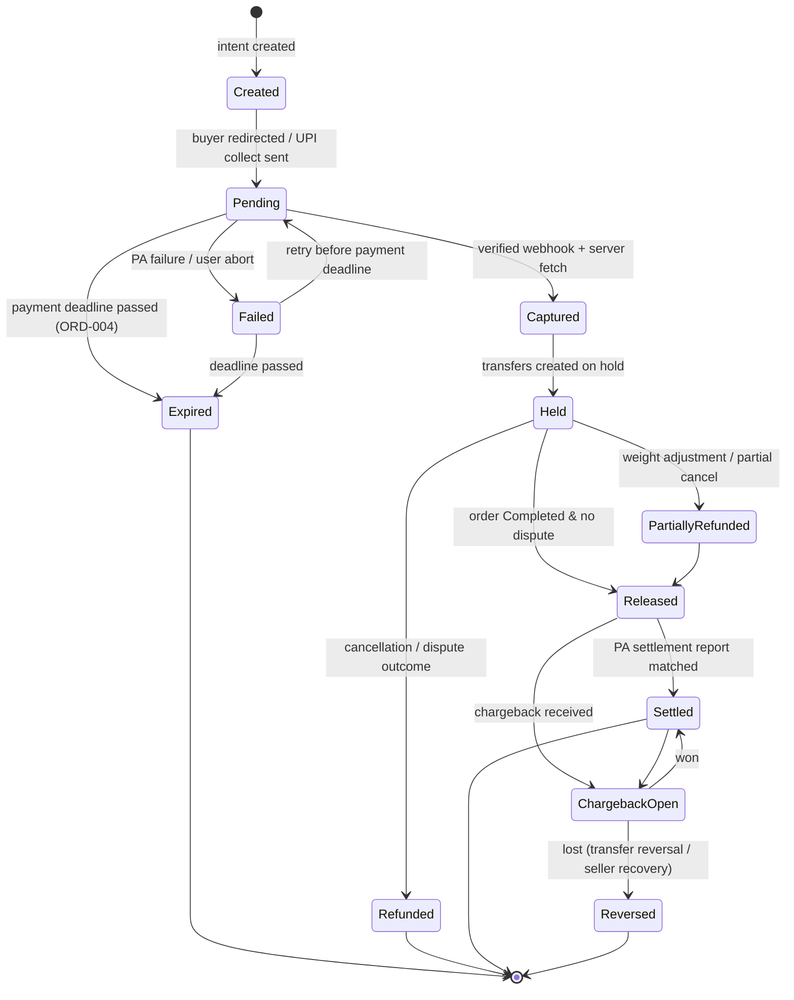
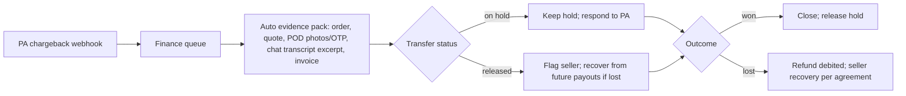
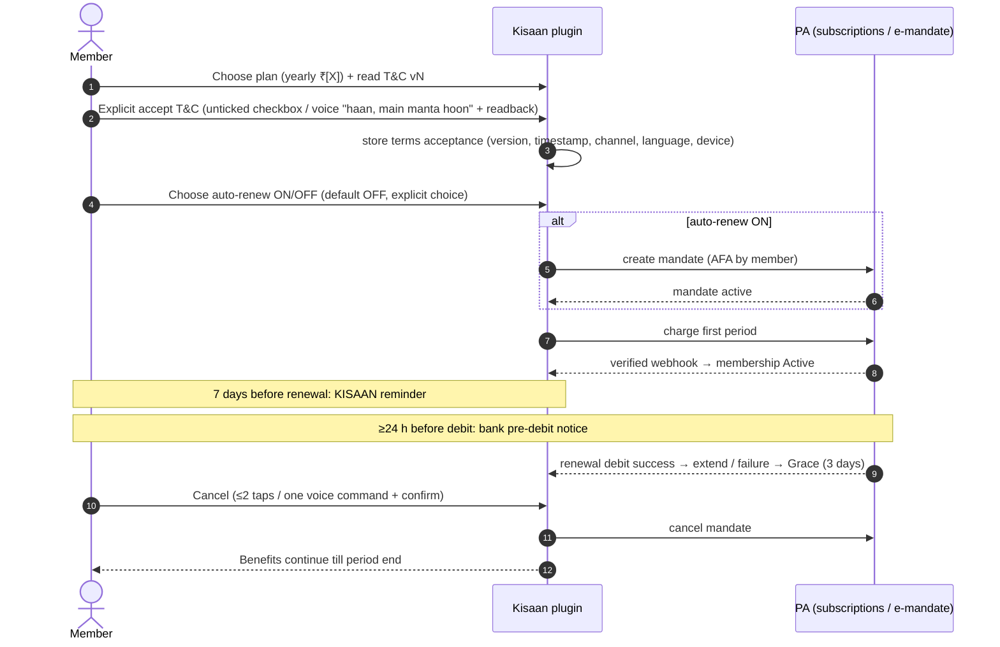
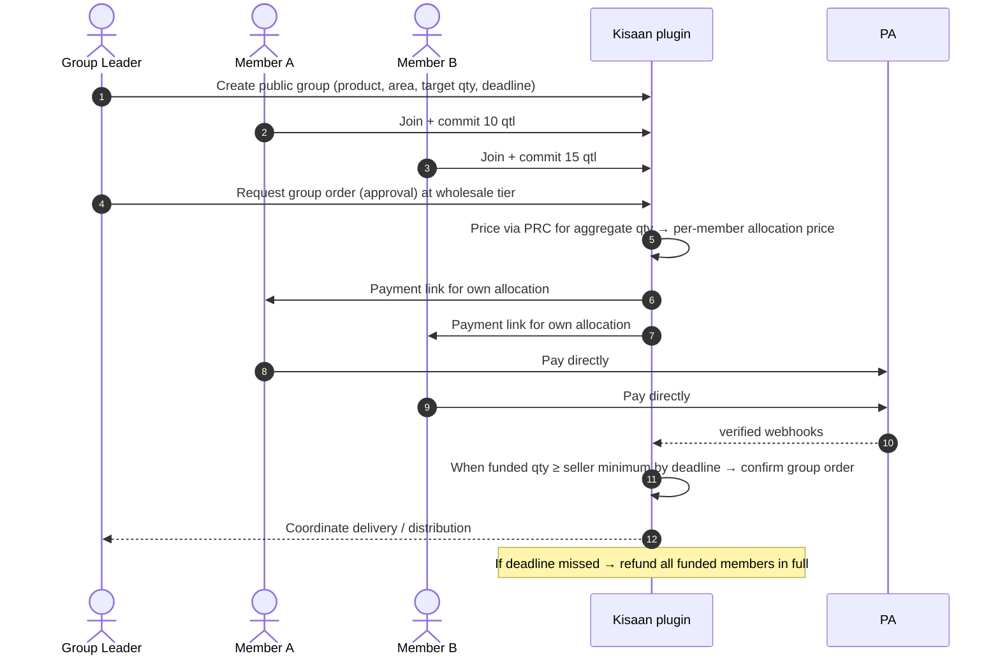

# KISAAN — Payment and Business Model

> Status: Draft v0.1 · Last updated: 2026-11-14 · Owner: KISAAN product & architecture · Source of truth index: [README](README.md)

> ⚠ **Every number in this document marked "placeholder" is illustrative only.** It is not a price decision, a gateway quote or tax advice. Regulatory statements come from desk research done 2026-11-14 (sources listed in §13); items marked `[LEGAL REVIEW]` or `[TAX REVIEW]` must be confirmed by counsel or a chartered accountant before launch.

Related: [PRD](PRD.md) (PAY-001…012, INVC-001…006, MEM-*, PRC-*, CPN-*, GRP-*) · [FUNCTIONAL_SPECIFICATION](FUNCTIONAL_SPECIFICATION.md) (pricing worked examples, state machines) · [SECURITY_AND_COMPLIANCE](SECURITY_AND_COMPLIANCE.md) · [MEMBERSHIP_TERMS_AND_CONDITIONS](MEMBERSHIP_TERMS_AND_CONDITIONS.md) · [OPSAPI_INTEGRATION](OPSAPI_INTEGRATION.md)

---

## 1. Summary of recommendations

| # | Recommendation | Status |
|---|---|---|
| 1 | **Initial revenue model:** a low transaction commission on completed orders, plus the confirmed paid membership (**KISAAN Plus**) and a logistics booking fee. Featured listings, seller subscriptions and premium AI are Future. | Commission rate and payer `[DECISION D-19]` (seller-side 1.5% placeholder) |
| 2 | **Money never sits in a KISAAN bank account.** All buyer payments go through an **RBI-authorised Payment Aggregator (PA)** using its marketplace split/route product. The PA pays sellers, transporters and KISAAN's commission directly. | Legal basis summarised in §5.1 `[LEGAL REVIEW]` |
| 3 | **PA shortlist:** Razorpay Route (primary) and Cashfree Easy Split (alternative). Stripe India is not a launch option. | `[DECISION D-09]` (PRD) |
| 4 | **Settlement on hold:** the seller's share is held at the PA and released after delivery is confirmed and the buyer acceptance window has passed (or the buyer confirms early). | Window lengths `[DECISION D-08]` (PRD); hold mechanism `[DECISION D-91]` |
| 5 | **Group buying:** every member pays the PA directly for their own allocation. The leader never touches money. Any leader incentive is paid by KISAAN as a KYC'd payout with TDS. Leader-collects-money is **Future and blocked on legal review**. | GRP; `[DECISION D-10]` (PRD) |
| 6 | **Membership renewal** uses UPI AutoPay / card e-mandate under the RBI e-mandate framework: plan price stays below the ₹15,000 no-AFA limit, the bank sends a pre-debit notice ≥24 h before, and the free trial never requires a mandate. | MEM-007, PAY-010 `[LEGAL REVIEW]` |
| 7 | **No cash on delivery** in MVP (PAY-012). PA escrow cannot be used for COD, and COD breaks inventory and settlement guarantees. | — |
| 8 | **opsapi billing is Stripe-based.** Kisaan builds its own **PA adapter + payment ledger** in the `kisaan` plugin and does not use opsapi checkout payments for INR marketplace orders. Membership plans and subscriptions also live in Kisaan tables, not opsapi billing (`[DECISION D-24]`, see §10.4). | `[OPSAPI: new]` |

---

## 2. Revenue model analysis

Each candidate is assessed for fit with an Indian agri-marketplace in the first 12 months (Punjab pilot). The main reference point is that a Punjab farmer selling wheat/paddy in a mandi already bears or sees statutory market fee + rural development fee (reported 3% + 3% of MSP) plus arhtiya commission, while private buyers in a mandi pay those levies `[UNVERIFIED primary text; see SECURITY_AND_COMPLIANCE §APMC]`. KISAAN's fees must be visibly small next to these.

| Model | How it works | Pros | Cons / risks | Fit | Scope |
|---|---|---|---|---|---|
| **Transaction commission** | % of completed order value, charged to buyer, seller or split; configurable per category | Aligned with value delivered; zero cost to try; standard for marketplaces | Disintermediation (users meet on KISAAN, then trade offline); GST on commission may be 18% unless the agri commission-agent exemption applies `[TAX REVIEW]` | **Primary** | MVP |
| **Paid membership (KISAAN Plus)** | Monthly/yearly fee; benefits incl. free delivery (capped), priority support, member deals, early access | Confirmed requirement (§2A.3); recurring revenue; retention | Free delivery on bulk loads is expensive — benefit caps are essential; dark-pattern and e-mandate rules | **Confirmed** | MVP |
| **Logistics service fee** | Booking fee or margin on transport arranged via the platform | Real value (finding trucks is a pain point); per-shipment | Thin margins; GST treatment depends on whether KISAAN bills transport in its own name (GTA vs facilitator) `[TAX REVIEW]` | Secondary | MVP (flat booking fee) |
| **Featured listings / store promotion** | Sellers pay for placement | Easy to add | Must be labelled "Sponsored" (disguised-advertisement dark pattern); must not distort AI recommendations without disclosure | Later | Future |
| **Seller subscriptions** | Paid seller tiers (more listings, analytics) | Predictable | Farmers are price-sensitive; puts a barrier before liquidity | Later | Future |
| **Buyer subscriptions** (non-membership) | Paid access for businesses (RFQ volume, analytics) | B2B willingness to pay | Overlaps with KISAAN Plus; confusing | Fold into membership | Future |
| **Premium AI services** | Paid AI features (advanced price analytics, bulk negotiation assist) | Differentiated | AI is the core differentiator — paywalling it early hurts adoption; forecasts need validated data | Later | Future |

### 2.1 Recommended initial model and why

1. **Commission on Completed orders only.** Placeholder **1.5% of goods value, charged to the seller and deducted from the seller payout** (FS BR-PAY, `[DECISION D-19]`; rate configurable per category and effective-dated, PAY-022). Why seller-side is the proposed default:
   - the buyer sees one clean price (goods + delivery + taxes) with no platform fee line, which keeps the price breakup simple and comparable;
   - the commission is small compared with the arhtiya commission and mandi costs a farmer already bears, and the seller statement shows it transparently (INVC-008).
   The downside is that farmers see a deduction from their receipt. Mitigation: show the net payout before the seller accepts any offer, and explain it in the seller's language. A buyer-side or split model stays configurable (PAY-022) if pilot data argues for it.
2. **KISAAN Plus membership** for buyers (PRD MEM-001: placeholders ₹199/month, ₹1,999/year — `[DECISION D-11]`).
3. **Logistics booking fee** (placeholder ₹[X] per shipment, waived for members within the free-delivery cap).
4. Revisit after 6 months of pilot data: featured listings (Future), then seller tiers.

Commission is charged only when the order **completes**. Cancelled or fully refunded orders carry no commission. Partial refunds reduce commission proportionally (`BR-PAYM-03`).

---

## 3. Who funds each discount

Pricing follows the single pricing engine (PRD PRC-001/002). Stacking order:

1. Base list price
2. Wholesale: the best single tier, or the "buy the whole lot" price
3. Negotiated price — **replaces** steps 1–2 if an accepted offer exists
4. Member-only price — only if the seller opted in, only on the non-negotiated path, and the **lower of wholesale vs member price wins** (no compounding)
5. One seller coupon — on a negotiated price only if `allow_on_negotiated = true`
6. Delivery fee, with the membership free-delivery waiver
7. Taxes where applicable

| Discount | Funded by | Effect on commission | Effect on seller payout | Notes |
|---|---|---|---|---|
| Wholesale tier / whole-lot price (WHL) | **Seller** | Commission on post-discount goods value | Lower unit price | Seller decides tiers |
| Negotiated price (OFR) | **Seller** (it is the agreed price) | On agreed value | Agreed value | — |
| Member-only seller price (MEM, seller opt-in) | **Seller** | On post-discount value | Lower unit price | Seller opts in per listing |
| Seller coupon (CPN) | **Seller** (PRD CPN-006, `[DECISION D-13]`) | On post-coupon value | Reduced by coupon value | Commission calculated after coupon |
| Membership free delivery (MEM) | **Platform** | None | None | Paid from membership revenue; tracked per MEM-014 |
| Platform coupon (Future) | **Platform** | On pre-platform-coupon value (`[DECISION D-92]`) | Unaffected — the PA transfer to the seller is the full amount; KISAAN funds the gap | GST/TCS value of supply treatment `[TAX REVIEW]` |

### 3.1 Worked example A — wholesale + coupon + member free delivery (illustrative, placeholders)

Listing: 100 quintal wheat (PBW-type variety), Moga. Seller list price ₹2,600/qtl. Wholesale tiers: 50+ qtl −5%, 100+ qtl −8%. Seller coupon `MOGA1`: 1% off, max ₹2,000, `allow_on_negotiated = false`. The buyer is a KISAAN Plus member. Platform transport cost is ₹9,000. The free-delivery cap is ₹500/order (PRD MEM-006 placeholder).

| Step | Calculation | Amount (₹) | Funded by |
|---|---|---|---|
| 1 Base | 100 × 2,600 | 2,60,000.00 | — |
| 2 Wholesale 100+ tier (−8%) | 2,600 × 0.92 = 2,392.00/qtl × 100 | 2,39,200.00 | Seller (−20,800) |
| 3 Negotiated | none | — | — |
| 4 Member-only price | seller did not opt in | — | — |
| 5 Seller coupon (1%, cap 2,000) | 1% of 2,39,200 = 2,392 → capped | −2,000.00 → **2,37,200.00** | Seller |
| 6 Delivery | 9,000 − 500 member waiver | 8,500.00 | Platform funds 500 |
| 7 Taxes on goods | loose wheat — nil-rated `[TAX REVIEW]` | 0.00 | — |
| **Buyer pays** | 2,37,200 + 8,500 | **2,45,700.00** | No platform fee line for the buyer |
| Commission (seller-side 1.5%, placeholder) | 1.5% of 2,37,200 | 3,558.00 | Deducted from seller payout |
| GST on commission (if taxable at 18%) | 18% × 3,558 | 640.44 `[TAX REVIEW: entry 54(g)]` | Deducted from seller payout |
| Income-tax TDS (if applicable, §4) | 0.1% × 2,37,200 | 237.20 `[TAX REVIEW]` | Deducted from seller payout |
| **Seller net payout** | 2,37,200 − 3,558 − 640.44 − 237.20 | **2,32,764.36** | Released after the acceptance window |

### 3.2 Worked example B — negotiated price (coupon not allowed)

The same lot is sold via an accepted offer at ₹2,450/qtl → goods ₹2,45,000. Wholesale tiers are **ignored** because the negotiated price replaces them (PRC-002). The coupon `MOGA1` has `allow_on_negotiated = false` → not applied. The rest proceeds as in Example A.

### 3.3 Worked example C — member-only price vs wholesale (no compounding)

The seller opts in a member price of ₹2,420/qtl. The 100+ wholesale tier gives ₹2,392/qtl. The lower price wins → ₹2,392 (wholesale), and the member price is **not** applied on top.

---

## 4. Illustrative unit economics — one 100 qtl wheat order

> All values are placeholders for modelling. PA fees vary by method and negotiated rate; UPI P2M pricing in particular must be confirmed with the chosen PA `[UNVERIFIED]`.

Using Example A (goods ₹2,37,200, buyer pays ₹2,45,700.00, seller nets ₹2,32,764.36):

| Line | Basis | Platform view (₹) | Notes |
|---|---|---|---|
| Commission revenue | 1.5% seller-side | +3,558.00 | `[DECISION D-19]` |
| GST on commission | collected and remitted | 0 net | Pass-through if taxable |
| Logistics booking fee | placeholder ₹[X] | +[X] | Waived/included for members within cap |
| PA processing fee | placeholder 0.0–2.0% depending on method (UPI vs card vs netbanking) on ₹2,45,700 | −0 to −4,914 | Big swing → steer large B2B tickets to UPI/NEFT virtual accounts `[DECISION D-93]` |
| PA route/transfer fee | per transfer placeholder | −[Y] | |
| Membership free-delivery cost | member waiver | −500.00 | Platform-funded |
| AI cost for the order | conversations, STT/TTS | −[Z] | PRD D-15 ceiling |
| **Contribution (excl. fixed costs)** | | ≈ +3,058 − PA fees − [Y] − [Z] | Sensitive to payment method |

Statutory withholdings (not revenue — collected/deducted and remitted on behalf of the government):

| Item | Rule (research summary) | On this order | Status |
|---|---|---|---|
| GST TCS (CGST s.52) | 0.5% of net value of **taxable** supplies via the ECO (from 10 Jul 2024) | Likely **not applicable** — loose wheat from an agriculturist is nil-rated | `[TAX REVIEW]` |
| Income-tax TDS on e-commerce participants (former s.194-O; now under Income-tax Act 2025) | 0.1% of gross sales from 1 Oct 2024; small-participant exemption (≤₹5 lakh, PAN furnished) may apply | 0.1% × 2,37,200 = **₹237.20** deducted from seller payout if applicable | `[TAX REVIEW]` — whether it applies to agriculturists' sales; section mapping in the 2025 Act `[UNVERIFIED]` |
| Mandi market fee / RDF | Punjab: reported 3% + 3% on notified produce bought by licensees | Potentially very material (≈₹14,232 on this lot) — **may apply depending on the APMC licensing model** | `[LEGAL REVIEW]` — the main business-model risk (R-90) |

**Takeaways for the business model**

- On wheat/paddy, the commission is small next to statutory mandi levies, so the APMC position (licensed e-trading platform vs lead-gen only) decides viability more than commission rate does (R-90).
- PA fees can exceed commission on card payments. Large tickets must default to UPI/bank-transfer rails (D-93).
- Free delivery on full-truck loads is unaffordable at low membership prices. The per-order and per-month caps (MEM-006) are what keep it viable. The benefit is designed for small/medium loads.

---

## 5. Regulatory frame for payments (summary)

### 5.1 Why KISAAN must not hold funds

- The **RBI (Regulation of Payment Aggregators) Directions 2025** (RBI/DPSS/2025-26/141, 15 Sep 2025) consolidate the PA regime. Non-bank PAs need RBI authorisation and must hold customer funds in an **escrow account with a scheduled commercial bank**. A PA contracted with a marketplace can settle directly to sellers who interface with the payer. Escrow may not be used for COD. Simplified due diligence applies to merchants with turnover up to ₹40 lakh. (Primary PDF not fetched; secondary law-firm summaries — `[UNVERIFIED primary]`.)
- Collecting buyers' money into KISAAN's own current account and later paying farmers would amount to aggregating and settling funds for merchants. That is PA activity requiring authorisation under **PSS Act 2007 s.4**, and it loses escrow protection. **Design rule BR-PAYM-01:** funds flow buyer → PA escrow → seller / transporter / KISAAN commission, by PA instruction only. `[LEGAL REVIEW]`
- Before signing, confirm the chosen PA is on RBI's list of authorised PAs (D-09).

### 5.2 Marketplace disclosures (Consumer Protection (E-Commerce) Rules 2020, Rule 5)

The checkout must display: payment methods, fees, **how to cancel regular payments** (membership), charge-back options, the PA's contact details, and the full price breakup at first display (no drip pricing). There are no cancellation charges on consumers unless the platform bears similar charges when it cancels (Rule 4). Refunds must be made within a reasonable time per RBI rules.

---

## 6. Payment gateway evaluation

| Criterion | Razorpay Route | Cashfree Easy Split | PayU | Juspay | Stripe India |
|---|---|---|---|---|---|
| Marketplace split | ✅ Linked Accounts; per-payment transfers to multiple accounts | ✅ Vendor onboarding, commission deduction | Claimed marketplace/split capabilities — product name/docs `[UNVERIFIED]` | Primarily orchestration (HyperCheckout); split `[UNVERIFIED]` | — |
| Settlement hold until condition (delivery) | ✅ Transfers can be put **on hold** and released | Hold/release `[UNVERIFIED — confirm in sales call]` | `[UNVERIFIED]` | n/a | — |
| Split refunds | Reversal of transfers `[confirm]` | ✅ Split refund liability across vendors | `[UNVERIFIED]` | n/a | — |
| UPI, cards, netbanking | ✅ (standard) | ✅ (standard) | ✅ (standard) | Via underlying PAs | — |
| UPI AutoPay / e-mandate (membership) | Subscriptions product `[confirm availability on the same account]` | Subscriptions product `[confirm]` | `[UNVERIFIED]` | `[UNVERIFIED]` | — |
| RBI authorised PA | Confirm on RBI list | Confirm on RBI list | Confirm on RBI list | PA status `[UNVERIFIED]` | — |
| Availability | Available | Available | Available | Available | **Invite-only in India since May 2024; 2025 relaunch reported postponed** → **not a launch option** |
| **Verdict** | **Primary (recommended)** | **Alternative / fallback** | Evaluate if commercials better | Consider later for multi-PA routing | Excluded |

**Design for portability:** the Kisaan PA adapter exposes a provider-neutral interface (`create_payment_intent`, `verify_payment`, `create_transfer`, `hold_transfer`, `release_transfer`, `refund`, `reverse_transfer`, `create_mandate`, `cancel_mandate`, `fetch_settlements`). Adding Cashfree later is an adapter, not a redesign (`PAY-013`).

---

## 7. Payment requirements (additions to PRD PAY/INVC)

PRD defines PAY-001…012 and INVC-001…006. This document adds the detail below. The IDs continue the PRD sequence.

| ID | Requirement | Scope |
|---|---|---|
| PAY-013 | Provider-neutral PA adapter in the `kisaan` plugin (interface in §6); provider credentials in secrets store; per-environment PA accounts (test/live) | MVP |
| PAY-014 | **Seller payout onboarding**: create PA linked account/vendor for each seller and transporter after PAN (where available) + bank penny-drop name match; payouts blocked until verified | MVP |
| PAY-015 | **Payment ledger** (double-entry, append-only) recording every intent, capture, transfer, hold, release, refund, reversal, fee, TCS, TDS; balances derivable per order, seller and platform | MVP |
| PAY-016 | Order-level **payment intent** created only from a server-side price quote (PRC-006); the amount is never taken from the client | MVP |
| PAY-017 | Webhook endpoint verifies PA signature, stores the raw event, deduplicates by provider event ID, processes asynchronously, and re-fetches payment status from the PA API before state change | MVP |
| PAY-018 | Transfers to seller/transporter created **on hold** at capture; released by settlement job when order = Completed and no open dispute (PAY-003) | MVP |
| PAY-019 | Large-ticket payment rails: orders above ₹[threshold] default to UPI / net banking / bank-transfer virtual account; cards optional `[DECISION D-93]` | MVP |
| PAY-020 | Payment link for AI/WhatsApp flows: the AI can only **request** a checkout link (`payment.request_checkout_link`); the user pays in the PA page; the AI never handles card/UPI credentials | MVP |
| PAY-021 | Chargeback/dispute intake from PA webhooks → finance queue, evidence pack auto-assembled (order, POD, chat, invoices) | MVP |
| PAY-022 | Commission & fee configuration per category, side (buyer/seller) and effective date; history retained | MVP |
| PAY-023 | Group order payments: per-member payment intents linked to a group order; group order confirmed only when funded allocations reach the seller's minimum (GRP) | MVP |
| PAY-024 | Leader incentive payouts (if D-10 approves) from platform funds via PA payouts, after leader KYC and with TDS | Future |
| PAY-025 | Membership e-mandate lifecycle: create (with AFA), notify, debit, failure → grace, cancel/revoke via PA API | MVP |
| PAY-026 | Weight/quantity reconciliation adjustments: if delivered weight differs within tolerance, partial refund of the difference before release (FS weight rules) | MVP |
| INVC-007 | Withholding computation: TDS (e-commerce participant) on seller payouts and GST TCS on taxable supplies, configurable rates and applicability flags per seller/category; outputs feed monthly statements `[TAX REVIEW]` | MVP (calc) |
| INVC-008 | Seller monthly statement: gross sales, coupons, commission (seller-side, D-19), TDS, TCS, net payouts, with downloadable PDF/CSV | MVP |
| INVC-009 | Membership invoices (platform's own GST invoice) on every charge; credit notes on refunds | MVP |
| INVC-010 | Credit/debit notes for post-invoice adjustments (partial refunds, weight differences) | MVP |

### 7.1 Business rules (payments-doc rules)

> These rules use the prefix `BR-PAYM-` so they do not collide with `BR-PAY-01…11` in [FUNCTIONAL_SPECIFICATION](FUNCTIONAL_SPECIFICATION.md) (canonical for payment workflow rules). They are complementary.

| ID | Rule |
|---|---|
| BR-PAYM-01 | Funds flow only through PA escrow; KISAAN's operating account receives only its own commission/fees/membership revenue settled by the PA. |
| BR-PAYM-02 | An order becomes **Paid** only after a verified webhook *and* a successful server-side status fetch (PAY-004, PAY-017). |
| BR-PAYM-03 | Commission accrues on Completed orders; refunds reverse commission pro rata; fully cancelled orders carry no commission. |
| BR-PAYM-04 | Seller transfer release requires: order Completed, no open dispute, seller payout account verified. |
| BR-PAYM-05 | Refunds go to the original payment method only; no cash or wallet refunds in MVP. |
| BR-PAYM-06 | Each refund is linked to a reason code (cancellation, dispute outcome, weight adjustment, membership refund) and an approver for manual refunds above ₹50,000 (finance role, maker-checker). |
| BR-PAYM-07 | No AI agent initiates, authorises or releases a payment, refund or transfer. After the user approves an ApprovalRequest in their own client, the backend may generate a PA payment link, which the user completes in the PA's own flow (consistent with FS BR-PAY-09). AI may otherwise only show status, explain, or draft a support/dispute ticket (see AI_AGENT_ARCHITECTURE). |
| BR-PAYM-08 | Membership plan prices stay ≤ ₹15,000 per debit so renewals stay within the no-AFA recurring limit. |
| BR-PAYM-09 | Inventory reservation is held until the payment deadline (ORD-004); payment confirmation converts the reservation into a deduction atomically with the order state change. |
| BR-PAYM-10 | A payment captured after the order was cancelled/expired (late success) is automatically refunded in full and inventory is not re-reserved. |

---

## 8. Payment lifecycle

### 8.1 Order payment sequence

```mermaid
sequenceDiagram
    autonumber
    actor B as Buyer
    participant W as Kisaan Web/PWA
    participant K as Kisaan plugin (opsapi)
    participant P as Payment Aggregator
    participant S as Seller
    B->>W: Proceed to pay (order O-1001)
    W->>K: POST checkout/quote → pay (Idempotency-Key)
    K->>K: Re-price (PRC), validate reservation & quote validity
    K->>P: create payment intent / order (amount, transfers ON HOLD)
    P-->>K: intent id
    K-->>W: PA checkout params
    W->>P: Buyer pays (UPI / netbanking / card)
    P-->>K: webhook payment.captured (signed)
    K->>K: verify signature, dedupe event id
    K->>P: fetch payment status (server verify)
    K->>K: ledger entries; order → Paid; reservation → deducted
    K-->>S: Notify "payment received – dispatch"
    Note over K,P: Delivery → POD → acceptance window
    K->>P: release transfer(s) to seller / transporter
    P-->>S: Settlement to bank (PA timeline)
    P-->>K: settlement report (daily) → reconciliation
```

### 8.2 Payment state machine



### 8.3 Payment confirmation and idempotency

- **Client callbacks are ignored for state.** The PA success redirect only triggers UI polling of the order status.
- Webhooks: signature check → insert into `kisaan_payment_events` with a unique `(provider, provider_event_id)` → `202` immediately → worker processes. Processing is idempotent: the state transition is conditional (`UPDATE … WHERE status = 'pending'`).
- Every create call (intent, refund, transfer, release) carries an internal idempotency key derived from `(order_id, operation, attempt_scope)`, and the API layer honours the `Idempotency-Key` header (opsapi plugin creates support it).
- A **missed-webhook sweeper** polls the PA for intents in `Pending` older than N minutes.

### 8.4 Failed transactions

| Scenario | Handling |
|---|---|
| UPI collect not approved / timeout | Payment `Failed`; buyer can retry until the payment deadline; reservation kept (PAY-006) |
| Bank debited but PA shows pending | Sweeper polls; UI shows "payment processing — do not pay again" |
| Duplicate payment for same order | Second capture auto-refunded in full (BR-PAYM-10 pattern) |
| Late success after expiry | Auto-refund; notify buyer; no re-reservation |
| Webhook signature invalid | Rejected, security alert, no state change |
| PA outage | Checkout disabled with a clear message; reservations extended once by admin policy `[DECISION D-94]` |

### 8.5 Refunds

| Trigger | Amount | Source of funds | Approval |
|---|---|---|---|
| Buyer cancels before dispatch | Full | Held transfer reversed | Automatic per cancellation policy |
| Seller cancels / cannot fulfil | Full | Held transfer reversed | Automatic; seller penalty per policy |
| Weight/quality adjustment (agreed) | Partial | Held transfer reduced | Buyer + seller agreement or dispute outcome |
| Dispute outcome | Full/partial | Held transfer; if already released → seller recovery from future payouts `[LEGAL REVIEW: seller agreement clause]` | Admin (maker-checker above ₹50,000, `[DECISION D-85]`) |
| Membership refund | Per MEM-009 | Platform revenue | Automatic per policy |

Refunds always go to the original method. The buyer sees a refund reference and the expected timeline from the PA.

### 8.6 Reconciliation (daily)

1. Fetch PA settlement & transaction reports (API) for T-1.
2. Match each PA record to ledger entries by `provider_payment_id` / `transfer_id` / `refund_id`.
3. Classify: matched · amount mismatch · missing in ledger · missing at PA · fee mismatch.
4. Mismatches → finance queue with an ageing SLA; dashboards in ADM.
5. Monthly: ledger trial balance per seller → seller statements (INVC-008); TCS/TDS summaries for filings `[TAX REVIEW]`.

### 8.7 Settlement

- Seller and transporter shares are created as **transfers on hold** at capture.
- Release condition: order Completed (buyer confirmed, or acceptance window elapsed — PRD ORD-006 / D-08) **and** no open dispute **and** seller payout account verified.
- Release timing after the condition is met: within 1 h (PAY-003). Bank credit then follows the PA's settlement cycle (T+1 reported, `[UNVERIFIED]`).
- KISAAN commission: retained in the PA as KISAAN's own merchant settlement.
- `[DECISION D-91]`: confirm hold duration limits with the PA (maximum hold period) and the policy for orders whose acceptance window is extended by a dispute.

### 8.8 Payment disputes and chargebacks



Marketplace disputes between buyer and seller (quality, weight, non-delivery) are handled in the DSP flow in FUNCTIONAL_SPECIFICATION. Money moves only through §8.5.

---

## 9. Invoices, GST and withholdings

| Document | Issuer | Recipient | When | Notes |
|---|---|---|---|---|
| Bill of supply / tax invoice for goods | Seller (generated by KISAAN on the seller's behalf) | Buyer | On order Paid / dispatch | Unregistered farmer selling own produce → bill of supply, nil-rated; GST-registered seller → tax invoice with GSTIN, HSN (e.g. 1001 wheat, 1006 rice) `[TAX REVIEW]` (INVC-001) |
| Commission/platform fee invoice | KISAAN | Seller (commission is seller-side, D-19) | On completion | GST 18% unless the agri commission-agent exemption (Notification 12/2017-CT(Rate) entry 54(g)) applies — **contested; get an AAR/CA opinion** `[TAX REVIEW]` |
| Logistics invoice | Transporter (facilitated) or KISAAN (if it bills in its own name) | Buyer | On delivery | GTA transport of agricultural produce may be exempt; depends on billing model `[TAX REVIEW]` |
| Membership invoice | KISAAN | Member | Each charge | Likely 18% taxable service `[TAX REVIEW]` (INVC-009) |
| Credit note | Original issuer | Original recipient | On refund/adjustment | (INVC-010) |
| Payment receipt | KISAAN (on behalf of PA flow) | Payer | On capture/refund | (INVC-003) |

- **E-commerce operator registration:** GST registration of KISAAN as an ECO is required with no threshold where TCS applies (CGST s.24(x)). Monthly GSTR-8 for TCS.
- **E-invoicing:** mandatory when KISAAN's aggregate turnover exceeds ₹5 crore (INVC-005, P2).
- **E-way bill:** required above ₹50,000 consignment value except exempt/nil-rated goods; loose wheat/paddy are likely exempt; packaged consignments are not. The transporter flow must support carrying an e-way bill number `[TAX REVIEW]`.
- **Numbering:** sequential, gap-free per issuer per financial year (INVC-004).
- **Language:** PDFs in the buyer's language + English.

---

## 10. Membership payments (KISAAN Plus)

### 10.1 Rules (from RBI e-mandate framework 2026, research summary)

- Mandate registration and modification require AFA.
- Recurring debits up to **₹15,000 per transaction** without AFA (BR-PAYM-08).
- The **issuer** sends a pre-debit notification **≥24 h** before each debit (merchant, amount, date/time, mandate reference, reason). The customer can opt out of a single debit or cancel the mandate.
- No charge to the customer for using an e-mandate.
- KISAAN additionally sends its own renewal reminder **7 days** before renewal (MEM-007).
- **Free trial requires no mandate and no payment details** (dark-pattern "subscription trap" avoidance). At trial end, the member is invited to subscribe; membership lapses if they do nothing.

### 10.2 Membership billing flow



### 10.3 Membership refunds

Per PRD MEM-009 (`[DECISION D-12]`, `[LEGAL REVIEW]`): full refund if cancelled within 7 days and no benefit used. No pro-rata refund on monthly plans otherwise. Yearly plans: pro-rata minus the value of benefits used. Refunds are issued to the original method with a credit note.

### 10.4 Reuse of opsapi billing

opsapi's `billing` preset provides plans, subscriptions and coupons, but it is wired to Stripe and is GBP-centric. **Decision (`[DECISION D-24]`):** KISAAN Plus plans, memberships and benefit usage live in Kisaan-owned tables (`kisaan_membership_plans`, `kisaan_memberships`, `kisaan_membership_benefit_usage`; see [DATABASE_SCHEMA](DATABASE_SCHEMA.md)), with the Kisaan PA adapter as the charging engine. opsapi billing is **not** used for membership. Billing **coupons** (platform-level) are also **not** used for seller coupons (CPN is a Kisaan module).

---

## 11. Group-order payments



Rules:

- The leader **never receives member money** (BR-GRP from FS; research §6.3: a leader pooling funds risks operating an unauthorised payment system, deposit-law questions, GST agency registration and AML opacity).
- The wholesale tier is computed on the **aggregate funded quantity**. If some members don't pay by the deadline and the funded quantity falls below the tier threshold, the price is recalculated. Members who paid at the higher tier price get a partial refund, or the order proceeds at the lower tier only if the seller agrees `[DECISION D-95]`.
- Leader incentive (if any, D-10) is paid by KISAAN as a platform-funded payout after leader PAN KYC and bank penny-drop, with income-tax TDS on commission `[TAX REVIEW]`. **Future** (PAY-024).
- **Leader-collects-money mode: Future, blocked on `[LEGAL REVIEW]`.** If ever enabled, leaders would need to operate through a bank/PA business-correspondent-type partner programme.

---

## 12. Cost & revenue impact of §2A commercial features

| Feature | Revenue impact | Cost impact | Controls |
|---|---|---|---|
| Wholesale tiers | ↑ order size and GMV; commission on lower unit price | None for platform | Seller-set floors (PRC-003) |
| Group buying | ↑ GMV from small buyers who unlock tiers | Ops/support cost of coordination; refunds when groups fail | Deadlines, minimum funded qty, leader ratings |
| Membership | Recurring fee | Free delivery (platform-funded), priority support staffing, PA subscription fees | Per-order and per-month delivery caps; fair use; service area limits |
| Seller coupons | ↑ conversion | Seller-funded; commission on post-coupon value slightly ↓ platform revenue | Abuse limits per CPN; max % without admin review (`D-40` in UX spec) |
| Platform coupons (Future) | Acquisition | Fully platform-funded | Budget caps per campaign |

---

## 13. Decisions, assumptions and risks introduced here

| ID | Type | Item |
|---|---|---|
| D-90 | Decision | → merged into **D-19** (seller-side 1.5% placeholder, per category) |
| D-91 | Decision | Settlement hold mechanics: max hold duration at PA; handling when disputes extend the window |
| D-92 | Decision | Commission basis when a platform coupon (Future) is applied |
| D-93 | Decision | Large-ticket threshold and allowed payment methods (steer to UPI/bank transfer) |
| D-94 | Decision | Reservation extension policy during PA outages |
| D-95 | Decision | Group order: price behaviour when unpaid members drop the funded qty below a tier |
| A-90 | Assumption | Razorpay Route supports transfers on hold and release with a hold period long enough for delivery + acceptance window `[UNVERIFIED]` |
| A-91 | Assumption | The chosen PA supports UPI AutoPay mandates on the same merchant account as Route `[UNVERIFIED]` |
| A-92 | Assumption | Income-tax TDS on e-commerce participants may apply to farmer sales; collecting PAN at seller onboarding is feasible for most sellers |
| R-90 | Risk | Punjab APMC licensing and market fee/RDF may apply to on-platform wheat/paddy trades, materially changing buyer landed cost and platform obligations |
| R-91 | Risk | PA fees on card payments exceed commission on low-margin grain orders |
| R-92 | Risk | Free-delivery membership benefit abused or under-priced vs bulk logistics cost |

---

## 14. Sources (research accessed 2026-11-14)

Full annotated list: see the research appendix in [SECURITY_AND_COMPLIANCE.md](SECURITY_AND_COMPLIANCE.md). Key sources used here:

1. RBI Master Directions page (PA Directions 2025): https://rbi.org.in/Scripts/BS_ViewMasDirections.aspx?id=12896
2. JSA Prism, PA Master Directions (Sep 2025): https://www.jsalaw.com/wp-content/uploads/2025/09/JSA-Prism-FinTech-September-2025-PA-Master-Directions.Final_.pdf
3. IndiaCorpLaw, Decoding RBI's PA overhaul: https://indiacorplaw.in/2025/10/09/decoding-rbis-overhaul-of-the-payment-aggregator-directions/
4. Khaitan & Co ERGO, E-mandate Framework 2026 (5 Jun 2026): https://www.khaitanco.com/sites/default/files/2026-06/ERGO_E-Mandate_Digital%20Payments_5%20June%202026.pdf
5. NPCI RuPay AutoPay AFA limit circular (2022): https://www.npci.org.in/PDF/npci/rupay/2022/Circular-RuPay-AutoPay-AFA-Limit-enhancement-and-compliance.pdf
6. Razorpay Route: https://razorpay.com/route/ ; docs: https://razorpay.com/docs/payments/route/linked-account
7. Cashfree Easy Split FAQs: https://www.cashfree.com/docs/help/easy-split/faqs/faqs
8. Juspay PA terms: https://juspay.io/aggregator-terms
9. Stripe Support, "Stripe accounts are invite-only in India": https://support.stripe.com/questions/stripe-accounts-are-invite-only-in-india
10. Mint via Magzter, Stripe pauses India relaunch (Oct 2025): https://www.magzter.com/nl/stories/newspaper/Mint-Hyderabad/STRIPE-PAUSES-INDIA-RELAUNCH-AMID-STRICTER-LICENSING-NORMS
11. Taxmann, ECO TCS 0.5% (Notification 15/2024-CT): https://www.taxmann.com/post/blog/ecos-to-collect-0-5-tcs-on-net-value-of-taxable-supplies-made-through-it-by-other-suppliers-notification/
12. Taxguru, s.194-O rate cut to 0.1%: https://taxguru.in/income-tax/section-194-o-amendment-lower-tds-rate-e-commerce-payments.html
13. TDSMan, s.194-O and the 2025 Act mapping: https://blog.tdsman.com/2025/03/section-194o-tds-on-payments-by-e-commerce-operators-to-participants/
14. Consumer Protection (E-Commerce) Rules 2020, DoCA gazette (G.S.R. 462(E)) — see SECURITY_AND_COMPLIANCE sources
