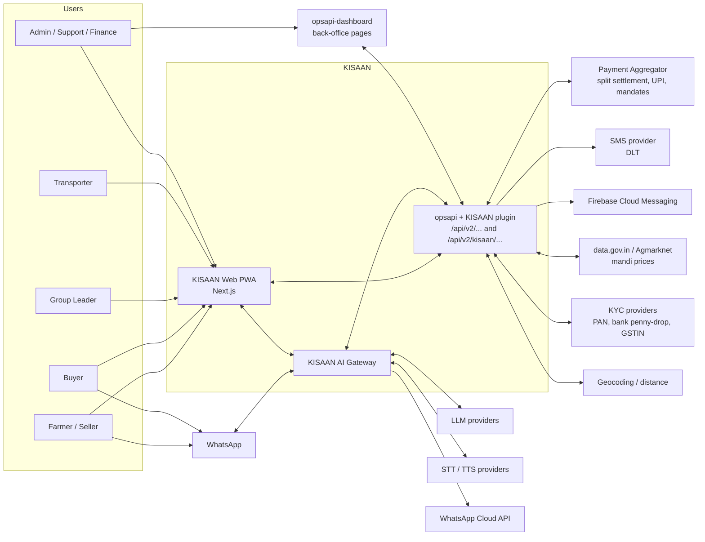
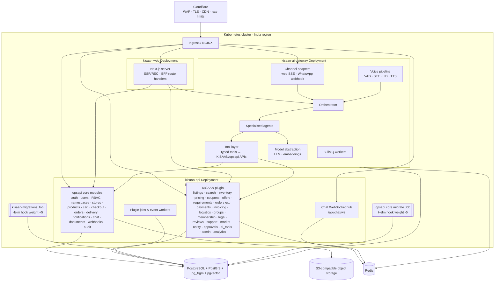
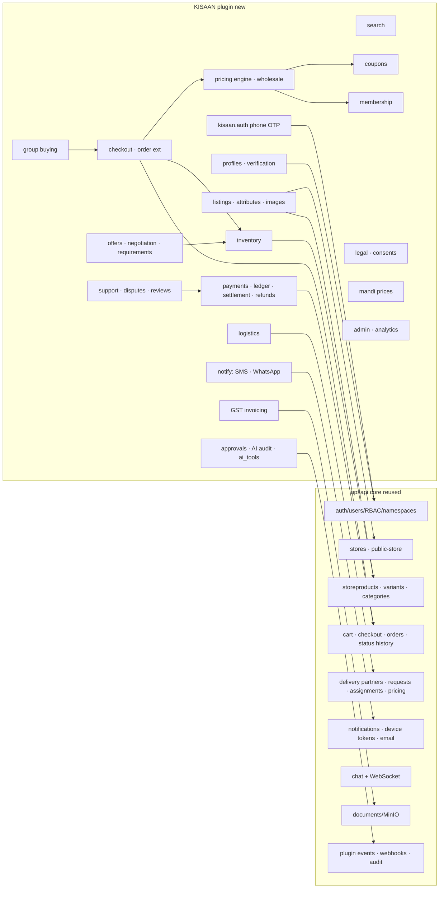
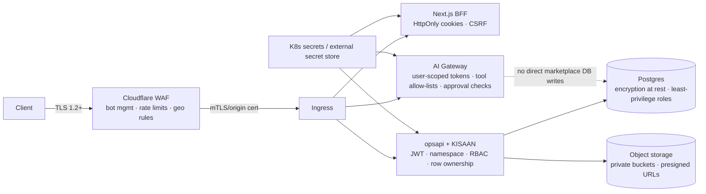
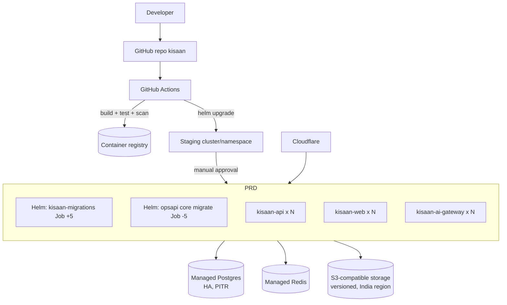

# KISAAN — System Architecture

> Status: Draft v0.1 · Last updated: 2026-11-14 · Owner: KISAAN product & architecture · Source of truth index: [README](README.md)

Related: [OPSAPI_INTEGRATION](OPSAPI_INTEGRATION.md) (backend reuse map, plugin, migrations) · [AI_AGENT_ARCHITECTURE](AI_AGENT_ARCHITECTURE.md) · [DATABASE_SCHEMA](DATABASE_SCHEMA.md) · [API_SPECIFICATION](API_SPECIFICATION.md) · [SECURITY_AND_COMPLIANCE](SECURITY_AND_COMPLIANCE.md)

---

## 1. Architectural drivers

| Driver | Consequence |
|---|---|
| opsapi is the mandatory backend (Master Prompt §9A) | Modular monolith = opsapi + KISAAN plugin in one image; no greenfield backend |
| AI-first, multi-agent, voice | A separate **KISAAN AI Gateway** service handles streaming, long-running LLM calls, audio and model routing outside the OpenResty request cycle |
| Rural, low-bandwidth, low-end Android | PWA, server-rendered first paint, small JS bundles, aggressive image compression, offline drafts/queue, Opus audio |
| Money and stock correctness | Postgres transactions, row locks, idempotency keys, double-entry ledger, outbox events |
| Indian compliance (DPDP, e-commerce rules, GST, RBI PA rules) | India data residency, consent records, audit trails, licensed payment aggregator |
| Small team, uncertain demand | Start with few deployables; scale out by replicas before splitting services |

**Deliberately not done:** no microservices per domain, no Kafka in MVP, no separate search cluster in MVP, no native apps in MVP.

---

## 2. Technology stack

| Layer | Choice | Status / notes |
|---|---|---|
| Web client | **Next.js (App Router) + React + TypeScript + Tailwind CSS**, installable **PWA** (service worker, Web App Manifest) | Master Prompt preference |
| Client i18n | `next-intl` (or equivalent) with ICU messages for `pa-IN`, `hi-IN`, `en-IN`; Noto Sans Gurmukhi / Devanagari | — |
| Backend | **opsapi** image `bwalia/opsapi:1.0.N` (Lua, Lapis, OpenResty) + **KISAAN plugin** at `/app/projects/kisaan/` | Verified mechanism, see OPSAPI_INTEGRATION §2 |
| AI service | **KISAAN AI Gateway**: TypeScript/Node.js (Fastify or NestJS) `[DECISION D-32]`; orchestrator + agents, tool layer, model abstraction, SSE streaming, voice pipeline | New |
| Database | **PostgreSQL 16** + **PostGIS** + `pg_trgm` (+ `unaccent`) | PostGIS already used by opsapi delivery (`migrations/geolocation-delivery-system.lua`) |
| Vector store | `pgvector` in the same Postgres for RAG (help/policy corpus, listing embeddings) `[ASSUMPTION A-31: extension can be enabled on the managed DB]` | New |
| Cache / queues | **Redis** — opsapi chat pub/sub (reuse), rate limits, OTP throttles, AI session cache, BullMQ queues in the AI Gateway | opsapi uses Redis for chat (`lib/chat-ws.lua`) |
| Background jobs | opsapi plugin **jobs** (`FOR UPDATE SKIP LOCKED`) for domain jobs; AI Gateway BullMQ for AI/voice/notification fan-out | Verified (`PLUGINS.md:582-621`) |
| Events | opsapi plugin **transactional outbox** (at-least-once, 8 retries) | Verified (`PLUGINS.md:488-572`) |
| Object storage | **S3-compatible** (MinIO in dev/self-hosted; managed S3-compatible in an Indian region in prod) via opsapi documents | opsapi `helper/minio.lua` |
| Payments | Indian **payment aggregator** with marketplace split/route settlement + UPI AutoPay/e-mandate | Provider decided in [PAYMENT_AND_BUSINESS_MODEL](PAYMENT_AND_BUSINESS_MODEL.md) |
| SMS | DLT-registered SMS provider (OTP + transactional) | Provider TBD `[DECISION D-33]` |
| WhatsApp | WhatsApp Business Platform **Cloud API** (direct or via BSP) | See §7 |
| STT / TTS | Pluggable. Candidates: Sarvam (`pa-IN`), Azure AI Speech (`pa-IN` STT; `pa-IN-OjasNeural`/`VaaniNeural` TTS), AI4Bharat IndicConformer/Indic-Transcribe (self-hosted, MIT), Google `pa-Guru-IN` (Preview), Bhashini (public API POC-only) | Choose by Phase 0 benchmark `[DECISION D-34]` |
| LLM | Provider-agnostic via model abstraction; at least two providers for fallback | `[DECISION D-35]` |
| Maps / geocoding | Pincode → district/lat-lng table (open data) + a commercial geocoding/distance API for road distance | `[DECISION D-36]` |
| Mandi prices | data.gov.in "Current Daily Price of Various Commodities from Various Markets (Mandi)" (Agmarknet), resource `9ef84268-d588-465a-a308-a864a43d0070`, OGDL-India | API availability `[UNVERIFIED]` |
| Edge | **Cloudflare** (DNS, TLS, WAF, rate limiting, bot management, CDN for static/images) | — |
| Runtime | Docker; **Kubernetes (k3s)** with **Helm**, as opsapi deploys today | opsapi `deploy-k3s.yml`, Helm charts |
| CI/CD | GitHub Actions: build, test, scan, push, Helm deploy; environment promotion dev → staging → prod | — |
| Observability | Prometheus + Grafana (reuse opsapi `/metrics` + dashboards), Loki (logs), OpenTelemetry traces (Tempo/Jaeger), Sentry (frontend + gateway errors), LLM tracing (Langfuse or equivalent) `[DECISION D-37]` | opsapi metrics verified |

---

## 3. System context



---

## 4. Container / component architecture



### 4.1 Deployables

| Deployable | Image | Scales by | Notes |
|---|---|---|---|
| `kisaan-web` | KISAAN Next.js | HPA on CPU/RPS | Stateless; BFF route handlers keep tokens in HttpOnly cookies |
| `kisaan-api` | `FROM bwalia/opsapi:1.0.N` + KISAAN plugin | HPA on CPU/RPS | Readiness `/ready` (503 if plugin fails to load), liveness `/live` |
| `kisaan-api-worker` (optional) | same image | queue depth | Same image with jobs/event workers only, if job load starts to affect API latency (P2) |
| `kisaan-ai-gateway` | KISAAN AI Gateway | HPA on concurrent sessions / queue depth | Stateless; session state in Redis + Postgres |
| `kisaan-migrations` | same as `kisaan-api` | Helm hook Job | Weight +5, after opsapi core (−5) |
| Postgres, Redis, object storage | Managed services (preferred) | Vertical first; read replica P2 | India region |

---

## 5. Backend architecture (opsapi + KISAAN plugin)

The backend is a **modular monolith**: opsapi core modules plus the KISAAN plugin modules in one process, sharing one Postgres database. Module boundaries are enforced by code structure (`plugins/kisaan/lib/<module>/`), table prefixes and RBAC modules, not by network calls.

### 5.1 Module map



### 5.2 Key backend patterns

| Concern | Pattern |
|---|---|
| Transactions | Each command handler runs one DB transaction; domain events are written to the opsapi outbox **in the same transaction** (via `publishes`/`sdk.emit`) |
| Inventory concurrency | `UPDATE kisaan_inventory SET reserved = reserved + $q WHERE listing_id = $id AND on_hand - reserved >= $q` → 0 rows = insufficient stock (409). Never read-then-write. See FUNCTIONAL_SPECIFICATION INV rules |
| Idempotency | `Idempotency-Key` on all commit-class POSTs (SDK `sdk.idempotent`); provider webhooks deduped on provider event id |
| State machines | Pure Lua transition tables in `lib/` (listing, offer, order ext, payment, shipment, group order, membership, dispute) with unit tests; illegal transitions → 409 |
| Money | `numeric(14,2)` INR; computed server-side only; the pricing breakdown is persisted on the order |
| Read models | Denormalised `kisaan_search_documents` updated by event listeners; KPI materialised views refreshed by jobs |
| Real-time | Buyer↔seller messages use opsapi chat WebSocket. Order/offer/approval updates go to clients through the AI Gateway SSE channel, which subscribes to KISAAN events in Redis (P2: a dedicated realtime relay if load requires) |
| External calls | All outbound HTTP from Lua via `sdk.http` (SSRF-safe), with timeouts, retries with jitter, circuit-breaker flags in Redis |

---

## 6. AI architecture (summary)

Full design: [AI_AGENT_ARCHITECTURE.md](AI_AGENT_ARCHITECTURE.md).

```mermaid
sequenceDiagram
  autonumber
  participant U as User (voice/text, web or WhatsApp)
  participant G as AI Gateway: channel + voice
  participant O as Orchestrator
  participant A as Specialised agent
  participant T as Tool layer
  participant K as KISAAN/opsapi API
  participant C as User's client app (PWA / WhatsApp buttons)
  participant AP as Approvals API (kisaan_approvals)
  U->>G: audio "Mere paas 100 quintal wheat hai…"
  G->>G: VAD → STT → language ID (pa/hi/en, code-mixed)
  G->>O: utterance + user context (roles, language, location)
  O->>A: route intent sell_produce → Listing agent
  A->>T: listing.create_draft (read/draft class)
  T->>K: POST /api/v2/kisaan/listings (status=draft) with user's token
  A-->>O: draft + missing fields + mandi reference (sourced, dated)
  A->>T: listing.request_publish (commit class)
  T->>AP: create approval_request (status=pending, params hash) — Gateway can only CREATE
  O-->>G: response text + approval card (approval_request_id)
  G-->>U: TTS read-back in Punjabi + card
  U->>C: taps Approve, or says "Haan" → client shows confirmation read-back → user confirms
  C->>AP: POST /approvals/:id/approve (user's own token; step-up OTP if required)
  C->>K: POST /api/v2/kisaan/listings/:id/publish { approval_request_id }
  K->>K: re-validate approval (approved, not expired, params hash match, same user) → execute
  K-->>G: event kisaan.approval.approved / listing.published → Gateway resumes the workflow
```

The AI Gateway never approves, rejects or executes a commit-class action. A spoken "haan" is interpreted on the user's device into an explicit confirmation step, and the approve call and the commit call are both made by the user's own client with the user's own token ([API_SPECIFICATION](API_SPECIFICATION.md) approvals; [AI_AGENT_ARCHITECTURE](AI_AGENT_ARCHITECTURE.md) §5).

Architectural rules:
1. The AI Gateway **never touches the database for marketplace data**. It calls KISAAN/opsapi APIs with the **end-user's scoped token** (on-behalf-of). It only has its own tables for conversations, agent runs and evaluations.
2. Tools are typed and classified **read / draft / commit**. Commit tools are executable only with an `approved` `kisaan_approval_requests` row whose payload hash matches the call. The API re-checks this server-side.
3. **Model abstraction:** one internal interface (`chat`, `tool_call`, `embed`, `transcribe`, `speak`) with provider adapters, per-task model routing (small model for intent/NLU, larger for negotiation explanations), fallbacks, per-user/day budgets.
4. **Voice:** client records Opus (16 kHz mono) with push-to-talk → AI Gateway → STT vendor. TTS is cached per (text hash, voice). Low-bandwidth mode uses text + short TTS only.
5. **RAG corpora:** help centre, policies/T&C, category guides, mandi-name/commodity glossary (pgvector).
6. **Observability:** every agent run → trace (prompt version, model, tokens, cost, tools called, latency, approval outcome).

---

## 7. External integrations

| Integration | Purpose | Approach | Status |
|---|---|---|---|
| Payment aggregator (marketplace/split product) | Collect buyer payments, split to seller/transporter/platform, refunds, settlement reports, UPI AutoPay/e-mandate for membership | KISAAN `kisaan_payments` adapter + webhooks | Provider + contract `[DECISION]`; RBI rules in SECURITY_AND_COMPLIANCE |
| SMS (DLT) | OTP, transactional alerts | Adapter in `kisaan.auth`/`kisaan.notify`; DLT entity + template registration | Provider `[DECISION D-33]`; DLT lead time is a Phase 0 item |
| WhatsApp Business Platform (Cloud API) | Notifications (MVP), conversational marketplace (P2) | Webhook → AI Gateway; templates for business-initiated messages | Verified constraints (market research, Meta docs): opt-in naming the business is required; per-message pricing since Jul 2025; free-form only inside the 24-h customer-service window; India accounts must move to INR billing by 31 Dec 2026. Reported ban on general-purpose AI chatbots from 15 Jan 2026 (press; Meta terms not read `[UNVERIFIED]`) → KISAAN's bot must stay task-specific to the marketplace |
| STT / TTS | Voice | Adapter in AI Gateway; Phase 0 benchmark on field recordings | Verified availability: Azure `pa-IN` STT + 2 Punjabi neural voices; AWS Transcribe `pa-IN`; Google `pa-Guru-IN` **Preview**; Sarvam `pa-IN` STT (₹0.49/min listed); AI4Bharat IndicConformer (22 languages, MIT, self-hostable); Bhashini public API **proof-of-concept only** (production needs a paid arrangement) |
| LLM providers | Agents | Model abstraction; ≥2 providers | `[DECISION D-35]` |
| data.gov.in (Agmarknet mandi prices) | Price intelligence | `mandi_ingest` job: `GET https://api.data.gov.in/resource/9ef84268-d588-465a-a308-a864a43d0070?api-key=…&format=json&filters[state]=Punjab…`; store each snapshot (resource holds the latest day only, reportedly) | Endpoint pattern from developer usage; **live status `[UNVERIFIED]`** (site unreachable during research). Known quality issues: 2–3 day delays, missing markets, duplicates. Licence OGDL-India (commercial use with attribution) |
| KYC providers | PAN verify, bank penny-drop, GSTIN lookup | Adapter `kisaan_verification` | Provider `[DECISION]`; Aadhaar restrictions in SECURITY_AND_COMPLIANCE |
| Firebase Cloud Messaging | Push | opsapi `device_tokens` + `helper/push-notification.lua` (FCM HTTP v1) | Verified reuse |
| Geocoding / distance | Search radius, freight estimates | Pincode table + API | `[DECISION D-36]` |
| IMD weather (P2) | Advisory context | `api.imd.gov.in` requires IP whitelisting | Researched; P2 |

All outbound credentials live in Kubernetes secrets → `PLUGIN_KISAAN_*` env vars (API) or Gateway env, never in the repo or per-workspace settings for platform-wide keys.

---

## 8. Frontend architecture

### 8.1 Structure

```text
web/
├── app/
│   ├── [locale]/                     # pa | hi | en
│   │   ├── (public)/                 # landing, search, listing detail, store/[slug], groups (public), legal pages
│   │   ├── (auth)/                   # phone OTP login, role selection, onboarding, leader signup
│   │   ├── (farmer)/farmer/...       # dashboard, listings, inventory, offers, orders, store, coupons, wholesale, payouts
│   │   ├── (buyer)/buyer/...         # dashboard, requirements, offers, cart/checkout, orders, membership
│   │   ├── (leader)/leader/...       # groups, members, group orders
│   │   ├── (transporter)/transporter/...  # requests, quotes, trips, vehicles, earnings
│   │   ├── (admin)/admin/...         # moderation, verification, disputes, payments, AI monitoring, config, analytics
│   │   └── assistant/                # full-screen AI chat (also available as a drawer everywhere)
│   └── api/                          # BFF route handlers: session cookies, token refresh, upload signing, SSE proxy
├── components/ (design system: tokens, Button, Card, PriceTag, TierTable, ApprovalCard, VoiceButton …)
├── lib/ (opsapi client @opsapi/client, generated KISAAN client from plugin OpenAPI, i18n, offline queue)
├── messages/ (pa.json, hi.json, en.json)
└── public/ (manifest.webmanifest, icons, offline.html)
```

### 8.2 Decisions

| Concern | Approach |
|---|---|
| Rendering | React Server Components + SSR for public pages (SEO for stores/listings, fast first paint on 3G); client components only where interactive |
| Role experiences | Route groups per role. Middleware checks the session's roles; multi-role users switch roles explicitly (role switcher) |
| Auth | Phone OTP via BFF; access token in memory/HttpOnly cookie; refresh via BFF; CSRF protection on BFF mutations |
| Data fetching | TanStack Query for client cache; server actions/route handlers for mutations with `Idempotency-Key` generated per user action |
| State | Server state in TanStack Query; small UI state in React context/Zustand; chat state streamed from the AI Gateway via SSE |
| i18n | Locale in URL; user preference stored in profile; numbers/currency via `Intl` with `en-IN` grouping (₹1,00,000); units shown as quintal by default for grains |
| Offline / PWA | Service worker (Workbox): cache shell + last-viewed listings/orders; **IndexedDB outbox** for drafts (listing drafts, voice notes, messages) replayed with the same idempotency key when online; commit actions (payments, accepts) are never queued offline — the user must be online to approve |
| Performance budgets | ≤ 170 KB JS (gzipped) on first load for farmer routes; LCP ≤ 2.5 s on simulated slow 4G; images AVIF/WebP via CDN with width variants; lazy-load chat/voice bundles (see NFRs in PRD) |
| Accessibility | WCAG 2.1 AA; 48 px touch targets; icon + text labels; voice everywhere; see [UX_UI_SPECIFICATION](UX_UI_SPECIFICATION.md) |
| Admin | KISAAN admin in the same Next.js app (route group, separate auth policy: email + 2FA, IP allow-list optional). opsapi-dashboard plugin pages for raw back-office CRUD |

---

## 9. Security architecture (summary)

Full controls: [SECURITY_AND_COMPLIANCE.md](SECURITY_AND_COMPLIANCE.md).



| Layer | Controls |
|---|---|
| Edge | Cloudflare WAF, DDoS, bot management, per-route rate limits (OTP, search, public APIs), block unused opsapi routes (Stripe, unused modules) |
| Identity | Phone OTP (rate-limited, hashed, 5-min TTL); admins email + 2FA; short-lived JWTs (HS256, opsapi) + rotating refresh tokens |
| Authorisation | opsapi RBAC `module.action` + KISAAN row-ownership checks + approval gating for commit-class actions |
| AI | Prompt-injection defences, tool permission boundaries, output filters, no secrets in prompts, PII minimisation before LLM calls |
| Data | TLS everywhere; encryption at rest; KYC docs in a private bucket with field-level encryption for identifiers; PII access logged |
| Supply chain | Pinned opsapi tag/digest; image scanning (Trivy); SBOM; dependency updates |
| Audit | opsapi audit trail (plugin events auto-audited) + `kisaan_audit_log` for financial, AI and approval actions |

---

## 10. Deployment architecture



- **Hosting region:** India (e.g. Mumbai/Hyderabad) for latency and data-residency expectations `[ASSUMPTION A-32]`.
- **Kubernetes:** k3s or a managed Kubernetes service, with Helm charts per deployable (follows opsapi's own Helm approach). "Kubernetes where justified": a single small cluster with 3 nodes for prod; staging smaller. If the team prefers, MVP can run on Docker Compose on one VM for dev/test only.
- **Rollouts:** rolling updates with readiness gates; migrations as pre-upgrade hooks; feature flags (plugin settings + Next.js flags) for dark launches.
- **Secrets:** Kubernetes secrets populated from an external secret manager; rotated quarterly or on incident.

### 10.1 Environments

| Env | Purpose | Data | opsapi tag | Integrations |
|---|---|---|---|---|
| `local` | Developer machines (docker compose: opsapi+plugin, Postgres/PostGIS, Redis, MinIO, AI Gateway, web) | Seeded fake data | Pinned tag | Provider sandboxes/mocks; OTP printed to logs (non-prod only) |
| `dev` | Integration of merged work | Synthetic | Pinned tag (or candidate during upgrade branch) | Sandboxes |
| `staging` | Release candidate, UAT, load tests | Synthetic + anonymised production-like data (no real PII) | Same as next prod | Sandboxes; real SMS to allow-listed test numbers |
| `prod` | Live pilot | Real | Pinned tag | Live |

Strict separation: separate databases, buckets, secrets, payment accounts (test vs live keys), WhatsApp numbers, and Cloudflare zones/routes. No production data copied to lower environments without anonymisation.

### 10.2 Backup and recovery

| Asset | Backup | RPO | RTO |
|---|---|---|---|
| PostgreSQL | Managed automated backups + continuous WAL / PITR (35 days); daily logical dump to a separate account/bucket (encrypted) | ≤ 5 min | ≤ 4 h (MVP target) |
| Object storage | Versioning + lifecycle; cross-region replica for KYC/invoices | ≤ 24 h (≤ 1 h for invoices/KYC) | ≤ 8 h |
| Redis | Not a source of truth (cache, queues). Queued jobs are reconstructable from Postgres outbox | n/a | ≤ 1 h |
| Config & secrets | IaC + Helm values in Git; secrets in secret manager with versioning | n/a | ≤ 2 h |

- **DR drill** before launch (Phase 8) and quarterly: restore PITR to a scratch instance, run migrations check and smoke tests.
- Before every opsapi upgrade: take an on-demand snapshot (see OPSAPI_INTEGRATION §9).
- Payment truth can be rebuilt from the PA's settlement reports + `kisaan_payment_events` raw webhook store.

---

## 11. Observability

| Signal | Tooling | Key content |
|---|---|---|
| Metrics | Prometheus scraping opsapi `/metrics` (`lib/prometheus_metrics.lua`, reuse), AI Gateway, Next.js; Grafana dashboards | RED metrics per route, DB pool, job lag, outbox lag, reservation expiry counts, payment webhook failures, STT latency/WER sample, LLM tokens/cost per agent |
| Logs | Structured JSON → Loki (or equivalent); PII redaction at source | `request_id`, `user_id` (hashed in AI logs), `namespace_id`, `approval_id`, `agent_run_id` |
| Traces | OpenTelemetry from web → AI Gateway → API (trace id passed in `traceparent`) | Agent tool spans, external provider spans |
| AI tracing | LLM trace store (Langfuse or equivalent, self-hosted in India region) | Prompt version, model, tokens, cost, eval scores |
| Alerts | Alertmanager → on-call (PagerDuty/Slack) | `/ready` failing, error rate > 2 %, p95 latency breach, payment webhook backlog, outbox lag > 2 min, reconciliation mismatch, AI cost budget > 80 %, OTP send failure rate |
| Uptime | External probes (Gatus is in opsapi repo; or Cloudflare health checks) | Public pages, OTP request, search, checkout health endpoint |

---

## 12. Scalability path

| Stage | Trigger | Change |
|---|---|---|
| MVP (pilot, ≤ ~10k MAU, ≤ ~1k orders/day `[ASSUMPTION A-33]`) | — | 2–3 replicas each of api/web/gateway; one managed Postgres (HA); one Redis |
| Growth 1 | DB CPU > 60 % sustained or search p95 > 500 ms | Postgres read replica for search/analytics; split `kisaan-api-worker`; more aggressive caching of public pages at the CDN |
| Growth 2 | Search complexity (typo tolerance across scripts, facets at scale) | Dedicated search engine (OpenSearch/Meilisearch) fed by outbox events |
| Growth 3 | AI/voice load | Separate voice workers; self-hosted Indic STT on GPU nodes if cheaper than API at volume |
| Growth 4 | Multi-state expansion | Partition large tables (`kisaan_mandi_prices`, analytics events, notification log) by month; event streaming (Kafka/Redpanda) only if outbox throughput is insufficient |

Splitting a KISAAN module into its own service is considered only when one of these holds: independent scaling needs, a separate team, or isolation for compliance (e.g. payments). The plugin module boundaries make that possible later.

---

## 13. Architecture decisions summary

| ID | Decision | Status |
|---|---|---|
| D-21 | `PROJECT_CODE=ecommerce_chat,billing` | Proposed |
| D-25 | Marketplace assistant runs in KISAAN AI Gateway, not opsapi chat-agent | Proposed |
| D-32 | AI Gateway language/framework: TypeScript/Node | Proposed |
| D-33 | SMS provider (DLT) | Open |
| D-34 | STT/TTS vendor(s) after Phase 0 benchmark | Open |
| D-35 | LLM providers (primary + fallback) | Open |
| D-36 | Geocoding/distance provider | Open |
| D-37 | Observability stack specifics (Loki/Tempo/Sentry/Langfuse) | Proposed |

More decisions, assumptions and risks: [RISKS_AND_ASSUMPTIONS.md](RISKS_AND_ASSUMPTIONS.md).
