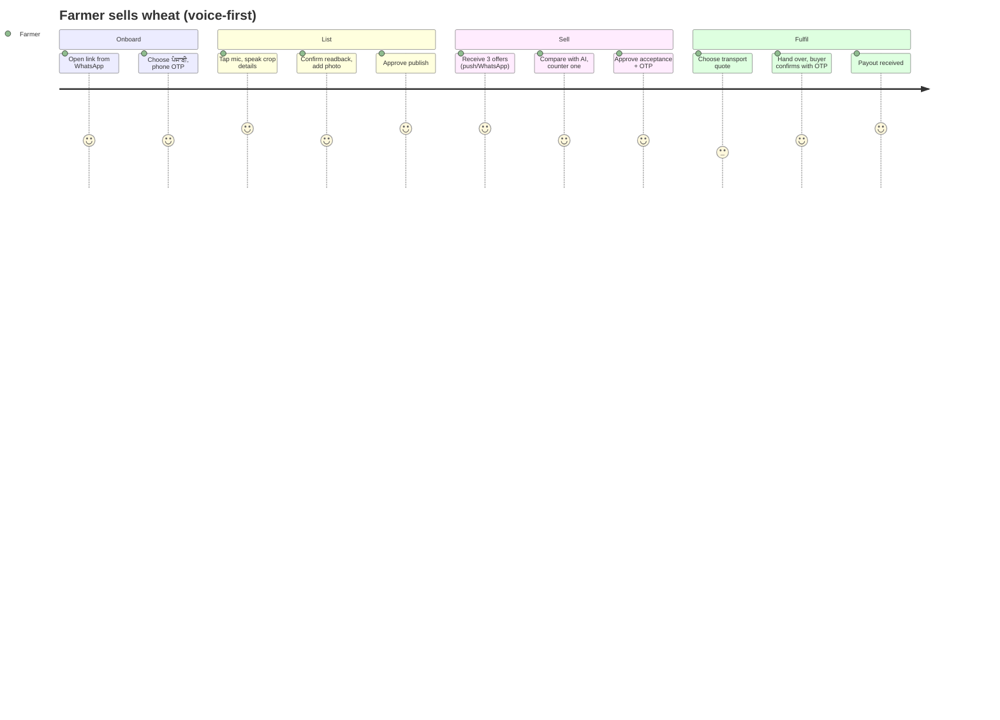
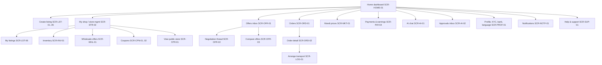
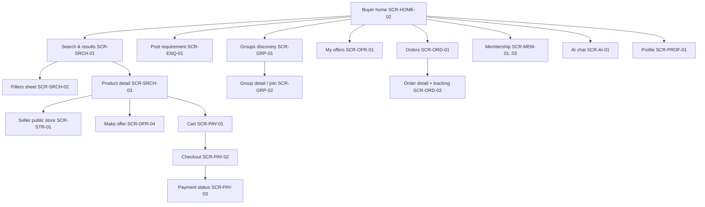
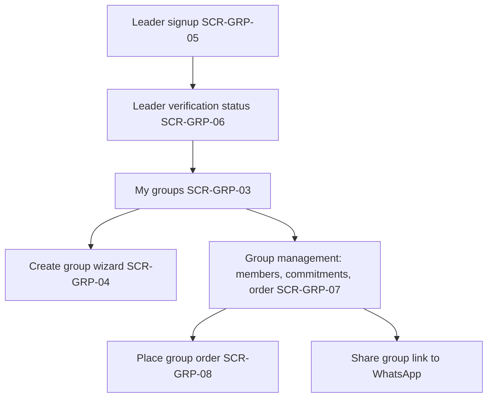
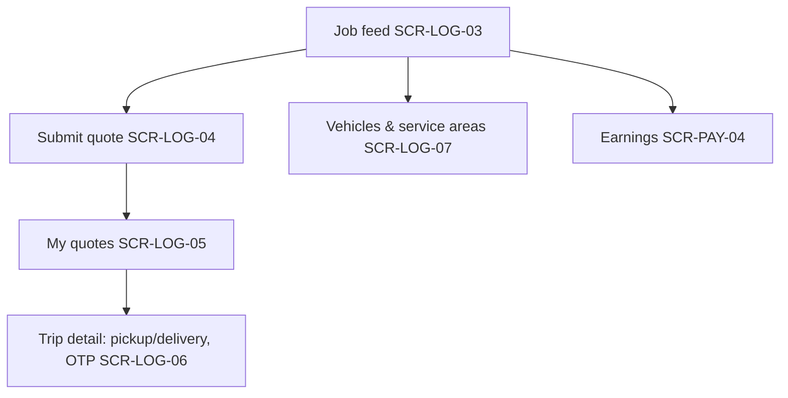

# KISAAN — UX / UI Specification

> Status: Draft v0.1 · Last updated: 2026-11-14 · Owner: KISAAN product & architecture · Source of truth index: [README](README.md)

This document covers the user experience and interface design for KISAAN: design principles for rural, low-literacy and low-bandwidth users, the design system, navigation and page hierarchy per role, the AI chat experience, and screen-by-screen specifications (master prompt §6, §8).

Related: [PRD](PRD.md) · [FUNCTIONAL_SPECIFICATION](FUNCTIONAL_SPECIFICATION.md) · [AI_AGENT_ARCHITECTURE](AI_AGENT_ARCHITECTURE.md) · [API_SPECIFICATION](API_SPECIFICATION.md) · [TESTING_STRATEGY](TESTING_STRATEGY.md)

---

## Table of contents

1. UX principles
2. Personas and key journeys
3. Design system
4. Platform, layout and responsiveness
5. Navigation and page hierarchy per role
6. Dashboard layouts
7. AI chat interface
8. Screen specifications
9. Interaction states (global standards)
10. Accessibility
11. Low-bandwidth and offline UX
12. Localisation rules
13. Open decisions and assumptions raised here

---

## 1. UX principles

| # | Principle | Practical rule |
|---|---|---|
| U1 | **Speak first, type last** | A large microphone button is on every primary screen. Every form field accepts voice. |
| U2 | **One task per screen, one question per turn** | Wizard-style flows with ≤ 3 inputs per step; progress dots. |
| U3 | **Show, don't write** | Icons + photos + colour + short labels; numbers are large. Every critical text has a 🔊 "listen" control. |
| U4 | **Same pattern everywhere** | One approval card, one product card, one status chip vocabulary across the app. |
| U5 | **Trust is visible** | Verification badges, "Seller-declared" vs "Verified" labels, data source + "as of" time on every price. |
| U6 | **Forgiving** | Drafts auto-save; undo for 10 s on non-committing actions; no data loss on network drop. |
| U7 | **Lightweight** | First load ≤ 200 KB JS (gzipped) on the farmer shell; images lazy-loaded and served as WebP/AVIF at the right size. |
| U8 | **AI and screens are equal paths** | Every AI action has a conventional screen; every screen has an "Ask KISAAN" entry pre-filled with context. |
| U9 | **Respect for the user** | No dark patterns: no fake urgency, no pre-ticked auto-renewal, cancellation as easy as sign-up (see MEM and [SECURITY_AND_COMPLIANCE](SECURITY_AND_COMPLIANCE.md)). |

---

## 2. Personas and key journeys

| Persona | Profile | Primary goals | Design implications |
|---|---|---|---|
| **Gurpreet (Farmer, Moga)** | 45, 12 acres wheat/paddy, Punjabi speaker, reads Gurmukhi slowly, Android phone (2–3 GB RAM), patchy 4G, WhatsApp daily | Sell harvest at a fair rate, get paid reliably | Voice-first, Punjabi default, big buttons, WhatsApp parity |
| **Rajesh (Wholesaler, Ludhiana)** | 38, buys 500–2,000 qtl/month, Hindi/English, uses laptop + phone | Find reliable supply, compare offers, manage orders | Dense list views on desktop, filters, bulk actions |
| **Harjit (Group Leader, village)** | 50, respected in village, coordinates purchases for 20 families | Aggregate demand, get wholesale rate | Group dashboard, member list, share link to WhatsApp |
| **Sukhdev (Transporter, Bathinda)** | 33, owns two trucks, Punjabi/Hindi | Get loads, quote fast, get paid | Job feed, one-tap quote, OTP delivery proof |
| **Admin / Verifier (Ops team)** | Desktop users | Verify sellers, moderate, resolve disputes, monitor AI | Data tables, queues, keyboard shortcuts |

Key journeys (step-level detail in [FUNCTIONAL_SPECIFICATION](FUNCTIONAL_SPECIFICATION.md)):



---

## 3. Design system

Name: **"Khet" design system**. Implemented as Tailwind theme tokens + a React component library (shadcn/ui-style headless primitives, Radix) [ASSUMPTION A-40: Radix/shadcn acceptable].

### 3.1 Colour tokens

| Token | Hex | Use | Contrast vs `#FFFFFF` |
|---|---|---|---|
| `green-700` (primary) | `#1B6E3A` | Primary buttons, active nav, links | ≈ 6.3 : 1 (AA normal text) |
| `green-800` | `#145A2F` | Pressed state, headers | ≈ 8 : 1 |
| `green-100` | `#E3F1E7` | Selected backgrounds, success surfaces | n/a (background) |
| `white` (secondary) | `#FFFFFF` | Surfaces | — |
| `cream-50` (page bg) | `#FAF7F0` | App background | — |
| `earth-700` | `#6B4F2A` | Secondary text accents, category chips | ≈ 7.4 : 1 |
| `earth-200` | `#E8DCC8` | Dividers, card borders | — |
| `amber-700` | `#B45309` | Offers, deals, coupon chips, warnings text | ≈ 5.0 : 1 (AA) |
| `amber-100` | `#FEF3C7` | Deal/warning backgrounds | — |
| `ink-900` (text) | `#1F2A1F` | Body text | ≈ 14.9 : 1 |
| `ink-600` (muted) | `#5B6459` | Secondary text | ≈ 6.1 : 1 |
| `red-700` (error) | `#B42318` | Errors, destructive actions | ≈ 6.6 : 1 |
| `blue-700` (info) | `#1D4ED8` | Info, links in admin | ≈ 6.7 : 1 |

Rules: text contrast ≥ 4.5 : 1 (WCAG 2.2 AA), large text/icons ≥ 3 : 1. Colour is **never** the only signal; status chips always carry an icon and a word. Contrast values are approximate and must be verified with tooling in the design QA step.

Dark mode: Future (outdoor sunlight readability is the priority; a high-contrast mode is MVP — see §10).

### 3.2 Typography

| Script | Font (all open-licence) | Fallback |
|---|---|---|
| Latin | Noto Sans (or Inter) | system-ui |
| Gurmukhi | Noto Sans Gurmukhi | system Gurmukhi font |
| Devanagari | Noto Sans Devanagari | system Devanagari font |
| Numerals | Tabular figures (`font-variant-numeric: tabular-nums`) for prices/quantities | — |

Fonts are subset per script and loaded only for the active language (`font-display: swap`), keeping each font ≤ 60 KB WOFF2 [ASSUMPTION A-41].

Type scale (mobile; desktop +2 px on body):

| Token | Size / line height | Weight | Use |
|---|---|---|---|
| `display` | 28 / 36 | 700 | Key numbers (price, quantity) |
| `h1` | 24 / 32 | 700 | Screen titles |
| `h2` | 20 / 28 | 600 | Section titles |
| `body-lg` | 18 / 28 | 400 | Default body for farmer/transporter UI |
| `body` | 16 / 24 | 400 | Buyer/admin body; minimum anywhere |
| `caption` | 14 / 20 | 500 | Metadata, timestamps (never for critical info) |

Gurmukhi and Devanagari need about 10–15% extra line height (applied via `:lang(pa)`, `:lang(hi)` selectors).

### 3.3 Spacing, sizing, radius, elevation

- Spacing scale: 4, 8, 12, 16, 24, 32, 48 px.
- **Touch targets ≥ 48 × 48 px** (56 px for primary actions in farmer/transporter UI), with ≥ 8 px between targets.
- Radius: 8 px (inputs), 12 px (cards), 999 px (chips, mic button).
- Elevation: two levels only (card, sheet/modal) to keep rendering cheap.

### 3.4 Iconography and imagery

- Icon set: Lucide (outline, 24 px; 28 px in farmer UI) plus a custom crop icon set (wheat, paddy, maize, pulses, potato, onion, kinnow) drawn as simple pictograms recognisable without text.
- Units always shown with an icon + word: ⚖ quintal / kg / tonne.
- Product photos: 1:1 thumbnails (160 px) and 4:3 detail (up to 1080 px wide); a blur-up placeholder ≤ 1 KB.

### 3.5 Core components

| Component | Variants / notes |
|---|---|
| `Button` | primary, secondary, ghost, destructive; sizes md (48 px), lg (56 px); loading state with spinner and preserved width |
| `MicButton` | Floating 64 px circle; states: idle, listening (pulsing ring + live waveform), processing, error; hold-to-talk and tap-to-toggle |
| `ListenButton` (🔊) | Plays TTS of the adjacent text block |
| `ProductCard` | Photo, crop icon, name + variety, qty available, price/unit, wholesale badge ("Thok rate"), distance, seller badge, member price tag (if any) |
| `PriceBlock` | Large unit price, unit, wholesale tiers table, applied discounts breakdown, "as of"/source for reference prices |
| `ApprovalCard` | Fixed layout: icon + action title, terms list, total, counterparty, expiry countdown, 🔊 readback, **✔ Approve** (primary) / **✖ Cancel** (secondary); step-up OTP sheet when required |
| `StatusChip` | draft, live, paused, sold out, pending, accepted, rejected, expired, paid, in transit, delivered, disputed — each with fixed icon + colour |
| `TrustBadge` | Phone verified, KYC verified, bank verified, GST verified, top seller (P2) |
| `QuantityInput` | Number pad + unit selector (kg/qtl/t); shows converted value ("100 qtl = 10,000 kg") |
| `Stepper` | Progress dots + step label |
| `OfflineBanner` | "You're offline — changes will be sent when connected" |
| `EmptyState` | Illustration + one sentence + one primary action + "Ask KISAAN" |
| `Toast` | Success/error; ≤ 6 s; with undo where applicable |
| `BottomSheet` | Filters, unit picker, OTP, confirmation |
| `DataTable` (admin) | Sort, filter, column chooser, bulk select, CSV export |
| `ChatBubble`, `AgentCard`, `QuickReplies` | AI chat (see §7) |
| `LanguageSwitcher` | ਪੰਜਾਬੀ / हिंदी / English, always reachable from profile and onboarding |

---

## 4. Platform, layout and responsiveness

- **Next.js PWA** (installable, offline shell, background sync). Breakpoints: `sm` 360 px (design baseline), `md` 768 px, `lg` 1024 px, `xl` 1280 px.
- Farmer, transporter and group leader UIs are designed for 360 × 640 first. Buyer UI is responsive with a desktop list/detail layout. Admin is desktop-first (≥ 1280 px) with a usable tablet layout.
- Bottom navigation on mobile (max 5 items); left sidebar on `lg+`.
- Server-rendered public pages (store, product, group) for SEO and fast first paint; app pages use client navigation with cached data.

---

## 5. Navigation and page hierarchy per role

Role switching: a multi-role user sees a **role switcher** in the header ("Selling / Buying / Transport") and the bottom nav changes accordingly. The AI chat is shared and role-aware.

### 5.1 Farmer / Seller

Bottom nav: **Home · Sell (+) · Offers · Orders · Chat (🎤)**. Profile/Store/Inventory/Coupons are under Home → "My shop" and the avatar menu.



### 5.2 Buyer

Bottom nav: **Home · Search · Groups · Orders · Chat (🎤)**; Cart/Offers via header icons.



### 5.3 Group Leader (buyer with `group_leader` role)

Additional nav item under Groups: **My groups**.



### 5.4 Transporter

Bottom nav: **Jobs · My quotes · Trips · Earnings · Chat (🎤)**.



### 5.5 Admin (desktop)

Left sidebar sections:

```mermaid
flowchart TD
    AD[Admin overview SCR-ADM-01] --> U[Users & roles SCR-ADM-02]
    AD --> V[Verification queue SCR-ADM-03]
    AD --> M[Listing moderation SCR-ADM-04]
    AD --> O[Orders monitor SCR-ADM-05]
    AD --> P[Payments & settlements SCR-ADM-06]
    AD --> D[Disputes SCR-ADM-07]
    AD --> T[Trust flags SCR-ADM-08]
    AD --> G[Groups & leaders SCR-ADM-09]
    AD --> MB[Membership plans & T&C versions SCR-ADM-10]
    AD --> C[Commission & fees config SCR-ADM-11]
    AD --> AI[AI monitoring & costs SCR-ADM-12]
    AD --> R[Reports & analytics SCR-ADM-13]
    AD --> CFG[Platform configuration & audit log SCR-ADM-14]
```



---

## 6. Dashboard layouts

### 6.1 Farmer home — SCR-HOME-01 (mobile 360 px)

```text
┌──────────────────────────────────┐
│ ☰  KISAAN        ਪੰ  🔔3   (GP) │  header: lang, notifications, avatar
├──────────────────────────────────┤
│ ਸਤ ਸ੍ਰੀ ਅਕਾਲ, ਗੁਰਪ੍ਰੀਤ ਜੀ 🔊       │
│ ┌──────────────────────────────┐ │
│ │ 🎤  ਬੋਲ ਕੇ ਦੱਸੋ — ਕੀ ਵੇਚਣਾ ਹੈ? │ │  big voice CTA (56px)
│ └──────────────────────────────┘ │
│ ┌──────────┐ ┌──────────┐        │
│ │ 💬 3     │ │ 📦 1      │        │  tiles: New offers / Active orders
│ │ ਨਵੀਆਂ    │ │ ਆਰਡਰ     │        │
│ │ ਪੇਸ਼ਕਸ਼ਾਂ │ │ ਚੱਲ ਰਹੇ   │        │
│ └──────────┘ └──────────┘        │
│ ┌──────────┐ ┌──────────┐        │
│ │ ✅ 2      │ │ ₹ 48,000 │        │  Pending approvals / Payments due
│ │ ਮਨਜ਼ੂਰੀਆਂ │ │ ਆਉਣੇ ਹਨ  │        │
│ └──────────┘ └──────────┘        │
│ ਮੰਡੀ ਰੇਟ (ਕਣਕ) · as of 09:00 🔊   │
│ Moga ₹—  Jagraon ₹—  Khanna ₹—   │  from MKT feed; "—" if unavailable
│ ਮੇਰਾ ਮਾਲ                          │
│ [🌾 ਕਣਕ PBW-826 · 100 ਕੁ. · Live]│  listing cards
├──────────────────────────────────┤
│ 🏠  ➕ਵੇਚੋ  💬ਪੇਸ਼ਕਸ਼  📦ਆਰਡਰ  🎤 │  bottom nav
└──────────────────────────────────┘
```

Content priority: (1) voice CTA, (2) items needing action (offers, approvals), (3) money, (4) prices, (5) listings.

### 6.2 Buyer home — SCR-HOME-02

Mobile: search bar with mic → "Your requirements" chips → "Near you" product cards → active groups near you → orders in progress. Desktop: two-column layout (search + results feed left; orders/offers summary right).

### 6.3 Transporter home — Job feed SCR-LOG-03

Cards sorted by distance to pickup: route (A → B, km), load (qty, packaging), pickup window, required vehicle, "Quote" button. Filter: my service areas / vehicle type.

### 6.4 Admin overview — SCR-ADM-01 (desktop)

```text
┌───────────┬─────────────────────────────────────────────────────────────┐
│ KISAAN    │ Overview  [Today|7d|30d|Custom]       Search ⌘K   (Admin)   │
│ Admin     ├─────────────────────────────────────────────────────────────┤
│ Overview  │ KPI tiles: Users | Verified farmers | Buyers | Active        │
│ Users     │ listings | Orders (pending/completed) | GMV | Commission     │
│ Verify(12)│ | Open disputes | Trust flags | AI cost today                │
│ Listings  ├───────────────────────────────┬─────────────────────────────┤
│ Orders    │ GMV & orders trend (line)     │ Listings by category (bar)  │
│ Payments  ├───────────────────────────────┼─────────────────────────────┤
│ Disputes  │ Funnel: search→enquiry→offer→ │ Queues needing action:      │
│ Trust (5) │ order→paid→delivered          │ verification, moderation,   │
│ Groups    │                               │ disputes, failed payouts    │
│ Membership├───────────────────────────────┴─────────────────────────────┤
│ Fees      │ AI agents: task success %, fallback %, P95 latency, cost/agent │
│ AI        │ Recent audit events                                           │
│ Reports   │                                                               │
│ Config    │                                                               │
└───────────┴─────────────────────────────────────────────────────────────┘
```

KPI definitions are in the ANL section of the [PRD](PRD.md).

---

## 7. AI chat interface — SCR-AI-01

The chat is the **central interaction point**: reachable from the bottom-nav 🎤 button, from "Ask KISAAN" on every screen (opens with context, e.g. the current listing), and from WhatsApp.

### 7.1 Layout (mobile)

```text
┌──────────────────────────────────┐
│ ←  KISAAN ਸਹਾਇਕ   ਪੰ ▾   ⋮        │  language override, menu (history, clear)
├──────────────────────────────────┤
│              ┌──────────────────┐│
│              │🎤 0:06 ▶  "ਮੇਰੇ ││  user voice bubble + transcript
│              │ਕੋਲ 100 ਕੁਇੰਟਲ…" ││  (tap transcript to edit)
│              └──────────────────┘│
│┌──────────────────────────────┐  │
││ ਠੀਕ ਹੈ। ਕਣਕ ਦੀ ਕਿਹੜੀ ਕਿਸਮ ਹੈ? 🔊│  │  assistant bubble with listen
│└──────────────────────────────┘  │
│ [PBW-826] [HD-3086] [ਹੋਰ] [ਪਤਾ ਨਹੀਂ]│  quick replies (≥48px)
│┌──────────────────────────────┐  │
││ 📝 Draft listing               │  │  AgentCard (draft)
││ 🌾 ਕਣਕ · 100 ਕੁ. · ਮੋਗਾ          │  │
││ ਕਿਸਮ: — · ਰੇਟ: —               │  │  missing fields highlighted
││ [Edit on screen]               │  │  deep link to SCR-LST-02
│└──────────────────────────────┘  │
├──────────────────────────────────┤
│ 📷  [ ਲਿਖੋ…               ]  (🎤) │  composer: camera, text, big mic
└──────────────────────────────────┘
```

### 7.2 Message and card types

| Type | Purpose | Notes |
|---|---|---|
| Text bubble | Assistant/user messages | Max 3 short sentences; 🔊 on assistant bubbles; auto-play TTS when the user's last turn was voice (setting) |
| Voice bubble | User voice | Waveform, duration, transcript (editable before sending in "review transcript" mode, default off for farmers) |
| Quick replies | Fast answers | Max 4, plus "Other / ਹੋਰ" |
| Product/listing card | Results | Same as `ProductCard`; horizontally scrollable list of ≤ 5 |
| Comparison table card | Offer/transport comparison | Collapses to stacked cards on 360 px |
| Price card | Mandi prices | Source + as-of always shown; "Reference only" label |
| Draft card | Listing/offer/requirement/group drafts | Missing fields marked; "Edit on screen" deep link |
| **Approval card** | Commit actions | Standard `ApprovalCard`; never auto-approved; voice "haan" requires a second confirmation for payments/orders/offer acceptance (see APR) |
| Status/timeline card | Orders, shipments, payments | Step timeline with current step highlighted |
| Handoff card | Human support | Ticket number, expected response time |
| System notice | Offline, degraded AI, budget limit | Neutral style |

### 7.3 Voice interaction states (MicButton)

| State | Visual | Audio/haptic | Text |
|---|---|---|---|
| Idle | Green mic | — | "ਬੋਲੋ / बोलिए / Speak" |
| Listening | Pulsing ring + live waveform; timer | Short beep + vibrate on start | "ਸੁਣ ਰਿਹਾ ਹਾਂ…" |
| Too quiet / noisy | Amber ring | — | "ਥੋੜ੍ਹਾ ਨੇੜੇ ਹੋ ਕੇ ਬੋਲੋ" (speak closer) |
| Processing | Spinner inside mic | — | "ਸਮਝ ਰਿਹਾ ਹਾਂ…" |
| Low confidence | Transcript shown with uncertain words underlined | — | "ਕੀ ਤੁਸੀਂ '100 ਕੁਇੰਟਲ' ਕਿਹਾ?" + Yes/No |
| Offline | Mic disabled with cloud-off icon; voice notes can still be recorded and queued (P2) | — | "ਇੰਟਰਨੈੱਟ ਨਹੀਂ — ਬਾਅਦ ਵਿੱਚ ਭੇਜਾਂਗੇ" |
| Error | Red ring | Double vibrate | "ਦੁਬਾਰਾ ਕੋਸ਼ਿਸ਼ ਕਰੋ" + type fallback |
| Permission denied | Mic with slash | — | Instructions to enable microphone + text fallback |

### 7.4 Approvals inbox — SCR-AI-02

A list of pending approvals (action, amount, counterparty, expiry countdown) with Approve/Cancel actions; filter by type; history tab (approved/rejected/expired with timestamps). Badge count in the header.

### 7.5 AI transparency

- Every AI message has a small "AI" label; long-press shows "Why this?" (sources, data timestamps).
- Thumbs up/down on assistant messages (feeds evaluation, see [AI_AGENT_ARCHITECTURE](AI_AGENT_ARCHITECTURE.md) §15).
- "Talk to a person" is always in the ⋮ menu.

---

## 8. Screen specifications

Format per screen: **Purpose · Roles · Entry points · Components · Data · Actions · States · Accessibility · Related requirements.** Global states follow §9; only screen-specific deviations are listed.

### 8.1 Onboarding and profile

#### SCR-ONB-01 Language and welcome
- **Purpose:** Choose language before anything else. **Roles:** all (logged out).
- **Components:** Three large tiles with native-script labels and 🔊 (ਪੰਜਾਬੀ, हिंदी, English); short welcome video/animation (≤ 300 KB, optional, P2).
- **Actions:** Select language → SCR-ONB-02. **States:** none beyond default.
- **Accessibility:** Tiles 96 px tall; each auto-reads its label on focus.
- **Related:** VOX, AUTH.

#### SCR-ONB-02 Phone sign-in (OTP)
- **Purpose:** Register/login with mobile number. **Components:** Phone input with +91 prefix, numeric keypad, consent checkbox (not pre-ticked) linking to privacy notice in the chosen language (PRIV), "Send OTP" button; OTP screen with 6 boxes, SMS autofill (WebOTP API where supported), resend timer (30 s), "Get OTP on WhatsApp" option (WA, if enabled).
- **States:** wrong OTP (inline error, remaining attempts), rate-limited (wait time), SMS delay (show WhatsApp option after 30 s).
- **Related:** AUTH, PRIV. Note: phone-OTP auth is a Kisaan plugin capability, since opsapi lacks SMS OTP (see OPSAPI_INTEGRATION).

#### SCR-ONB-03 Role selection
- **Purpose:** Pick what the user wants to do: "ਮੈਂ ਵੇਚਣਾ ਚਾਹੁੰਦਾ ਹਾਂ (Sell)", "ਖਰੀਦਣਾ (Buy)", "ਟਰਾਂਸਪੋਰਟ (Transport)". Multi-select allowed. Group leader sign-up is a **separate entry** ("Buy for my village/group?" → SCR-GRP-05).
- **Related:** PROF, ONB.

#### SCR-ONB-04 Basic profile wizard (per role)
- Steps (≤ 3 inputs each): name (voice-enabled) → village/town + district (GPS "use my location" with consent, or picker) → role-specific fields (seller: main crops, land size range optional; buyer: buyer type, business name, GSTIN optional; transporter: vehicle summary). Skip-able non-mandatory steps.
- **Related:** ONB.

#### SCR-ONB-05 Verification centre
- **Purpose:** Show verification level and next steps. **Components:** checklist with badges: phone ✔, identity (method per ONB, e.g. DigiLocker/offline verification — see SECURITY_AND_COMPLIANCE) , bank account (penny-drop) — required before first payout, GSTIN (buyers/businesses, optional for farmers), transporter documents (RC, licence).
- **States:** pending review (with expected time), rejected (reason + re-upload), verified.
- **Related:** ONB, AI-TRS (human-reviewed).

#### SCR-PROF-01 Profile and settings
- Sections: personal details, roles, language, notification preferences (push / WhatsApp / SMS toggles, quiet hours), privacy (show village vs district only on store; discoverable for outreach), bank account (view masked; change requires OTP and is never done via AI), conversation history management (delete), membership status, logout, delete account request.
- **Related:** PROF, PRIV, NOTF.

### 8.2 Listing creation and management (seller)

#### SCR-LST-01 Create listing — method choice
- **Components:** three large options: 🎤 "ਬੋਲ ਕੇ (Speak)", 📷 "ਫੋਟੋ ਤੋਂ (From photo)", ✍ "ਫਾਰਮ ਭਰ ਕੇ (Fill form)". Speak and photo open the chat with the Listing Agent context; the form opens SCR-LST-02.

#### SCR-LST-02 Listing form wizard (4 steps)
| Step | Fields | Notes |
|---|---|---|
| 1. Crop | Category (icon grid of MVP categories), variety (searchable list + "other"), | Attribute schema loads per category (CAT) |
| 2. Quantity & quality | Quantity + unit (`QuantityInput`), harvest date, grade (seller-declared, optional), moisture % (optional), packaging (loose / bags + bag weight), storage | Labels show "Seller-declared" |
| 3. Price & terms | Expected price per unit, negotiable toggle, minimum order qty, available from/until, pickup location (default farm address), delivery option (buyer pickup / seller can deliver) | Mandi reference price card shown with source and as-of, labelled "reference only" |
| 4. Photos | Up to 6; camera or gallery; client-side compression to ≤ 200 KB each; AI hints shown as suggestions | EXIF stripped before upload |
- **Actions:** Save draft (auto every change), Next/Back, "Review".
- **States:** validation errors inline per field in user's language; offline → saved locally, banner shows "will publish when online" (publish still needs approval once online).
- **Related:** PRD, CAT, INV, AI-LST.

#### SCR-LST-03 Review and publish
- Summary card (all fields, photos), price shown per unit and total value, **wholesale offer toggle** (→ SCR-WHL-01), 🔊 readback, `ApprovalCard` "Publish listing".
- **Success:** confirmation with share-to-WhatsApp button and link to the public product page.

#### SCR-LST-04 Photo capture helper
- Camera overlay with guidance ("ਦਾਣੇ ਨੇੜੇ ਤੋਂ ਦਿਖਾਓ — show grain close-up", "ਪੂਰਾ ਢੇਰ — whole heap"); retake; quality check (blur/dark warning).

#### SCR-LST-05 AI suggestions panel
- Shows AI-extracted hints with confidence chips ("AI suggestion — please check"), accept/reject per field. Never displays grade/moisture as AI-derived (G2 in AI architecture).

#### SCR-LST-06 My listings
- Tabs: Live · Draft · Paused · Sold out · Expired. Card shows available/reserved quantities, views/enquiries count, status chip. Actions: edit, pause/resume, mark sold out, duplicate, share. Price or quantity edits on live listings require approval.

### 8.3 Wholesale offers (seller) — SCR-WHL-01
- **Purpose:** Configure "Buy the whole lot" price and quantity tiers per listing (see WHL requirements in PRD).
- **Components:** Toggle "Wholesale offers on"; "Whole lot price" (per unit or % off); tier table (min qty, discount type %/₹ per unit, value) — add/remove rows (max 5 tiers); live preview "Buyer buying 120 qtl pays ₹2,400/qtl (₹2,88,000)"; stacking info ("Coupons can/can't be combined", per PRC rules).
- **Validation:** tiers strictly ascending in min qty; discounts strictly increasing; effective price > 0; whole lot price ≤ lowest tier price (warn otherwise); tiers can't exceed available qty (warn).
- **Actions:** Save (C if listing is live → approval).
- **Related:** WHL, PRC.

### 8.4 Inventory — SCR-INV-01 / SCR-INV-02
- **SCR-INV-01 Inventory overview:** per listing: total, available, reserved (with link to the orders/offers holding it), sold; low-stock threshold setting; badges "Low stock", "Out of stock — hidden from search".
- **SCR-INV-02 Adjust stock:** quantity +/-; mandatory reason (damage/spoilage, sold offline, recount, other + note); approval card; movement history list (timestamp, type: reservation/release/deduction/adjustment, qty, reference, actor). Automatic movements are read-only.
- **States:** concurrent change conflict ("stock changed since you opened this — review") with refresh.
- **Related:** INV.

### 8.5 Search and discovery (buyer)

#### SCR-SRCH-01 Search and results
- **Components:** Search bar (text + 🎤, suggestions in all three scripts), active filter chips, sort (Relevance, Price low→high, Distance, Newest, Rating), result list of `ProductCard`s (mobile) / grid with map toggle (desktop, P2 map). Wholesale badge and "from ₹X with wholesale" line; member price tag if eligible; coupon chip "Coupon available".
- **Empty:** "No matches" + actions: widen distance, post a requirement (SCR-ENQ-01), set alert, ask KISAAN.
- **Related:** SRCH.

#### SCR-SRCH-02 Filters (bottom sheet)
- Category, variety, quantity available ≥, price range, distance/district, quality grade (seller-declared), verified sellers only, wholesale available, delivery available, harvest date. "Apply (N results)" button with live count.

#### SCR-SRCH-03 Product detail
```text
┌──────────────────────────────────┐
│ ←                         ♡  ⤴   │
│ [ photo carousel 4:3 ]  1/4      │
│ 🌾 Wheat · PBW-826               │
│ ₹2,500 / quintal   ✓ Negotiable  │  display size price
│ 100 qtl available · Moga (32 km) │
│ ┌ Wholesale (Thok rate) ───────┐ │
│ │ 50+ qtl   ₹2,450 (−2%)        │ │
│ │ 80+ qtl   ₹2,425 (−3%)        │ │
│ │ Whole lot (100 qtl) ₹2,400    │ │
│ └──────────────────────────────┘ │
│ 🏷 Coupon KANAK50: ₹50/qtl off   │  amber chip, validity date shown
│ ⭐ Member: free delivery         │  if membership benefit applies
│ Quality (seller-declared): Gr A  │
│ Harvested: Apr 2026 · Bags 50kg  │
│ Mandi ref: Moga ₹— (as of …) ℹ   │
│ ┌ Seller ──────────────────────┐ │
│ │ Gurpreet Farms ✔KYC ⭐4.7 (23)│ │
│ │ [Visit store]                 │ │
│ └──────────────────────────────┘ │
│ Qty: [ 60 ] qtl  → ₹2,450/qtl    │  live price calc via pricing quote
│ Subtotal ₹1,47,000  Coupon −3,000│
├──────────────────────────────────┤
│ [Make offer]     [Add to cart]   │  sticky actions
└──────────────────────────────────┘
```
- **Data:** listing, tiers, coupon(s) applicable, membership eligibility, seller summary, reference price.
- **Actions:** quantity entry → price breakdown recalculated server-side (PRC); Make offer → SCR-OFR-04; Add to cart → SCR-PAY-01; Ask seller (platform chat; contact details hidden); Ask KISAAN.
- **States:** listing paused/sold out (actions disabled, "Notify me" button); reserved quantity reduces available in real time; quantity > available → inline error.
- **Accessibility:** price breakdown readable by 🔊; tier table is a real table with headers.
- **Related:** SRCH, WHL, CPN, MEM, PRC.

#### SCR-ENQ-01 Post a requirement (RFQ)
- Wizard: product + variety → quantity + quality → delivery location + date → budget (optional, private or visible) → review with approval card. After publishing: matched sellers count, offers received.
- **Related:** ENQ, AI-DSC, AI-MAT.

### 8.6 Public seller store — SCR-STR-01 / SCR-STR-02

#### SCR-STR-01 Public store page (logged-out accessible, SEO-rendered)
- **URL:** `/store/{store-slug}` (shareable).
- **Components:** banner image, store name, verification badges, rating and review count, location (village or district only per privacy setting), service area, member since, response-time indicator (P2), description and policies (cancellation, delivery), list of live listings (product cards), reviews list, "Share" (WhatsApp/copy link), "Report store".
- **Privacy:** phone and exact address never shown; contact via platform after login.
- **States:** store paused ("This store is not taking orders right now"), no live listings (empty state with "Follow store", P2).
- **Related:** STR.

#### SCR-STR-02 Store management
- Edit store name, slug (once per 30 days), banner (upload with crop), description (voice dictation + AI "improve text" suggestion), policies (templates), visibility toggle, preview as public.
- **Related:** STR.

### 8.7 Offers and negotiation

#### SCR-OFR-01 Offers inbox
- Tabs: Received · Sent · Closed. Each row: counterparty + trust badge, product, qty, offered price vs listing price (difference in ₹ and %), expiry countdown, status chip. "Compare" multi-select (2–4) → SCR-OFR-03.

#### SCR-OFR-02 Negotiation thread
```text
┌──────────────────────────────────┐
│ ← Sharma Traders ✔ ⭐4.6          │
│ Wheat PBW-826 · 100 qtl          │
├──────────────────────────────────┤
│ Your listing     ₹2,500/qtl      │
│ ▸ Offer #1 (buyer)  ₹2,420  ✖    │  timeline of offers/counters
│ ▸ Counter (you)     ₹2,480       │
│ ▸ Offer #2 (buyer)  ₹2,460  ⏳23h │  current, with expiry
│ Terms: buyer pickup · pay via    │
│ KISAAN on delivery               │
│ 💡 AI: Moga ref ₹— (as of …).     │  AI-NEG hint, grounded, dismissable
│ Offer is ₹40 below your listing. │
├──────────────────────────────────┤
│ [Accept]  [Counter]  [Reject]    │
│ [Ask KISAAN to compare]          │
└──────────────────────────────────┘
```
- **Actions:** Accept / Reject / Counter — each opens an `ApprovalCard` (C-class); Counter opens a sheet with price + qty + message (AI draft available). Messages within the thread are moderated; phone numbers/UPI IDs masked with a warning ("Pay only through KISAAN").
- **States:** offer expired (actions disabled, "Make new offer"); listing stock changed (warning); counterparty withdrew.
- **Related:** OFR, AI-NEG, APR.

#### SCR-OFR-03 Compare offers
- Normalised table (mobile: stacked cards) with price/unit, quantity, payment terms, transport responsibility, estimated net-to-seller (only if a transport quote exists; else "unknown"), buyer trust, expiry. AI summary at the top with the explicit line "Decision is yours".

#### SCR-OFR-04 Make offer (buyer)
- Quantity, price per unit (shows listing price, wholesale price for that quantity, and difference), delivery preference, message, validity (default 24 h). Approval card to send.

### 8.8 Cart, checkout and payments

#### SCR-PAY-01 Cart
- Items grouped **by seller** (one order per seller). Per item: qty editing with live tier pricing, reservation timer once checkout starts ("Stock held for 15:00"). Coupon field per seller (one seller coupon per order, PRC). Membership benefits line.

#### SCR-PAY-02 Checkout
- Sections: delivery address/pickup, delivery method (buyer pickup / seller delivers / KISAAN transport request), price breakdown (base → wholesale → negotiated → coupon → delivery fee → membership waiver → taxes if applicable → total), GSTIN for invoice (optional), payment method (handled by the Payment Aggregator: UPI intent/collect, cards, net banking), T&C/cancellation policy summary, "Pay ₹X" button.
- The **Pay button is the approval** for payment (APR-004): tapping it opens the PA flow; the AI cannot trigger it.
- **States:** price changed since cart (show diff, require re-confirmation), stock reservation expired (re-reserve or remove), coupon invalid (reason shown), PA unavailable (retry / alternative method).
- **Related:** PAY, PRC, CPN, MEM, INV.

#### SCR-PAY-03 Payment status
- States: processing (do not close), success (order number(s), invoice link, next steps), failed (reason in plain language, retry, "money debited?" help link), pending (explains auto-reconciliation and time, creates watch; push when resolved).

#### SCR-PAY-04 Payments & earnings (seller/transporter)
- Summary: received this month, pending settlement (with expected date), on hold (dispute). List of settlements (order, gross, commission, fees, net, UTR/reference, date). Download statement (PDF/CSV). Bank account (masked) with verification status.
- **Related:** PAY, INVC.

### 8.9 Orders

#### SCR-ORD-01 Orders list
- Tabs: Active · Completed · Cancelled. Card: order no., counterparty, product, qty, total, status chip, next action ("Arrange transport", "Confirm pickup", "Rate seller").

#### SCR-ORD-02 Order detail
- Status timeline (Placed → Confirmed → Paid → Pickup scheduled → In transit → Delivered → Completed / Disputed), parties, items with price breakdown, payment status, invoice download, transport info (transporter, vehicle no., contact via platform call masking P2), delivery OTP (shown to buyer only, with 🔊), actions: cancel (policy-dependent, approval), raise issue/dispute (SCR-SUP-02), rate & review (after completion).
- **Related:** ORD, LOG, INVC, DSP, REV.

### 8.10 Logistics

#### SCR-LOG-01 Arrange transport (seller/buyer)
- Pre-filled from order: pickup, drop, load (kg, packaging), date window. Options: "Request quotes from KISAAN transporters" (approval to publish), "I'll arrange my own" (enter vehicle no. optional).
#### SCR-LOG-02 Transport quotes
- Comparison cards: transporter (badges, rating), vehicle type/capacity, price, pickup window, quote expiry; AI summary; Accept → approval card.
#### SCR-LOG-03 Job feed (transporter) — see §6.3.
#### SCR-LOG-04 Submit quote
- Price (total), vehicle selection, pickup date/time window, notes; validity; submit (approval card for transporter).
#### SCR-LOG-05 My quotes — status: submitted, accepted, rejected, expired.
#### SCR-LOG-06 Trip detail (transporter)
- Steps with big buttons: "Reached pickup" → "Loaded" (photo of loaded vehicle + seller OTP or seller confirmation) → "In transit" → "Delivered" (buyer's delivery OTP + photo). Navigation link to maps (deep link). Offline: actions queued with timestamps and GPS, synced later; OTP validation requires connectivity (fallback: buyer confirms in their app).
#### SCR-LOG-07 Vehicles & service areas
- Add vehicle (type, capacity, registration no., RC photo), service districts (multi-select map/list), availability toggle.
- **Related:** LOG, AI-LGX.

### 8.11 Membership — SCR-MEM-01..04

#### SCR-MEM-01 Membership overview (marketing + plans)
- Benefits list with icons, marked by tier (MVP: free delivery on eligible orders, member-only deals from opted-in sellers, early access (2 h) to new bulk lots and groups, priority support; shown as "coming later": priority delivery (P2, D-96) — final list per MEM requirements). Plans: Monthly / Yearly with price placeholders (₹—), trial info if enabled. "Who funds benefits" is not shown to users. Clear auto-renewal statement next to the price.

#### SCR-MEM-02 Plan checkout and T&C acceptance
```text
┌──────────────────────────────────┐
│ ← KISAAN Plus · Yearly ₹—        │
│ Renews automatically every year  │
│ on 14 Nov. Cancel anytime in     │
│ Settings → Membership.           │
│ ┌ Terms & Conditions v1.0 ─────┐ │
│ │ (scrollable, in your language)│ │
│ │ 🔊 Listen to summary          │ │
│ └──────────────────────────────┘ │
│ ☐ I have read and accept the     │  NOT pre-ticked; enabled after
│   Membership T&C (v1.0)          │  T&C viewed
│ ☐ Allow auto-renewal (UPI        │  separate explicit consent for
│   AutoPay / card mandate)        │  recurring mandate
│ [ Pay ₹— and join ]              │
└──────────────────────────────────┘
```
- T&C acceptance is **screen-only** (never by voice alone or WhatsApp free text); the acceptance record stores version, timestamp, channel and IP/device. Disabled CTA until the checkbox is ticked.
- **Related:** MEM, PAY, PRIV.

#### SCR-MEM-03 My membership
- Status (active/trial/grace/cancelled), renewal date, plan, benefits used (e.g. deliveries saved ₹), manage auto-renewal, cancel (≤ 2 taps after entering, with a single neutral retention message, no guilt-shaming), refund eligibility statement, T&C version accepted + link.
#### SCR-MEM-04 T&C update re-acceptance
- When a new T&C version materially changes terms: modal summarising changes, accept or cancel membership, deadline shown.

### 8.12 Group buying — SCR-GRP-01..08

#### SCR-GRP-01 Groups discovery (public)
- List/map of public groups: product, area (village/mandi), leader name + verification + rating, target qty, committed qty (progress bar), price per unit (if a wholesale tier is unlocked), closing date. Logged-out users can view; joining requires login.
#### SCR-GRP-02 Group detail / join
```text
┌──────────────────────────────────┐
│ 🥔 Potatoes · Dhudike group      │
│ Leader: Harjit Singh ✔ ⭐4.8     │
│ "Buying 200 qtl from Gill Farms" │  public statement (GRP)
│ ████████░░ 156 / 200 qtl · 18 ppl│
│ Price now: ₹1,100/qtl (50+ tier) │
│ At 200 qtl: ₹1,050/qtl           │
│ Closes: 20 Nov, 6 pm             │
│ Pickup: Dhudike gurudwara ground │
│ How payment works: you pay       │
│ KISAAN directly for your share.  │  MVP model: no money to leader
│ The leader never collects money. │
│ Your quantity: [ 5 ] qtl         │
│ [ Join & commit ]                │  → approval card + checkout
└──────────────────────────────────┘
```
- **States:** group full, closed, cancelled (refund status explained), tier not reached at close (per GRP rule: proceed at the achieved tier or cancel — shown before joining).
#### SCR-GRP-03 My groups (leader)
#### SCR-GRP-04 Create group wizard
- Product + listing/seller selection (or an RFQ-based open-demand group with a commodity spec and no seller yet — MVP per PRD GRP-003), target qty, area + pickup point, closing date/time, min per member, visibility (public), group rules text, review + approval.
#### SCR-GRP-05 Group leader signup (separate flow)
- Explanation of leader responsibilities → extra verification (identity, address, optional references) → leader agreement acceptance (versioned) → submit for review.
#### SCR-GRP-06 Leader verification status
#### SCR-GRP-07 Group management
- Members list (name, qty, payment status), totals, messages/announcements to members (templated), remove member (with reason), close early, extend once.
#### SCR-GRP-08 Place group order
- Summary of paid commitments, final tier price, seller confirmation, pickup scheduling, distribution checklist (mark each member collected, with member OTP).
- **Related:** GRP, WHL, PAY, LOG.

### 8.13 Coupons (seller) — SCR-CPN-01 / SCR-CPN-02

#### SCR-CPN-01 Coupons list
- Tabs: Active · Scheduled · Paused · Expired. Row: code, discount, validity window, usage (used/limit), status chip; quick pause/resume.
#### SCR-CPN-02 Create/edit coupon
- Fields: code (auto-suggest, editable, uppercase A–Z0–9, 4–15 chars), discount type (% / ₹ fixed per order), value, max discount cap, min order value or qty, applicable listings/categories, start and end date-time (IST), total usage limit, per-user limit, eligibility (everyone, members only, group leaders only, first-time buyers), status.
- **Preview:** "A buyer ordering 60 qtl at ₹2,450 pays ₹—", with stacking note (e.g. "Can be used with wholesale prices; one coupon per order").
- **Validation:** end > start; % ≤ 50% (hard cap, no admin override in MVP) [DECISION D-40]; value > 0; can't change code after first redemption.
- **Compliance:** "Limited time" display only shows real end dates — no fake countdowns (U9).
- **Related:** CPN, PRC.

### 8.14 Support and disputes

#### SCR-SUP-01 Help centre
- Search (text/voice), top articles per role, "Ask KISAAN", "Talk to a person", my tickets.
#### SCR-SUP-02 Raise issue / dispute
- Select order → issue type (quality mismatch, quantity short, not delivered, payment issue, other) → description (voice) + photos → desired resolution → submit. Status tracker with SLA.
- **Related:** SUP, DSP.

#### SCR-NOTF-01 Notifications
- Grouped by day; types with icons; tap → deep link; settings shortcut.

#### SCR-MKT-01 Mandi prices
- Commodity selector, my district default, table of nearby markets (min/modal/max per quintal, arrival date, source, as-of), "Reference only" note, set price alert, and a simple 7/30-day history chart of sourced prices with dates (MVP basic, retrospective only, no forecasts — D-52; analysis/insights P2).
- **Related:** MKT, AI-PRI.

### 8.15 Admin

| Screen | Purpose | Key components and actions |
|---|---|---|
| SCR-ADM-01 Overview | Health at a glance | See §6.4 |
| SCR-ADM-02 Users & roles | Manage users | Search, filters (role, verification, district), user detail (profile, roles, activity, orders, flags), suspend/reinstate (reason required, audited), role assignment |
| SCR-ADM-03 Verification queue | KYC/leader/transporter review | Document viewer, verification results (name match), AI-TRS hints labelled advisory, approve/reject with reason templates, SLA timers |
| SCR-ADM-04 Listing moderation | Policy enforcement | Flagged/new listings queue, duplicate clusters, price anomaly flags; actions: approve, request changes, remove (reason → seller notified) |
| SCR-ADM-05 Orders monitor | Operations | Filters by status/age; stuck orders (unpaid > X, undelivered > Y); order timeline; intervene (contact parties, cancel with reason) |
| SCR-ADM-06 Payments & settlements | Finance | Payment events, reconciliation mismatches, settlement batches, refunds queue (finance role), holds |
| SCR-ADM-07 Disputes | Resolution | Case view: order, evidence from both sides, chat log, timeline; decision with resolution type (refund/partial/reject), notes; escalation |
| SCR-ADM-08 Trust flags | Fraud signals | Flag list (severity, signal, subject), evidence, link to user/listing, actions: dismiss, escalate, take action (separate screen with reason) |
| SCR-ADM-09 Groups & leaders | GRP oversight | Groups list, leader performance, complaints, suspend leader |
| SCR-ADM-10 Membership & T&C | MEM config | Plans, prices, benefits mapping, T&C versions (draft/publish with effective date), member stats |
| SCR-ADM-11 Commission & fees | Revenue config | Commission rules by category/role, fee schedules, effective dates, change history |
| SCR-ADM-12 AI monitoring | AI ops | Per-agent success/fallback/latency, cost by agent/channel/day, budget settings, kill switches, conversation sampler (PII-redacted, access audited), red-team results |
| SCR-ADM-13 Reports & analytics | BI | KPI dashboards (ANL), funnels, cohort retention, category/district breakdowns, export |
| SCR-ADM-14 Configuration & audit | Platform settings | Feature flags, category/attribute management, notification templates, language strings, audit log search (actor, action, entity, time) |

Admin screens require role-based access (admin, verifier, support_agent, finance); destructive actions need a reason and are audited (SEC, ADM).

---

## 9. Interaction states (global standards)

| State | Standard |
|---|---|
| Loading | Skeletons matching layout (no full-screen spinners); for > 3 s show a text hint ("Network is slow — still loading"). |
| Empty | `EmptyState` with one sentence, one primary action and "Ask KISAAN". |
| Error (recoverable) | Inline message in the user's language explaining what happened + what to do + Retry; never raw error codes (an error ID is shown small for support). |
| Error (blocking) | Full-screen with Retry, "Go home", and "Get help". |
| Offline | `OfflineBanner`; cached data shown with "last updated" time; writes queued where safe (drafts, status updates); commit actions (payments, approvals) disabled offline. |
| Success | Toast or success screen with next best action. |
| Partial data | Show what's available; mark unknowns as "—" with an info tooltip (e.g. mandi price unavailable). |
| Permission | Explain why before requesting OS permissions (mic, camera, location, notifications). |
| Session expired | Silent refresh; otherwise re-login preserving the current draft. |

---

## 10. Accessibility

- Conformance target: **WCAG 2.2 AA** for all public and app screens (NFR).
- Screen-reader support (TalkBack primary on Android): labelled controls, logical focus order, `lang` attributes per text block so TalkBack uses the right voice.
- All critical information is available as audio (🔊) and as text.
- High-contrast mode and text size up to 200% without loss of function; layouts reflow at 320 px width.
- No time limits on forms except security-related ones (OTP, reservations, approvals) — those show a visible timer and can be extended once where safe.
- Motion reduced when `prefers-reduced-motion` is set.
- Icon-only buttons always have accessible names; key icons are paired with words in the farmer UI.
- Usability testing with low-literacy farmers in Punjab is part of the plan (TESTING_STRATEGY).

---

## 11. Low-bandwidth and offline UX

| Area | Behaviour |
|---|---|
| App shell | PWA service worker caches the shell, fonts for the active language, icons, last-viewed screens |
| Data | Stale-while-revalidate for listings, orders and prices; "as of" timestamps visible |
| Images | Responsive `srcset`; thumbnails ≤ 15 KB; "Data saver" setting loads images on tap only |
| Uploads | Client-side compression (photos ≤ 200 KB, audio Opus); resumable/chunked uploads; retry with backoff |
| Writes | Offline queue (IndexedDB) for drafts, listing edits, transporter status updates (with original timestamps); conflicts surfaced on sync |
| Commit actions | Not queued — require connectivity (prevents stale approvals) |
| Notifications | Critical updates also via SMS/WhatsApp so offline app users still get them |
| Budgets | Farmer home ≤ 300 KB total transfer on first load (excluding photos); subsequent loads ≤ 50 KB (cached shell) [ASSUMPTION A-42] |

---

## 12. Localisation rules

- All UI strings externalised (ICU MessageFormat) with pa-IN, hi-IN, en-IN; no concatenated sentences.
- Translations reviewed by native speakers from the farming community, not machine-only; agricultural terms follow a glossary shared with the AI lexicon (see AI architecture §9).
- Numbers: Indian grouping (1,00,000), ₹ prefix, units localised (ਕੁਇੰਟਲ / क्विंटल / quintal).
- Dates: `14 ਨਵੰ 2026` / `14 नव॰ 2026` / `14 Nov 2026`; times in IST with 12-hour format by default.
- Text expansion: layouts tolerate +40% string length; no truncation of prices or quantities.
- Language switch takes effect immediately without data loss; the AI follows the UI language unless the user speaks another.

---

## 13. Open decisions and assumptions raised here

| ID | Item | Type |
|---|---|---|
| D-40 | Maximum seller coupon percentage without admin approval (proposal 50%) | Decision |
| D-41 | Brand name for membership (placeholder "KISAAN Plus") | Decision |
| D-42 | Whether the buyer app shows a map view in MVP (proposal P2) | Decision |
| A-40 | Radix/shadcn-style headless components are acceptable for the design system | Assumption |
| A-41 | Subset Noto fonts per script keep each font ≤ 60 KB | Assumption |
| A-42 | Page-weight budgets in §11 are achievable with Next.js + PWA | Assumption |
| A-43 | Most target farmers use Android phones with ≥ 2 GB RAM and Chrome-based browsers (PWA-capable) | Assumption |

These items are consolidated in [RISKS_AND_ASSUMPTIONS](RISKS_AND_ASSUMPTIONS.md).
